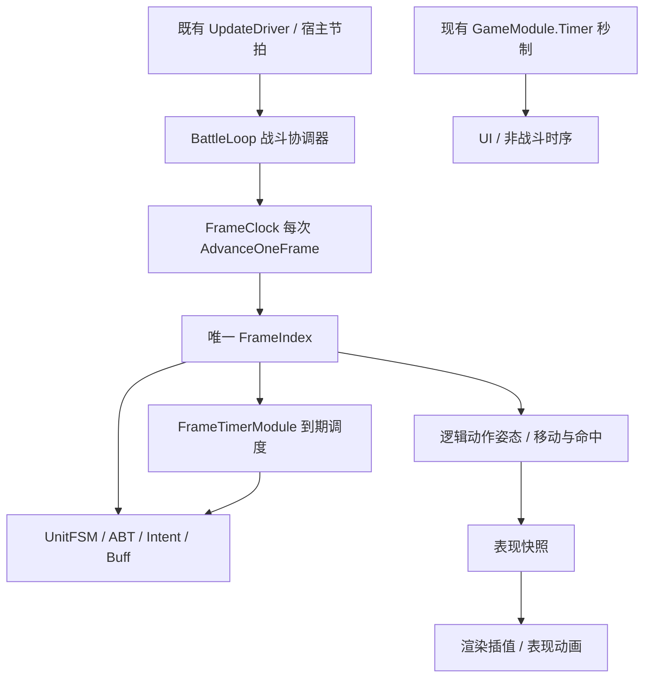

# 帧驱动计时体系：TEngine 模块设计草案

状态：调研后的推荐方案，尚未实现，也不表示实现方案已经获得确认。

依据：[Notion「09 帧驱动计时体系」](https://app.notion.com/p/09-40057765a5d0816aae0cd33a896dd18f)、[开源调研与证据](01-开源调研与证据.md)、当前项目源码。日期：2026-11-09（Asia/Shanghai）。本文没有改动业务代码、资源或 Notion。

## 1. 模块目标与范围

为战斗提供唯一的逻辑帧时间、按整数帧到期的任务，以及明确的生命周期和执行顺序。Intent 缓冲、组合键窗口、无敌帧、后摇、Buff 和动作事件都使用同一个帧域。

第一版实现范围建议限定为：60Hz 逻辑步长、整数帧源、单线程显式推进、一次/循环任务、取消、Scope 生命周期、稳定同帧顺序、全局战斗暂停和销毁清理。窗口与事件数据的语义同时定义，但 ABT、UnitFSM、动画与物理接入属于各自模块。

暂不设计联机协议、回滚、序列化任意委托、多世界通用框架、线程安全注册、R3 接入或复杂分层时间轮。帧源可显式推进并不等于已经实现回放。

## 2. 已确认需求与文档假设

### 已确认：来自 Notion

- 逻辑帧为唯一战斗判定时间源，名义步长为 60Hz。
- 卡顿时逻辑整体慢放，帧序列不跳过，计数器只随实际执行的逻辑 Tick 增加。
- 渲染可与逻辑分离，高帧率可以插值。
- 动画、UAnim 窗口、事件和 Hitbox 需要同步帧化。
- 打断已归入 UnitFSM 强制迁移通道，不在计时器中另建一层打断系统。

### 推荐假设：用于形成可评审方案，尚非已确认事实

| 事项 | 草案采用的默认值 | 原因与代价 |
| --- | --- | --- |
| 一次渲染最多推进多少 Tick | 最多 1 个 | 最符合“1 FPS 时只推进 1 帧”；30 FPS 时战斗也会约半速 |
| 卡顿欠账 | 丢弃完整步长的节拍欠账，保留不足一步的余量 | 不在恢复后突然加速补齐；丢的是现实节拍债，不是已编号逻辑帧 |
| 暂停 | 战斗帧源不推进，所有战斗截止帧保持不变 | 避免每个 Timer 自行扣暂停时长 |
| 单位局部 Hitstop | 第一版不引入独立单位时间域 | 需要时必须连同单位动画、移动和窗口一起定义，不能只暂停 Timer |
| 动作窗口 | 保留 Notion 的闭区间 `[startFrame, endFrame]` | 避免擅自改变原数据含义；持续 N 帧时 end = start + N - 1 |
| 回调异常 | 由战斗调度边界标记本场 Faulted 并中止推进 | 半帧更新后继续运行可能污染后续战斗，不能吞异常假装成功 |
| 计时器数量 | 暂无实测数据 | 选择简单稳定堆，不写无依据的容量和性能承诺 |

“最多 1 Tick”是推荐取舍，不是固定步长的必然要求。若未来要求低于 60 FPS 仍保持真实游戏速度，应重新选择有上限的补跑策略，并让全部战斗阶段逐 Tick 补跑。

## 3. 三种驱动方式的行为差异

| 情况 | Unity 默认 FixedUpdate | 固定步长累积器 + while 补跑 | 本草案：最多一个 Tick，不追赶 |
| --- | --- | --- | --- |
| 渲染快于逻辑 | 部分帧无 FixedUpdate | 部分帧无 Tick | 部分帧无 Tick |
| 渲染 30 FPS、目标 60Hz | 通常每渲染帧约两次更新，受设置影响 | 通常每渲染帧两次逻辑 Tick | 每渲染帧最多一次，约半速 |
| 单次卡顿 1 秒 | 可能连续补跑，受最大时间步限制 | 可补很多帧，若无上限存在死亡螺旋 | 本次只跑一个完整逻辑 Tick |
| 卡顿恢复 | 取决于 Unity 限制 | 继续消化欠账，或被上限限制 | 不追赶已丢弃的现实节拍 |
| 是否自然满足 Notion 慢放 | 不保证 | 不保证 | 满足本草案的慢放解释 |

依据：调研报告 A1、A4。不要让 Timer 只 +1，却让移动、物理或动画补跑多次，那会再次产生多时间源错位。

宿主节拍的概念流程：累积宿主的非负时间增量；不足 `1/60` 则只渲染；足够时执行一个完整 Tick，再将完整节拍债丢弃，仅保留小于一步的余数。暂停期间不累积欠账，恢复时重建宿主采样基准。

这里的宿主时间只决定“是否发出 Tick 请求”。核心 Timer、Buff 和连招不读取宿主秒数。不得把 FrameIndex 设置成 `floor(墙钟秒数 × 60)`，也不得用 `Time.frameCount` 代替。

## 4. 分层与唯一推进权

| 部件 | 职责 | 不应承担的职责 |
| --- | --- | --- |
| 宿主节拍适配 | 用 Unity 时间决定是否请求一个 Tick | 决定 Buff 何时过期 |
| BattleLoop | 唯一协调完整战斗 Tick；确定系统阶段 | 分散到每个 MonoBehaviour 自行计帧 |
| FrameClock | 保存当前逻辑帧与会话身份，逐帧推进 | 查 Unity 时间、负责动画或碰撞 |
| FrameTimerModule | 管理截止帧、顺序、取消与任务生命期 | 知道“无敌”“眩晕”等业务含义 |
| FrameWindow / 动作事件数据 | 用动作本地整数帧查询窗口与事件 | 每个窗口再生成一组独立全局 Timer |
| UnitFSM / ABT / Buff | 决定自己的业务状态、Scope 和有效期 | 任意修改全局 FrameIndex |
| 表现层 | 消费快照、插值显示、音画反馈 | 向权威 Hitbox 回写插值后的 Transform |

FrameClock 是唯一时钟对象；Timer 的“上次处理帧”只是顺序检查，不是第二个时钟。业务只持有只读帧信息，推进接口只由 BattleLoop 使用。

## 5. 核心数据契约

| 数据 | 推荐表达 | 说明 |
| --- | --- | --- |
| FrameIndex | `long` | 会话初始为 0；首次 Tick 为 1；不随渲染更新 |
| TickRate | 场次固定值 60 | 同场不动态改变配置的单位含义 |
| DelayFrames / IntervalFrames | 正 `int` | 任务注册边界校验；0 和负数拒绝 |
| DueFrame | `long` | `currentFrame + delayFrames`；加法边界显式检查 |
| Sequence | 会话内递增 `long` | 相同 DueFrame 按注册顺序稳定执行 |
| TimerHandle | `SessionId + TimerId` | 会话内 Id 不复用，旧场句柄不能误取消新场任务 |
| TimerScope | 与一次业务生命期绑定的作用域 | 动作、单位、Buff 实例各自拥有，不等同于 Unity 对象是否存在 |
| ActionLocalFrame | 相对动作开始的整数进度 | 第一版本速为 1；若暂停或变速，应由动作上下文权威推进 |

不把帧数、秒数、动画资源采样帧混在同一个 `float time` 字段中。配置直接存逻辑帧数；秒数只在作者工具和显示层转换。

### 5.1 一次任务与循环任务

在帧 T 内调用 `ScheduleAfter(N)`：截止帧严格为 `T + N`。例如 T=100、N=9，到 109 的计时阶段触发。

循环任务首次按 DelayFrames 到期；以后沿固定逻辑节拍使用 `previousDue + intervalFrames`。禁止以现实触发秒数重建节拍。

每次调度只接受紧接上次的逻辑帧，不允许从 100 直接 `Tick(160)`。若将来支持快速回放，必须完整执行 101…160 的各系统和计时阶段，不能只补调 Timer。

### 5.2 窗口不等于延迟任务

| 业务 | 推荐表达 | 原因 |
| --- | --- | --- |
| Intent 缓冲 | 输入记录的有效截止帧 | 状态由输入系统查询，不需要每个输入闭包回调 |
| 组合键判定 | 两条输入的帧差 / 当前帧与截止帧 | 保持事件消费规则集中 |
| 无敌、取消、派生窗口 | 动作本地帧闭区间 | 动作切换时自然使用新上下文 |
| UAnim 事件 / Hitbox 开关 | 排序后的事件关键帧 + 当前游标 | 避免动作每次开始创建成对 Timer；相同帧按资产顺序执行 |
| Buff 过期与周期脉冲 | Buff 的截止帧 + 调度任务 | Buff 状态仍归 Buff 系统所有，Timer 只通知到期 |
| 技能冷却 | 可用帧 `readyFrame` | 主要是查询状态，通常无需持续回调 |

持续 N 帧的窗口从帧 S 生效，则有效帧为 `[S, S+N-1]`，从 `S+N` 起失效。例如 S=100、N=9，包含 100…108，109 不再有效。动作事件第 0 帧由动作进入后的动作阶段执行，不借助零延迟 Timer。

## 6. 一帧内的推荐顺序

以下是协调器设计契约，具体与 UnitFSM、ABT 对接前还需确认：

1. 帧源 +1，提交本帧的输入、外部命令和已知强制迁移；强制迁移先使旧动作 Scope 失效。
2. 处理本帧到期任务，按 `(DueFrame, Sequence)` 排序；逐个任务执行前检查取消状态。
3. UnitFSM 提交计时/输入产生的普通迁移；ABT 基于有效状态推进一次，处理动作窗口和关键帧事件。
4. 推进权威动作姿态、移动和命中查询，按项目选定方式与物理同步。
5. 结算命中和状态效果。新产生的受击/死亡强制迁移立即清理旧上下文；不得在同帧对整个 ABT 再跑第二次 Tick。重入可完成初始化，下次完整 Tick 才正常推进。
6. 产出表现快照，结束本帧，渲染层消费快照。

已经执行过的回调无法被稍后的命中撤销；上述阶段就是决定因果顺序的规则。不要依赖 MonoBehaviour 更新顺序或普通事件总线的碰巧注册顺序。

若同一个 Buff 的周期脉冲与到期恰好同帧，Buff 系统必须明确采用“先到期，因此无最后一跳”或“先脉冲，再到期”。Timer 不发明业务优先级；推荐 Buff 以单一到期处理入口决定两件事的顺序，避免依赖任务创建先后。

## 7. 调度器容器与复杂度

推荐使用稳定二叉最小堆，键为 `(DueFrame, Sequence)`；以 `Dictionary<TimerId, Entry>` 定位条目，Entry 保存堆下标。暂停/取消等操作维护同一份状态。

| 操作 | 推荐实现 | 复杂度 |
| --- | --- | --- |
| 新增 | 分配单一条目，加入堆与索引 | O(log N) |
| 无任务到期的 Tick | 只看堆顶 | O(1) |
| 本帧 K 个到期 | 逐个弹出执行，循环任务重新入堆 | O(K log N) + 回调成本 |
| 按句柄取消 | 索引定位后移除堆条目 | 平均查找 O(1)，堆调整 O(log N) |
| Scope 取消 M 个任务 | 作用域索引取出任务 Id，逐项取消 | O(M log N) |
| 清场 | 清堆、索引、Scope 与回调引用 | O(N) |

不依赖目标 Unity 未确认提供的 `.NET PriorityQueue`；先查项目是否已有满足需求的堆。没有时仅增加模块内部必要的数据结构，不建立通用容器库。

第一版不进行无依据的对象池改造。可按预计任务量预留容量，避免高频 LINQ、`params object[]`、每 Tick 快照全量复制和每帧字符串构造。注册委托、闭包、集合扩容仍可能分配，不能宣传整个模块“零 GC”。

时间轮只有在实际任务规模、分布、取消率表明堆成为问题时再替换。调度接口与容器分离即可，不预先实现多种容器的动态策略切换。

## 8. 回调期间修改集合的规则

- 开始派发前先弹出当前任务；不会在枚举整个活动集合时调用任意业务代码。
- 新建任务的 DelayFrames 必须 >=1，因此不会本帧递归立即执行。
- 取消另一个尚未执行的任务立即生效，包括已到期但仍在队列中的任务。
- 一次任务在回调前进入执行/完成状态；不能被旧句柄“重启”。需要重做就创建新任务。
- 循环任务在回调期间仍可被取消；回调返回后，仅当本条目及 Scope 仍有效，才按旧 DueFrame + Interval 重新入堆。
- 禁止回调重入 Tick，禁止回调在半帧中途直接重建场次。结束战斗提交给协调器，在约定阶段清理；当前场次被标记结束后停止后续派发。
- 第一版不提供原地修改时间和 Restart。业务可 Cancel + Schedule，获得新句柄及新 Sequence，减少回调内重置状态的歧义。

采用“堆顶出队后回调”的方式，不直接照搬其他库的全列表快照；借鉴的是安全边界，不是实现代码。

## 9. 生命周期、打断与暂停

### 9.1 TimerScope

Scope 代表某次业务实例的生命期，例如“单位 17 的第 42 次动作”。动作退出、UnitFSM 强制打断、Buff 删除、单位回池和战斗结束都从对应职责入口取消 Scope。

对象池里的同一个 GameObject 可能被反复复用，所以 `owner != null` 或弱引用存活不足以判断旧动作回调是否有效。Scope 必须是本次实例独有的身份；旧 Scope 关闭后不重新激活，复用时创建新身份。

取消 Scope 不仅做逻辑标记，也清除对应待执行任务和委托引用，避免长 Buff 或长延迟任务继续持有已退出场景对象。维护 Scope 到任务 Id 的索引，取消时不能一边枚举集合一边破坏同一个枚举器。

### 9.2 暂停与速度

全局战斗暂停通过停止 FrameClock 实现；不用遍历所有 Timer 扣暂停时间。暂停时表现可冻结或独立显示暂停 UI，UI 仍走原有秒制时序。

当前 RootModule 的 GameSpeed 会修改 Unity `Time.timeScale`。若宿主用 unscaled 增量，必须由战斗状态明确传递暂停，不能假设 `timeScale=0` 会让战斗自动停下。第一版建议战斗仅暴露暂停/恢复；连续变速、局部 Hitstop 等在业务需求明确后定义。

单个 Timer 暂停/恢复不列入第一版；如果某类 Buff 需要暂停，必须先明确其脉冲、持续时长、UI 和所属动作是否也暂停。

### 9.3 异常与参数边界

参数与配置在入口校验：空回调、非正延迟、溢出、关闭 Scope 注册、重复/越帧 Tick、非主线程调用和调度重入属于错误。旧场句柄或重复取消属于可预期状态，返回“未取消”即可。

回调跨越业务事件和生命周期边界，执行前仍需确认任务未取消且 Scope 有效。无需在同一已校验同步调用链层层判空。

回调异常交给战斗边界：记录场次、逻辑帧、任务 Id、Scope 身份及原始异常，并将场次置为 Faulted；不要吞掉异常继续计帧，也不在未知半帧状态下自动重试。具体日志格式复用项目日志体系。

## 10. 动画、UAnim 与物理的接入约束

### 动画

Notion 的手动驱动方向正确，但需要区分三个量：动作本地逻辑帧、片段时间（秒）、归一化进度。不能把全局 FrameIndex 不加动作起点直接喂给每个动画。

Playables 使用 Manual 后，可以采用固定步长 Evaluate，或者显式设置片段时间后再评估图。`PlayableGraph.Evaluate` 的参数是时间增量，不是归一化进度。后一种方案还要明确混合、循环、Root Motion 和动画事件的行为；具体接入属于后续动画设计。

Hitbox 如果依赖骨骼姿态，命中前必须取得当前逻辑帧的权威姿态。渲染插值只能改表现对象，不能让插值骨骼反过来影响命中。Root Motion 若参与移动，也必须按逻辑 Tick 提取并应用，不能每渲染帧额外推进。

### UAnim

窗口保留整数闭区间，事件按 `(localFrame, assetOrder)` 排序。帧游标只能由动作上下文推进；开始、打断、循环、重新进入都从明确入口重置。动作第 0 帧事件、同帧多个 Hitbox 事件也属于资产契约。

`SetTime` 到一个新时间点不能被当成“自动、完整、确定地触发所有途中游戏事件”。业务事件由帧数据分发，不依赖动画事件回调充当权威战斗事件。

### 物理

只新增计时器不能使 Unity 自动物理一起慢放。如果玩法依赖物理，必须选定：每个逻辑 Tick 手动模拟一次，或采用由逻辑状态驱动的运动/碰撞查询。当前项目包含 2D 包，但这不足以确认最终战斗采用 2D 还是 3D。

手动模拟时避免自动物理再模拟一次；同时核对 FixedUpdate 中是否还有独立推进的玩法。采用固定步长可改善可复现性，不把它等价为跨平台位级确定性。此部分是接入依赖，不包含在单独的 Timer 实现内。

## 11. 配置映射与取整

| Notion 项目 | 原秒数 | 原文帧数 | 本草案解释 |
| --- | ---: | ---: | --- |
| Intent 缓冲 | 0.15 | 9 | 直接配置 9 |
| 组合键窗口 | 0.2 | 12 | 直接配置 12 |
| 常规无敌示例 | 0.2 | 12 | 直接配置 12，不当作外部游戏官方事实 |
| 看破斩示例 | 0.6 | 36 | 直接配置 36 |
| 太刀后摇示例 | 2 | 120 | 直接配置 120 |
| 居合无敌示例 | 0.22 | 13 | 13 帧是设计值；若按“不少于秒数”转换应为 14 |
| Buff | 300 | 18,000 | 18,000 个逻辑 Tick；慢放时现实持续时间更长 |

首选让配置作者直接输入帧数。旧秒制数据如需迁移，应按字段语义制定一次性转换：最短保障时长可向上取整，最近采样事件可按明确规则取最近帧。不能用一个统一 Round 猜所有业务，也不能运行时反复把秒转帧。

300 秒 Buff 在本方案中意味着 300 个游戏秒。如果产品实际要求 300 个现实秒或离线流逝，它属于另一时钟域，应在需求阶段明确。

## 12. 与 TEngine 的建议接入位置

以下是候选位置，不表示文件已经创建：

| 位置 | 建议内容 |
| --- | --- |
| `Assets/TEngine/Runtime/Module/FrameTimerModule/` | 接口、模块外观、纯整数调度核心、Handle/Scope 必要类型 |
| 与 FrameTimer 相同的框架层目录 | 纯 C# FrameClock 和只读帧信息，具体文件划分按实现规模确定 |
| `Assets/GameScripts/HotFix/GameLogic/GameModule.cs` | 按现有缓存模式增加 `GameModule.FrameTimer` |
| `Assets/GameScripts/HotFix/GameLogic/` 内战斗模块 | BattleLoop 与各业务阶段；由热更业务决定场次开始/结束 |
| 既有 UpdateDriver 监听入口 | 只接一次宿主更新，退出时成对解绑 |

`FrameTimerModule` 不实现现有秒制 `IUpdateModule`，由 BattleLoop 在明确计时阶段推进。接口名和实现名遵守 ModuleSystem 的反射约定；框架层不反向引用 GameLogic 的 UnitFSM、ABT 或 Buff 类型。

建议接口语义，不固定为最终 C# 签名：

| 操作 | 语义 |
| --- | --- |
| `ScheduleAfter(delayFrames, callback, scope)` | 创建一次任务，返回本场句柄 |
| `ScheduleEvery(delayFrames, intervalFrames, callback, scope)` | 创建固定逻辑节拍循环任务 |
| `Cancel(handle)` | 幂等取消，返回是否实际取消 |
| `CancelScope(scope)` | 取消这一业务实例的所有待执行任务 |
| `TryGetRemainingFrames(handle)` | 区分任务不存在与剩余 0 帧，不用 0 同时表达两种情况 |
| 内部调度入口 `Tick(frameIndex)` | 由协调器调用，帧号只允许逐帧前进 |
| 场次结束 / 模块 Shutdown | 清理任务、索引、Scope、宿主绑定和持有引用 |

纯帧时钟不接受 deltaTime；宿主节拍层可以使用 Unity 时间。API 不提供 `isUnscaled`，因为战斗 Timer 只有逻辑帧这一个单位。

框架模块生命周期可跨场存在，但计时核心的会话状态必须每场独立创建或完整清空。计时器 Id 在场内不复用，跨场依靠 SessionId 区分；不要让清场后 Id 从 1 开始造成旧句柄命中新任务。

## 13. 设计原则与模式判断

- 单一职责：宿主决定节拍，时钟负责帧，调度器负责到期，业务负责状态和生命周期。
- 开闭与依赖倒置：业务依赖帧信息与调度契约；后续可替换宿主或内部容器，但第一版不先造通用策略框架。
- 接口隔离与最少知识：普通业务不能推进帧；计时器不查询 UnitFSM、UI、资源系统或物理世界。
- 合成复用：BattleLoop 组合时钟、调度器和业务阶段。当前不需要继承多层 Timer 基类，也没有强行使用工厂/观察者的收益。
- 里氏替换：只在同单位、同边界契约下替换实现；秒制 `ITimerModule` 和帧制计时器不是可互换实现。
- KISS / DRY / YAGNI：所有帧判定同源；共用到期/取消逻辑；不在多个 UI/动作类复制计时，不预先加入回滚和多线程。

## 14. 影响范围、后续工作与待定取舍

新增模块的直接影响是框架模块、GameModule 入口和战斗协调器。真正达成 Notion 整体行为还依赖输入归帧、UnitFSM/ABT、Buff、动画、Hitbox 与物理逐项接入，不能把计时器完成当成整个战斗时序改造完成。

本次已排查现有秒制 Timer、GameTime、RootModule、UpdateDriver、ModuleSystem、GameModule、UI 调用与战斗相关关键词，没有发现可直接复用的完整战斗帧时钟。项目已有工具和模块入口优先复用，不引入第二套 Unity 驱动。

后续实现可以按依赖分为：纯帧契约和调度核心 → TEngine 外观和生命周期 → BattleLoop 及宿主节拍 → 逐个业务系统接入。这里只说明拆分关系，本次不进入实施。

实现前需要决定的实质取舍：

1. 是否确认“每渲染帧最多一个 Tick，低于 60 FPS 就慢放”，并丢弃卡顿后的完整节拍欠账。
2. 单位局部 Hitstop 是否属于首版；如属于，需连同动作、移动、Buff 与动画时间域一起设计。
3. 动画/物理采用什么驱动路径，现有 UAnim、ABT、UnitFSM 实际位于哪里；缺失的 `UnityProject/AGENTS.md` 是否另有来源。
4. `0.22 秒 / 13 帧` 哪个是权威设计值；300 秒 Buff 是否确实按游戏时间流逝。

计时器负载数量尚无证据，物理维度尚未确认，跨机确定性也未建立。这些是当前方案的真实边界，不由高星仓库背书。
