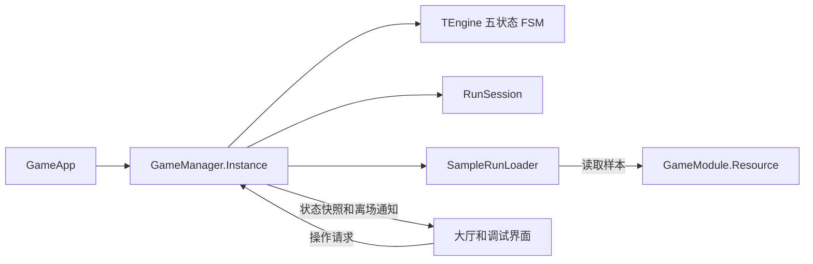

# Project B 游戏生命周期分步实现方案

2026-11-15 · 待确认实施稿

本稿细化《Project_B 整游实现流程》的第 01 步。交付从 `main.unity` 进入大厅、运行一局手动样本、暂停继续、正常结束或放弃、清理并重开的完整入口。第 02 步独立搭建固定帧驱动，第 03 步由 `RunSession` 接入子战斗并转交暂停、继续和退出请求。[整游实现流程 §3.01](../../架构设计/Project_B整游实现流程.md) · [生命周期执行手册](../../架构设计/Project_B整游实现/执行手册/01-游戏生命周期与帧驱动.md#s01)

## 1. 职责与状态

| 对象 | 作用域 | 职责 |
| --- | --- | --- |
| `GameApp` | 应用 | 沿用反射热更入口，启动 `GameManager.Instance`，应用销毁时先释放业务，再走现有单例与框架清理。 |
| `GameManager : Singleton<GameManager>` | 应用 | 持有唯一 TEngine FSM、大厅窗口和当前 `RunSession`。接收 UI 请求，协调开局装配与退场，裁决状态迁移，发布只读快照和一次离场通知。 |
| `RunSession` | 一局 | 持有 `RunId` 和开局样本数据，推进试玩计数、封存一次自然结果。第 03 步由会话装配和关闭子战斗。 |
| `SampleRunLoader` | 由 `GameManager` 持有 | 通过 `GameModule.Resource` 发起加载，按开局请求持有并释放句柄，返回带 `RunId` 的就绪或失败回报。 |
| `ProjectBLobbyUI` | 应用 | 一个 TEngine `UIWindow`，包含大厅和局内调试两个区域。按钮提交请求，界面根据已提交快照更新。退场清空局内绑定，关应用时销毁窗口。 |



游戏生命周期的业务文件统一放在 `Assets/GameScripts/HotFix/GameLogic/Module/GameModule/`。调试窗口放在 `Runtime/UI/`。热更业务沿用 `GameLogic` 程序集，通过根目录下已有的 `GameModule.cs` 访问 TEngine 服务。复用项目内的 `Singleton<T>`、`IFsmModule`、UIWindow 和 YooAsset，异步操作使用项目已有的 UniTask 与 YooAsset 接口。[单例基类](../../../Assets/GameScripts/HotFix/GameLogic/SingletonSystem/Singleton.cs) · [框架门面](../../../Assets/GameScripts/HotFix/GameLogic/GameModule.cs) · [TEngine 上游](https://github.com/Alex-Rachel/TEngine) · [UniTask 取消行为](https://github.com/Cysharp/UniTask#cancellation-and-exception-handling)

```text
Assets/GameScripts/HotFix/GameLogic/
├── GameApp.cs
├── GameModule.cs
├── Module/GameModule/
│   ├── GameManager.cs
│   ├── GameStates.cs
│   ├── RunSession.cs
│   └── SampleRunLoader.cs
└── Runtime/UI/ProjectBLobbyUI.cs
```

| 状态 | 允许的请求与行为 | 出口 |
| --- | --- | --- |
| `StartGame` | 大厅就绪后接收「开始」。受理时分配新 `RunId`，冻结样本选择并加载。同一状态用快照区分空闲与加载中。加载中可「放弃」。 | 当前局资源就绪 → `RunGame`。放弃或装配失败 → `ExitGame`。 |
| `RunGame` | 打开局内输入，推进样本。可「暂停」「模拟结束」「放弃」。 | 暂停 → `PauseGame`。自然结果已提交 → `EndGame`。放弃或故障 → `ExitGame`。 |
| `PauseGame` | 关闭玩法输入，冻结样本进度。仍处理「继续」「放弃」及界面刷新。 | 继续 → `RunGame`，沿用原会话。放弃 → `ExitGame`。 |
| `EndGame` | 冻结运行并用值快照显示一次自然结果。只受理「返回大厅」。 | 确认 → `ExitGame`，沿用已冻结结果。 |
| `ExitGame` | 关闭输入、撤销本局加载交接资格、停止并清理会话，发布一次离场结果。 | 局内清理完毕 → `StartGame` 的大厅空闲态。旧加载句柄由原请求继续收尾。 |

**结果裁决。** 首期离场原因使用 `Completed`、`Abandoned`、`LoadFailed`、`Faulted`。`EndGame` 读取已提交的自然结果，`ExitGame` 是离场通知的唯一发布点。自然结果已提交时保留 `Completed`。同一次 FSM 更新里，放弃优先于尚未提交的样本结束、暂停或加载就绪。每次更新至多发生一次迁移，按钮和加载回报仅提交请求或事实。

**身份与顺序。** 每次实际开局分配本进程内递增的 `RunId`，首期每局一次装配，加载记录用 `RunId` 关联。暂停、继续、模拟结束、放弃和返回均携带按钮当前绑定的 `RunId`。开局请求只在大厅空闲时受理，离场清除该局未处理请求。所有状态写入、Unity 资源交接和界面刷新在主线程进行。`RunId` 作为联调身份，跨进程的档案标识由后续存档阶段设计。

## 2. 分步实施清单

### 2.1 恢复正常启动链

- [ ] **处置 Entitas Demo 编辑器入口。** `Assets/Editor/EntitasDemoTest.cs` 引用已随 Demo 移除的 `Contexts.sharedInstance`、`DemoMoveSystem` 和组件。当前文本搜索只找到该脚本的声明。实施时核对调用后随 `.meta` 一起移除遗留脚本。[编辑器脚本](../../../Assets/Editor/EntitasDemoTest.cs)
- [ ] **清除启动场景的遗留对象。** `Assets/Scenes/main.unity` 下的 `EntitasDemoBehaviour` 仍挂脚本 GUID `6d167e5c0cb3d884dab7dc879ef03c1d`。确认对象为独立 Demo 根后移除整个对象，保留 `GameEntry`、`UIRoot` 和 `Main Camera`。[启动场景](../../../Assets/Scenes/main.unity)
- [ ] **将 Player 启动场景指向 `main.unity`。** `ProjectSettings/EditorBuildSettings.asset` 仍启用缺失的 `Assets/Scenes/SampleScene.unity`，项目现有发布工具直接读取场景列表。将首个启用项配置为 `Assets/Scenes/main.unity`，GUID 使用该场景 `.meta` 里的 `2cda990e2423bbf4892e6590ba056729`。场景列表修复随本步完成，Player 实机验收按后续里程碑进行。[场景列表](../../../ProjectSettings/EditorBuildSettings.asset) · [发布工具](../../../Assets/TEngine/Editor/ReleaseTools/ReleaseTools.cs)

```text
main.unity → GameEntry.Awake → ProcedureLaunch → 资源初始化与程序集加载
           → ProcedureLoadAssembly 切换 ProcedureStartGame → 反射调用 GameApp.Entrance
```

### 2.2 在 GameModule 目录接入 GameManager 单例

- [ ] **修改 `GameApp.cs` 的启动和释放。** `StartGameLogic()` 获取 `GameManager.Instance` 并调用幂等 `Start()`，保留 `Entrance(object[])`、日志、程序集接收与现有热更流程。入口只注册一次 `ReleaseLogic` 监听。应用释放时先撤销监听，若 `GameManager.IsValid` 则释放已存在的实例，再调用 `SingletonSystem.Release()` 和 `GameModule.Shutdown()`。[GameApp](../../../Assets/GameScripts/HotFix/GameLogic/GameApp.cs) · [热更调用方](../../../Assets/GameScripts/Procedure/ProcedureLoadAssembly.cs)
- [ ] **新增 `Module/GameModule/GameManager.cs`。** 用 `Singleton<GameManager>` 统一实例生命周期。`Start()` 创建 `SampleRunLoader`，缓存 `IFsmModule` 和名为 `ProjectB.Game` 的唯一 FSM 句柄。`GameManager` 在当前开局装配成功时创建 `RunSession`。应用释放进入 `OnRelease()`，停止并清理当前会话、待收尾加载和业务窗口，再通过缓存模块销毁尚有效的 FSM。框架若已回收 FSM，仍清理宿主持有的业务对象。已有 FSM 更新驱动状态迁移。
- [ ] **新增 `Module/GameModule/RunSession.cs`。** 用装配完成的样本值和 `RunId` 初始化，保存试玩进度并提交自然结果。`GameManager` 根据 FSM 状态决定推进、停步或结束会话，界面通过管理器读取展示数据。

```text
StartGameLogic → GameManager.Instance.Start()
Start → 创建 SampleRunLoader → 创建 ProjectB.Game FSM → Start<StartGameState>() → 打开大厅
当前开局装配成功 → 创建并持有 RunSession → 进入 RunGameState
ReleaseLogic → Release 已存在的 GameManager → SingletonSystem.Release → GameModule.Shutdown
GameManager.OnRelease → 封口 → 释放会话和全部待收尾加载
                      → 释放大厅窗口 → 销毁仍有效的 FSM 句柄
```

### 2.3 建立五状态和局级请求入口

- [ ] **新增 `Module/GameModule/GameStates.cs`。** 实现五个 `FsmState<GameManager>`。`IFsm` 由宿主持有，状态类在自己的更新中调用受保护的 `ChangeState`。复用同一更新入口收集加载完成、消费请求并迁移，`RunGameState` 独占样本推进。暂停期间保持 `Time.timeScale`，由运行状态决定何时推进会话。[FSM 状态 API](../../../Assets/TEngine/Runtime/Module/FsmModule/FsmState.cs)
- [ ] **在 `GameManager` 加入请求和快照。** 提供 `RequestStart` 以及带 `RunId` 的 `RequestPause`、`RequestResume`、`RequestSampleComplete`、`RequestAbandon`、`RequestReturnToLobby`。快照包含状态、是否加载、本局身份、样本进度、按钮可用性以及已冻结结果。命令受理依当前状态和身份，按钮禁用用于展示相同的约束。
- [ ] **接入样本推进和自然结束。** `GameManager` 在 `RunGame` 推进当前 `RunSession` 的试玩计数，首次进入从零开始，继续时保留进度。「模拟结束」作为样本的自然终止输入，由会话提交一个 `RunOutcome` 后进入 `EndGame`。会话结果使用值数据，退出后仍可显示离场原因。试玩计数仅用于本步生命周期演示。

```text
UpdateState
    收集加载完成事实并让原加载操作释放句柄
    取当前状态可消费且身份匹配的请求
    若 RunGame 已提交自然结果：迁移 EndGame，结束本次更新
    若当前状态允许放弃且收到放弃：进入 ExitGame(Abandoned)，结束本次更新
    处理本状态的就绪、失败、暂停、继续或返回；迁移后结束本次更新
    若仍处于 RunGame：GameManager 推进当前 RunSession(本次运行量, 样本输入)
        样本提交自然结果 → EndGame；运行故障 → ExitGame(Faulted)
```

### 2.4 实现异步装配与退出收尾

- [ ] **新增 `Assets/AssetRaw/Configs/ProjectBRunSample.json` 和 `Module/GameModule/SampleRunLoader.cs`。** 通过 `DefaultPackage` 现有 Configs 收集规则和文件名地址 `ProjectBRunSample` 加载 `TextAsset`。每次受理开局用 `LoadAssetAsyncHandle<TextAsset>` 创建并记录独立句柄。完成时检查状态，复制并校验样本标识等值字段，再归还句柄。仅匹配当前加载中的 `RunId` 时，允许结果写入待提交队列。缺资源、解析失败或装配异常生成 `LoadFailed`，新局重新申请资源。[AssetBundle 收集配置](../../../Assets/Editor/AssetBundleCollector/AssetBundleCollectorSetting.asset) · [资源模块](../../../Assets/TEngine/Runtime/Module/ResourceModule/ResourceModule.cs)
- [ ] **在 `GameManager` 与 `ExitGameState` 实现离场。** 顺序为关输入、撤销本局装配资格、停止当前会话及其子对象、撤下局内界面绑定、清理本局持有资源、提交离场值、返回大厅。第 03 步在会话停止和清理处接战斗注销。待完成的样本加载由 `SampleRunLoader` 按原请求保存句柄，普通退局后可在大厅继续收尾；新局不等待旧加载。应用销毁时释放仍有效的待收尾句柄并丢弃待提交队列。
- [ ] **加入可复现的加载中放弃用例。** 调试窗口提供一次性的「延迟下次装配回报」，只延迟该请求的完成处理。旧请求 A 被放弃后允许 B 正常就绪。A 恢复时只归还 A 的句柄，不进入 B 的会话。样本加载失败使用无效地址的调试输入复现，下一次使用正常地址。

```text
BeginLoad(runId) → 记录 {runId, handle, 可选调试延迟}
CollectCompletedLoads → 对每个已完成且可处理的操作
    若仍是当前加载：读取状态，复制样本值或记录失败原因
    在收尾处释放该操作的有效句柄并移除记录
    若仍是当前加载：将 Ready 或 LoadFailed 交给 FSM

ExitGame → 封口 → 撤销该 RunId 的装配资格 → 停止并释放该 RunSession
         → 清理该局请求和界面绑定 → 提交并发布一次离场结果 → 大厅空闲
```

### 2.5 连接大厅与调试界面

- [ ] **新增 `Runtime/UI/ProjectBLobbyUI.cs` 和 `Assets/AssetRaw/UI/ProjectBLobbyUI.prefab`。** 用 `WindowAttribute` 配置 YooAsset 窗口地址，由 `GameModule.UI` 异步打开。包含「开始」「暂停」「继续」「模拟结束」「放弃」「返回大厅」及状态、局号、样本进度和离场原因。窗口打开成功且大厅就绪后启用开始按钮，窗口装配失败记录地址和错误。保留加载、运行、暂停、结果和大厅在同一窗口更新，避免每局切换时重复异步加载窗口。
- [ ] **接入窗口生命周期及状态反馈。** 创建时绑定按钮，注册已提交快照通知后读取当前快照，使用 `OnRefresh` 刷新。模块间状态通知用 `GameEvent`，窗口用 `AddUIEvent` 管理订阅，按钮直接提交宿主请求。离场清除局内绑定，只保留大厅可展示的值结果；关闭窗口时解绑按钮与局内引用。[窗口生命周期](../../../.agents/skills/tengine-dev/references/ui-lifecycle.md) · [事件规范](../../../.agents/skills/tengine-dev/references/event-system.md)

```text
OnCreate / OnRefresh → 绑定一次按钮或读取现有快照 → Render
OnPauseClicked → RequestPause(界面绑定的 RunId)
OnSnapshotChanged → 按当前状态和 RunId 刷新控件与文本
ExitGame 完成 → 清除局内视图绑定 → 显示大厅及离场原因
```

## 3. 交接与验收

| 用例 | 操作与预期 |
| --- | --- |
| 正常启动 | 通过 `main.unity` 启动，现有热更流程进入大厅。业务层只有一个 `GameManager` 实例和一个生命周期 FSM，每次只受理一局。 |
| 正常结束 | 开始 → 观察进度 → 暂停 → 等待 → 继续 → 模拟结束 → 返回。暂停中计数保持，继续从原计数推进。每局产生一次 `Completed` 离场通知。 |
| 运行或暂停中放弃 | 分别在运行、暂停时放弃并重开。回大厅后只见一次 `Abandoned`，新局的 `RunId` 不同且进度从零开始。 |
| 加载中放弃后重开 | 延迟 A → 放弃 A → 开 B → B 已运行后放行 A。B 的身份、界面和进度保持正确，A 的句柄已释放，只有 A 自己的 `Abandoned` 通知。 |
| 装配失败后重试 | 用无效地址开始，回大厅时显示 `LoadFailed` 与地址；随后正常开局并成功进入运行。 |
| 重复和交错请求 | 连点开始只受理一局。提交自然结果前同时收到放弃和模拟结束时，走放弃；自然结果已经提交时，返回只发布该自然结果。旧 `RunId` 请求在新局无效。 |
| 应用销毁 | 分别在加载和运行时关闭应用或退出 Play Mode。业务句柄和订阅被撤销，旧回报不能重新创建管理器或打开业务窗口。 |

交给第 03 步的是 `GameManager` 持有的活动 `RunSession`、暂停继续的受理边界和 `ExitGame` 的清理顺序。`RunSession` 通过战斗模块控制本场。独立帧驱动从 TEngine 的更新入口取得时间。[第 02 步固定帧驱动方案](02-Project_B固定帧驱动分步执行方案.md) · [第 03 步战斗模块方案](03-Project_B战斗模块分步执行方案.md)

本文只记录实现方案。各目标与验收用例在实施后依据实际结果登记。本次未运行 Unity、编译或测试。
