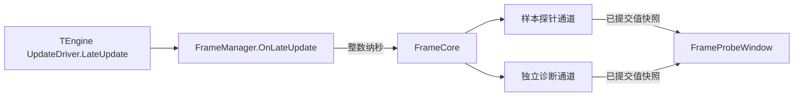

# Project B 固定帧驱动分步执行方案

2026-11-15 · 待确认实施稿

本稿细化整游实现流程的第 02 步。应用级 `FrameManager` 单例在 `Module/Frame/` 独立实现，经 TEngine 的 `ILateUpdate` 自行采样和分发。使用独立探针验证 Tick、定点计数、计时器、通道暂停、调试单步和过载。第 03 步由战斗模块登记战斗通道。[整游实现流程 §3.02](../../架构设计/Project_B整游实现流程.md) · [第 03 步方案](03-Project_B战斗模块分步执行方案.md)

## 1. 接入位置与时间口径



| 对象 | 所有权和职责 |
| --- | --- |
| `GameApp` | 分别启动应用级模块，退出时先结束业务，再释放帧驱动。 |
| `FrameManager : Singleton<FrameManager>, ILateUpdate` | 帧驱动模块单例。持有并释放运行时 `FrameCore`，自行量化宿主帧间隔，分发通道更新，记录通用调度故障。对外提供通道注册和注销。 |
| `FrameCore` | 普通纯 C# 实例。按顺序推进已登记通道，持有通道销毁责任，隔离故障。独立测试和重跑可直接构造自己的实例。 |
| `ClockProbeChannel` | 每条探针持有自己的 `FrameClock`、`FrameTimer` 和提交缓冲。两条探针分别计数，用于验证单步、暂停和故障隔离。 |
| `FrameProbeWindow` | TEngine 调试窗口。创建和注销探针，读取已提交的只读数据，发送探针内部的调试请求。 |

下列路径以 `Assets/GameScripts/HotFix/GameLogic/` 为根。`Module/Frame/` 与第 01 步的 `Module/GameModule/` 并列。游戏模块与帧驱动之间无直接调用、类型引用或事件订阅。帧模块对调用方只暴露通用通道接口，业务模块决定自己的通道何时暂停或结束。`FrameCore`、`FrameClock`、`FrameTimer` 和定点值保持纯 C#。执行手册为时钟配置与调度算法提供依据，本稿规定更新入口和模块边界。[独立帧模块方案](../../架构设计/01-帧驱动独立模块方案.md) · [帧模块与定点值原型](../../架构设计/04-Project_B-三模块CSharp实现代码.md#1-帧驱动模块)

| 路径 | 本步修改目标 |
| --- | --- |
| `GameApp.cs` | 在热更入口启动和释放帧驱动，并登记和注销调试窗口。 |
| `Module/Frame/` | 新增 `FrameManager.cs`、`FrameClock.cs`、`FrameCore.cs`、`FrameTimer.cs`，保留 `GameLogic.Frame` 命名空间。 |
| `Module/FixedPoint/FixedPoint.cs` | 落地 `GameLogic.FixedPoint` 下的 `Fixed64`、`Point2` 值定义及配置解析。 |
| `Module/Frame/Debug/` | 新增 `ClockProbeChannel.cs` 和 `FrameProbeWindow.cs`，提供独立样本和调试入口。 |

- **联调配置采用 60 Hz、每次宿主更新最多 4 Tick、1 倍速。** 步长是精确的 `1 / 60` 秒。核心支持 `1..240 Hz` 和 `0..4` 倍速的有效域。单次宿主时间最多接纳 1 秒，截去的纳秒和预算外的整步分别记录，保留不足一步的相位。战斗接入后，期限随已提交 Tick 推进。限步和余量处理参考固定步长设计及 Bevy 的固定调度。具体预算与丢步口径沿用项目执行手册。[执行手册 §02](../../架构设计/Project_B整游实现/执行手册/01-游戏生命周期与帧驱动.md#s02) · [固定步长设计](https://gafferongames.com/post/fix_your_timestep/) · [Bevy 固定调度源码](https://github.com/bevyengine/bevy/blob/main/crates/bevy_time/src/fixed.rs)
- **三种值各自持有单位。** 宿主输入是整数纳秒，时钟相位按 `10^15` 为一整步计，业务数值用 `Fixed64.Raw / 1_000_000`。Tick、序号和 ID 保持整数。浮点运算放在宿主采样与 UI/渲染边界。
- **第 02 步使用独立探针。** 在大厅也可启动探针。锚定目标 Tick 的输入和已提交摘要是本步的复现数据。战斗通道及战果衔接在第 03 步接入。

## 2. 分步执行清单

### 2.1 固定步时钟和定点值

- [ ] **新增 `Module/Frame/FrameClock.cs`。** 沿用原型 `Advance(long elapsedNs, int scaleRaw, Func<long, StepDirective> executeStep)`。使用整数相位推出本次整步数，按预算执行候选 Tick，记录 `ClippedNanoseconds`、`DroppedSteps` 和 `CommittedTick`。倍速原始值 `1_000_000` 表示 1 倍。检查配置域、负时间、时钟重入和 Tick 溢出。原型配置上限下，相位计算的乘积最大为 `9.6 × 10^17`，加余相位仍在 `long` 范围内。
- [ ] **实现候选提交和调试单步。** 每次调用步进回调前取 `CommittedTick + 1`。成功后才提交编号，`StopAfterCommit` 提交当前步并停止本轮剩余预算，抛错时水位停在上一成功 Tick。调试暂停保留相位，暂停期间忽略普通帧间隔。多次单步请求合并为一次，下次推进只执行一 Tick，成功后清零相位，恢复调试运行时取消未消费的单步。预算内因主动停止而未跑的步数不加入过载丢步计数。
- [ ] **新增 `Module/FixedPoint/FixedPoint.cs`。** `Fixed64` 从原始整数构造或从固定文化的小数文本解析，最多六位小数，错误格式和超域值报错。`Point2` 保存两个原始整数分量。样本使用一个定点累加值验证数值合同，后续再按实际玩法补乘除和几何。[共享定点值原型](../../架构设计/04-Project_B-三模块CSharp实现代码.md#fixedpointcs)

```text
Advance(elapsedNs, scaleRaw, executeStep)
    重置本次过载计数
    调试暂停时仅消费单步请求，成功后清零相位并返回
    0 倍速时冻结相位并返回
    admitted = min(elapsedNs, 1_000_000_000)
    ClippedNanoseconds = elapsedNs - admitted
    whole, phase = DivRem(phase + admitted × scaleRaw × tickRate, 10^15)
    budget = min(whole, maxSteps)
    DroppedSteps = whole - budget
    在 budget 内逐步执行
        candidate = checked(CommittedTick + 1)
        directive = executeStep(candidate)
        CommittedTick = candidate
        收到 StopAfterCommit 或调试暂停即停止

每 Tick 的样本定点推进
    deltaRaw, remainder = DivRem(rateRawPerSecond + remainder, tickRate)
    valueRaw = checked(valueRaw + deltaRaw)
```

### 2.2 独立通道与 Tick 定时器

- [ ] **新增 `Module/Frame/FrameCore.cs`。** 复用 `ITimeChannel`、`Register`、`Unregister`、`Update` 和 `Dispose`。注册成功后由 Core 持有通道，注册前由创建者负责。排序先按 `Order`，同级按注册序。分发中新注册的通道下一轮开始，同轮已注销且尚未运行的通道跳过，统一在分发结束释放一次。禁止重入与分发中直接销毁 Core。[通道原型](../../架构设计/04-Project_B-三模块CSharp实现代码.md#framecorecs)
- [ ] **在故障队列中保留来源。** 原型只记录异常。落地时让 `TryReadFault` 返回带通道调度身份、发生阶段（推进或释放）和异常的记录。`FrameManager` 消费帧核心故障队列，用于通用诊断。推进失败的通道在分发收尾注销，其他通道继续。通道的业务方可在自己的步进边界保存最后提交结果和业务诊断。
- [ ] **新增 `Module/Frame/FrameTimer.cs`。** 沿用 `BeginTick`、`Once`、`Repeat`、`Cancel`。每通道从 Tick 0 开始，按「截止 Tick、入队序」派发，每次登记至少延迟一 Tick。周期从上次截止 Tick 推导，重排时分配新入队序。支持同 Tick 前项取消后项、重复任务自取消、跨计时器句柄拒绝。样本在候选 Tick 内执行同步到期任务，异常沿通道故障处理。注销清空任务和回调引用。[定时器原型](../../架构设计/04-Project_B-三模块CSharp实现代码.md#frametimercs)

```text
Core.Update(ns)
    按 Order、注册序遍历更新开始时有效的通道
    通道推进异常 → 记录通道与异常 → 标记注销 → 继续其他通道
    统一释放被注销的通道

Timer.BeginTick(candidate)
    先更新当前 Tick，再按截止 Tick、入队序执行到期项
    未取消的周期项 → 以上次截止 Tick 加周期重新登记
```

### 2.3 通过 TEngine 接入独立更新

- [ ] **新增 `Module/Frame/FrameManager.cs`。** 继承 `Singleton<FrameManager>` 并实现 `ILateUpdate`。复用 `SingletonSystem` 已有 `ILateUpdate` 注册和移除。`Start()` 幂等创建 `FrameCore`，`OnLateUpdate()` 读取一次 `Time.unscaledDeltaTime`，将秒值和不足 1 ns 的余量换算为整数时间后推进 `FrameCore`。通道注册、注销和分发均在主线程。采样余量属于帧模块的应用期时钟，通道相位属于每条通道。[SingletonSystem](../../../Assets/GameScripts/HotFix/GameLogic/SingletonSystem/SingletonSystem.cs) · [UpdateDriver](../../../Assets/TEngine/Runtime/Module/UpdataDriver/UpdateDriver.cs)
- [ ] **修改 `GameApp.cs` 装配和释放。** `StartGameLogic()` 独立启动 `FrameManager.Instance` 与 `GameManager.Instance`，并注册独立调试窗口。`ReleaseLogic()` 先关闭业务和调试窗口，释放通道绑定，再释放已存在的 `FrameManager`。`FrameManager.OnRelease()` 统一释放核心和剩余通道，记录调度清理故障，随后继续现有单例和框架清理。释放时用 `IsValid` 确认实例已创建。

```text
GameApp.StartGameLogic
    FrameManager.Instance.Start()
    GameManager.Instance.Start()
    登记独立探针窗口

FrameManager.OnLateUpdate
    realSeconds = Time.unscaledDeltaTime
    exactNs = realSeconds × 1_000_000_000d + fractionalNs
    elapsedNs = checked(向零取整(exactNs))
    fractionalNs = exactNs - elapsedNs
    FrameCore.Update(elapsedNs)
    消费通用调度故障

GameApp.ReleaseLogic
    释放业务与调试窗口 → 释放已创建的 FrameManager → 现有框架清理
```

### 2.4 让样本接入候选 Tick、输入与提交快照

- [ ] **新增 `Module/Frame/Debug/ClockProbeChannel.cs`。** 两个探针各持一套 `FrameClock`、`FrameTimer`，缓存步进委托。探针快照保存前后两次已提交的定点值，一个宿主帧可提交多步，仍按 Tick 保存各步输入和摘要。
- [ ] **建立探针输入。** 调试样本在主线程受理时绑定 `{ProbeId, TargetTick, Sequence, Payload}`。实时目标是当前已提交 Tick + 1，同目标按受理序执行，重跑使用已记录的目标 Tick 与序号。拒绝旧探针、过期 Tick 和重复序号。探针的停止指令在次个可推进的 Tick 提交并返回 `StopAfterCommit`，后续帧保持停止直到注销。
- [ ] **接候选和已提交数据分界。** 候选步先取出有序输入，再派发 Tick 任务、执行输入并更新定点值，最后暂存值快照及终止结果。通道在 `Advance` 返回或抛错时只移交 `Tick <= CommittedTick` 的暂存记录。故障记录带候选编号，已提交记录由窗口读取。诊断记录包含已提交 Tick、命令序号、定点原始值、计时器触发记录及结束原因。

```text
RunSampleTick(candidate)
    commands = 按序取该候选 Tick 的输入
    timer.BeginTick(candidate)
    nextValue = 按固定步计算样本值
    暂存 {candidate, 输入序号, nextValue, 计时器记录, 可选的自然结果}
    有自然结果 → StopAfterCommit，否则 Continue

Probe.Advance(ns)
    调用 Clock.Advance(ns, scaleRaw, 已缓存步进委托)
    在收尾处移交暂存记录中 Tick <= Clock.CommittedTick 的部分
    候选异常传给 FrameCore，剩余候选记录随注销丢弃
```

### 2.5 连接调试显示与复现入口

- [ ] **新增 `Module/Frame/Debug/FrameProbeWindow.cs`。** 通过 `GameModule.Debugger.RegisterDebuggerWindow` 登记 `IDebuggerWindow`。窗口提供创建和注销探针的入口，显示探针身份、`CommittedTick`、定点原始值、`Phase`、丢步、裁剪纳秒与计时器序列。可视化用 `Phase / 10^15` 在前后两个已提交值之间插值，暂停保持显示，单步后显示最新值。注销窗口时回收其注册的探针。[Debugger 模块接口](../../../Assets/TEngine/Runtime/Module/DebugerModule/IDebuggerModule.cs)
- [ ] **加「暂停」「继续」「单步」调试请求。** 请求只操作目标探针的时钟，另一个探针可继续推进。调试暂停时，下一次通道推进仅消费一个单步请求。恢复时保留原相位和已提交进度，暂停期间的时间间隔作废。
- [ ] **加确定性复现入口。** 用同一套样本通道接收整数纳秒序列，注入相同的有序命令和显式故障 Tick，输出每次提交的值摘要。复现从 Tick 0 开始，在同一已提交 Tick 比较结果。运行表现、计时和日志开销作为独立观察项，样本结果按业务值摘要判定。

```text
请求单步(probeId) → 校验探针身份及调试暂停 → Clock.RequestDebugStep()
渲染 → 从只读快照取 Previous、Current、Phase → 计算显示值
复现 → 载入同一初态与固定 Tick 命令 → 逐段输入纳秒 → 比较已提交摘要
```

## 3. 待实施验收与交接

下表的数值是联调用例的期望。每次记录配置、输入序列、预期值、实际值和证据位置，按实际完成情况勾选第 2 节。

| 用例 | 输入与期望 |
| --- | --- |
| 精确步长 | 60 Hz 从零相位先输入 `16,666,666 ns`，再输入 `1 ns`，分别提交 0 和 1 Tick。样本速度 `1,000,000 Raw/s` 在 Tick 60 累计 `1,000,000 Raw`。 |
| 不同画面帧切分 | 同初态、同目标 Tick 的有序输入，分别供 `20 × 50 ms` 和 `50 × 20 ms`。两组提交 60 Tick、相位为零，逐 Tick 定点值、命令顺序和计时器触发序列一致。 |
| 过载和裁剪 | 各从零相位开始。`250 ms` 提交 4 步、丢 11 步、无裁剪。`1,250 ms` 提交 4 步、丢 56 步、裁剪 `250,000,000 ns`。两例余相位为零。非整步用 `8 ms → 9 ms → 200 ms`，依次提交 0、1、4 步，末次丢 8 步，余相位 `0.02` 步。 |
| 暂停、单步与恢复 | 暂停一个探针，另一个继续推进。连续两次单步请求只提交一次 Tick。恢复沿原相位推进，暂停间隔不计入该通道。重新注册的探针从 Tick 0 开始。 |
| 计时器顺序 | 单次任务登记延迟 2，周期任务间隔 2，从 Tick 0 推进到 6。单次触发在 2，周期触发在 2、4、6。同截止按入队序，前项取消后项后后者跳过，重复任务自取消后停止。 |
| 候选失败 | 先给 `50 ms` 提交到 Tick 3，再给 `50 ms` 并在样本探针 Tick 5 触发故障。保留本轮提交的 Tick 4，日志含失败通道与候选 Tick 5。故障通道注销，另一个探针正常推进。 |
| 正常停止和旧输入 | 一次宿主帧有四步预算，探针在候选第 2 步提交停止。水位停在第 2 步，后续帧保持停止。重新注册后拒绝旧 `ProbeId` 的请求。 |
| 通道所有权 | 同级通道按注册顺序推进。A 在执行中注册 C、注销尚未推进的 B，B 本轮跳过并释放一次，C 下一轮首次推进。关闭应用后释放仍注册的通道。 |
| 模块独立性 | 从大厅启动独立探针，开局、暂停、继续、结束和返回大厅期间，探针都按自己的时钟设置推进。系统只有一个 `FrameManager.OnLateUpdate()` 采样入口。 |

第 03 步由战斗模块按场次创建 `ITimeChannel` 并通过 `FrameManager` 注册和注销。该场的初态、暂停、计时、输入顺序和结果提交由战斗模块管理。调度器按同一通用接口推进战斗和探针。[第 03 步方案](03-Project_B战斗模块分步执行方案.md)

本次只编写执行方案。源码实现、Unity 运行、编译与测试均待实施。
