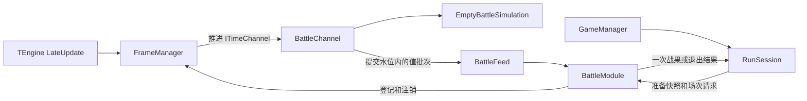

# Project B 战斗模块分步执行方案

2026-11-15 · 待确认实施稿

本稿细化整游实现流程的第 03 步。完成后可在第 01 步的大厅开局，进入一场空战，观察固定 Tick、暂停和继续、超时结算、主动退场及故障中止。第 04 步在同一战斗生命周期接入 Entitas 战场、单位、建筑和视图。[整游实现流程 §3.03](../../架构设计/Project_B整游实现流程.md) · [第 01 步方案](01-Project_B游戏生命周期分步实现方案.md) · [第 02 步方案](02-Project_B固定帧驱动分步执行方案.md)

## 1. 模块位置与职责

战斗代码放在 `Assets/GameScripts/HotFix/GameLogic/Module/BattleModule/`，与 `Module/GameModule/`、`Module/Frame/` 并列，仍属 `GameLogic` 热更程序集。每次尝试开战创建一个 `BattleModule` 实例，活动实例由 `RunSession` 持有。`BattleModule` 通过通用通道接口使用独立更新的 `FrameManager`。游戏模块只接入战斗模块的开战、暂停、继续、退出与战果接口。通道的分发、退出和结果提交以本方案为准，算法沿用现有原型。[战斗生命周期执行手册](../../架构设计/Project_B整游实现/执行手册/02-战斗生命周期与单位.md#s03) · [战斗通道原型](../../架构设计/04-Project_B-三模块CSharp实现代码.md#battlechannelcs)



| 对象 | 职责与所有权 |
| --- | --- |
| `GameManager` | 受理游戏生命周期请求，由当前 `RunSession` 处理本场控制请求和结果。持有 `BattleSetupLoader`，按身份转交装配回报。 |
| `RunSession` | 冻结本轮准备结果 `RoundSetup`，分配场次身份，持有一个活动 `BattleModule`。将暂停、继续和退出转交本场，接收一次场次结果。 |
| `BattleModule` | 管理一场的三状态、开战装配、场内命令队列、`BattleFeed` 和退场。在模块内部使用 `FrameManager` 注册或注销通道，并控制本场何时暂停推进。 |
| `BattleChannel` | 实现 `ITimeChannel`，持有本场 `FrameClock` 和 `IBattleSimulation`。执行候选步，更新结果提交水位并记录场内故障。注册成功后由 `FrameManager` 内的 `FrameCore` 负责通道释放。 |
| `BattleFeed` | 保存按 Tick 排列的值批次及已提交水位，寿命覆盖战场释放和场次结果消费。 |
| `EmptyBattleSimulation` | 执行样本命令并产生空战结果。到达已配置的截止 Tick 时返回超时终局候选。 |

OpenRA 将按帧受理命令与 World 的推进和退场分别实现，可参考其职责划分。Project B 的开战登记和完成水位沿用前两步的帧接口，命令按本地场次投递。[OpenRA 命令处理](https://github.com/OpenRA/OpenRA/blob/bleed/OpenRA.Game/Network/OrderManager.cs) · [OpenRA World](https://github.com/OpenRA/OpenRA/blob/bleed/OpenRA.Game/World.cs)

## 2. 状态与交接数据

| 状态 | 进入与执行 | 离开条件 |
| --- | --- | --- |
| `StartBattle` | 接收准备快照、分配 `BattleId`，异步装配数据和创建战场。登记通道后提交 Tick 0，开启场内输入。已开始的战斗在此状态按 Tick 推进。界面通过就绪标志区分装配中与已开战。 | 读到已提交的终局批次 → `EndBattle`。取消、装配失败或推进故障 → `ExitBattle`。 |
| `EndBattle` | 封存一次自然战果，关闭输入，回收本场资源，把值结果交给 `RunSession`。 | 会话保存战果并清除活动场引用，可开始下一场。 |
| `ExitBattle` | 关闭输入与装配交接资格，清理正在装配或运行的场次，提交一次 `Cancelled`、`SetupFailed` 或 `Faulted`。 | 会话保存退出结果并清除活动场引用。装配失败可原数据重试，模拟故障中止本局。 |

三状态用 `BattlePhase` 枚举和显式迁移实现。`PauseGame` 通过 `RunSession` 暂停当前战斗的通道，冻结本场相位与 Tick，其他通道按各自状态推进。控制层仍可受理退出。`EndBattle` 和 `ExitBattle` 共用资源清理入口，各场只受理一次离场结果。

| 值合同 | 首期字段与消费规则 |
| --- | --- |
| `RoundSetup` | `RunId`、`RoundId`、样本场地地址、种子、`TickRate`、`DeadlineTick`。由会话冻结，装配重试使用同一份快照。`RoundId` 首期用 `(RunId, SampleRoundNo)`，样本轮号用于区分两次独立开场。 |
| `BattleId` | 在 `GameManager` 的应用生命周期内递增，每次受理开战分配一个，重试也分配新值。输入、装配回报和通道故障均可定位该场。 |
| `BattleCommand` | `BattleId`、`TargetTick`、`InputSequence`、值载荷。第 03 步用「记录标记」命令验证受理、执行顺序和回放。 |
| `BattleTickResult` | `BattleId`、`Tick`、已应用的命令序号、样本值、剩余 Tick、可选终止原因。快照与命令摘要使用独立值或复制后的数据。 |
| `BattleResult` / `BattleExit` | 自然结束提供 `BattleResult`，含 `RunId`、`RoundId`、`BattleId`、已提交结果及 `Timeout`。非自然结束提供 `BattleExit`，含同样的身份、退出原因、最后成功 Tick 和诊断信息。Tick 0 提交前用空值表示尚未开战。 |

## 3. 分步执行清单

代码路径省略 `Assets/GameScripts/HotFix/GameLogic/` 前缀。每项目标实施后记录实际改动和验收证据，再勾选。

### 3.1 建立场次状态与开战入口

- [ ] **新增 `Module/BattleModule/Flow/BattlePhase.cs` 和 `BattleModule.cs`。** 实现开始、结束、退出三状态和一次性关闭入口。`StartBattle` 阶段先持有装配请求，提交 Tick 0 后打开输入。双方终止路径都在关场时撤销输入、清理资源并向外提交一个值结果。
- [ ] **新增 `Module/BattleModule/Flow/BattleContracts.cs`。** 定义准备输入、Tick 批次和结果值合同，为 `RunSession` 消费战果提供稳定身份。场内的 Tick 状态随场建立，跨重试只保留准备快照。倒计时使用 `remainingTicks = max(0, DeadlineTick - CommittedTick)`。
- [ ] **修改 `Module/GameModule/RunSession.cs` 与 `GameManager.cs`。** `GameManager` 提供应用期 `BattleId` 分配。`RunSession` 在运行态受理一次「开始空战」，冻结样本准备值并记录活动场。通道注册由 `BattleModule` 实现。重复开战请求在当前场仍活动时拒绝。装配失败时保留原准备值并开放「重试」，重试分配新 `BattleId`。

```text
RunSession.RequestStartEmptyBattle(runId)
    确认当前局处于运行态且没有活动场
    setup = 冻结本次样本准备值
    BeginAttempt(setup, AllocateBattleId())

RunSession.RequestRetryBattle(previousBattleId)
    确认最近一次匹配的尝试为 SetupFailed 且没有活动场
    BeginAttempt(原 RoundSetup, AllocateBattleId())
```

### 3.2 装配空战并在帧边界提交 Tick 0

- [ ] **新增 `Module/BattleModule/Loading/BattleSetupLoader.cs` 及 `Assets/AssetRaw/Configs/ProjectBEmptyArena.json`。** 使用 `DefaultPackage` 的现有 Configs 收集规则，由 `GameModule.Resource.LoadAssetAsyncHandle<TextAsset>` 读取最小场地值 `ArenaId`。沿用第 01 步按请求保存句柄的方式。每个请求记录 `(RunId, BattleId)`，读出所需的值后由加载方归还句柄。加载器随 `GameManager` 创建与释放，当前场退出后仍可收尾，应用销毁时主动归还仍持有的句柄。[资源模块接口](../../../Assets/TEngine/Runtime/Module/ResourceModule/IResourceModule.cs) · [收集配置](../../../Assets/Editor/AssetBundleCollector/AssetBundleCollectorSetting.asset)
- [ ] **修改 `Module/GameModule/GameStates.cs` 的控制更新。** 在暂停和大厅可收取或丢弃待完成的装配回报，可在暂停受理当前场退出。只在运行态激活就绪战斗。受理暂停或继续时，`RunSession` 调用 `BattleModule.SetPaused`，关开本场输入并冻结或恢复通道。运行态和暂停态的控制更新都先从战斗模块消费已提交的事件，再受理新的控制请求。
- [ ] **新增 `Module/BattleModule/World/IBattleSimulation.cs`、`EmptyBattleSimulation.cs`。** 提供 `InitialResult()`、`RunTick(candidateTick, tickRate, commands)` 与 `Dispose()`。空战初始化标记和倒计时，按序应用样本标记命令，在 `candidateTick >= DeadlineTick` 时产生 `Timeout`。交互样本建议用 60 Hz 下的 180 Tick，短时限验收用 3 Tick，均为联调参数。
- [ ] **接开战激活顺序。** 仅接受当前 `(RunId, BattleId)` 且仍在等待装配的回报。在运行态的 TEngine `Update` 中创建战场、暂存 Tick 0，由 `BattleModule` 登记 `BattleChannel`。登记成功才暴露 Tick 0 并打开输入。本场通道跳过登记当帧的 `LateUpdate` 采样，下一帧才首次累计时间。装配、初态或注册失败，按逆序释放已取得对象并提交 `SetupFailed`。[TEngine 模块更新](../../../Assets/TEngine/Runtime/Module/RootModule.cs)

```text
OnArenaLoaded(runId, battleId, value)
    加载方释放本次句柄
    若当前等待中的场次身份匹配：记录可装配结果

运行态 Update 的开战边界
    接纳已就绪且匹配的装配结果
    world = 创建 EmptyBattleSimulation(setup, arenaValue)
    channel = 创建 BattleChannel(world, feed)
    标记本通道跳过本帧采样
    暂存 world.InitialResult() 为 Tick 0
    frameManager.Register(channel)
    feed.CommitThrough(0) → 提交初态 → 开输入
```

### 3.3 接命令队列、战斗通道和已提交批次

- [ ] **新增 `Module/BattleModule/Commands/BattleCommandQueue.cs`。** 实时输入在主线程通过当前会话受理，目标为下一未执行 Tick，受理时生成场内递增 `InputSequence`。复现入口可提交记录中的目标和序号。拒绝旧场身份、已经执行的目标 Tick、重复序号和封口后的命令。每步只取该 Tick 的输入，同目标按序执行。暂停时保持已受理的队列，拒绝新玩法输入；退出时封口并清空未执行项。
- [ ] **新增 `Module/BattleModule/Frame/BattleChannel.cs` 与 `BattleFeed.cs`。** 复用第 02 步的 `FrameClock.Advance`、`StepDirective` 与 `ITimeChannel`。步前确认结果容量，世界执行完才暂存值批次，按 `FrameClock.CommittedTick` 更新可读水位。遇自然终局返回 `StopAfterCommit`，同时锁住后续推进直到回收。暂停期间跳过本场采样，恢复当帧也跳过一次，下一帧从原相位继续。通道释放 World 后，`BattleFeed` 继续持有已提交数据。[通道与结果队列原型](../../架构设计/04-Project_B-三模块CSharp实现代码.md#battlechannelcs)
- [ ] **接业务故障和结果消费。** `BattleChannel` 捕获模拟异常后在自身 `BattleFeed` 记录失败候选 Tick，再把异常抛给 `FrameCore` 隔离故障通道。推进成功的较早批次仍进入可读水位。`BattleModule` 在下一次控制 `Update` 先读取已提交批次，再按本场 `BattleFeed` 的状态处理故障或终局。`RunSession` 消费战斗模块交付的一次场次结果，通用调度日志由帧管理器处理。

```text
BattleChannel.Advance(elapsedNs)
    已暂停或已终止 → 返回
    若刚登记或恢复 → 清除跳过本帧采样的标记，返回
    调用本场 FrameClock.Advance(elapsedNs, 1 倍速, RunCandidate)
    在收尾处 feed.CommitThrough(clock.CommittedTick)
    步进异常 → 记录本场候选失败 → 抛出供 FrameCore 隔离

RunCandidate(tick)
    feed.EnsureRoom()
    commands = queue.TakeForTick(tick)
    batch = simulation.RunTick(tick, tickRate, commands)
    feed.Stage(batch)
    有终局候选时锁住后续推进并返回 StopAfterCommit，否则 Continue

RunSession 的控制 Update
    BattleModule 读取已提交批次和本场故障 → 消费场次结果
    再处理暂停、继续、退出和就绪战斗

FrameManager.OnLateUpdate
    不同通道按各自状态处理本帧采样
```

### 3.4 接正常战果、退出清理和装配重试

- [ ] **在 `BattleModule` 实现 `EndBattle`。** 仅由已提交的终局批次触发。从该批次冻结 `BattleResult`，关闭入口并执行共用清理。`RunSession` 核对 `RunId`、`RoundId` 和 `BattleId`，写入一次结果，清除活动场引用后通知界面。空战超时只结束当前战斗，会话可开下一场。第 01 步的「模拟结束」在无活动场时可结束样本局。
- [ ] **在 `BattleModule` 实现 `ExitBattle`。** 主动停止取 `Cancelled`，Tick 0 前的装配失败取 `SetupFailed`，推进异常取 `Faulted`。主动停止当前战斗后，可在同一局再开一场。整局放弃则先关闭当前子战斗，再沿第 01 步回大厅。已提交 Tick 0 后的推进故障记录最后成功 Tick，由 `RunSession` 请求整局 `Faulted` 退出。装配失败记录后保留原准备快照，新尝试只重新装配本场。
- [ ] **实现统一清理和结果裁决。** 先封口并撤销场次加载绑定，再清空命令、解除场内订阅和界面绑定。已登记通道通过 `FrameManager.Unregister` 归还，帧核心已摘除的故障通道视为已释放。登记前的通道或 World 由实际所有者直接释放。未结束的异步加载保留其原句柄收尾责任，旧回报只在加载方释放资源。每场退场只提交一次，清理异常记诊断。自然结果已提交时保留自然战果；若在推进前已受理退出，该次更新不再给本场分配候选 Tick。

```text
FinishAttempt(terminal)
    锁定本场唯一终止结果 → 封口并停止接受装配回报
    清命令 → 解绑场内订阅和视图
    若通道仍登记：FrameManager.Unregister(channel)
    若仍由装配方持有：释放未登记的通道或 World
    RunSession 按身份提交一次 BattleResult 或 BattleExit
    清除活动场引用 → 通知 UI
```

### 3.5 连接调试界面与可复现用例

- [ ] **修改 `Runtime/UI/ProjectBLobbyUI.cs` 与 `Assets/AssetRaw/UI/ProjectBLobbyUI.prefab`。** 在既有调试区域增加「开始空战」「退出战斗」「重试」和样本标记操作，显示 `BattleId`、装配/运行状态、最后成功 Tick、剩余 Tick 和结果。按钮携带界面绑定的局、场身份，把请求交给 `GameManager`。暂停时仍可退出战斗。第 02 步的诊断探针可保留用于时钟对照，空战倒计时读取本场自己的已提交 Tick。
- [ ] **接只读状态刷新和故障注入。** 权威结果由 `RunSession` 先提交，跨模块界面通知走 `GameEvent`，窗口用 `AddUIEvent` 管理订阅。测试入口能为指定的一次尝试延迟装配回报、制造加载失败，或在指定候选 Tick 注入模拟故障。诊断开关绑定 `BattleId`，重试继续使用原 `RoundSetup` 的正常场地地址和截止 Tick。保存样本准备、输入、已提交摘要与结果。[TEngine 事件规范](../../../.agents/skills/tengine-dev/references/event-system.md)

```text
启动按钮 → RequestStartEmptyBattle(当前 RunId)
退出按钮 → RequestExitBattle(当前 RunId, 绑定的 BattleId)
结果更新 → 读取已提交战斗快照 → 刷新倒计时、场次结果和可用按钮
```

## 4. 待实施验收与后续交接

| 用例 | 预期 |
| --- | --- |
| 装配与 Tick 0 | 连点开始只创建一场。装配前拒绝场内输入。就绪并登记后发布一次 Tick 0，本帧 LateUpdate 跳过，下一帧首次推进，加载时长未进入倒计时。 |
| 超时与补步 | 设 `DeadlineTick = 3`，从 Tick 0 输入 `80 ms`，一轮原可执行 4 Tick。空战提交 1、2、3，Tick 4 未执行。终局只上报一次 `Timeout`，通道与 World 释放后仍可查看值战果。 |
| 暂停、继续和退出 | Tick 2 后暂停，战斗 Tick 与倒计时冻结，帧模块的独立探针仍推进。继续后从原相位推进。在暂停中退出时只上报一次 `Cancelled`。同局新场以新 `BattleId` 从 Tick 0 开始。 |
| 输入排序与场次隔离 | 对同一目标 Tick 提交两个标记，按受理序消费。复现入口拒绝重复序号和过期 Tick。向 B 提交 A 的命令或退出请求，B 继续运行。 |
| 装配失败后重试 | 第一次场地加载失败，记一次 `SetupFailed`，本局仍可操作。重试沿用同一 `RoundSetup` 和 `RoundId`，换新 `BattleId`，可成功超时。 |
| 加载中退出后重开 | 延迟 A 的装配回报，先退出 A、开 B，再放行 A 的回报。A 的句柄由原加载操作释放，B 的身份、通道和状态保持正确。再从大厅重开一局复现旧局回报。 |
| 同轮候选故障 | 第 3 Tick 抛错，前两个 Tick 已在同一次推进成功。只保留 1、2 的结果，故障位为 3，最后成功位为 2。帧核心摘除故障通道，本场提交一次 `Faulted`，本局按故障退场。 |
| 退出与终局竞争 | 退出先被受理时关闭命令和推进，只得到取消结果。若截止 Tick 已提交，后续退出请求不会改变已封存的超时战果。 |

第 04 步沿用 `IBattleSimulation` 接正式 `BattleWorld`，让每场 World 拥有自己的 Entitas Context 和根系统。单位与视图在本场装配入口挂接，按 `BattleId` 和场内对象标识接纳异步视图回报，并走同一场次清理顺序。本步验收以空战生命周期和已提交结果为准。[第 04 步执行手册](../../架构设计/Project_B整游实现/执行手册/02-战斗生命周期与单位.md#s04)

本次只编写执行方案。源码实现、Unity 运行、编译与测试均待实施。
