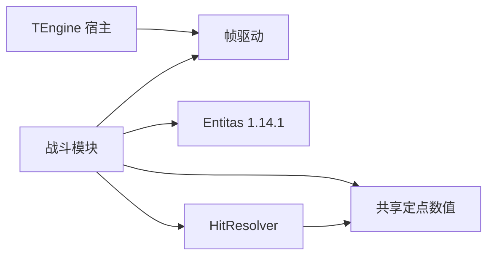

# 02 Project B 战斗模块方案

2026-11-15 · 待确认

## 1. 目标与组合关系

战斗模块负责 **把时间推进变成 Project B 的战斗规则**。它实现战斗时间通道，从帧驱动获得候选 Tick，使用 Entitas 管理本场状态，把合法攻击与受击快照传给 HitResolver，再将结果写回战场。回合出口交付已提交的状态和业务事实。首期以固定初态和测试部署指令走通「召唤 → 自动接近与攻击 → 塔破损 → 核心暴露或回合终止」。正式牌组、洗牌、商店、整局流程和表现资产后续接入。 [程序策划案](../游戏设计/02-程序策划案.md) · [回合准备与终止](../游戏设计/功能需求/03-回合准备与终止.md) · [伤害与攻击结算](../游戏设计/功能需求/39-伤害与攻击结算.md)



箭头表示源码依赖。运行时帧驱动通过自己的 `ITimeChannel` 回调战斗通道。战斗通道持有通用时钟，收到 Tick 后调用战场。HitResolver 可以在固定步长、回合制或独立工具中由调用方直接执行。战斗模块负责把它的批内结果序号关联到战斗 Tick。 [帧驱动独立模块方案](01-帧驱动独立模块方案.md) · [HitResolver 独立模块方案](03-HitResolver独立模块方案.md)

本篇定义战斗执行和两个底层模块的接缝。牌组、建筑、单位、Buff 和资源等模块接入后，按各自所有权提交写入。战斗编排提交有序命令和补丁，拥有组件的子系统用 Entitas 的生成 API 落状态。局级准备、商店和跨回合交接详见 [战斗编排与集成方案](Project_B战斗与局内系统/00-战斗编排与集成方案.md)。

## 2. 目录、对象与生命周期

| 对象与位置（拟） | 责任 |
| --- | --- |
| 热更宿主 `GameApp` / `GameModule.Frame` | 复用现有 TEngine 生命周期，持有应用级的 FrameCore 并喂整数纳秒。秒制 UI/表现计时继续通过 `GameModule.Timer`。 |
| `GameLogic/Battle/Simulation/BattleTimeChannel` | 实现 `ITimeChannel`，持有本场的 `FrameClock` 和 `BattleWorld`。把通用候选 Tick 交给 World，将完成或暂停后的停止要求转换成时钟能理解的指令。 |
| `BattleWorld` 和每场的 Entitas Systems | 持有本场的 Context、指令队列、配置、随机状态、命中账本及复用缓冲。决定业务帧序、结算与终止，按同一批数据写回 ECS。 |
| `GameLogic/Battle/Components/` 和 `Battle/Generated/` | 手写组件与唯一正式生成根。实体按稳定 `BattleEntityId` 引用，组件存 ID 或纯数据。 |
| 战果与表现出口 | 回传不可变战果及只读快照。外部层可以通过 TEngine 事件桥消费已提交信息。 |

建议由 `GameApp.StartGameLogic()` 激活应用周期的宿主，复用 `Singleton<T>` 和 `IUpdate`，通过 `ReleaseLogic()` 回收。宿主在 Update 从 `Time.unscaledTimeAsDouble` 采样，换算经过纳秒并保留换算余量。开战在采样边界发布 Tick 0，开始接收正式命令，下一段完整采样才进入本场。前后台切换重取基准，后台离开时长不积压。现有 Update 回调经异步注册，常驻一个宿主，回合切换时只注册或注销战斗通道。事件消费在独立阶段运行，避免在 `SingletonSystem.OnUpdate()` 枚举时由订阅者变更更新者集合。 [GameApp](../../Assets/GameScripts/HotFix/GameLogic/GameApp.cs) · [SingletonSystem](../../Assets/GameScripts/HotFix/GameLogic/SingletonSystem/SingletonSystem.cs) · [UpdateDriver](../../Assets/TEngine/Runtime/Module/UpdataDriver/UpdateDriver.cs) · [Unity 时间采样](https://docs.unity3d.com/6000.0/Documentation/ScriptReference/Time-unscaledTimeAsDouble.html)

准备确认和敌方部署完成后，局流程交付初态，World 构造独立 `Contexts` 和根 `Systems`。结束时先关输入，停止后续补步，将已提交结果交给独立消费队列。然后注销通道、停用系统 Collector、调用 `TearDown()`、释放世界对 Entity 的保留并清理 Context。下场创建新的 World，局流程仅移交明确需要跨回合的数据。

### Entitas 生成

仓库已有 Entitas 运行时插件。项目约束为 **1.14.1**，当前 `GameLogic.asmdef` 声明 `overrideReferences = false`。现有 `Jenny.properties` 仍以 `Game` 为 Context，指向工具项目 `Tools/Entitas/EntitasGen/EntitasGen.csproj`，扫描和输出均为原 EntitasDemo 路径。工作树中 Demo 源已删除，编辑器遗留脚本仍使用 Demo 生成 API。实施时先获得同版可用 Jenny，沿当前唯一入口调整组件扫描与工具侧属性，迁移至正式 `Battle` Context 和独占 `Battle/Generated`，同步处置遗留引用。生成器开启目录清理，输出目录仅放生成物。若组件字段使用共享定点值类型，Jenny 的解析项目同时纳入其源码或类型引用。工具配置位于仓库根级，需要随实现范围确认。目标平台的 DLL 导入及 HybridCLR 的 AOT 保留仍待运行验证。 [当前 Jenny 配置](../../Jenny.properties) · [EntitasGen.csproj](../../../Tools/Entitas/EntitasGen/EntitasGen.csproj) · [编辑器遗留脚本](../../Assets/Editor/EntitasDemoTest.cs) · [项目生成规范](../../.agents/skills/entitas-dev/references/jenny-and-integration.md)

每场通过生成的 `Contexts` 实例取得自己的 `BattleContext`。初次 `Initialize()`，每步一次根 `Execute()`、`Cleanup()`。使用缓存 Group 和重复使用的容器取数据，冲突和随机取样先按业务 ID 或指令序排序。每笔攻击使用值缓冲保留身份；写回通过生成的 `ReplaceXxx`，生命周期操作在清理阶段完成。 [项目生命周期规范](../../.agents/skills/entitas-dev/references/systems-and-lifecycle.md)

## 3. 业务时间、组件和帧序

- **战斗时间。** 建议 60 Hz、每宿主更新最多 4 步。超额整步时间丢弃后，倒计时与自动攻防共同随已执行 Tick 放慢。正式战斗没有玩家暂停。调试单步显示最新一次成功状态。单位存续、行动硬直、攻击冷却和抽牌都由业务字段描述，首版使用同一条战斗 Tick。 [回合准备与终止](../游戏设计/功能需求/03-回合准备与终止.md) · [出牌与费用](../游戏设计/功能需求/07-出牌与费用.md)
- **定点配置。** 位置、速度和范围使用共享 `Fixed64`。正时长从十进制原始值按 `ceil(secondsRaw × tickRate / 1_000_000)` 转换为 Tick，单位存续为 0 表示无限。单位移动由 [RVO2](Project_B战斗与局内系统/19-寻路模块实现代码.md) 按固定 Tick 推进，位置出入通过定点转换和量化。数值域与几何范围采用 [HitResolver 方案的定点契约](03-HitResolver独立模块方案.md#2-定点相交与数值边界)。
- **组件。** 战场实体含业务 ID、归属、定点位置、生命和受击形状。可行动实体增加目标 ID、攻击可用 Tick、移动意图/站位和可选存续截止。塔拥有格位、种类与破损状态，核心另含暴露状态。局流程交付跨回合状态。 [玩家单位](../游戏设计/功能需求/09-玩家单位.md) · [敌方防御塔](../游戏设计/功能需求/10-敌方防御塔.md) · [英雄核心](../游戏设计/功能需求/11-英雄核心.md)
- **输入。** 出牌、部署和技能命令携带会话代号、下一未执行 Tick、递增输入序号。每步开始封存输入，只消费一次，按正式规则验证费用和合法位置。重放用分配到 Tick 后的命令记录。正式抽牌拟先处理出牌，再处理已到期或暂停在零的抽牌，让满手成功出牌后同一步可抽。新牌下一步起可出。 [抽牌与洗牌](../游戏设计/功能需求/06-抽牌与洗牌.md) · [出牌与费用](../游戏设计/功能需求/07-出牌与费用.md)

```text
BattleTimeChannel.Advance(elapsedNs)
    clock.Advance(elapsedNs, RunCandidateTick)
    无论正常返回还是失败，在退场前保存 clock.CommittedTick 到宿主结果队列
    正常结束：关闭输入，向 FrameCore 请求注销本场通道

RunCandidateTick(tick, tickRate)
    在宿主持有的结果队列预留本步槽位
    封存本步输入，撤销到期单位资格，处理部署与业务指令
    索敌、移动、用移动后位置复核攻击范围
    按稳定顺序创建 AttackRequest，固定进攻和受击快照
    batch = hitResolver.Resolve(requests, snapshot, ledger, rules, buffers)
    预检实体映射、写入范围、持久账本及破损与连带事实容量
    由组件所有者写回生命及待清理标记
    应用本步命中账本增量，回收已结束的攻击段记录
    按真实归零事实处理破损、核心、统计和回合终止
    在本步提交会影响下一 Tick 的派生状态，例如技能能量
    执行 Cleanup，装入值快照与结果
    返回 Continue 或 StopAfterCommit

宿主消费阶段
    按场和 Tick 读取不超过已保存提交水位的成功结果
    向局流程与表现发布
```

命中模块接收适配器投影的值数据。战斗持有活动攻击表，分配不复用的实例 ID，固定其来源和定义，关闭段后停止产生该段请求。`IHitRule` 读取显式提供的攻击属性与修正快照，并校验阵营、技能授权和核心保护。战斗用 `(BattleId, Tick, HitOrdinal)` 标识外部每击结果。

Clock 提交正常返回的候选步。`StopAfterCommit` 结束本轮补步，战斗通道另外请求注销。宿主持有的结果队列及每场最后提交编号独立于 World，使故障时仍能保留最后一次成功提交。若 N 成功、N+1 失败，消费 N，丢弃 N+1 部分结果，隔离故障世界并退场，故障场不产出正常回合结算。订阅异常在消费阶段处理。反击和本步派生产生的新伤害进入下一 Tick。

## 4. 战场规则与结果出口

| 场景 | 战斗模块的处理 |
| --- | --- |
| 塔破损和核心保护 | 以固定的本步受击快照结算。外塔在 N 步破损时，步末计算更新暴露，N+1 起使用新的可索敌、可受击与开火状态。穿层技能及八方向覆盖规则待确认。 |
| 核心击破 | 本步将其余仍存活塔转为连带破损，按业务 ID 产出对应事实。已经直接破损的塔保持原击破归因，连带结果没有虚构的命中和扣血。 |
| 单位到期与回合截止 | 评审建议单位行动区间为 `[SpawnTick, ExpireTick)`。回合截止 D 步完整执行，D+1 入口关闭。保存超时、核心击破及提前结束各自事实。提前结束条件包括费用无法支付任何候选牌且所有玩家非建筑单位已阵亡。局流程按确认的优先级决定分支。 |
| 评分、技能能量、掉落和回收 | 每击同时保留计算伤害和实际扣血，指标口径由各业务定义。技能能量等会影响下一 Tick 的权威状态在 World 内由所有者当步写入，发布端只消费已提交的值。核心、抵抗塔和连带破损按策划区分。回合回收独立记录。 |
| 渲染和调试 | 多步时按顺序保留每笔已提交事件。可用相位显示最近两步位置插值，初始、传送和单步同步当前快照。展示状态单向流出。 |

项目规则出处包括 [英雄核心](../游戏设计/功能需求/11-英雄核心.md)、[评分](../游戏设计/功能需求/14-战斗评分.md)、[荣誉值](../游戏设计/功能需求/15-荣誉值与失败判定.md)、[角色主动技能](../游戏设计/功能需求/16-角色主动技能.md) 和 [法球掉落与领取](../游戏设计/功能需求/19-法球掉落与领取.md)。

## 5. 分步实施与联接验收

- [ ] **B1 · Context 和世界。** 补齐同版 Jenny，准备组件及生成根，用「创建 → 初始化 → 单步 → 清理 → 退出 → 新世界」核对生命周期。
- [ ] **B2 · 战场和命中适配。** 用测试初态驱动索敌、[RVO2 移动](Project_B战斗与局内系统/19-寻路模块实现代码.md)与基本攻击。通过快照调用 HitResolver，使用生成 API 写回真实生命和破损。可先手动传入 Tick 做战斗单步，帧驱动接入后用同一入口。
- [ ] **B3 · 宿主和结果出口。** 装配 FrameCore、战斗时间通道、帧时钟及 HitResolver。接入测试部署、敌塔、核心与截止时间。按「命令 → 自动攻防 → 破损/终止 → 战果」走通。
- [ ] **B4 · 正式业务接入。** 策划确认后接上牌组、技能、评分、能量和掉落。配置加载、牌区和局流程遵循各自生命周期。

| 联接用例 | 预期 |
| --- | --- |
| 零步、多步、暂停单步 | 每成功步只执行一次 World。多步不重复执行输入，出站批有序。官方玩法入口不提供暂停。 |
| 速度每秒 ±61 Raw，60 步 | 每轴净位移分别为 ±61 Raw。传送与停止的位置符合战场规则。 |
| 同 Tick 多击、双方互杀 | 保留逐笔扣血和一次归零。由战场正确写入 Entitas，已采集有效攻击按评审口径处理。 |
| 第 N 步伤害使技能能量达标 | N+1 可读取新能量。两步在一个宿主更新内补步，和分两次更新各走一步的结果相同。 |
| 核心暴露、击破与超时 | 下一步起使用暴露状态。核心击破只一次，其他存活塔连带破损。截止步同时记录命中及终止事实。 |
| 批次失败、退出重开 | 已提交批次仍可消费，失败批不可见。新场的命中账本、时间和命令无串场。 |
| 同版本重跑与性能 | 同 Player、RVO2 版本与配置、初态、种子和 Tick 命令，以不同宿主频率驱动。按同一已执行 Tick 比较战场状态与命中队列，摘要覆盖活动段、账本、随机状态、截止字段与量化位置。记录 Tick P95、候选峰值、丢步量和 GC，独立模块的稳定热路径以 `0 B/Tick` 为测量目标。 |

待确认项包括 60 Hz/4 步与超载计时方式、原型数值域、截止步与单位到期的边界、同 Tick 出牌抽牌顺序、合法零伤是否占命中资格、互杀、核心规则和伤害统计口径。前三份方案均为待确认设计，当前未运行 Unity、Jenny、编译、Profiler 或回放。 [Klotho 的输入及回放相关同步设计](https://github.com/xpTURN/Klotho/blob/main/Docs/SynchronizationDesign.md)
