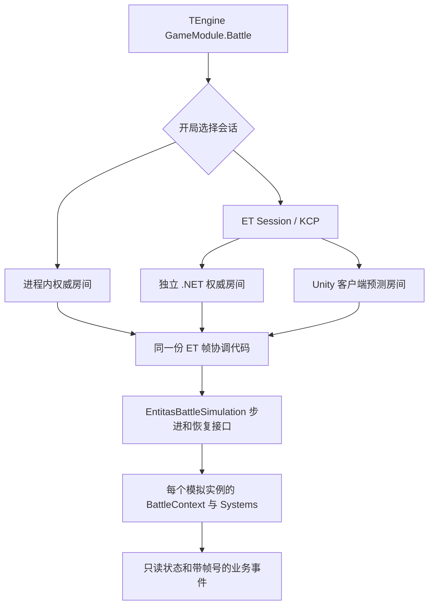

# Project B · ET10 与 Entitas 战斗逻辑适配方案

本文补充 [ET10 适配 TEngine 项目模块](Project_B-ET10适配TEngine项目模块实施方案.md) 和 [单机开放与联机全量适配](Project_B-ET10单机开放与联机全量适配实施方案.md)。**ET10 驱动 Entitas 战斗世界的 `Step()`，迁入源码直接由 Project B 的 `Assets/GameScripts/` 和 `Tools/` 管理。** ET10 继续提供房间、帧与网络基础设施。交付范围仍是玩家只开放单机，内部同批打通真实联机、预测回滚和完整重连。

## 1. 决策：改 ET 接入层，保留 Entitas 框架

**后续战斗功能继续用 Entitas 1.14.1 写。** 召唤、移动、技能、伤害、Buff、死亡和胜负都使用 Entitas 的组件、实体和系统实现。项目写一个 `EntitasBattleSimulation` 适配器，供迁入的 ET 房间调用。它把输入送给本场的 Entitas 系统树，并提供快照、恢复与校验所需的数据。保留 Entitas 官方运行时和常规 API；调整的是项目的组件建模、系统调度、Jenny 生成配置，以及 ET Lockstep 示例中直接依赖 `LSWorld` 的部分。

| 做法 | 实际代价 | 结论 |
| --- | --- | --- |
| 原样使用 ET 的 `LSWorld`、`LSEntity` 和快照 | 最接近上游示例。战斗系统要改用 ET API，或者让 Entitas 只做表现。 | 与用 Entitas 写战斗逻辑的目标冲突。 |
| 在 ET 房间里调用 Entitas，继续让两套 ECS 保存同一批单位 | 生命、位置、技能等字段需要双向同步，迟早要决定回滚时哪一边才是真值。 | 同步面和测试成本高，不采用。 |
| 保留 ET 帧调度与网络，对接 Entitas 的步进与状态 | 需要替换 ET 示例的步进、快照、回滚、重连和录像接缝。战斗开发沿用 Entitas。 | **采用。每个模拟实例只有一份 ECS 状态。** |

`ET.World`、Fiber、Room 和 Session 仍有运行职责，房间持有模拟适配器。ET 的 `LSWorld` / `LSEntity` 在外部上游源码中保留作对照，Project B 用 Entitas 建立战场。联机时服务器有一份权威 Entitas 世界，客户端有自己独立的预测世界，各自只有一个状态来源。

## 2. 源码边界与迁移清单

以此前选定的 [ET10 官方 master 提交 `743c635d`][et] 为基线。固定提交中的 `RoomSystem.Update()` 给样例 `LSUnit` 设置输入，在 `LSWorld.Update()` 前保存并计算 `LSWorld` 快照；`LSClientHelper` 回滚和录像跳转直接销毁、反序列化并替换 `LSWorld`。重连示例读的是 `LSUnit` 的位置和朝向。仅把 `LSWorld.Update()` 换成 Entitas 的 `Systems.Execute()`，其他路径仍看不到 Entitas 的血量、任务或随机状态。[RoomSystem][room] · [LSClientHelper][client] · [重连处理][reconnect]

| 层 | 保留和复用 | 项目要改接的入口 |
| --- | --- | --- |
| ET Core 与接入 | World/Fiber、房间生命周期的基础设施、ETTask、消息分发与 Session、KCP 传输。 | TEngine 启动与释放 ET 宿主。ET 协议映射为项目值类型命令或确认帧，消息对象回收前复制必要数据。 |
| ET Lockstep 调度 | Room、`FixedTimeCounter`、客户端和服务端 Updater 的角色、输入历史、确认后校正的流程、录像节奏。 | 统一接到同一个项目帧协调器。改 `RoomSystem` 的初始化、样例 `LSUnit` 输入注入和 `LSWorld.Update()`。输入和快照槽按场次和 Tick 标记，识别环形槽覆盖；协议显式携带 Tick，连续消费确认帧。 |
| 回滚、录像与重连 | 复用 ET 的确认输入比较、找历史、重演及联机交换流程。 | `SaveLSWorld/GetLSWorld`、`Rollback`、`JumpReplay`、Hash 消息和重连改读写 Entitas 状态合同。统一用提交后快照，复核客户端、服务端、录像的 Tick 偏移。 |
| Entitas | 官方 `Context`、`Entity`、`Matcher/Group`、索引、`Systems`、Jenny 生成 API。 | 新建正式 `Battle` Context 和项目系统树。新增步进适配器、组件快照编码与恢复装配。 |
| TEngine | `GameModule.Battle`、应用流程、Luban 配置、资源及 UI。 | 把输入转换成命令，向界面提供投影和已确认事件。界面和 Unity 对象不保存权威战斗状态。 |

ET 示例的服务端 Updater 是先增加 `AuthorityFrame`、广播输入，再推进世界。本方案明确采用**先执行并完成提交，再推进已提交水位并广播确认**。另有一个接收连续确认输入的水位，可领先于客户端已应用的确认帧；不能把 “收到确认” 当成 “本地已应用”。客户端预测头也独立记录。[服务端 Updater][server] · [客户端确认处理][confirm] · [FrameBuffer][buffer]

## 3. 谁驱动谁，玩法开发怎么写



战斗房间只由 ET 迁入的固定 Tick 驱动；Unity Update、TEngine Pump 或项目其他帧通道不会额外推进战斗。网络回调把命令和权威帧交给房间所属执行线程处理。每个房间、预测副本和回放实例独立构造自己的 Context 和 Systems，不用 `Contexts.sharedInstance`。TEngine 的 Pump 只推进 ET 宿主；视图按显示帧插值。单机暂停只暂停本地房间逻辑 Tick，内部联机不能从客户端暂停权威时钟。

玩法开发者仍然写 `[Context("Battle")]` 或生成的 `[Battle]`、`BattleMatcher`、`BattleEntity` 与 `IExecuteSystem`。比如技能系统产生有序的命中请求，伤害系统遍历请求并用生成的 `ReplaceHealth` 更新组件，死亡系统处理终局，最后清除已消费的请求。逐笔伤害用独立请求实体或有序队列；不能依赖 Reactive Collector 还原同一实体在一帧内的多次写入。高频规则按阶段显式调用，允许用于确定性逻辑的变化监听须定义触发和恢复边界。表现层可以响应变更，但不可反向改战斗 ECS。[项目 Entitas 生命周期规则](../../.agents/skills/entitas-dev/references/systems-and-lifecycle.md) · [Entitas 1.14.1 发布][entitas]

```text
Room.TryAdvance(tick, frameInputs):
    batch = NormalizeAndOrder(tick, frameInputs)
    result = battle.Step(tick, batch)
    state = battle.CaptureState()           # Tick 清理后的值状态
    history.Commit(tick, batch, state)     # 保存、摘要和水位按模式提交
    当作权威房间时，广播已提交的帧并产出正式事件

EntitasBattleSimulation.Step(tick, batch):
    写入本 Tick 的输入和确定性时钟数据
    systems.Execute()                     # 输入 → 移动 → 技能/命中 → 伤害 → 终局
    systems.Cleanup()                     # 清已消费项目，保留会影响未来 Tick 的状态
    返回本 Tick 的只读投影和事件记录
```

`Step`、`CaptureState`、`RestoreState` 是项目接缝，不是 ET 或 Entitas API。`Step` 不调用 Socket、Unity API、实时时钟或异步 IO。房间步进失败时不得广播本帧确认；隔离可能被系统部分写入的实例，按最近成功提交点恢复或终止该局，不能在脏状态上继续跑下一帧。

## 4. Entitas 玩法迁移的硬要求

| 项目 | 本方案的约定 |
| --- | --- |
| **状态所有权** | 权威状态定义在 Entitas 组件或战斗世界的受控值状态中。系统内部缓存如果影响未来行为，要搬入可快照状态或按规则重建。Group、临时查询缓冲、对象池、观察者无需序列化。 |
| **确定性** | 移动、命中及概率规则使用明确的定点数或整数、固定 Tick、可保存的 RNG 状态。按稳定 ID、席位和命令序号排序，不能以 Group/HashSet 枚举顺序决定结果。碰撞、避障和寻路只有能在目标 Player 与独立 .NET 同样重演，才能参与权威结算。 |
| **输入语义** | 所有模式用同一 `InputBatch`。持续移动等输入可以按规则沿用；召唤、释放技能等一次性命令有唯一序号，缺包时不能沿用上一帧再次执行。远端输入通过席位、帧号和业务校验。 |
| **跨局身份** | 使用稳定 `UnitId` 和局标识。快照、配对与视图引用不用 Entitas `creationIndex`、组件槽位编号或实例引用。恢复后按业务 ID 重新解析实体。 |
| **表现和结算** | UI、音效、GameEvent、存档和奖励由桥接层消费。可撤销的预测表现按 ID 更新，重新演算时不重复派发外部副作用。正式结算来自确认态并使用稳定事件键去重。 |

## 5. 快照、回滚与完整重连

`Snapshot(t)` 表示 **Tick t 提交后** 的状态，`Snapshot(0)` 是开局初态。快照以项目版本化值结构记录场次和 Tick、配置摘要、规则版本、稳定实体/组件字段、ID 分配器、RNG、冷却、Buff、波次、延迟任务和未消费且必须跨帧的命令。按稳定字段和实体顺序编码，权威哈希取同一 Tick 的规范字节。配置可按摘要绑定在开局数据中；恢复时拒绝不匹配配置。对象池、Context、系统树、Collector、Unity 对象和 TEngine 观察者都不写进快照。新增影响规则的组件时，同步评审快照覆盖、版本和恢复方式，避免联机到最后才发现有字段没存。

- **恢复单个模拟实例。** 在房间所属线程创建新的 Context，先验证和导入值状态，再装配或清理系统收集器与索引。确保导入触发的新增事件不会作为真实召唤或伤害被消费；常驻系统依赖的初始缓存由状态直接重建。保持旧世界及对外索引直到新世界恢复成功，随后停用、释放旧系统并按 ID 重绑视图。首选正确性容易验证的整世界恢复；是否改增量取决于实测。
- **客户端回滚。** 若第 k 帧预测输入与权威批次不同，加载 `Snapshot(k-1)` 或更早的可用恢复点，按权威连续帧重演至当前确认水位，再重演未确认窗口内仍有效的本地输入与远端预测。修正 k 之后的预测历史；只发布收敛后的投影和新确认事件。若历史已覆盖、对同一确认帧的哈希持续不一致或缺连续权威输入，转完整恢复。比如第 42 帧预测部署 A、权威拒绝，恢复 41 帧后重演，A 的位置、冷却和 RNG 消耗都回到权威结果。
- **重连和录像。** 服务端发同一切点的完整 `Snapshot(t)`、版本及 `t+1` 起的连续确认帧，客户端完成校验、恢复和追帧后再恢复预测。录像同样保存初态、确认输入和周期快照，用同一个恢复入口支持跳转与独立 .NET 重播。升级后若数据不兼容，显式拒绝或保留对应旧规则运行版本；不能按新组件槽位硬读旧快照。

正确性阶段先用有帧戳的有界完整快照做预测窗口，回放可稀疏存点。实施时测峰值窗口的 `快照大小 × 保留槽数 × 并发实例`、一次回滚的恢复加重跑耗时和跨端摘要，再选窗口、步进上限或快照间隔。单机即使用这套快照和回放合同，避免联机时才重构玩法数据。

## 6. 把源码拆入 Project B 的模块

**从固定 ET10 提交按文件选取，直接迁入目标目录。** `Packages/cn.etetet.*` 只是上游源码的查找位置，不作为 Project B 的安装或构建入口；也不新增 `com.projectb.battle` 之类的共享 UPM 包。房间、逻辑帧、回放、预测、回滚和重连按 Project B 战斗模块维护。Fiber、Session 和 KCP 也作为项目源码入库，在 `GameScripts` 下划给基础设施。保留已有 Entitas 插件及项目正常的第三方依赖，不把取消 ET 的 UPM 布局扩大为重排现有 Unity 包。

以下是拟新增的目录，路径相对于仓库根目录。

| 位置 | 放什么 | 构建归属 |
| --- | --- | --- |
| `UnityProject/Assets/GameScripts/Infrastructure/EtRuntime/` | 从 ET10 提取的 World、Fiber、时间、ETTask、Entity/System 注册、消息分发、Session、UDP/KCP、必要的序列化适配和定点数学。按 `Core/`、`Transport/`、`Serialization/`、`Math/` 组织。 | Unity 的项目内 AOT 运行时程序集 `ProjectB.EtRuntime`，独立 `.NET` 通过显式目录或文件清单编入其中可跨端的源码。底层不引用 `GameLogic`。 |
| `UnityProject/Assets/GameScripts/HotFix/GameLogic/Module/BattleModule/Shared/` | `Contracts/` 放开局数据、帧命令、确认和快照值结构；`Simulation/` 放 Entitas 组件、Jenny 生成物、系统与 `EntitasBattleSimulation`；`Lockstep/` 放权威房间、帧时钟、历史、预测回滚、快照和录像；`Protocol/Generated/` 放双端共用的战斗消息生成物。 | Unity 首期由现有 `GameLogic.asmdef` 编译，`.NET` 的共享项目以 `Compile Include` 选入同一份源码。共享代码不引用 UnityEngine、TEngine、Luban 生成表、YooAsset 或 UniTask。 |
| `UnityProject/Assets/GameScripts/HotFix/GameLogic/Module/BattleModule/` | `BattleService`、Unity 侧本地开局与远端会话入口、TEngine 的 ET 宿主接线、资源、输入、读模型和表现桥。 | 仅 Unity 的 `GameLogic` 使用。单机由门面进入本地房间；联机客户端使用网络会话，其预测和恢复调用 `Shared`。 |
| `Tools/ProjectB.Server/` | 独立 `.NET` 启动、服务端监听、连接到房间的路由、加入与恢复请求入口、服务端部署配置和无头重播。 | 只编译服务端入口及明确纳入的基础设施和 `BattleModule/Shared` 源码，不复制一份战斗逻辑到服务端。 |
| `Tools/ProjectB.CodeGen/` 与 `Tools/Entitas/EntitasGen/` | 前者管理战斗协议定义、ET 协议生成及必要的生成器构建或配置；后者解析正式 Entitas 组件。Unity 若需编译期分析器或生成器，由项目的编辑器工具路径配置引用，工具本体不进入 Player。 | 生成入口用仓库相对路径，避免依赖 `Packages/cn.etetet.*`、PackageCache 或某台机器上的 ET checkout。 |

**文件迁移顺序。** 先为实际运行所需的 ET 文件记录 `上游提交/原路径 → 项目路径 → Unity/.NET 编译归属 → 生成器与注册依赖`，连同第三方声明、许可证和项目改动一并记录。按顺序移入底层、迁 `Room` 和 `FrameBuffer` 等算法到战斗模块、替换 `LSWorld` 调用、再接协议和两端宿主。对原本由包清单或包扫描隐式提供的 asmdef 引用、条件宏、分析器、协议输入扫描、类型注册、配置读取和启动顺序逐项改成项目入口；不整包复制 `package.json`、原示例 Loader 或原目录通配符。初次迁入保留有必要的底层 `ET` 命名空间，按模块边界隔离；只有在查清生成和注册依赖后才改名。

### Jenny、程序集和热更的实际改动

项目已保留 Entitas 官方运行时插件，`GameLogic.asmdef` 目前为 `overrideReferences: false`。但当前 `Jenny.properties` 仍配置 `Game` Context，输出指向 `EntitasDemo/Generated`；`Tools/Entitas/EntitasGen/EntitasGen.csproj` 仍只扫描旧 Demo 组件路径。当前不能把 Demo 配置或生成物当成正式战斗入口。[Jenny 配置](../../Jenny.properties) · [解析工程](../../../Tools/Entitas/EntitasGen/EntitasGen.csproj) · [GameLogic.asmdef](../../Assets/GameScripts/HotFix/GameLogic/GameLogic.asmdef) · [Demo 清理方案](../问题修复/EntitasDemo残留清理方案.md)

| 拟落位置 | 工作内容 |
| --- | --- |
| `Jenny.properties` 和 `Tools/Entitas/EntitasGen/` | 把正式生成目标切到 `Battle`，扫描 `Shared/Simulation/Components/` 和所需类型。输出到 `Shared/Simulation/Generated/`，与协议生成目录分开；生成器的清理范围只覆盖各自生成物。共享根用 `Entitas.Systems`，Unity 编辑器观察和 Debug 类型留在工具/表现侧；生成事件或清理聚合组时核对基类与跨端编译条件。 |
| Unity HotFix 战斗模块 / 独立 `.NET` 宿主 | `GameLogic` 显式引用项目内的 AOT 运行时。在热更业务入口 `GameApp.Entrance` 装配 ET 时，宿主把注册器或目标程序集显式交给运行时，无需 AOT 层反向引用热更代码或扫描 ET 包。`.NET` 装配自己的服务端入口及匹配的 Entitas 运行时与依赖。双端核对协议 ID、生成物和规则版本；Player 另查 IL2CPP 裁剪和 HybridCLR AOT 泛型。已开房间固定其规则版本。 |

源码放在 `GameLogic` 的目录里，服务端编译同一文件并不意味着服务端要引用 `GameLogic.dll`。Unity 用现有 asmdef 确定编译边界，服务端用自己的 csproj 明确选入共享子目录及运行时；所有协议类型用显式的协议 ID 对齐，避免把 CLR 程序集名作为线上身份。[Unity 程序集说明][unity-asm] · [MSBuild 选择编译文件][msbuild-compile]

## 7. 分步实施与验收

以下是待实施清单。玩家版始终只暴露单机入口，内部联机使用同一套战斗逻辑。

| 步骤 | 全部修改目标及做法 | 验收 |
| --- | --- | --- |
| [ ] E0 · 拆出项目源码，建成共享 ECS | 从固定提交筛选 ET 源码，建立原路径到项目路径清单，迁移 asmdef、生成器输入及运行时注册。迁 Jenny 正式配置，生成 `BattleContext/Entity/Matcher`，构造两个独立实例。`上游源 → 项目源码 → 双端编译 → 独立世界`。 | 从干净工作区通过项目路径与可复现的生成步骤构建，不依赖 ET UPM 包或外部 ET checkout；相同组件和系统可由 Unity、独立 .NET 运行，两实例隔离。 |
| [ ] E1 · 单机权威闭环 | 接 TEngine 门面和 ET 本地房间，只让它驱动 `EntitasBattleSimulation`。实现部署、移动、命中、伤害和终局的代表性系统，处理暂停、退出、重开与表现桥。`命令 → 封帧 → Step → 提交 → 视图`。 | 断网 Player 不启动网络会话便可完成战斗；暂停不推进逻辑帧，重开无旧实体/监听；一笔召唤消息只消费一次。 |
| [ ] E2 · 快照与重播 | 定义组件值编码、完整快照、规则摘要和恢复装配；换掉 LSWorld 保存、Hash 与录像路径，补帧戳和恢复点覆盖策略。`Capture(t) → Restore(t) → Replay(t+1...)`。 | Unity/.NET 同一录像逐确认帧校验相同。挑含 Buff、技能冷却、生成和死亡的中途快照，恢复后继续多帧一致；不重复派发结算。 |
| [ ] E3 · 真实联机确认 | 接入 ET 会话、KCP、双方协议生成、独立 .NET 房间与两 Unity 客户端。迁权威输入封存及确认处理，确认帧提交顺序与单机共用。`两客户端 → KCP → 服务端提交 → 两端应用确认帧`。 | 两客户端在纯确认模式下使用同一 Entitas 规则，服务端与客户端的已应用确认帧摘要相同，重复或乱序确认不会跳过帧。 |
| [ ] E4 · 预测、重连和发行边界 | 替换回滚与重连的数据源，加入重演副作用控制、完整恢复、版本匹配和诊断。内部包跑网络异常，玩家包只走本地启动；记录内存与步进预算。`预测错 → 恢复上一个状态 → 重演；历史过期 → 权威快照`。 | 强制造成预测失败、历史覆盖和短时断线，最终恢复到同一确认状态并继续一致；正式 Player 断网可运行，内部 Player 可连独立服务端。 |

未来开放联机时，新增房间入口、身份接入和正式部署配置。新技能或单位继续按 Entitas 的组件和系统开发；只要遵守确定性及快照合同，同一份规则就能在单机、服务器和客户端预测运行。是否需要重新打包 Player 取决于当前发行包是否编入并保留网络路径。

本文是方案与源码分析。未修改运行时代码、未执行 Jenny，也未启动 Unity、编译或运行测试。

[et]: https://github.com/egametang/ET/commit/743c635dd5b0f6f6bab549c0093382c85f3f8307
[room]: https://github.com/egametang/ET/blob/743c635dd5b0f6f6bab549c0093382c85f3f8307/Packages/cn.etetet.lockstep/Scripts/Hotfix/Share/RoomSystem.cs
[client]: https://github.com/egametang/ET/blob/743c635dd5b0f6f6bab549c0093382c85f3f8307/Packages/cn.etetet.lockstep/Scripts/Hotfix/Client/LSClientHelper.cs
[server]: https://github.com/egametang/ET/blob/743c635dd5b0f6f6bab549c0093382c85f3f8307/Packages/cn.etetet.lockstep/Scripts/Hotfix/Server/Room/LSServerUpdaterSystem.cs
[confirm]: https://github.com/egametang/ET/blob/743c635dd5b0f6f6bab549c0093382c85f3f8307/Packages/cn.etetet.lockstep/Scripts/Hotfix/Client/OneFrameInputsHandler.cs
[buffer]: https://github.com/egametang/ET/blob/743c635dd5b0f6f6bab549c0093382c85f3f8307/Packages/cn.etetet.lockstep/Scripts/Model/Share/FrameBuffer.cs
[reconnect]: https://github.com/egametang/ET/blob/743c635dd5b0f6f6bab549c0093382c85f3f8307/Packages/cn.etetet.lockstep/Scripts/Hotfix/Server/Room/G2Room_ReconnectHandler.cs
[entitas]: https://github.com/sschmid/Entitas/releases/tag/1.14.1
[unity-asm]: https://docs.unity3d.com/6000.0/Documentation/Manual/assembly-definitions-intro.html
[msbuild-compile]: https://learn.microsoft.com/en-us/visualstudio/msbuild/how-to-select-the-files-to-build
