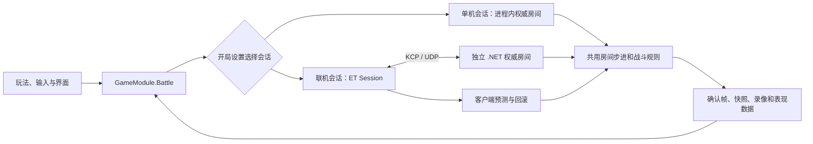

# Project B · 单机开放与 ET10 联机全量适配实施方案

2026-11-17 · 方案 B 补充方案 · 待实施

## 1. 本期交付

**本期玩家只玩单机。开发期同时适配并验收 ET10 的单机、联机客户端和独立服务端。** 单机使用进程内的权威房间，联机使用远端的权威房间。两者共享 ET 逻辑世界、规则、确认帧、快照、录像及 TEngine 的战斗门面。未来开放联机时，项目直接接入已验证的会话与房间入口，继续沿用已落地的战斗模块与玩法代码。

沿用方案 B 的 `GameModule.Battle`、TEngine 生命周期和 ET10 `master` 基线 `743c635dd5b0f6f6bab549c0093382c85f3f8307`。原方案将真实会话、预测回滚与完整重连列为后续里程碑。采用本文时，这几项进入本期工程交付，始终通过内部联调配置验收。现有简易帧驱动和战斗草稿不作为新模块的设计约束。[方案 B 完整实施方案](Project_B-ET10适配TEngine项目模块实施方案.md) · [ET10 固定提交][et10]

| 交付对象 | 本期使用方式 | 完成标准 |
| --- | --- | --- |
| **玩家单机版** | 正常入口只展示单机。断网可开局、暂停、继续、结束、退出重开与回放。启动本地权威房间，网络会话和远端服务保持未启动。 | 打包后的 Player 实际走完单机流程，并通过房间与资源释放、录像与快照恢复检查。 |
| **内部联调版** | 同一套 Unity 玩法通过测试入口加入独立 .NET 房间。使用 ET Session、KCP/UDP 和同版协议，具备预测、回滚、完整重连和日志。 | 两个真实客户端对一个独立服务端，能完成一场对局并验证确认、水位收敛与异常恢复。 |
| **后续联机产品** | 在已有通信与房间能力上增加联机界面、产品身份、接入环境和上线配置。 | 用正式环境复验版本配对、目标平台连接能力、实际对局规模、运营与发布要求。 |

本文的“全量适配”指 **Project B 战斗从宿主到联机可运行的完整技术闭环**。包括 ET 逻辑帧、房间和会话、独立进程、双端生成与构建、预测及恢复。ET 自带的 MMO 地图、商城、任务等按 Project B 的玩法需求单独评估，其编译依赖以实际闭包为准。当前联调默认采用实时权威房间、20 Hz 基线和双客户端。玩法角色、正式步频、人数和上线拓扑仍是可配置或待验收项。

## 2. 必须适配到什么程度

| 能力 | 本期落地内容 | 验收方式 |
| --- | --- | --- |
| **TEngine 门面与宿主** | `GameModule.Battle`、应用 FSM 接线、资源与 Luban 配置、低频 GameEvent 与诊断。一个宿主驱动 ET Update/LateUpdate，同一场次有明确的释放责任。 | 单机与内部联网都走同一门面。主线程能读取两种会话的快照和诊断。 |
| **ET Core 与确定性仿真** | World、Fiber、Entity/System、ETTask、LSWorld、TrueSync、随机状态、业务规则相位。保留 ET 包的固定来源和项目补丁记录。 | Unity 与 .NET 使用同版共享代码，读同一初态、配置和确认输入时逐帧校验一致。 |
| **权威房间和本地会话** | 本地权威部署在 Unity 进程内，远端权威部署在独立 .NET 进程内。两端共用座位、输入封存、步进、终局和快照实现。 | 同一双方输入序列可经本地房间和真实联机房间重演，结果一致。 |
| **联机客户端、传输与协议** | ET NetComponent、Session、KCP/UDP、双端协议生成、版本握手、进入／退出、Ready、时钟对齐、断开与超时。 | 开启内部配置后，真实连接可直接建立并进入对局。测试入口调正常的客户端会话路径。 |
| **预测、回滚和重同步** | 明确预测帧数和步进预算，比较权威输入后重演，历史槽位用完整 Tick 校验。完整恢复传输场次、版本、权威快照及快照后的确认输入。 | 验收刻意制造的预测错误、历史过期、断线恢复、确认重复与乱序，并比对最终权威状态。 |
| **离线回放与跨端版本** | 同一格式录制初态、配置摘要、规则版本和确认输入，间隔保存快照。回放从初态或有效快照开始。 | Unity、独立 .NET 重播和联机权威录像可以横向对照。旧规则或不兼容快照有明确的拒绝结果。 |
| **启动与构建** | Unity Player、独立服务端、协议生成与配置导出使用同一包提交与版本表。验证当前 Unity 6 的 IL2CPP/AOT、MemoryPack、构建宏和 Socket 路径。 | 从干净工作区可重建玩家单机版、内部联调版及服务端，随版本记录构建和启动参数。 |

首个可运行网络拓扑定为 **单进程直连房间**。ET 的 Actor 和房间投递需要在该拓扑走通。Loader、Location、Gate、NetInner、Router、服务发现等逐一登记其编译、原版样例和正式场景依赖。若其中某项进入选定拓扑，就把对应配置、启动和故障路径纳入本期验收。后续按部署拓扑增加跨服、网关与软路由时，接在会话和投递边界，房间规则与业务门面继续复用。[Lockstep 包清单][etDeps] · [ET Session][etSession]

## 3. 运行模式与接线



- **模式归开局会话。** 开局请求确定本地权威或远端权威，场次存续期间保持固定。切换模式需要结束本场并创建新场次。门面接入场次句柄、命令提交、状态查询和退出。单机暂停属于本地会话能力，联机会话另有连接、准备和恢复状态。
- **战斗规则归共享层。** 相同的 `BattleSetup`、`InputBatch` 和 `Snapshot` 合同用于两侧。Tick 0 为已提交初态，房间用同一个权威步进入 `LSWorld.Update()`。输入按席位、序号和子命令稳定排序。帧成功提交后才能发确认、写录像和结算。
- **网络只替换会话路径。** 单机会话将命令值交给进程内房间，房间按相同规则返回确认。联机会话经 ET Session 连接独立服务端，客户端按确认输入推进，在有预算时启用预测。玩法 UI 接收相同的读模型、场次状态和确认事件。
- **服务端职责明确。** 网络回调把包与会话映射成拥有明确所有权的值，再投递给拥有该房间的 Fiber。服务器为席位分配身份、裁定输入并发布确认。网络缓冲池的对象在完成映射后按原生 ET 所有权释放。
- **产品入口由构建配置控制。** 单机发行配置装配本地会话，内部联调配置装配远端会话和诊断入口。联调配置默认只连接开发或局域网地址。产品开放联机时增加正式联机会话入口、授权配置与服务端地址。若发行构建裁剪了未用网络代码，切换联机配置需要重新构建 Player。
- **Unity 宿主归 TEngine。** 项目中由现有 Update/LateUpdate 调度 ET，退场先收尾场次，应用退出时再关闭 ET World。YooAsset 管理视图资源，Luban 提供同版规则值，GameEvent 在确认后传递业务状态，UI 用 AddUIEvent 订阅。[方案 B 的门面与生命周期](Project_B-ET10适配TEngine项目模块实施方案.md#4-tengine-门面与生命周期)

```text
打开战斗(request)
    用构建配置检查可用模式
    根据 request.Mode 创建本地权威会话或远端会话
    await 会话准备与 Tick 0 确认
    返回 BattleHandle 和同一套战斗读模型

提交命令(handle, command)
    会话送达本地权威房间或远端权威房间
    房间封存输入 → 运行共享规则 → 提交 Tick → 发布确认
    门面按场次和 Tick 更新读模型，发布确认后的业务事件
```

## 4. 为后续开放联机预先固定的合同

| 合同 | 本期约定 |
| --- | --- |
| **统一开局** | 由场地与规则配置生成开局数据，包含场次、地图 ID、种子、席位、TickRate、规则版本和配置摘要。配置与 Unity 资源引用分别装配，服务端只消费值。 |
| **统一输入** | 玩法只提交逻辑命令。单机由本地会话映射席位，联机由服务端根据已接入会话确认席位。一次性动作只消费一次，持续输入缺失的替代规则显式编码。 |
| **统一提交** | 每帧只有权威房间能够提交结果。客户端可展示预测状态，发奖、存档、终局和其他不可逆行为用已确认结果触发，按场次、帧号和事件序号去重。 |
| **统一恢复点** | `Snapshot(t)` 表示 Tick t 提交后的完整状态。恢复时应用快照，再连续重演 t+1 起的确认帧。包含决定后续行为的实体、规则配置、ID/RNG、计时任务与技能状态。 |
| **统一版本** | 网络握手绑定协议、规则、配置摘要和步频，录像与快照记录各自格式版本。共享程序集与生成物按版本一起构建，已开房间固定用开局时的版本。 |
| **统一前端读模型** | 使用稳定的场次 ID、UnitId 和事件 ID 更新视图。预测回滚或全量恢复后依据最新状态重新关联，表现层引用稳定值。 |

单机活动或单机存档继续归本地游戏。未来联机新建由服务器裁定的会话。把进行中的单机对局迁移成联网房间、正式账号与单机存档共享经济等属于额外业务需求。

## 5. 实施顺序与每步验收

以下步骤属于同一批工程交付。内部网络验收可以在单机玩法样例可用后开展，作为单机发布前的基础设施验收。

### 1. 固定源码、程序集和模式边界

- [ ] 把基线、包闭包、协议与配置生成、上游补丁及第三方来源落到清单。保留 ET10 的运行底座，明确 TEngine 负责的宿主接点。
- [ ] 建立玩家单机、内部联调和服务端的构建配置。定义共享合同以及 `GameModule.Battle` 的模式选择与场次生命周期。

```text
锁定 ET10 Git 提交 → 分析编译、注册和运行依赖 → 建立 Unity 与 .NET 白名单
                    → 同一份共享源与生成物 → 三种构建
```

**验收标准。** 同一提交的源码和生成物可重建。单机和联调配置的启动入口及服务清单可独立核对。

### 2. 接入单机权威房间和共享战斗

- [ ] 用 TEngine 宿主启动 ET，接入离线会话、暂停、继续、结束、重开和视图。配置、资源和回调按场次清理。
- [ ] 使用同一套权威房间实现启动、输入、固定 Tick、终局、快照与回放。以部署、移动、命中和伤害组成一场可验收样例。
- [ ] 提供纯 .NET 重播入口，先验证共享规则和序列化可独立于 Unity 运行。

```text
本地开局 → 本地权威房间 → 逐帧执行共享规则 → 写确认录像
同一录像 → Unity / .NET 重演 → 核对 Tick 摘要和终局
```

**验收标准。** 玩家配置断网可完整游玩样例，一局退出和重开可观测到房间与场次资源释放。Unity 与 .NET 对同一录像得出同一结果。

### 3. 同批接入真实联机

- [ ] 导入 ET Session 和 KCP，完成独立 .NET Host、内部客户端入口和双方协议生成。实现加入、Ready、初态、逐帧确认、终局和健康检查。
- [ ] 将客户端预测、回滚和完整重连接入相同读模型。处理窗口越界、重复确认、短断线和确认补齐。完整快照覆盖重连后的后续帧结果。
- [ ] 从同一份玩法实现跑双客户端真实 UDP，保存服务端与客户端日志和可重演录像。

```text
内部联调入口 → ET Session → .NET Room → 连续确认帧
差异 → 恢复快照 → 重演确认与有效预测 → 校验后提交视图
断线恢复 → 完整权威快照 → 追确认帧 → 回到正常会话
```

**验收标准。** 两个客户端在开发网络完成一局。插入预测偏差、延迟和短断线后，双方最终确认帧和服务端摘要一致。具备问题日志和独立重播素材。

### 4. 通过单机发行验收并保留联机开启流程

- [ ] 用目标单机 Player 验收冷启、断网、暂停、切后台、退出、重开和回放。检查实际运行没有启动联机会话或监听。
- [ ] 将联调入口与服务端的构建命令、协议版本、配置导出、私有地址和验收录像一并记录。
- [ ] 用同一发布候选版本完成内部联调回归。记录平台、配置、已测对局规模和网络异常覆盖。

```text
同一提交 → 单机 Player → 断网验收
         → 联调 Player + 独立 .NET App → 真实 UDP 与恢复验收
         → 记录将来开启联机所需的入口、制品与配置
```

**验收标准。** 两条路径都有可启动产物和可重复的验收记录。单机 Player 通过日常入口游玩。内部联调 Player 直接连接同版服务端，玩法、地图数据、快照和回放使用现有共享实现。

## 6. 将来开放联机需要做的工作

1. 接入正式的联机入口、房间或匹配界面和产品身份系统，调用已经实现的加入／退出与恢复接口。
2. 部署同版独立服务端，配置正式连接地址、运维和授权。按目标平台及连接环境决定是否需要 ET 的 Gate、Router 或其他接入拓扑。
3. 开启联机产品配置，发布配套客户端，并按正式人数、地图和目标设备重新验证步进、预测窗口、断线恢复和性能。

研发上的“直接增加联机”以 **已存在可运行的客户端与服务端** 为准。更换联机产品入口后，业务仍提交同一种命令，仿真仍使用同一规则和快照合同。新增玩法若依赖 Unity 物理、浮点避障或 Unity Jobs，需要在纳入联机规则时验证可重演性。每个新增系统都应能走 Unity 和 .NET 的同一确认帧链路。

本文为新增实施提案。以上移植与运行验收均待执行。

[et10]: https://github.com/egametang/ET/commit/743c635dd5b0f6f6bab549c0093382c85f3f8307
[etDeps]: https://github.com/egametang/ET/blob/743c635dd5b0f6f6bab549c0093382c85f3f8307/Packages/cn.etetet.lockstep/package.json
[etSession]: https://github.com/egametang/ET/blob/743c635dd5b0f6f6bab549c0093382c85f3f8307/Packages/cn.etetet.core/Scripts/Model/Share/Message/Session.cs
