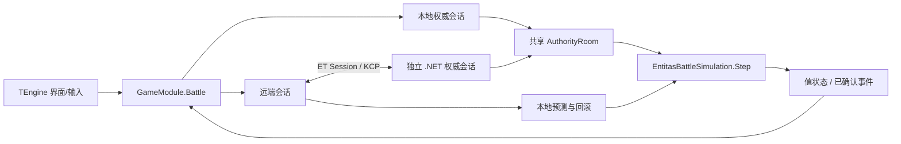

# Project B · ET10 源码迁入与 Entitas 战斗联机分步执行手册

2026-11-17 · 方案 B · 施工提案 · 所有实施项待执行

**最终落点：把 ET10 的固定逻辑帧、房间及联机源码拆进 Project B；用 Entitas 1.14.1 编写并保存战斗逻辑；用 TEngine 管应用生命周期、资源和表现。** 本期玩家只开放单机，工程同批交付可运行的独立 .NET 权威服、两个 Unity 联机客户端、预测回滚及完整重连。项目中的战斗和网络源码从第一天就按最终目录维护，无需安装原 ET UPM 包，也不建立 Project B 的共享 UPM 包。

本手册把此前的 [TEngine 模块实施方案](Project_B-ET10适配TEngine项目模块实施方案.md)、[单机开放与联机全量适配](Project_B-ET10单机开放与联机全量适配实施方案.md) 和 [Entitas 接入方案](Project_B-ET10与Entitas战斗逻辑适配方案.md) 合成一条实施顺序。施工以本文的目录、数据合同、分步清单和验收为准；前几份文档和 [ET10 源码调研](Unity%20ET框架全量源码调研与逻辑帧驱动.md) 用于追溯背景。

## 1. 完成定义与当前基线

| 交付物 | 施工结束时要拿到什么 |
| --- | --- |
| 玩家单机 Player | 正常菜单能开一场本地权威战斗，断网可冷启、游玩、暂停、退出、重开和回放。该模式不创建 ET 网络会话、不监听端口。 |
| 内部联机 Player + 独立 .NET 权威服 | 两个单独启动的 Unity Player，经实际 UDP/KCP 进入同一服务端房间，完成一场战斗。在延迟、错误预测和断线后恢复并继续，权威状态可核对。 |
| 共享源码与工具 | Unity 和 .NET 从 `BattleModule/Shared` 编译同一份 Entitas 规则、帧逻辑与生成物。可从干净工作区还原 Jenny、协议、MemoryPack 等构建链。交付源迁入清单、构建参数、目标平台验收记录与重演录像。 |

**已选基线。** ET10 官方 `master` 固定为 [`743c635dd5b0f6f6bab549c0093382c85f3f8307`][et]，不跟随浮动分支；作者已同意迁移，随文件保留来源及声明，第三方库独立记录。Project B 当前 Unity 版本为 `6000.0.69f1`，ET10 上游基线是 `2022.3.62f3`。独立服务端以 ET10 的 `.NET 8` 工程为迁移起点，首个目标平台与最终部署运行时由实际构建、部署决定。Entitas 固定 [1.14.1][entitas]。

**仓库现状。** `GameApp.Entrance` 已接热更启动，`StartGameLogic` 激活 `FrameManager`，后者用普通 `IUpdate` 广播应用级 `TickAdvanced`。它不是新战斗房间的时钟；保留其现有调用方，新房间不订阅这个 Tick。`SingletonSystem` 已能把 `IUpdate` / `ILateUpdate` 注册到 TEngine 的 UpdateDriver。`GameModule.cs` 尚无战斗门面。`Jenny.properties` 和 `EntitasGen.csproj` 仍用旧 `Game` / `EntitasDemo` 配置，本体工具目录 `UnityProject/Jenny/` 被 Git 忽略，不能假设干净工作区已有 CLI 和插件。[GameApp](../../Assets/GameScripts/HotFix/GameLogic/GameApp.cs) · [FrameManager](../../Assets/GameScripts/HotFix/GameLogic/Module/Frame/FrameManager.cs) · [SingletonSystem](../../Assets/GameScripts/HotFix/GameLogic/SingletonSystem/SingletonSystem.cs) · [Jenny 配置](../../Jenny.properties) · [Jenny 解析工程](../../../Tools/Entitas/EntitasGen/EntitasGen.csproj)

**本期能力范围。** 完整迁入所选直连房间拓扑需要的 ET 运行时、房间、帧同步、会话/KCP、序列化与编译生成。ET 的 Gate、Location、Router、NetInner、服务发现按依赖逐项归类；若确有必需服务，迁入并验收它的配置和启动，直连能够替代的示例依赖从调用处移除。上游 MMO 登录/匹配示例、ET 的战斗 ECS、美术和第二套 YooAsset/Loader 启动不进入本期运行。正式账号、匹配、跨进程路由和上线运维留到开放联机前；进行中的单机对局不迁成联机房间。

## 2. 最终目录、程序集和新增文件

路径相对仓库根。以下是拟创建的文件，不是当前已落地代码。已有项目模块和关联目录只做必要接线。

```text
UnityProject/Assets/GameScripts/
  Infrastructure/EtRuntime/                   # ProjectB.EtRuntime.asmdef，Unity AOT
    Core/                                     # World、Fiber、ETTask、时间、注册、Entity 基础
    Transport/                                # NetComponent、Session、KService/KChannel、KCP、UDP 适配
    Serialization/                            # 消息元数据和 MemoryPack 的运行接缝
    Math/                                     # 从 TrueSync 提取的共享定点数和 RNG
  HotFix/GameLogic/                           # 现有 GameLogic.asmdef
    GameModule.cs / GameApp.cs                 # 增加模块门面、启动与停止接线
    Module/BattleModule/
      IBattleService.cs / BattleService.cs
      Host/EtBattlePump.cs                     # 唯一 TEngine → ET Update/LateUpdate
      Client/LocalBattleSession.cs / RemoteBattleSession.cs
      Presentation/BattleViewBridge.cs         # UnitId、显示插值、资源、确认事件
      Shared/
        Contracts/                             # BattleSetup、InputBatch、Snapshot、ReadModel
        Simulation/
          Components/ / Generated/ / Systems/  # Entitas Battle Context，生成物单一输出
          EntitasBattleSimulation.cs / BattleSnapshotCodec.cs
        Lockstep/                              # AuthorityRoom、RoomClock、FrameHistory、预测、回滚、回放
        Protocol/Generated/                    # ET 消息类型、Opcode 表，可跨端编译
Tools/
  ProjectB.Server/                             # 建议 .sln，Runtime、Battle、Host、ReplayCli 各 csproj
  ProjectB.CodeGen/                             # 协议 Schema、Opcode 清单、生成入口、迁入清单
  Entitas/EntitasGen/                           # 复用现有解析工程，改扫正式 Battle 组件
```

| 编译单元 | 明确的依赖方向与落地动作 |
| --- | --- |
| Unity `ProjectB.EtRuntime`（新 asmdef） | 只编译基础设施，允许迁入的底层 unsafe 路径按平台启用，统一 MemoryPack 运行库和版本。不引用 `GameLogic`、YooAsset、Luban 或 Unity 业务；需要平台能力时由宿主提供实现。 |
| Unity `GameLogic`（现有 asmdef） | 显式引用 `ProjectB.EtRuntime`；复用已有 Entitas Runtime/Attributes 插件引用并核对导入平台。`BattleModule/Shared` 与 Unity 门面同属现有 `GameLogic`，不增加热更 DLL 名。现有 `UpdateSetting.asset` 热更列表为 `GameProto.dll`、`GameLogic.dll`，新增 AOT 基础设施不加入热更列表。对实际使用的泛型、生成 formatter 与注册类型检查 AOT 补充和裁剪保留。 |
| `.NET` `ProjectB.EtRuntime.csproj`、`ProjectB.Battle.csproj` | 用 `Compile Include` 取仓库内的 `Infrastructure/EtRuntime` 可跨端路径和 `BattleModule/Shared` 子目录，不把 Unity 生成的 `GameLogic.csproj` 或 `GameLogic.dll` 当服务端依赖。独立引用匹配的 Entitas 运行时与依赖，传输与生成物版本一致。 |
| `.NET` `ProjectB.Server.Host.csproj`、`ProjectB.Server.ReplayCli.csproj` | 引用上述两个 `.NET` 项目。前者持有主循环、UDP 监听、场次注册、会话到席位及关停；后者读取 `Setup + Snapshot + ConfirmedFrames` 重演，不建立网络。 |

程序集边界以项目 asmdef 和 csproj 为准，不照抄上游 `MainPackage.txt` 的构建收集规则。ET 上游的 `ET.Core.csproj` 会读 `MainPackage.txt` 再从 `Packages` 收集 Core 源；本项目显式列文件或受控子目录。ET 运行时需要发现的热更类型，由 `GameApp.Entrance` 装配时传入已加载程序集或已生成的注册表。涉及反射扫描、生成器检查程序集名、包名常量、Obfuz 或 IL2CPP 时逐项建立注册清单，不能把缺注册当成“未调用就不用迁”。[上游 ET.Core.csproj][et-core-build] · [Unity 程序集][unity-asm] · [MSBuild 选择编译文件][msbuild] · [项目 UpdateSetting](../../Assets/TEngine/Settings/UpdateSetting.asset)

## 3. ET10 文件搬迁表

下表的源路径相对于固定提交，简称 `CORE = Packages/cn.etetet.core`、`LS = Packages/cn.etetet.lockstep`。它是首批可点名的入口与闭包种子。M0 要对每个实际迁入 `.cs`/库补出精确文件、来源与依赖，表中的目录不表示全目录无条件复制。

| 上游文件或入口 | 判定与项目落点 | 每项必须处理的调用或依赖 |
| --- | --- | --- |
| `CORE/Scripts/Core/Share/World/World.cs`、`Singleton.cs`、`Fiber/FiberManager.cs`、`Fiber/FiberInit.cs`、`TimeInfo/TimeInfo.cs`，以及 `Scripts/Core/Share/ETTask/`、`Entity/` | **提取**至 `EtRuntime/Core/`，选择 World、Fiber、调度、Entity 基础及实际依赖。 | 区分全局单例和 Fiber 内单例，显式登记启动、注册与释放顺序。一个进程一个 ET World，房间可各有 Fiber；离线房间不装 NetComponent。若复用 `CodeTypes` 或生成的系统类，登记扫描来源和保留类型。 |
| `CORE/Scripts/Core/Share/Network/{KService,KChannel,AService,AChannel,IKcpTransport,MessageSerializeHelper,OpcodeType,OpcodeRangeDefine}.cs`、`Network/Kcp/`；`Scripts/Model/Share/Message/{NetComponent,Session,MessageSessionDispatcher}.cs`；`Scripts/Hotfix/Share/Message/{NetComponentSystem,SessionSystem}.cs` | **提取并适配**至 `EtRuntime/Transport/`、`Serialization/`。补被直接调用的 UDP 实现、包缓冲、超时、分派和消息注册。 | `NetComponentSystem.Awake` 接入 `IKcpTransport`，建立 `KService`。直连走 `Create(realIPEndPoint)` 分支；用项目读消息接线把已解码包送到会话/房间。保留 Session 生命周期、超时、关闭与 RPC 回调清理。按 ET 的消息所有权复制值后再回池。路由版重载及旧 Gate 分派仅按实际拓扑保留。 |
| `CORE/Scripts/Core/Share/Serialize/MemoryPackHelper.cs`；`Packages/cn.etetet.memorypack/DotNet~/ET.MemoryPack*` | **提取实际使用的运行库及生成链**。运行端接入 `EtRuntime/Serialization/` 或必要的同版本第三方库；生成工具在 `Tools/ProjectB.CodeGen/` 管理。 | Wire DTO 使用同版 MemoryPack formatter。核对特定 fork 的实际依赖和声明，Unity 与 .NET 不各装一套不同版本；避免类型冲突。战斗状态规范编码由项目拥有，不能序列化活的 Entitas 世界。 |
| `Packages/cn.etetet.truesync/Scripts/Core/Share/{Fix64,TSMath,TSRandom,TSVector2}.cs` | **提取**实际使用的定点和 RNG 依赖至 `EtRuntime/Math/`。 | 先确认类型所需查表、舍入、溢出和 raw 值编码。快照须能恢复完整随机算法状态；只保存初始 seed 无法恢复已消耗的随机序列。若上游 RNG 状态不便导出，项目加窄适配或选明确可保存的共享 RNG，实现两端同算法。 |
| `LS/Scripts/Model/Share/{Room,FixedTimeCounter,FrameBuffer,OneFrameInputs,Replay}.cs`；`LS/Scripts/Hotfix/Share/RoomSystem.cs` | **改成项目代码**。`Room` → `AuthorityRoom`/客户端房间；`FixedTimeCounter` → `RoomClock`；`FrameBuffer` → `FrameHistory`；`RoomSystem.Update` → 单一提交链。落 `BattleModule/Shared/Lockstep/`。 | 去掉 `LSUnitComponent`、`LSWorld` 初始化与序列化。移植时钟公式和历史的环形思路，补完整 Tick 标签、分别保存权威输入/预测输入/状态。上游在步进前保存快照；项目改为步进、清理、成功提交后保存，并统一回滚偏移。 |
| `LS/Scripts/Hotfix/Server/Room/{FiberInit_RoomRoot,LSServerUpdaterSystem}.cs`、`…/Server/Map/{FrameMessageHandler,RoomMessageHelper}.cs` | **迁机制，改宿主**。权威步进与封帧在共享层，启动和消息投递在 `.NET` Host 或 Unity 本地会话。 | 上游权威 Updater 先递增和广播，再 `room.Update`；本项目先执行并提交再广播。补服务端会话绑定席位、一次性与持续输入的分别封存、乱序/重复处理，禁止直接信任客户端身份或战斗结果。 |
| `LS/Scripts/Hotfix/Client/{LSClientUpdaterSystem,OneFrameInputsHandler,LSClientHelper,LSReplayUpdaterSystem,Room2C_CheckHashFailHandler}.cs` 和 `…/Server/Room/{C2Room_CheckHashHandler,G2Room_ReconnectHandler}.cs` | **迁控制流**到 `Shared/Lockstep/` 与客户端、服务端网关。 | 权威帧用显式 Tick 而不是“收到就 AuthorityFrame++”。换掉 `GetLSWorld`、世界替换和旧 Hash。`JumpReplay`、回滚和重连都通过项目恢复接口。上游重连只给帧号与单位位置等不足以继续算，替换为完整快照协议。 |
| `LS/Proto/LockStepOuter_C_11001.proto`、`LockStepInner_S_21001.proto`；`Packages/cn.etetet.proto/DotNet~/Proto2CS.cs`；`Packages/cn.etetet.sourcegenerator/DotNet~/ET.SourceGenerator/` | 协议 **参考后重定义**。工具 **提取与改路径** 到 `Tools/ProjectB.CodeGen/`。Roslyn 只配置实际所需生成器与分析规则。 | 核对 `Proto2CS` 包扫描、初始 Opcode 与消息顺序、生成输出和对 Mongo 的强制调用。为 Project B 建项目路径入口和显式 Opcode 清单；在 Unity 与 .NET 核对实体系统、MemoryPack 的生成与注册。 |
| `Packages/cn.etetet.lsentity/`；`Packages/cn.etetet.loader/Scripts/Loader/Client/{Init,CodeLoader}.cs`；ET Demo 表现、Gate/Router 样例、原打包脚本 | **原版行为参考**。整套 `LSWorld/LSEntity`、原 Init/CodeLoader、UI、美术以及上游 UPM 描述不进入本项目战斗。 | 只从上游初始化顺序收集所需服务。保留 TEngine 既有 Loader、Config、YooAsset。直连首期按实际引用处理 Gate/Location/NetInner/Router/discovery，若为必要依赖则按文件迁入；其正式部署不是首期验收拓扑。 |

关键源码：[RoomSystem][et-room] · [FrameBuffer][et-buffer] · [客户端回滚][et-client] · [权威 Updater][et-server] · [示例重连][et-reconnect] · [NetComponentSystem][et-net] · [协议生成器][et-proto-gen]。上游分析建立在固定 Git 树和关键源码上；编译闭包和生成配置要到 M0/M1 产出，不能以目录存在替代实际可构建的证明。

## 4. 固定合同：战斗门面、帧号和 ECS

### 4.1 谁持有状态，谁推进



`IBattleService` 的最小门面是 `StartOfflineAsync(BattleStartRequest, ct)`、内部构建的 `JoinOnlineAsync(OnlineJoinRequest, ct)`、`SubmitCommand(BattleHandle, BattleCommand)`、`TryGetReadModel(BattleHandle, out model)`、`SetOfflinePaused(BattleHandle, paused)`、`StopAsync(BattleHandle, ct)`。所有客户端入口走同一套 `BattleHandle`（场次、代次）和只读模型。Unity 侧异步用 UniTask，比赛 Tick 内无 IO 或 await；网络消息和异步结果排到房间线程再应用。服务端通过 .NET 自己的宿主驱动同一份权威源码。

- `EtBattlePump` 只注册一次 `IUpdate/ILateUpdate`，负责 ET 的时间更新和 Fiber Pump，查核 `FiberManager` 实际注册的调度器，防止 Unity/ET 各自驱动重复。应用 FSM 持有会话进入、后台和退出的请求，不直接执行战斗系统。预测、权威、录像各自有模拟实例与时钟，不共享 Entitas 全局 Context。
- 本地按游戏规则暂停房间时钟，ET 宿主保持 Pump。恢复时重锚 `RoomClock`，保留下一帧前应等待的剩余时间；暂停期间没有补帧。联机退后台不暂停服务器；回来依据延迟/断线状态追帧或重连。停止先阻断新输入、取消关联资源请求，等待房间清理完成，再释放会话和 Pump。应用退出的同步清理可作兜底，不能依赖退出回调启动需要若干未来帧的异步释放。
- 视图只拿值和 `UnitId`。按 generation 丢弃迟到的资源/登录结果，错误归属的资源按 TEngine 规则释放。低频开局、离场、连接状态走 `GameEvent`，UI 用 `AddUIEvent`；是否采用接口事件，要先核对当前注释掉的 `GameEventHelper.Init()` 和项目注册。逻辑系统按固定顺序写组件，表现读模型可在渲染帧插值。

### 4.2 帧合同与最小战斗实现

| 值合同 / 水位 | 字段与规则 |
| --- | --- |
| `BattleSetup` | `BattleId/Generation`、`MapId`、`RuleVersion`、`ConfigDigest`、`SnapshotVersion`、种子、确定性的初态/配置值、已排序席位。默认联调参数 20 Hz（50 ms/Tick）、两个客户端；正式值待量测。Unity 从 Luban 投影，服务端用同一格式的值导出，Unity 资源路径与对象引用不进规则配置。 |
| `BattleCommand` / `InputBatch` | 单条含 `TargetTick`、`CommandSeq`、`Kind`、定点/整数值；服务端从 Session 解析席位。封帧后批次不可改，排序键 `(SeatId, CommandSeq, SubIndex)`。持续轴向可填上一确认的有效输入，一次性部署/施法缺失则为空。输入在允许的未来窗才入队，已提交 Tick 的输入拒绝；相同 `(席位, 命令序号)` 重投不重复执行，接受、过期、消费及清理策略归房间。 |
| `CommittedTick` | 只属于权威房间。Tick 0 是已提交初态。第 k 帧要完成 ECS 执行、清理、规范状态和历史写入，才更新水位、确认广播、录制与终局。网络发送失败可以重送已提交确认，不能重复演算。 |
| `ReceivedConfirmTick` / `AppliedConfirmTick` / `PredictedTick` | 客户端分别记录收到的连续权威确认头、已计算并核对的确认头、当前预测头。缺帧保留等待，重复且内容一致可丢弃，重复且冲突保留诊断并转恢复。预测快照与权威确认槽独立标记。 |
| `Snapshot(t)` / `StateHash(t)` | t 的提交后状态和对应规范字节摘要。包含稳定业务字段、规则/配置、逻辑 Tick、ID 分配器、RNG、延迟任务、Buff/技能计时、会影响后续 Tick 的队列。未提交的外部网络包留在运行态队列；可影响下一步的持续输入语义必须能从快照或权威基线恢复。哈希不纳入连接 ID、本地时钟、池容量或 CLR 实例。 |

模拟第一段验收样例采用短直线路径和定点坐标，避免让 RVO2、Unity Physics 或浮点导航阻塞迁移。正式玩法要接入这些能力时，先验证目标 Player、服务端的逐帧确定性和可恢复性。第一批组件按正式 `Battle` Context 生成：`UnitId`、`Seat`、`Position`、`MoveIntent`、`Health`、`AttackCooldown`、`Dead`，另含 `BattleState`、`PendingTask` 等必要战斗状态。攻击/伤害请求单独入队，不能用对同一单位多次 `ReplaceDamageRequest` 来承载逐笔输入。Root Systems 固定顺序：输入解码与部署 → 移动 → 攻击/到期任务 → 伤害与死亡 → 胜负 → Cleanup。按 `UnitId` 遍历会影响结果的集合，不依赖 ECS 枚举和池子的自然顺序。用生成 API 写组件，保留稳定业务 ID，不让 `creationIndex` 或 Matcher 槽位进入持久化格式。[Entitas 生命周期](../../.agents/skills/entitas-dev/references/systems-and-lifecycle.md)

```text
AuthorityRoom.Advance(now):
    k = CommittedTick + 1
    若房间未 Running 或 k 未到期，返回
    batch = SealInput(k)                    # 确定性填缺和排序
    尝试：Step(k, batch) → Execute → Cleanup → EncodeState(k)
         History.Commit(k, batch, stateBytes, hash, events)
    失败：隔离脏实例，标记故障；水位不前进，本帧不发送确认
    成功：更新 CommittedTick，录入录像，发布确认和正式结果
```

`RoomClock` 只决定何时到期，Tick 内只吃整数帧号和固定步长。宿主有每轮补步上限，保留欠步并报告持续过载，不跳过战斗帧。战斗 `Step` 和帧提交同步完成；非模拟线程只能入队。首期采用固定规则版本运行一局，规则更新通过离场后重新匹配同版服务端生效。

## 5. 快照、对账、回滚和重连的实现细节

### 5.1 定义唯一的状态编码

首版 `BattleSnapshotCodec` 显式写入版本化标头和组件值，固定整数宽度/字节序、组件类型的稳定编号及字段顺序，按实体业务 ID 排序。字符串及集合若进入状态，要定义长度、编码和排序。保存 Entitas 的数据，不保存 Context、Group、Collector、系统实例或 Unity 引用。首版以规范字节的 SHA-256 对账；如果实测要缩减每帧传输，另定义摘要版本和采样频率。候选快照先校验大小、版本、场次、摘要、唯一 ID 和引用，再开放给运行实例。Wire DTO 可用 MemoryPack 封装这些字节，Wire 序列化不决定状态的规范顺序。

首批覆盖表至少列 `单位身份与所有权/坐标/意图/生命/冷却/死亡标记`、`局级计数与胜负`、`计时任务`、`持续输入基线`、`随机流状态`、`下一业务 ID`。每个新增持久战斗组件要明确“写进快照”或“由哪些已编码字段推导”。系统如果在私有字段缓存一个会改变结果的计数，要迁入该覆盖表或能纯重建。

恢复使用新的世界实例。按稳定 ID 先创实体，再补组件和引用；用正式 Context 工厂初始化必要的索引。如果生成索引注册在 `Contexts` 构造路径中，必须复用那条接线。状态注入完成再装配常驻系统，区分新开局初始化与恢复绑定；不会把导入的组件新增通知当作命中、生成或奖励。恢复成功才替换旧世界；原实例停用 Collector、TearDown，再释放 retain、Context 和缓冲。模拟世代变化后，视图由新的快照按 UnitId 重新关联。

### 5.2 环形历史和三条恢复路径

`FrameHistory` 的每个槽有 `BattleId/Generation + AbsoluteTick` 标签，并区分权威批次、已用预测批次、状态摘要和恢复点。读取标签不匹配就是历史不存在，不能从取模位置读另一轮数据。预测窗口内初版保存完整逐 Tick 快照；录像只周期保存快照并记录全部确认批次。保留的历史至少覆盖最大预测领先和恢复到分歧前所需的帧。联调先用小窗口可配置值，内存再按 `单点峰值字节 × 槽位数 × 同时存在的实例` 测算。

```text
OnConfirmedBatch(k, batch, authoritativeHash):
    按场次/代次/Tick 入权威缓冲；只推进连续 ReceivedConfirmTick
    从 AppliedConfirmTick + 1 顺序消费
    若 k 尚未预测：用权威输入步进 k，再核对权威摘要
    若 k 已预测且所用输入与摘要一致：提升已应用确认水位
    若使用的输入不同：取 Snapshot(k-1) 或更早有效恢复点
        在隔离世界重演连续权威帧，核对每个可用的权威摘要
        重建分歧后的预测槽；按当前确认输入和仍有效本地输入再预测
        整段成功才换视图并推进已应用确认水位
    若历史缺失、同输入仍无法得到正确摘要、权威流出现冲突：请求重同步
```

回滚期间不发音效、外部事件、结算或存档。确认事件去重键为 `(BattleId, Tick, EventIndex)`，一次性玩法命令和外部事件分别去重。普通联网可能出现预测结果变化，UI 从重算后的只读模型归并，已确认的奖励由权威事件出口控制。录像跳转走 `Restore(快照帧) → Apply(直到目标帧的确认批次)`，始终关正式副作用。

```text
Reconnect(request):
    服务端校验凭据、版本和席位，撤销旧连接对该席位的绑定
    房间线程选定 Snapshot(t) 与当下连续权威帧的截止点 u
    返回恢复代次、快照、摘要、确认帧 t+1..u；随后继续送 u+1 起的帧
    客户端暂存新确认，停止预测，校验并创建恢复世界
    从 t 追齐连续确认、校验状态后重绑视图，重开预测窗口
    客户端只重投仍在未来输入窗且未被确认消费的命令
    恢复失败保持不同步状态，明确重试或退出
```

首版可直接发最新已提交快照，降低补帧量；快照大于传输预算时，使用带恢复代次、总大小、序号和整段摘要的有界分块，并有过期清理。录制战斗至少输出 `Setup + 初态 + 按 Tick 排列的确认批次及摘要 + 稀疏快照`。保存故障现场时给出第一处差异的 `Tick/UnitId/组件字段`，避免只留下不同的哈希值。

## 6. 协议与三个生成入口

### 6.1 内部联机协议

复用 ET 的传输与 Session 机制，相同握手校验通过后才加入房间。采用 Project B 自己的 Schema；不需要兼容 ET Demo 客户端。以下消息为拟定的接口合同，具体编号写入仓库 `Tools/ProjectB.CodeGen/Protocol/opcodes.json`，处于 ET 外网允许范围，并在 M0 对底座已启用消息核查冲突。[ET 外网 Opcode 范围][et-opcodes]

| 通信 | 载荷与行为 |
| --- | --- |
| `C2S_Hello` / `S2C_Hello` | 协议版本、规则与快照版本、ConfigDigest、功能位。错误显式区分连接成功但版本不兼容。超时要能释放会话。 |
| `C2S_JoinRoom`、`C2S_Ready` / `S2C_StartBattle` | 内部房间凭据由服务端映射到席位。所有需要的席位准备后发同一 Setup、Tick 0、起始时钟同步信息。首期 `.NET` 一个进程直连，可用开发房间号与开发凭据，不绑定正式账号。 |
| `C2S_SubmitInput` / `S2C_InputRejected` | 场次与代次、目标 Tick、CommandSeq 和有界命令数据。席位从 Session 得知。Tick 越窗、内容非法、过期、玩家不在本房等返回明确结果。重复命令不产生第二次玩法执行。 |
| `S2C_ConfirmFrame` / `C2S_ReportStateHash` | 场次/代次、显式 Tick、封存后的有序输入、权威摘要。客户端只报告已经复算的确认 Tick，不上报为权威结果。服务器保存窗口，能定位分歧并发重同步指令。 |
| `C2S_Resume` / `S2C_Resync`、`S2C_EndBattle` | 恢复凭据、已应用确认头和版本；恢复响应带完整 Snapshot、快照帧号和后续连续确认。终局含提交 Tick、结果 ID，重送不会重复结算。 |
| `Ping/Pong`、退出与服务端关闭通知 | 使用 Session 保活或明确的心跳，保存时钟采样、RTT 和失联原因。服务端关停先停止接收新房，再关连接和 World。 |

客户端默认在联调先启用只消费确认帧模式，通过后再开预测。允许预测的输入有明确策略：本地用已排队的有效命令；远端持续输入估为最近确认值；远端一次性输入不猜。目标 Tick 由服务端时间基线加输入提前量计算。预测步数、最大重演步数与每轮补步量均由可覆盖的联调配置控制。

### 6.2 Jenny、Proto2CS 与编译期生成分别实施

| 入口 | 修改与产物 |
| --- | --- |
| **Jenny 1.14.1** | 改 `UnityProject/Jenny.properties`：`Contexts = Battle`（实际键 `Entitas.CodeGeneration.Plugins.Contexts`），`Jenny.Plugins.TargetDirectory = Assets/GameScripts/HotFix/GameLogic/Module/BattleModule/Shared/Simulation/Generated`。改 `Tools/Entitas/EntitasGen/EntitasGen.csproj` 扫 `Shared/Simulation/Components/**/*.cs`，纳入属性与值类型依赖，排除运行生成目录和 Unity 表现。引导期手写组件可用 `[Context("Battle")]`，免依赖未生成的 `[Battle]`；旧 `GameAttribute.cs` 从生成工程移除或按其他真实调用归档。先生成 `BattleContext/Entity/Matcher`、索引和组件 API，再接 Systems。初期显式装系统树，关闭依赖 Unity 的观察器生成，审查启用事件/清理生成时的 `Feature` 依赖。 |
| **ET Proto2CS** | 提取有用解析与模板，把 `Proto2CS.Export(HashSet<string> packages)` 的包扫描换成 `schemaPath + opcodeManifest + outputDir`。去掉只为上游构建保留 Mongo 的调用，若独立拓扑无 Mongo 需求，不为该调用引入数据层。`opcodes.json` 固定消息 ID，生成器检查重号、范围与删除/重排造成的变更。共用消息写 `Shared/Protocol/Generated`，握手与恢复阶段的处理器放相应宿主。产物与 Schema 一起版本化；在临时输出生成并比较，匹配后再替换专用目录。 |
| **Roslyn / MemoryPack** | `ETSystemGenerator` 等只保留底座在用的功能，必要时调整对 ET 上游程序集名或目录的检查，不把旧 ET `Model/Hotfix` 分层约束套到 Entitas 业务。Unity 使用兼容该 Editor Roslyn 的 Analyzer 路线，.NET 通过 Analyzer 引用接入。确认 wire 消息、formatter、EntitySystem 与 Opcode 生成/注册。相同逻辑只采用一种生成方式，避免一端既包含 C# 生成物又重复启用同一生成器。上线验收必须覆盖真实 IL2CPP Player。 |

落地后的候选操作如下。Jenny CLI 与插件应通过同版来源或固定构建产物准备，仓库应有版本及获取步骤；以下命令本次未执行。`ProjectB.CodeGen` / `ProjectB.Server` 命令是计划实现的入口与参数，不是当前已有命令。

```powershell
# Jenny：此段在 UnityProject/ 下执行，已固定 CLI 和插件时
dotnet Jenny/Jenny.Generator.Cli.dll gen

# 以下在仓库根目录执行，按本文实现对应 csproj 后使用
dotnet run --project Tools/ProjectB.CodeGen -- protocol --repo-root . --check
dotnet build Tools/ProjectB.Server/ProjectB.Server.sln -c Release
dotnet run --project Tools/ProjectB.Server/ReplayCli -- replay --input <录像> --expected <摘要清单>
dotnet run --project Tools/ProjectB.Server/Host -- --config <内部联调配置>
```

`protocol --check` 先生成到临时目录并对照仓库生成物。需要更新产物时提供显式写入模式，清理范围限定为生成目录。Jenny CLI 若使用仓库现有的 server/client 模式，server 与 client 都从 `UnityProject/` 启动并读取同一份新配置，勿误用仍在运行的旧 Demo 工具实例。[上游 Proto2CS][et-proto-gen] · [项目 Jenny 规范](../../.agents/skills/entitas-dev/references/jenny-and-integration.md)

## 7. 分步施工清单

执行 `M0 → M1 → M2 → M3 → M4 → M5 → M6 → M7`。每个勾选项是独立修改目标。按所属阶段完成后，将产物、实际改动和验收结果附在该项后；没有执行的验证保持未验收。施工建议按阶段留可单独撤回的提交。上层阶段遇到失败时暂不扩大迁入范围，先定位本阶段的边界、依赖或合同。

### M0 · 锁定源码和可迁入闭包

- [ ] **建立上游与目标基线。** 记录固定 ET 提交、两端 Unity/.NET 版本、实际可取得的源码和声明，固定 Entitas、Jenny、分析器与序列化依赖。保留原版 ET 样例入口作为差异参照，基线 checkout 单独存放。操作：`checkout 固定 SHA → 记录树/版本/工具来源 → 保存基线清单`。
- [ ] **给迁入范围做逐文件清单。** 新建拟定 `Tools/ProjectB.CodeGen/SourceImportManifest.csv`，列 `upstream_commit, source_path, disposition, target_path, unity_assembly, dotnet_project, codegen_registration, dependency_reason, license_note`。从第 3 节起点递归追编译、生成、配置和运行注册；常量或目录扫描也当依赖追踪。操作：`Room/Session/World → 找直接引用和注册 → 递归闭包 → 分类为原样提取/项目适配/仅参考`。
- [ ] **冻结数据和拓扑边界。** 选择室内双客户端直连、一套本地权威流程、固定步频输入合同、协议 ID 预留和稳定 ID。操作：`list 已注册外网 Opcode → 给新消息分配无冲突区间 → 固定 Schema/快照版本 → 记录待定参数`。

**放行证据：** 能按文件说明从哪来、搬到哪里、为什么需要和谁编译。为 Gate/Location/Router/NetInner 等列出“必要迁入”或明确的项目替代调用处。仍无法确认的运行依赖标明风险及需要在哪一步验证，不写成已移除。

### M1 · 拆入 ET 底座，打通两端最小构建

- [ ] **迁通用底座。** 依清单放入 `Infrastructure/EtRuntime`，添加 `ProjectB.EtRuntime.asmdef` 和服务端 Runtime csproj，删除包扫描入口并补必要宏、平台/unsafe 规则、生成器和 MemoryPack。操作：`迁入文件 → 显式源集合 → 生成/注册 → World/Fiber 探针`。
- [ ] **接 Unity 与 .NET 宿主。** `GameApp.Entrance` 初始化项目注册与 `EtBattlePump`，清理入口按 `停房间 → 继续 Pump 等释放 → 释放 ET World` 排序；`.NET` Host 管理自己的 Pump。技术探针只创建/销毁一个离线 Fiber，不创建网络。操作：`RegisterTypes → World → Pump → Create/Remove Fiber → Release`。
- [ ] **建立生成和注册对照。** 对每个必需的 EntitySystem、消息/formatter、FiberInit 列注册名及编译归属。检查是否写死程序集名、包名或上游入口。操作：`生成产物 → 运行注册清单 → 构建版日志 → 对照差异`。

**放行证据：** 干净工作区可以用项目内源码建立 Unity 和 `.NET` 最小构建；ET World/Fiber 只创建一次，退出可释放。不依赖 ET UPM、PackageCache 里的 ET 源码或外部 ET checkout。尽早用最小目标 IL2CPP 构建暴露生成器/AOT 问题，最终 Player 验收仍在 M7。

### M2 · 建正式 Entitas 战斗世界

- [ ] **迁 Jenny 配置和首批组件。** 改解析工程与正式输出路径，选定同版 CLI，处理指向旧 Demo 的关联引用。生成 Context/Entity/Matcher、索引和组件 API，使生成物能被 Unity 和 `.NET` 同时编译。操作：`正式组件 → Jenny → 唯一 Generated → 两端 Compile`。
- [ ] **实现战斗 Tick。** 建 `EntitasBattleSimulation`、独立的 Context/System 树、输入队列、确定性时间/定点/随机服务及最小系统。先跑部署、移动、攻击、死亡和终局。操作：`初始化 → Seal/Inject → Execute 顺序 → Cleanup → BuildResult`。
- [ ] **校验实例与生命周期隔离。** 同进程并列建两份战斗，先关闭其中一份再推进另一份；重开时不用 `Contexts.sharedInstance`，检查 Collector、Retain、场次代次的释放。操作：`A、B 开局 → 只推进 A → 释放 A → B 继续 → 新建 A2`。

**放行证据：** 同一个短脚本输入在两个环境运行规则源码，生成正式的部署、伤害、终局输出；关闭一个实例不影响另一个；快照尚未接时也不允许规则读 Unity 或墙上时钟。

### M3 · 单机可玩，完成快照与录像

- [ ] **建立共用权威房间。** 迁 `FixedTimeCounter`、`FrameBuffer` 和权威 Updater 机制，完成 `AuthorityRoom`、`FrameHistory`、输入封存与成功后提交。`LocalBattleSession` 直接进同一房间类。操作：`命令 → 定位可提交 Tick → Seal → Step → Hash/History → Broadcast/读模型`。
- [ ] **接 TEngine 门面和表现。** `GameModule.Battle` 接开局/暂停/退出；Luban 投影为确定性值配置；用项目资源入口建立 Scene/视图并按场次释放。将暂停策略和 Generation 丢弃晚到结果落实，现有 `FrameManager.TickAdvanced` 不接入此战斗。操作：`开局 → 绑定视图 → 离线暂停/恢复 → 停止任务和 Fiber → 清视图`。
- [ ] **实现规范快照、恢复与无头重播。** 写状态字段覆盖表、`BattleSnapshotCodec`、Hash 和 `ReplayCli`；中段快照导入后继续读确认输入。操作：`Capture(t) → Restore(t) → Apply(t+1...) → 对账每个确认摘要`。

**放行证据：** 断网时能通过实际项目入口完成首个战斗、暂停与重开。一个脚本录像可在 Unity 与独立 .NET 重跑，逐确认帧摘要和结果一致；故意恢复中间快照后也一致。保留代表性的生命周期与结果记录。

### M4 · 同批接入真实 UDP/KCP 和纯确认帧

- [ ] **建立协议生成和双端注册。** 建 Schema、明确 Opcode 清单、`ProjectB.CodeGen` 命令和清理区，生成共享 Wire DTO，Unity 与 .NET 同步注册。操作：`Schema/IDs → Gen → 双端序列化 → 注册表对比`。
- [ ] **建 .NET 直连 Host 与 Unity 客户端。** 服务端用实际 `NetComponent/KService/Session` 监听内网端口；内部 Unity Player 用 `NetComponent.Create(realIPEndPoint)` 直连，完成握手、席位、Ready、Tick 0、关闭。非房间线程只排值。操作：`Listen → Create Session → Hello → Join/Ready → Start → Route`。
- [ ] **接单一权威推进和确认队列。** 收到输入先由房间校验，`AuthorityRoom` 成功提交后才广播；Unity 先关闭预测，按显式 Tick 连续吃确认并上报摘要。操作：`二端输入 → 共享权威 Step → 连续确认 → 客户端 Step → Hash`。

**放行证据：** 两个独立 Unity Player 连一个 .NET 进程，通过实际 UDP 完成一场战斗。重复/迟到输入不重算，丢失或乱序确认不跳帧。客户端的已应用确认与服务端相同，连接关闭后会话/端口可回收。

### M5 · 加预测回滚和第一处差异定位

- [ ] **实现调时、限步预测和输入比较。** 以权威时间和最近确认做计划，用合法本地输入和允许的远端持续预测形成 `PredictedBatch`，一次性远端动作保持未知。操作：`时钟基线 → 预测到上限 → 入权威批次 → 比较 Input 与 Hash`。
- [ ] **统一快照恢复与补演。** 回滚入口替换旧 `LSWorld` 恢复，先重演权威帧，再重建未确认的预测。抑制副作用，并按 ID 重绑视图。操作：`分歧 k → Restore(k-1 或更早) → Replay Confirmed → Regenerate Prediction → Publish`。
- [ ] **增加历史槽和首个差异诊断。** 窗口被覆盖时转重同步；保留开局版本、Tick、预测/权威批次、两份状态摘要及首个字段差异。操作：`槽校验 → 有则重演 → 无则请求基线 → 记录原因`。

**放行证据：** 刻意让第 k 帧的远端一次性技能没被预测，客户端能恢复 k 前状态后重演并收敛。恢复后不重复播放确认事件或发奖。至少验证一次预测输入匹配但状态摘要不匹配时，能进入诊断/重同步而不假装确认。

### M6 · 完整断线恢复与关停

- [ ] **实现恢复协议和代次。** 服务端原子选权威快照及确认截止点，重新绑席位并废弃旧连接，客户端停止预测、缓冲正在到的确认帧。操作：`Resume → Validate/Replace Session → Snapshot(t)+Frames → CatchUp → Resume`。
- [ ] **处理越界、超时和拒绝。** 验证不兼容版本、截断/超限快照、恢复过期、双连接争抢席位；对未消费且仍有效的命令做受控重投。操作：`验版本/摘要/帧窗口 → 通过才换世界 → 失败保持未同步`。
- [ ] **补两端关停与录像证据。** 运行时关停停止分配新房间，清理会话/房间后退出；将异常期间权威录像保留，便于双端离线复演。操作：`拒绝新会话 → 收房间和任务 → 释放 Net/Fiber/World`。

**放行证据：** 强制断线和历史超窗后，恢复当前单位、冷却、Buff、延迟任务与随机流，接下来继续多帧与服务端一致。错误版本/超期无法进入运行态，旧连接不会继续提交输入。

### M7 · 建发行和内部联调两种配置

- [ ] **落实发布边界。** `PlayerOffline` 只绑定 `StartOffline`，发行构建不启用联调菜单、测试凭据和网络启动配置；`PlayerInternal` 有直接连接测试入口；`.NET Server` 独立启动。操作：`读取构建配置 → 装配会话工厂 → 核查入口与启用服务`。如果发行裁剪剔除了通信实现，未来开放联机需要重出 Player，而无需改 Entitas 规则。
- [ ] **验证真实构建链。** 核对目标 IL2CPP/AOT 泛型、MemoryPack Formatter、Socket、裁剪、热更加载与两端协议版本。操作：`干净工作区生成 → 构建三个产物 → 运行验收场景 → 记录结果`。
- [ ] **收口维护资料。** 保存实际迁入清单、依赖版本、启动参数模板、验收录像、第一处差异示例，以及性能记录。操作：`量测 → 冻结首发配置 → 记录未来联机开启步骤`。

**放行证据：** 同一候选提交产出离线 Player、内部两个客户端所用的 Player 和独立服务端。离线包断网能冷启、暂停重开且不拨号/监听；内部包重复完成确认、回滚、重连用例。记录峰值 Tick 耗时、快照字节、恢复耗时和目标平台，正式窗口按结果确定。

## 8. 可重复的验收用例

先维护一份测试战斗作为对账输入，玩法参数只用于迁移验收。建议 `Fixture_DeployMoveAttack`：Tick 0 有一名训练靶，坐标 `(2, 0)`、HP 6；第 1 帧部署我方单位于 `(0, 0)`；第 2 帧按固定一步向右移动到 `(1, 0)`；第 3 帧停止移动并攻击，伤害 3，训练靶剩 HP 3，攻击下次可用 Tick 5；第 4 帧攻击请求因冷却拒绝；第 5 帧命中致死，按规则退出或标记死亡，提交终局。`Snapshot(3)` 恢复后第 4、5 帧要给相同状态、事件和结果。另加一个独立的中途快照包含一个 Buff、一个跨 Tick 任务以及已推进的 RNG，防止短样例只测到字段表的一部分。

| 用例 | 怎么做 | 成功判定 / 记录 |
| --- | --- | --- |
| A01 · 双端确定性 | 对同一字节开局和确认输入运行两次 Unity、一次 ReplayCli，再从 `Snapshot(3)` 分别恢复。 | 每帧相同摘要、终局和顺序；恢复前后读模型一致。记录 SHA、实际工具与平台。 |
| A02 · 本地暂停和重开 | 断网启动 `PlayerOffline`，开局、暂停数个显示帧、继续，退出后立即开新局，包含一次资源未载完时取消。 | 暂停不推进，无恢复补帧；新一局无旧异步、Fiber、监听或资源。应用没有建立远端会话或监听。 |
| A03 · 真联机确认 | 独立 `.NET Host` 开房，两个 Player 进入。分别发送重复、过期与有效输入；联调确认缓存模拟重复/缺帧。 | 服务端只接受有效输入且只结算一次。客户端不跨缺失 Tick 应用。保存服务端和客户端的确认帧日志、真实端口/传输类型。 |
| A04 · 预测与回滚 | 给一端增加延迟或抖动，让其第 k 帧未预测远端技能。另开一次超过预测窗的场景。 | 历史有效则恢复 k 前并收敛，超窗走完整恢复；对相同 Tick 摘要一致，视图能撤销或重绑，没有重复正式事件。 |
| A05 · 完整恢复 | 让一端断开跨过多个确认帧，服务端继续演算；重连时快照包含中途冷却、Buff、生成和随机任务。 | 新会话绑定原席位，旧会话失效；恢复后若干连续 Tick 仍一致。快照损坏、错场次及错版本被拒绝。 |
| A06 · 发行与容量 | 从干净工作区生成和构建三种产物，运行目标 Player，量测代表性房间和预测窗口压力。 | 记录构建命令/锁定依赖、是否启用热更及 AOT 保留、每 Tick 耗时、快照大小、恢复峰值和并发实例数。结果限于实测环境。 |

验收报告最少包含：仓库提交、ET 来源提交、Unity Player 平台和后端、.NET 运行时、协议/规则/快照版本、配置摘要、每项用例的输入和实际结果。有问题时从“首个分歧 Tick”定位到输入批次、状态字段或注册缺失。只看到最后一个哈希相同不足以证明中间都一致。

## 9. 启用顺序和将来公开联机

继续开放内容时，玩法仍按 Entitas 的共享组件和系统新增；每次新增会影响未来帧的状态，要同步补快照覆盖和跨端重演。初期实现按阶段接入，失败时可以撤回对应的未启用模块或关闭内部联网/预测入口；旧应用 `FrameManager` 和原有资源、UI 入口不随此方案大规模删除。改 ET 运行底座、协议或快照格式时成对发布服务端与客户端，已开房间固定合同版本。

未来正式开放联机需要接界面、身份与匹配、部署地址、网络和容量验收；若引入网关、路由、服务发现，绑定在现有 Session 到房间投递的边界。已验收的 `AuthorityRoom`、战斗规则、协议数据合同和回滚恢复保持共用。这就是“后续能直接加联机”的完成标准：**增加产品入口和正式服务环境即可接现有网络玩法，不再重写战斗状态或另造一套模拟。**

本文已基于本仓库和固定 ET10 源码编写，属于施工文档。没有迁运行时代码、修改配置、执行 Jenny 或运行 Unity、编译、联机与性能验证。

[et]: https://github.com/egametang/ET/commit/743c635dd5b0f6f6bab549c0093382c85f3f8307
[et-core-build]: https://github.com/egametang/ET/blob/743c635dd5b0f6f6bab549c0093382c85f3f8307/Packages/cn.etetet.core/DotNet~/ET.Core.csproj
[et-room]: https://github.com/egametang/ET/blob/743c635dd5b0f6f6bab549c0093382c85f3f8307/Packages/cn.etetet.lockstep/Scripts/Hotfix/Share/RoomSystem.cs
[et-buffer]: https://github.com/egametang/ET/blob/743c635dd5b0f6f6bab549c0093382c85f3f8307/Packages/cn.etetet.lockstep/Scripts/Model/Share/FrameBuffer.cs
[et-client]: https://github.com/egametang/ET/blob/743c635dd5b0f6f6bab549c0093382c85f3f8307/Packages/cn.etetet.lockstep/Scripts/Hotfix/Client/LSClientHelper.cs
[et-server]: https://github.com/egametang/ET/blob/743c635dd5b0f6f6bab549c0093382c85f3f8307/Packages/cn.etetet.lockstep/Scripts/Hotfix/Server/Room/LSServerUpdaterSystem.cs
[et-reconnect]: https://github.com/egametang/ET/blob/743c635dd5b0f6f6bab549c0093382c85f3f8307/Packages/cn.etetet.lockstep/Scripts/Hotfix/Server/Room/G2Room_ReconnectHandler.cs
[et-net]: https://github.com/egametang/ET/blob/743c635dd5b0f6f6bab549c0093382c85f3f8307/Packages/cn.etetet.core/Scripts/Hotfix/Share/Message/NetComponentSystem.cs
[et-opcodes]: https://github.com/egametang/ET/blob/743c635dd5b0f6f6bab549c0093382c85f3f8307/Packages/cn.etetet.core/Scripts/Core/Share/Network/OpcodeRangeDefine.cs
[et-proto-gen]: https://github.com/egametang/ET/blob/743c635dd5b0f6f6bab549c0093382c85f3f8307/Packages/cn.etetet.proto/DotNet~/Proto2CS.cs
[entitas]: https://github.com/sschmid/Entitas/releases/tag/1.14.1
[unity-asm]: https://docs.unity3d.com/6000.0/Documentation/Manual/assembly-definitions-intro.html
[msbuild]: https://learn.microsoft.com/en-us/visualstudio/msbuild/how-to-select-the-files-to-build
