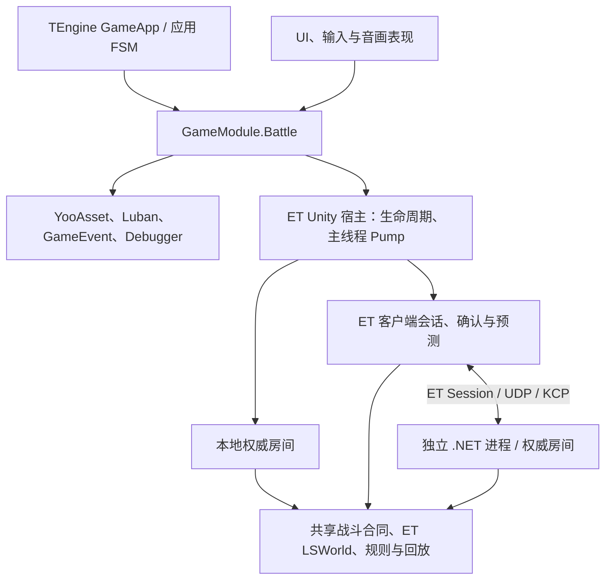

# Project B · ET10 适配为 TEngine 项目模块

2026-11-17 · 方案 B · 实施提案

## 1. 目标与交付范围

**从第一阶段就以 `GameModule.Battle` 作为项目的战斗入口。** TEngine 负责应用生命周期、异步资源、配置、界面、事件和诊断。ET10 负责 Fiber、逻辑世界、权威帧、预测回滚和网络会话。Unity 单机和未来的独立服务端运行同一份战斗规则，并使用相同的帧输入、快照和录像格式。

源代码基线固定为用户已选定的 ET10 `master` 提交 `743c635dd5b0f6f6bab549c0093382c85f3f8307`。现有简易帧驱动和战斗草稿不作为新战斗的设计约束。本文承接上次调研，单独给出方案 B 的落地顺序。上游 Demo 用于核对移植差异，Project B 从第一场可玩样例起就通过 TEngine 门面进入。[ET10 固定提交][et10] · [ET 源码调研](Unity%20ET框架全量源码调研与逻辑帧驱动.md) · [原迁移方式对照](Project_B-ET逻辑帧与网络迁移实施方案.md)

| 里程碑 | 用户可以看到什么 | 实施范围 |
| --- | --- | --- |
| **首期单机** | 从 TEngine 启动一场 ET 房间，部署单位，看到移动、命中和伤害。可以暂停、继续、退出、重开和播放录像。 | B0–B2。单机权威房间、表现桥、快照和独立 .NET 重播。 |
| **后续局域网联机** | 两个客户端进入独立 .NET 服务端上的同一房间。在延迟、预测偏差和短断线后重新收敛到相同的权威结果。 | B3–B4。复用 ET 原生会话和 UDP/KCP，补齐输入封存、预测、状态恢复及诊断。 |
| **产品上线** | 按实际平台、人数和运营需求验收。 | 后续按需求规划账号、匹配、持久化、路由、服务发现和发布拓扑。 |

实施提案暂用 ET Demo 的 **20 Hz** 和双客户端作为联调基线。步频是房间规则参数，正式值依据玩法手感、实际负载和目标平台确定。首个战斗样例采用规则简单的移动，规模化寻路和避障以后按玩法接入。

## 2. 系统归属和依赖



| 位置 | 拟新增或调整的职责 | 依赖方向 |
| --- | --- | --- |
| `Assets/GameScripts/HotFix/GameLogic/GameModule.cs` | 新增 `GameModule.Battle`，公开 `IBattleService`，在应用释放时清空缓存。 | 游戏业务和 UI → 门面。 |
| `Assets/GameScripts/HotFix/GameLogic/Module/BattleModule/` | `BattleService` 负责开局、退出、单机暂停、状态查询和事件。ET Unity 宿主适配负责注册、Pump、取消及清理。该目录还负责配置快照装配、表现桥和调试读数。 | `GameLogic` → 既有 TEngine 模块、共享战斗层、ET Unity 适配入口。 |
| `Packages/com.projectb.battle/Runtime/` | 建议按 `Contracts`、`Simulation`、`Lockstep` 分目录。定义可跨端的命令与结果、LS 实体与规则、房间推进、录像和快照。 | 同一份源由 Unity 和 .NET 构建。共享层向下引用必要 ET 包，保持 `UnityEngine`、`GameModule`、YooAsset 与 UniTask 零依赖。 |
| `Packages/cn.etetet.*` | 保留同一提交的上游源、包名和来源。ET 边界适配放项目目录。确需修改的上游文件单独记补丁。 | 由共享层和宿主使用。上游层对 Project B 无反向依赖。 |
| `Tools/ProjectB.Server/` | 首先提供纯 .NET 重播入口，随后提供独立 ET App、会话监听和权威房间装配。构建配置显式选入共享源码和生成物。 | .NET 宿主 → 同版共享层与 ET 原生运行时。 |

Unity 新包里的目录不必各自拥有 asmdef。首期将共享程序集作为稳定的 Unity 编译产物接入，`GameLogic` 的 HybridCLR 热更层放宿主和表现。协议、序列化和模拟规则由两端成对构建和发布。后续若把共享规则也纳入热更，房间需要绑定会话开始时的规则版本与配置，且版本滞留策略需要单独设计。

现有 `GameApp.Entrance` 启动热更业务，`GameAppManager` 已持有应用 FSM。`SingletonSystem` 自动识别 `IUpdate` 和 `ILateUpdate` 并接向 TEngine UpdateDriver。这些就是方案 B 的接入位置。应用 FSM 管理运行、切后台和退出，战斗服务另持有当前战斗状态，使同一应用生命周期能打开多场战斗。[GameApp](../../Assets/GameScripts/HotFix/GameLogic/GameApp.cs) · [GameModule](../../Assets/GameScripts/HotFix/GameLogic/GameModule.cs) · [GameAppManager](../../Assets/GameScripts/HotFix/GameLogic/Module/GameAppModule/GameAppManager.cs) · [SingletonSystem](../../Assets/GameScripts/HotFix/GameLogic/SingletonSystem/SingletonSystem.cs)

## 3. ET10 源码迁移清单

| 能力 | 从 ET10 迁入什么 | 方案 B 的适配点 |
| --- | --- | --- |
| **运行时和驱动** | `cn.etetet.core` 的 World、FiberManager、Entity/System、ETTask、时间与 Actor 分派，以及生成器需要的公共类型。 | Unity 宿主通过 TEngine 创建、驱动和释放。同一进程使用一个 ET World。底层日志经适配发给 TEngine，服务端可沿用自己的日志实现。 |
| **仿真与定点数** | `cn.etetet.lsentity` 的 LSWorld、LSEntity、LSUpdater 和回滚分派，以及 `cn.etetet.truesync` 的定点数学和 RNG。 | 用 Project B 规则取代示例移动和角色数据。战斗编排显式定义阶段顺序。 |
| **房间、时钟和历史** | `cn.etetet.lockstep` 的 Room、FixedTimeCounter、FrameBuffer、客户端／服务端 Updater、Replay 和回滚链。 | 房间由项目服务装配。单机与联机共用权威输入和 Step。补显式帧号、已提交水位、槽位帧戳和完整快照。 |
| **协议和会话** | ET 的协议生成、MemoryPack、Session、NetComponent、消息分派及 KCP/UDP。 | Project B 定义握手、进房、输入、确认、终局与恢复合同。网络层将值数据交给房间，Unity 门面管理连线状态。 |
| **启动与资源** | 参考 Loader 的注册顺序、ET Unity Init 和 .NET App 的启动结构。 | TEngine 宿主适配装配 ET 的必要服务和代码注册。配置从 Luban 投影为共享值，YooAsset 管理客户端场景、对象和表现资源。 |
| **运行与生成依赖** | 加入实际编译和注册所需的包、生成物、宏及第三方运行库。 | 为原版样例和项目运行时分别建依赖清单。先定位 Loader、GateSession、RoomRoot 与服务发现的引用，再裁剪 Demo 的服务和资源依赖。 |

上游工程的 Unity 版本是 **2022.3.62f3**，当前 Project B 是 **6000.0.69f1**。移植阶段要分别核对上游样例和目标 Player 的生成器、MemoryPack、IL2CPP/AOT 与 Socket 路径。计划保留上游 `net8.0` 工程结构作为服务端基线，实际发布运行时在部署阶段确定。Lockstep 清单的声明版本与仓库内置包版本存在差异，导入依赖时以固定提交、实际源码和生成结果共同核对。[上游 Lockstep 包清单][etDeps] · [上游 Unity Init][etInit] · [上游服务端工程][etApp] · [项目 Unity 版本](../../ProjectSettings/ProjectVersion.txt)

## 4. TEngine 门面与生命周期

### 4.1 接口草图

| 接口或事件 | 用法和结果 |
| --- | --- |
| `StartOfflineAsync(request, token)` | 开局配置和表现准备完成、ET 房间建立并提交 Tick 0 后返回场次句柄，错误返回可诊断的启动结果。 |
| `SubmitCommand(handle, command)` | 验证仍属于当前场次，把已复制的值命令交给本地权威或远端会话。返回的是入队结果，命令最终生效由权威帧确认。 |
| `PauseOffline(handle)` / `ResumeOffline(handle)` | 在 Tick 边界暂停房间推进，继续时重设时钟参考点。回前台时根据暂停原因恢复，手动暂停与切后台分别计入。 |
| `StopAsync(handle, reason)` | 停止输入并开始收尾，同一场次的并发退出请求共用一次收尾。等待房间释放与客户端资源清理完成。 |
| `ReadState(handle)` | 返回只读的场次状态、已确认帧和视图数据。调试器额外查看预测水位、回滚长度、首次校验分歧和连接状态。 |
| `ConnectAsync`、`JoinRoomAsync`、`ReconnectAsync` | 局域网阶段接入。TEngine 接口使用 UniTask，ET 异步与消息注册留在宿主适配和网络处理器内。 |
| `GameEvent` / `AddUIEvent` | 发布开局成功、战斗结束、连接变更和错误等低频状态。界面打开时先读取当前状态，后续用 `AddUIEvent` 订阅。每 Tick 的单位表现通过只读快照读取。 |

`BattleHandle` 由应用期标识与场次代数组成。服务同一时刻持有一个前台战斗。启动、换局和停止由服务串行受理。异步加载完成后在主线程复查场次身份，过期结果由持有该资源的操作释放。所有面向 UI 或 GameEvent 的返回值都在项目的主线程边界提交。项目异步边界采用 UniTask。正式落地时核对 `GameEvent` 接口事件所需的生成与注册，现有 `GameApp.Entrance` 中的 `GameEventHelper.Init()` 处于注释状态。[GameApp](../../Assets/GameScripts/HotFix/GameLogic/GameApp.cs) · [项目事件规范](../../.agents/skills/tengine-dev/references/event-system.md)

### 4.2 装配、暂停与释放

| 状态或操作 | 拥有者和约定 |
| --- | --- |
| **应用启动** | `GameApp` 在现有热更启动流程内注册宿主。`BattleService` 建立门面。首次开局前，宿主同步建立可驱动的 ET 调度器和必要单例，通过 `IUpdate/ILateUpdate` 启动 Pump，再完成依赖调度的异步 Fiber 初始化。开局只在 ET 就绪后进入。 |
| **场次准备** | 创建独立的场次上下文。Luban 配置投影为不可变的规则值与地图逻辑数据，资源通过 `GameModule.Resource` 加载。等逻辑开局数据及必要视图资源准备完毕，再创建房间、提交 Tick 0 及发布 Running。 |
| **运行** | `SingletonSystem` 触发宿主 Update 和 LateUpdate。宿主交给 ET 的 FiberManager，ET 房间比较当前时钟与下一帧截止时刻后推进。战斗逻辑时间来自房间 Tick。 |
| **暂停和切后台** | 手动暂停和后台暂停分开处理。单机房间暂停期间停模拟，宿主在可运行时继续处理必要生命周期事务。联网模式切后台时暂停本地表现或预测，远端服务器继续推进。恢复后先同步确认帧或重新连接。 |
| **退场／开局失败** | 服务先关闭输入、废弃场次代数并取消挂起工作，解除网络和视图订阅。房间由所属 Fiber 清理，客户端适配释放资产引用与场次对象。销毁房间期间保持 ET Pump 可用，直到正常收尾完成。 |
| **应用释放** | 正常退出路径先停止战斗和会话，再停止 Pump、释放 ET World 和外部订阅，最后走项目的单例与模块释放。已有同步销毁回调只处理仍持有的资源和注册，异步退出流程提前进行。 |

资源对象由申请方管理。普通资源通过 `LoadAssetAsync` 加载并与 `UnloadAsset` 配对，场景对象使用 `LoadGameObjectAsync` 及项目规定的实例释放路径。配置、日志和分析数据经过接口投影，服务端从同批次配置产物装配自己的开局值。[项目资源规范](../../.agents/skills/tengine-dev/references/resource-api.md) · [项目 Luban 规范](../../.agents/skills/tengine-dev/references/luban-config.md) · [ET FiberManager][etFiber]

```text
开局请求 → 分配 BattleHandle → 初始化 ET 调度与 Pump
        → 等 ET 就绪 → 加载规则配置与必要视图 → 创建房间 → 提交 Tick 0

Unity Update → ET FiberManager.Update → 房间按截止时刻推进
Unity LateUpdate → ET FiberManager.LateUpdate → 主线程读取场次表现批次

退出请求 → 关闭输入并取消准备 → 主线程移除视图订阅
        → 等房间退出并释放资源 → 返回空闲
应用释放 → 等当前房间收尾 → 停 Pump → 释放 ET World
```

## 5. 单机与独立服务端共用的规则

| 设计点 | 单机与联机共用的合同 |
| --- | --- |
| **帧号和时间** | Tick 0 为已提交初态，候选是 `CommittedTick + 1`。ET 世界内部帧号在适配边界统一。每个房间固定步长，宿主负载只影响本轮能执行几步。权威房间持续过载时记录积压并显式报错。 |
| **命令封存** | 输入携带房间身份、目标帧、来源和序号。确认前按规则封定输入，按座位、序号和子命令顺序执行。一次性动作缺失时为空，持续输入由规则选择保留最近值或置中。 |
| **逻辑步骤** | 每步同步执行命令、到期任务、移动、命中、伤害和清理。逻辑 ID、随机状态、排序规则和时间字段均作可恢复数据。逻辑帧内只处理共享值，服务器与 Unity 运行同一份 Step。 |
| **提交与输出** | 规则成功后提交候选帧，发布确认和可读结果。失败时停止当前房间并保留诊断信息。游戏结算、存档及不可逆表现从确认结果消费。 |
| **快照、校验和录像** | `Snapshot(t)` 表示提交 Tick t 后状态。恢复时从最近快照开始重演连续输入。快照覆盖实体、Buff、任务、随机状态与 ID 生成。录像存初态、确认输入、规则和快照版本。规范化序列化后对已确认状态计算校验。 |
| **网络线程与表现** | ET Session 的入站回调把消息转换为有所有权的值，再交给房间所有者。Unity 视图按稳定 UnitId 读取结果。需撤销的表现按预测视图刷新，确认事件按场次、帧号和事件序号去重。 |

单机使用同进程权威房间。联网后，独立服务端接受输入、封存并推进权威帧，Unity 客户端通过 Session 收到确认输入。先以确认帧模式验证闭环，再开启限步预测。预测出现偏差时从快照重算。历史过期时从服务器取得完整权威状态和连续确认帧。ET10 原示例的重连载荷包含帧号和单位位置及朝向，项目恢复协议还需覆盖能影响后续战斗的全部状态。[ET Lockstep 源码][etLs] · [ET 示例重连][etReconnect]

下文的 Step 指项目对一帧的编排。实现时由该编排封存输入并调用上游的 `LSWorld.Update()` 进入 ET 逻辑系统，确认后提交对外可见的帧号。

## 6. 分步实施清单

### B0 · 固定源码和双端依赖

- [ ] 保存上游包、路径、提交、依赖版本、第三方来源、生成物与项目补丁清单。
- [ ] 在独立工作区记录原版最小 Lockstep 样例的配置和启动方式。Project B 的工程入口在 B1 直接按方案 B 接入。
- [ ] 根据 asmdef、csproj、源生成与运行注册确定 Unity 和 .NET 的各自编译集合。列出会改变现有启动、资源和包版本的依赖，先形成明确的适配点。

```text
固定 Git 提交 → 枚举包和生成器 → 从 LSWorld/Room/Session 追依赖
              → 分别记录原版样例和项目宿主的构建与运行入口
```

**验收**以可追溯的文件清单和原版基线记录为准，能够说明每个关键依赖由哪个程序集和运行入口使用。

### B1 · 建成 TEngine 战斗模块和离线房间

- [ ] 按 `GameModule.Battle` 接入 `IBattleService`、主线程宿主、应用 FSM 委托和清理顺序。使用现有 Update/LateUpdate 入口调用 ET。
- [ ] 建立本地权威房间、开局配置、Tick 0、输入排队、暂停与恢复、退场和重开。
- [ ] 接入一处可操作的项目入口和诊断读数，验证加载中退出、重复开局、应用切后台及正常退出。

```text
GameModule.Battle.StartOfflineAsync → TEngine 宿主就绪 → 创建本地 Room
Tick 到期 → SealInput → LSWorld.Step → 提交 → 主线程视图读取
```

**验收**从 TEngine 入口可以开始、推进、暂停、退出并重开一场房间。连续重开后按场次检查 Fiber、订阅和资源的实际释放。

### B2 · 完成最小战斗、回放和 .NET 重演

- [ ] 实现部署、移动、命中、伤害、退出或终局。定义最小地图、稳定单位 ID、命令顺序和步进阶段。
- [ ] 记录确认输入和快照，实现播放、跳转、摘要及版本验证。恢复后按稳定 ID 重建表现关联。
- [ ] 用纯 .NET 重播入口消费同一份共享源、配置和录像，按帧核对 Unity 和 .NET 的状态摘要与终局。

```text
初态与种子 + 已确认命令 → 共享 Step → Snapshot(t) / Hash(t)
恢复 Snapshot(t) → 重演后续 n 帧 → 与原执行的确认状态逐帧比较
```

**验收**单机完成一场样例。相同录像在 Unity 与 .NET 上得到约定的状态校验和终局。快照恢复后可以继续模拟，回放不会重复结算。结论限于实际验收的版本、平台和样例。

### B3 · 跑通真实 KCP 会话和权威确认

- [ ] 通过 ET NetComponent、Session 和 KCP/UDP 连接独立 .NET App。先在一个服务端进程内装配房间。
- [ ] 实现协议、规则及配置版本匹配，接入开房、加入、准备、开局和结束。服务端把身份绑定到会话与席位，只有房间所有者能提交模拟帧。
- [ ] 按显式帧号派发确认输入。处理超时、重复确认、迟到输入、连接断开和资源清理。TEngine 模块对外报告状态和错误。

```text
两客户端 Join/Ready → 服务端建立房间并发初态
ClientInput → ET Session → 房间队列 → 封存、执行、提交、广播
客户端攒齐连续确认帧 → 同一 LSWorld.Step → 比较状态
```

**验收**两个独立客户端经实际 UDP 完成一场对局，确认流和终局一致。版本不匹配、无效的帧输入以及断开分别产生可诊断结果。

### B4 · 预测回滚、完整重连和异常场景

- [ ] 接客户端输入预测，明确最大领先帧数、最大重演步数和每轮预算。帧缓存按完整 Tick 检查槽位归属。
- [ ] 权威输入不同则恢复快照，按确认输入和仍有效的预测输入重演。窗口过期或出现持续状态分歧时，获取完整快照和后续帧。重连对恢复状态和版本执行校验。
- [ ] 将回滚次数、重演长度、确认帧差和恢复耗时接进 TEngine 调试界面。确认录像与服务器结果一致，验证表现和结算去重。

```text
权威帧到达 → 核对连续性与预测 → 相同则确认
不同 → 加载旧快照并重演；历史已过期 → 拉取权威快照并追帧
恢复后校验 → 更新确认水位和视图
```

**验收**构造延迟、抖动、预测错误和短时断线，检查确认帧能收敛。重连恢复生命、Buff、任务与随机状态，随后多帧仍与服务端一致。记录实测步耗时和快照大小，再确定正式帧率、预测窗口和内存预算。

## 7. 实施边界和待量测项

- **共享代码可移植性。** 如果正式玩法依赖 Unity Physics、浮点避障或 Unity Jobs，先明确它在共享仿真中的权威与重播策略，再按目标 Player 与 .NET 对照。固定步长和最终坐标量化只能约束部分差异。
- **编译与发布。** 真正的兼容断点在 Unity 6 Player 的 ET 生成物、unsafe/KCP、MemoryPack 与 AOT。上游样例、Unity Player 和独立服务端分别记录执行结果。
- **运行成本。** 快照内存随单帧字节数、保留槽数和房间数增长。回滚预算还取决于单 Tick 调度与演算开销。B2 记录样例数据，B4 用网络异常用例测上界。
- **方案状态。** 当前交付为方案 B 文档。以上实施项均待执行，包依赖闭包、Unity 构建、对局及性能尚未验证。

[et10]: https://github.com/egametang/ET/commit/743c635dd5b0f6f6bab549c0093382c85f3f8307
[etDeps]: https://github.com/egametang/ET/blob/743c635dd5b0f6f6bab549c0093382c85f3f8307/Packages/cn.etetet.lockstep/package.json
[etInit]: https://github.com/egametang/ET/blob/743c635dd5b0f6f6bab549c0093382c85f3f8307/Packages/cn.etetet.loader/Scripts/Loader/Client/Init.cs
[etApp]: https://github.com/egametang/ET/blob/743c635dd5b0f6f6bab549c0093382c85f3f8307/Packages/cn.etetet.lockstep/DotNet~/App/ET.App.csproj
[etFiber]: https://github.com/egametang/ET/blob/743c635dd5b0f6f6bab549c0093382c85f3f8307/Packages/cn.etetet.core/Scripts/Core/Share/World/Fiber/FiberManager.cs
[etLs]: https://github.com/egametang/ET/tree/743c635dd5b0f6f6bab549c0093382c85f3f8307/Packages/cn.etetet.lockstep
[etReconnect]: https://github.com/egametang/ET/blob/743c635dd5b0f6f6bab549c0093382c85f3f8307/Packages/cn.etetet.lockstep/Scripts/Hotfix/Server/Room/G2Room_ReconnectHandler.cs
