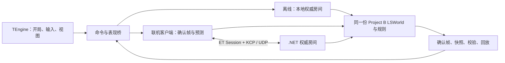

# Project B：ET 逻辑帧与网络迁移实施方案

2026-11-17 · 待确认 · 本文是实施提案，未改代码、包配置或场景

> 历史比选。项目已选择方案 B，并明确按文件将 ET10 源码迁入项目目录，Entitas 承载战斗规则。本篇的方案 A、UPM 目录和 `LSWorld` 仿真仅供比选。当前实施按 [TEngine 适配方案](Project_B-ET10适配TEngine项目模块实施方案.md) 和 [ET10 与 Entitas 战斗逻辑适配方案](Project_B-ET10与Entitas战斗逻辑适配方案.md) 执行。

## 1. 要达成什么

**以 ET10 `master` 官方源码为迁移底稿，把 ET 的运行时、Lockstep 和会话/网络移进 Project B 的独立模块。** 先让新战斗在离线时跑 ET 的权威房间，再把输入和确认消息接到 ET 会话，最终让两台客户端与独立服务端跑同一个逻辑世界。新战斗以 ET 的 `LSWorld/LSEntity` 为主，不要求沿用 Project B 现有的帧驱动、战斗草稿或 Entitas 调度。TEngine 继续负责现有 Unity 应用的启动、资源和表现，通过一层桥调用 ET。

| 阶段目标 | 达到的程度 | 验收要看到什么 |
| --- | --- | --- |
| **近期：ET 原生单机战斗可用** | 本地权威房间、固定 Tick、输入确认、稳定推进、录像和快照；无网络时也使用将来服务器采用的规则 | 玩家部署一个单位，单位移动并产生一次命中和伤害；暂停/继续与回放可用。同一初态和输入跑两次，权威 Tick/结果/校验一致。 |
| **本次迁移的网络里程碑：局域网真机链路** | 移入 ET Socket/KCP、会话、协议生成与独立服务端；用房间号开房/入房，至少两客户端。完成时钟对齐、逐帧裁定、预测回滚、断线恢复 | 两客户端经真实 UDP 连接一个独立房间。网络迟滞改变预测进度，确认水位和已确认状态最终一致；重连后包含单位生命、技能/计时数据的状态恢复。 |
| **后期：按产品联机需求扩展** | 选择公网接入、匹配、持久化、路由和多进程拓扑；在真实规模下确认玩法与性能 | 只有通过平台、网络、容量、认证及运维验收才对公网开放；训练样例和局域网通过不等于可上线。 |

方案暂按**实时、服务器权威的房间联机**设计。2 客户端是工程验收规模，不代表游戏最终人数或 PvP/合作规则。若后来只做异步挑战或只上传录像，可以在单机仿真与录像里程碑止步。若强调实时大规模作战但无法满足跨平台决定性，再评估服务器快照同步或混合方案。目标设备、公网拓扑和商用授权可分别在相关阶段确认；单机和局域网设计不依赖先决定这些产品细节。

## 2. 已确认底稿与迁移策略

使用 [ET10 官方 `master` 的 `743c635dd5b0f6f6bab549c0093382c85f3f8307`][et10]。用户已说明与作者沟通，可以迁移 ET10。后续代码记录作者授权覆盖的实际使用范围和各包的来源；与 Odin 等第三方商业插件或第三方许可证相关的文件另核对。本文不假定第三方授权随 ET 一并取得，无需为选择 ET10 再确认一次。完整模块和帧同步源链见 [ET 源码调研](Unity%20ET框架全量源码调研与逻辑帧驱动.md)。

**“直接搬”的定义：** 原生 ET10 的 `World/Fiber/Entity`、`LSWorld/LSEntity`、`Room` 逻辑帧协议、`Session/NetComponent` 和 KCP 维持同一提交的实现。先按原生包名及源目录直接引入能运行的闭包，做单独的适配提交。项目代码仅补启动、资源、玩法和协议边界，以及明确的演示缺口。不会用另一个 ECS 或另一个网络库重写这条链。

建立两个运行目标：

1. **上游基准。** 在独立工作区保留 ET10 的完整 Lockstep Demo 和其声明依赖，按上游版本配置运行。这是判断搬运前后差异的基线，与 Project B 发行内容隔离。
2. **项目运行时。** 在 Project B 中导入直接依赖与实际编译闭包，自己的包负责拼装。上游 Unity 场景、整个 Demo 资源、YIUI、主项目包清单、ProjectSettings 和 ET 的 HybridCLR/YooAsset 启动链不覆盖本工程。保留源码但不启用某个功能，与把整个演示开启，是两种不同的成本。

ET10 工程固定提交用 Unity **2022.3.62f3**，Project B 用 **6000.0.69f1**。先在上游要求的 Unity 版本建立基线，正式接入验证 Project B 的 Unity 6、IL2CPP、分析器/生成器、MemoryPack 和 socket 侧条件宏。服务器以 ET10 [App/Model/Hotfix 的 `net8.0` 工程结构][appnet] 为移植起点；发布运行时版本要随目标环境和支持周期确认。ET10 客户端示例 `Init` 初始化默认 YooAsset 包再进入 Loader，因此正式接入需要重用已有应用资源入口，不能在同进程直接创建第二个同名 `DefaultPackage`。

### 2.1 三种可落地的组织方式

共同约束：三种方案都**直接使用同一版本的 ET10 实现**，共享同一份 LSWorld 规则、房间协议和双端生成物，先单机、再局域网联机。区别在代码归属、谁负责生命周期和升级边界。这里的 **TE** 指现项目的 TEngine。

| 维度 | A · ET10 嵌入式第三方插件 | B · ET10 深度适配为 TEngine 项目模块 | C · 独立 ET10 工程，客户端按版本接入 |
| --- | --- | --- | --- |
| 源码主位置 | Project B 内 `Packages/cn.etetet.*` 保留原包，项目适配放 `com.projectb.etbattle` | ET10 底层仍单列保留，`GameScripts` 中由项目接管房间装配、会话、协议业务和生命周期；战斗共享源码另存公共包 | 独立 ET10 仓库持有 .NET 工程与共享包，Project B 消费固定版本的仿真 SDK、客户端网络和协议 |
| 谁管生命周期 | ET 管 World/Fiber/房间；TEngine 的薄桥只启动、Pump、关闭和传数据 | `GameModule` 门面、应用 FSM、TEngine 日志、配置、资源和业务事件接管外层，内部仍运行 ET 的 Fiber/Session/Lockstep | 独立工程管服务端生命周期与发布；Unity 保留独立的本地仿真和客户端会话适配 |
| 单机如何跑 | 本地 ET 权威房间，直接调用同一权威入口，无额外进程 | 走项目 `BattleService`，服务内部起同一个 ET 本地权威房间 | Unity 必须内嵌定版的共享仿真和 ET 最小运行时，离线仍可运行；不要求启动服务端程序 |
| 真实联机 | 同仓 .NET RoomHost，直接复用 ET 包和合同 | .NET Host 引用共享的项目规则与 ET 运行时；服务端不可依赖 TEngine 资源或 GameModule | 继续使用原生 ET 进程、网关与服务装配；Unity 客户端按发布版本的 wire/规则/配置对接 |
| 对工程的影响 | 中等：包、生成与应用桥；原生文件易对照 | 最大：主包/热更、FSM、日志、配置、错误处理、资源和 API 都需要映射；每次上游更新需重做适配审阅 | Unity 业务改动较少；至少两套构建/发布和一套 SDK/协议版本配对，工程运维最重 |
| 适用条件 | 目前单机，想先把原生逻辑帧和服务器一起搬过来，尽快跑通 | 已确定大部分玩法都通过 `GameModule` 访问，团队希望运行入口、工具和诊断与现项目统一 | 已有独立服务端仓库/负责人、CI 和发布节奏，或明确需要 ET 原生的多进程联机架构 |

**A：嵌入式插件，建议先采用。** “插件”优先指可读可构建的 **嵌入式 UPM 源码包**，不是拷一堆 DLL。先在独立工作区跑通原版，再把 Core、LSEntity、TrueSync、Lockstep、网络/会话及其闭包按原路径导入。Project B 只加 `EtBattleHost`、战斗和协议适配；Unity 构建产物仍在同一个 Player。短期只使用本地权威房间，局域网阶段再打开 KCP 会话。完成定义是两端复用上游包和项目规则，能对照同一提交定位问题。若以后必须交付 DLL，另建 CI 产出源码/元数据同版的 Unity DLL、Roslyn 生成器、AOT 保留及 .NET artifacts；单 DLL 不是本方案的默认形态。

**B：深度适配成项目模块。** 先确定 `GameModule.Battle` 或等价门面以及房间/网络会话、资源、配置、事件、诊断的归属；在项目应用 FSM 上串接加载、暂停、退出和恢复。让外层 API 用本项目值类型和 UniTask，ETTask、Entity、Fiber 和锁步继续留在内部。同一份战斗规则、合同和序列化放到 Unity/.NET 均可编译的共享程序集；只有宿主适配写入 TEngine 热更层。能先用 A 跑通共同基线，再逐步移动生命周期和门面，避免同时更改上游行为与项目入口。完成定义是普通游戏业务无需直接调用 ET 底层类型，在 Unity 工具里能诊断房间与网络；纯 .NET 仍不依赖 TEngine。若目标是彻底重写 ET Entity 或会话来符合 TEngine API，则属于另一项框架重构。

**C：独立 ET 工程和 SDK 接入。** 服务端在单独仓库维持原生 ET10 包、Project B 服务端场景及房间配置，按 Git 提交发布 `Battle.Shared`、ET 客户端会话和协议组的固定版本；Unity 只绑定该组产物。先建立跨仓构建清单、协议/配置兼容矩阵和端到端联调，再进入同样的 P1–P4。共享仿真随 Unity Player 一起发布，单机不依赖网络或启动本地独立 .NET 程序；上线服务可直接沿独立工程配置 Gate、Room 和服务发现。完成定义是两个仓能独立发布，但任意客户端与服务端组合都能通过握手判断兼容性。不建议现阶段就承担独立 SDK 发布和运维；已有明确的服务端组织与独立发版需求时再选。

**推荐决策：** 先选 A，保留很薄的 TEngine 门面，把真正的框架迁移和关键联调跑起来。达成 P2 后，如果业务团队需要统一战斗服务、资源与诊断入口，再追加 B 的外层适配；若服务端需要独立运维和发版，改用 C 的仓库及制品管理。这个顺序不会要求更换逻辑世界或重写网络协议。下文列的是 **A 的完整实施方案**；B、C 沿用验收目标，但按各自的归属和发布方式替换宿主环节。

| 如果一开始选 | 在同样的 P0–P4 中增加或替换的工作 | 必须额外验收 |
| --- | --- | --- |
| **B** | P0 定 `GameModule.Battle` 与局内/局外的所有权；P1 接 TEngine FSM、配置与日志适配；P2 让共享规则脱离 Unity 工程编译；P3–P4 由 Unity 门面暴露会话、确认/恢复和诊断状态 | 热更入口重进和场景退出都不残留 ET Fiber；服务端工程不引用 TEngine；测试能从门面驱动完整一局。 |
| **C** | P0 建独立服务端仓库和制品版本表；P1–P2 将同版共享仿真接入 Player 与独立服务端；P3–P4 先完成发布与版本握手，再验证真实网络、预测和重连 | 断网后 Unity 单机可玩；服务器与 Unity 独立构建；旧客户端遇到不相容的服务端时收到明确拒绝，不进入房间。 |

## 3. 方案 A 的文件与包移植清单

| 处理 | ET10 源码 | 在 Project B 的落点和边界 |
| --- | --- | --- |
| **直接迁入运行底座** | [`cn.etetet.core`][core]：World、FiberManager/Scheduler、Entity/EntityRef、EventSystem、ETTask、Actor、定时器、池及 core 网络；关联 [`sourcegenerator`][sourcegen] 的属性、分析器和系统模板 | 按原包名保留可运行闭包及元数据，继续原生 ET Entity/System 和 ETTask。第三方/编译依赖按实际程序集选择；分析器作为构建工具。项目侧 UniTask 和 ETTask 只在桥边转换，战斗 Step 同步运行。 |
| **直接迁入逻辑世界和房间框架** | [`lsentity`][lsentity] 的 `LSWorld`、`LSEntity`、`LSUpdater`、回滚派发；[`lockstep`][lockstep] 的 `Room`、`FrameBuffer`、`FixedTimeCounter`、客户端/服务端 Updater 与 Replay | 先完整跑通原生逻辑和演示，再修改装配和业务组件。保留 ET 模拟世界、输入帧/权威水位、预测/重放流程。WASD 示例换为部署、单位行动、命中和伤害。`LSUpdater` 按 ID 派发只提供稳定遍历，战斗相位的先后由项目系统显式定义。 |
| **直接迁入数学、编解码与生成闭包** | [`truesync`][truesync]、[`memorypack`][memorypack]、[`proto`][proto]、MemoryPack/BSON 注册及所需运行库 | 优先复用 ET10 已有定点和可序列化 RNG，核清第三方来源；一个房间只用一个数值格式。维持 MemoryPack 序列化、固定字段及类型顺序、生成脚本与两端相同输出；BSON 属性或注册若确属依赖则保留，不需要开 MongoDB 服务。若业务引入 Unity.Mathematics 的浮点类型，只在视图或明确非确定性边界使用。 |
| **直接迁入网络传输** | [`core/Network`][net]：`AService/AChannel`、`KService/KChannel`、`IKcpTransport/UdpTransport`、Kcp、缓存，以及 TCP/WS 分支编译闭包 | 首个真实通道使用原生 `KService(new UdpTransport(...), ServiceType.Outer)` 所代表的直连 KCP 模式，具体工厂与签名按上游保留。keepalive、连接、拆包归 ET。可保留其他协议所需类型，首版不启用 TCP/WebSocket 回退。必须验证 unsafe 元数据、内存所有权、地址族和目标 Player 的 Socket 支持。 |
| **直接迁入会话/RPC，适配玩法消息** | [`NetComponentSystem`][netcomponent]、[`Session`][session]、`MessageSerializeHelper/OpcodeType` 和 [Lockstep 双端协议][lsproto]；[`login`][login] 的 ClientSender / NetClient 为可复用入口 | ET 回调收包后反序列化，通过按 SceneType 注册的读包入口交给会话或房间。Project B 新增开房/Ready、逐帧输入/确认、心跳、校验、重连和终局消息，双端共用生成物；不承诺和 ET 演示联机互通。SeatId 由会话绑定。演示的 Gate 路由可保留做对照，首版在同进程将会话绑定房间。 |
| **适配 Loader 和 Native Room Fiber** | [`loader`][loader]、[`Unity Init`][unityinit]、[`服务端 App`][program]、[`RoomRoot 初始化`][roomroot] | Unity 端在应用启动的项目桥内初始化 Options/Logger/TimeInfo/FiberManager 和代码注册等必要链路，不直接挂上游 Init。启动 ET 房间后保证每个宿主帧只 Pump 一次 Update/LateUpdate，按反序注销。服务端用 ET 的 .NET 结构，首版起一个进程，网络入口和房间按需分 Fiber，房间单所有者。 |
| **采用构建闭包，推迟分布式功能** | [`actorlocation`][actorlocation]、[`netinner`][netinner]、[`router`][router]、[`servicediscovery`][discovery]、[`startconfig`][startconfig] 等 | 上游 `FiberInit_RoomRoot` 装配 LocationProxy，广播会经过 GateSession；锁步 Demo 的服务端启动还会建 NetInner 和发现代理。复跑基线要算入这些依赖，项目直连改在装配/投递边缘复用同进程会话，移除直接依赖之后才裁包。分布式网关、跨服、动态匹配、数据库、Aspire 和遥测按联机需求扩展。 |
| **Unity 表现与应用桥：新增项目实现** | `lockstep/HotfixView/Client` 只作为 UI/动画和回滚后重新绑定的示范 | 项目继续使用 TEngine 的应用入口、YooAsset、配置和 Unity 资产。桥只传开局值、命令和已生成的视图数据，不持有 LS 实体引用。上游 YIUI、第三方商业插件和旧示例美术不进入业务运行包。 |

**ET10 的包与构建差异。** [Lockstep `package.json`][et10deps] 还有 UI、资源、热更、测试和发现依赖；声明的 Core 3.0.3 与该提交内置 Core 4.0.0 存在差异。先固定整份 Git 树记录实际嵌入版本，不按包文件里的版本字符串去注册表拼不同提交。先保留基线依赖，再为 Project B 显式建立两份清单：编译需要哪些源码/程序集，运行哪些服务；去掉依赖时，分别核对代码引用、源生成器、程序集、定义宏和运行注册状态。基准跑通前不臆断能删哪些包。

目标目录（只列本轮新增范围，实际取哪些上游文件由 P0 清单锁定）：

```text
UnityProject/
  Packages/cn.etetet.*                       # 原生 ET10 包名，按实际构建闭包逐包导入
  Packages/com.projectb.etbattle/
    Runtime/Contracts/                       # 协议与存档版本、开局清单、命令
    Runtime/Simulation/                      # ET LSWorld 上的 Project B 规则
    Runtime/Lockstep/                        # 权威/离线/预测及房间装配改造
    Runtime/Networking/                      # ET 会话处理器、直连房间入口
  Assets/GameScripts/HotFix/GameLogic/
    Module/EtBattleHost/                     # Unity 生命周期、资源和表现桥
  Tools/ProjectB.Server/                     # App/Model/Hotfix 入口与最小外网服务
  ThirdParty/ET10/                           # 固定提交、来源清单、许可与适配说明
```

[ET10 Model][modelnet] / [Hotfix][hotfixnet] 原本通过 `$(SolutionDir)Packages\cn.etetet.*` 广泛收集源文件。独立服务端改为明确包路径和共享源白名单；否则无意间加一个包就可能把 Unity 表现或另一套业务注册编进服务端。共享源只维护一份，端侧编译配置分开。第一版 ET 共享库作为 Unity 普通工程程序集；现有 TEngine 热更入口只调稳定桥接 API。后续若要热更战斗程序集，客户端和服务端成对发布，已开房间绑定旧规则版本。

## 4. 单机和联机如何共用这套实现



| 约定 | 实施语义 |
| --- | --- |
| 开局合同 | `BattleStart` 包含 BattleId、模式/座位、地图与规则版本、配置摘要、种子、TickRate、起始 Tick 和初态。网络加入时验证 wire/规则/配置兼容性，失败不进入房间。宿主墙钟只是调度输入。 |
| 编号和归属 | 设 `CommittedTick=0` 为初态，候选为 `CommittedTick+1`；ET `LSWorld.Frame` 在适配器中表示下一帧，避免两个字段各自递增。服务器输入校验/落位、模拟和提交同一房间的状态在一个所有者上下文完成。IO 回调仅传递值消息，不修改场内对象。 |
| 时间 | 迁移首版用 ET 的 **20 Hz** 演示节奏进行联调，步频来自房间建立时的规则配置，后续可基于对局负载评测再选；不把任何 50 ms 字面量写进业务计算。服务端按单调时钟发 Tick，限制每次 Pump 的追帧数，无静默跳过权威 Tick；持续超预算时进入显式过载状态。客户端可调追帧和显示插值，实际步长不改。 |
| 单机暂停/应用挂起 | 离线暂停在已提交 Tick 停止，恢复时重锚时钟，不累加后台时间；可允许手动 Step 一次。联机客户端本地菜单、切后台不暂停服务器；恢复后追确认帧或重连。 |
| 输入 | `ClientInput` 含 BattleId、目标 Tick、序号、持续控制、一次性命令列表；会话绑定 SeatId。对于未收到的持续控制，复用最近已确认值或中性输入；部署、技能释放等一次性动作缺失即空，不从上一帧拷贝。接受窗口明确为未提交的未来 Tick，封存后拒绝更改。按座位、序号和命令子序统一排序，幂等去重。 |
| 权威批次与确认 | `AuthoritativeInputs(Tick, ...)` 自带帧号并校验房间代数。先封定、模拟成功、记录校验，再发布确认；重复包丢弃，缺帧补齐才能继续提高确认水位。单次失败不发布成功结果；阶段一优先停该房间并留诊断，不在部分写入的世界里继续跑。 |
| 快照与校验 | 迁移统一将 `Snapshot(t)` 定义为**已提交 t 后**的状态；重算第 t 步恢复 `Snapshot(t-1)` 或最近更早快照再重播。快照覆盖实体、组件、技能/Buff、计时器、RNG、ID 与影响未来的暂态；排除 socket、Unity 对象和墙钟。哈希对规范序列化后的状态计算，帧确认标明采样语义。 |
| 预测与重连 | 灰度先只让客户端受确认帧驱动；阶段 P4 开启有限预测。权威不同则重演；若窗口过期或同输入仍持续不一致，客户端丢弃预测，应用权威全量快照和其后的连续帧；版本/配置不匹配时拒绝恢复。 |
| 表现、终局和外部副作用 | 逻辑 Step 产生按 `BattleId/Tick/事件序号` 标识的值结果。可撤销表现按预测状态刷新，发奖、存档、终局和不可逆音效以确认/去重策略处理；预测重演不能重复确认或结算。 |
| 回放 | 录像头用规则、配置、协议及快照版本标识。记录初态、确认输入与间隔快照；支持同版本重播和跳转，版本不匹配报告原因；未承诺跨所有历史版本兼容。 |

```text
权威 Step：candidate = committed + 1
    batch = SealInput(candidate)                 // 会话校验、补缺失、稳定排序
    stepResult = BattleWorld.Step(candidate, batch)
    成功 → 提交 candidate → 记录确认输入与摘要 → 发布确认与值结果
    失败 → 封存房间和诊断，停止调用 Step

客户端确认：
    连续收到确认帧 → 写入只读的权威输入历史
    未预测 → 从最后已模拟状态按确认推进
    已预测且相同 → 只提高确认水位
    已预测但不同 → 恢复批次之前的快照，按权威帧 + 未确认本地输入重算
    历史不足或重复校验错误 → 走快照重同步
```

## 5. 分步实施及验收

以下清单在实际实施时逐项勾选。每步完结记录改动、依赖取舍和实测结果；不能用计划任务当成已完成。P0–P4 是该方案的完整交付范围；P5 是将来上线前的独立里程碑。

### P0 · 固定版本、建立原版基线

- [ ] **建立上游材料清单。** 下载固定 `master` Git 树，保留来源路径和提交。列出原生直接包、编译依赖、启动/运行依赖、生成产物、第三方代码及后续适配补丁，不从注册表自动升级。需要作者授权的文件按已经确认的范围记录；不复制未覆盖的第三方商业素材或插件进项目。
- [ ] **跑通未经改造的最小 Demo。** 在隔离环境按 [原版运行指南][guide] 初始化、选 Lockstep 主包、生成配置/协议、构建 ET.App，先观察一条输入到权威输出、预测、录像的可重复链路；保留构建参数和报错日志。上游示例和 Project B 的宿主分别运行。
- [ ] **定两张依赖图。** 标出核心编译与协议生成的闭包，以及以会话、RoomRoot 可运行的服务清单。对 `SourceGenerator`、MemoryPack、BSON、`DotNet~` 内引用、Unity asmdef、Define 和 AOT 明确所有者。记录每个包“直接搬／适配／仅基准”的结论。
- [ ] **建立可回退的导入边界。** 正式项目按“上游文件导入”和“项目接入补丁”分开提交；记录绕开 ET view、资源与热更的装配点。导入时发现必要依赖会修改现有全局入口或大范围覆盖项目配置，先收敛到桥层再继续，不隐式扩大范围。

```text
revision → 原版 Lockstep 及其实际依赖 → 构建与最小对局 → 保存基准
对每个候选包：源码引用 + 生成器/注册 + 运行服务 → 保留或明确替代
```

**验收：** 有可追溯的导入清单，原版在独立工作区可重复启动。能解释哪些包为编译所需，哪些只在原版 Demo 运行。

### P1 · 原生 ET10 进入 Project B，跑离线权威房间

- [ ] **导入 Core、LSEntity、TrueSync 与 Lockstep 闭包。** 保留 ET Tools 的必要生成步骤和程序集关系，版本同一提交；先降低 Room 对 Match/Map/Gate 的装配依赖，保留本地 RoomRoot/Fiber 和同一套 LSWorld。
- [ ] **新增 `EtBattleHost`。** 挂现有应用生命周期，只创建一次 ET World/主 Fiber，提供 Update/LateUpdate、启动和关闭桥。ET 启动里使用项目日志和配置提供器，资源由项目负责加载。离线模式不开监听端口、不做账号登录；主线程停止时卸载房间和 Pump。
- [ ] **实现本地输入和权威运行方式。** `LocalAuthorityRoom` 通过同一帧输入合同接收本地玩家命令；作为服务器执行相同模拟，不经过网络、不做预测。小局包含初态、暂停、单步、继续、退出和重开，应用退出只释放自己的运行时一次。
- [ ] **接一块可观察界面。** 显示场次 ID、当前权威帧、步数、命令消费和一个世界内对象位置；以值数据消费结果，不引用房间/实体内部。接通后，新战斗单独由 ET 时钟推进，不能同时被旧管理器和 ET 驱动。

```text
EtBattleHost.Start → World + FiberManager + 注册 → LocalAuthorityRoom.Init
宿主 Update/LateUpdate → FiberManager Pump → 到期时房间权威 Step
Unity 操作 → EnqueueLocalInput；暂停 → 停止调度并保留提交；继续 → 重锚
```

**验收：** Unity 内只靠 ET 链能创建、推进、暂停和释放一个本地房间；连续重开不残留订阅、实体或定时器。离线不依赖服务端，也不打开网络。

### P2 · 把移动演示换成 Project B 的最小战斗

- [ ] **设计稳定的实体/命令合同。** 起步只覆盖产生可复现差异的垂直切片：一条部署指令、两个对立单位、固定规则移动、一次命中和伤害、终局退出。明确开局种子、实体 ID、数值标度、命令排序、生成与销毁。
- [ ] **实现共享 Step 相位。** 放入 ET 的 `LSEntity` 组件与 System，以固定顺序处理输入、到期任务、移动、命中、伤害、提交/清理。除开局先取配置外，所有相位为同步值运算；不读取 Unity 时间、物理、动画或回调。
- [ ] **确定快照与录像编解码。** 保留 ET 快照和录像管线，按本方案将快照统一为提交后状态。显式覆盖 RNG、ID、到期任务、技能状态；约束字节顺序、哈希算法和字段变更规则。录像写入与 I/O 留在仿真外，恢复后重建运行索引。
- [ ] **接入预测可撤销的表现协议。** 表现桥接收到提交或预测序列，按稳定单位/事件标识重建视图。音效和发奖类操作按确认规则去重。加离线回放播放和跳帧入口，显示首个哈希不一致的 Tick、场次/版本和相关实体摘要。
- [ ] **给纯 .NET 宿主同一套模型和规则。** 编译入口消费相同源和快照格式，去除 Unity 引用。先运行离线或内存房间，确保跨宿主解释一致后再启用网络。

```text
Setup + seed → 初始化 LSWorld
每步：Commands → Due → Movement → Hit → Damage → Finalize
Snapshot(t) + 已确认输入 t+1…n → 恢复并重播 → Hash(n)
```

**验收：** 离线操控完成一次完整的小局。同一输入录像在 Unity 和独立 .NET runner 得到约定的确认帧校验和终局；从快照恢复可连续推进到同一状态。此结果只证明样本、配置和已测平台。

### P3 · 迁入真实网络并先跑确认帧

- [ ] **接 ET 原生客户端与独立 App。** 保留 Socket → KCP → NetComponent → Session → 协议分派，至少两客户端。服务器以单进程监听私有局域网，优先用上游的接入/会话抽象并在边界建立直连房间；不依赖外部 Gate、Router 或数据库。
- [ ] **定义时钟对齐与开局协议。** 区分网络估计时间和模拟固定步长。房间只在成员 Ready、版本与配置匹配后广播初态和起始约定；首版用已确认帧客户端模式验证输入链路。心跳和超时清理受绑定会话约束。
- [ ] **把房间输入变成可描述的一致流。** 将玩家身份由会话映射，不读取客户端声明作为授权身份；对 BattleId、帧窗口、消息大小、输入速率和序号进行校验。房间所有者封定并 Step，得到确认后发送带帧号和确认水位的输入集合。日志能按场次、玩家和 Tick 找到拒绝原因。
- [ ] **所有权及断开处理。** 明确 `MemoryBuffer`、消息池和跨 Fiber 复制责任；不会把已回收的消息传到房间线程。停止接收后清理会话、计时器、房间与传输；重复通知不得重复开局或销毁。

```text
接受连接 → Session → Hello/兼容性 → Join/Ready → Start
收 ClientInput → 会话绑定玩家 → 所有者入队 → 封定 t → Step(t) → 送确认帧
客户端收到连续确认帧 → 同一 LSWorld.Step → 校验并更新视图
```

**验收：** 自有局域网内一个 .NET 服务端、两个独立客户端走真实 UDP，玩完一个房间，双方按同一 Tick 顺序确认且权威结果一致。断开与退出释放资源，配置/协议不匹配不能进入仿真。公网入口不开启。

### P4 · 预测、回滚、过期补救和完整重连

- [ ] **移入并收紧预测循环。** 本地用当前输入，远端持续状态沿用最近确认，预测窗口限制用 `nextPredictedTick <= confirmed + maxAhead`，并设每次宿主 Pump 的次数和时长预算。超出预算停推进、继续收确认或切追帧，禁止为了追平直接丢逻辑帧。
- [ ] **修正历史窗口和确认策略。** 每个环形槽记录完整 Tick/房间代数，覆盖后不可恢复。收到重复确认不增加水位，看到缺帧先缓存/补齐。比对输入差异后从快照恢复并重演；已过期或重复校验不一致走全量恢复。修改以独立补丁保持与上游原逻辑可对比。
- [ ] **实现版本化完整重连。** 服务端下发已确认 Tick、完整快照、其后连续确认帧及剩余会话信息。客户端清空预测、验证版本/摘要、恢复 Unit/Buff/计时/RNG 的状态，逐段追帧；成功后回到正常模式，失败退出房间并给出原因。权威快照必须来自可信服务器连接。
- [ ] **让录像与终局沿确认流写入。** 录像只记确认输入，跳转不二次产生外部效果。网络失败、超预算、回滚次数、最大投机领先、丢弃与重同步有指标。建立可控的延迟、抖动、丢包和短断线场景。

```text
差异 tick t → 查 Snapshot(t-1) → 恢复 → 重演确认和未确认输入
槽已被覆写 / 连续校验失败 → 请求完整快照 → 校验版本 → 清预测 → 追确认
追至服务器确认点 → 恢复预测；失败 → 结束并保留诊断
```

**验收：** 能人为制造一次预测错误并收敛；网络出现重复/迟到/超窗消息不会改变已经封定的输入；断线重连时验证生命值、技能/计时器、随机状态及后续若干帧结果。录像读到的确认结果与服务端一致。

### P5 · 公开联机前再开展

- [ ] 确定目标平台、规模、服务器地域、身份服务、权限与数据留存策略；为 UDP 通道明确经认证的会话、加密/完整性、重连票据、速率/带宽预算。KCP 负责可靠传送，不能替代认证或机密性。
- [ ] 根据量测决定是否启用上游 Router、TCP/WebSocket、服务发现、跨进程房间、匹配、存档与运维。用平台及可达性监控证明“有必要引入”，不因示例带了就启用。
- [ ] 依据实际玩法和目标环境跑发布验收：长时间房间、满负载、异常网络、崩溃恢复、版本滚动发布和跨平台决定性。需要 Unity Dedicated Server 或混合状态同步时，独立评审选择。

## 6. 关键变量、风险和处置

| 变量 | 会如何影响迁移 | 处理/决策点 |
| --- | --- | --- |
| **平台与编译** | ET10 上游为 2022 LTS，当前工程是 Unity 6；不保证生成器和 IL2CPP/AOT 接口能直接兼容 | P0/P1 先验证装配；按真实的首个发布目标量测。网络、MemoryPack 泛型和 unsafe 优先见到 Player 而非仅 Editor。 |
| **工程全量依赖／初始化冲突** | 直接全拷会带来 UI、资源、生成器、全局启动和 asmdef 依赖；两份 YooAsset 初始化或 ET World 所有者会打架 | 建上游完整基准；Project B 只用可运行闭包，命名空间、加载器与资源桥明确。需要的原生包先保留，能替换调用点后再逐包剪掉。 |
| **规模与实时预算** | 全量序列化并为每 Tick 留快照会使状态增长迅速；一次回滚可能多跑多个移动、AI、伤害阶段 | 初期完整快照保证正确性；大规模前量测 `世界字节 × 实际留存槽 × 房间数`、步时和最差回滚开销。再决定输入/快照分别保留多久、间隔快照、增量或稀疏恢复，不照抄 Demo 的 1200 个 10 KB 初始缓冲。 |
| **决定性与寻路** | TrueSync 定点只覆盖采用其类型/算法的逻辑。Unity 物理、浮点或 Jobs 避障、无序查询和不稳定 tie-break 仍可能分歧 | 先用可重演的最小移动证明链路。若将来需要引入 RVO2/ORCA，不能靠“固定 Tick＋输出量化”承诺跨平台一致。测不过就将对应逻辑明确改为可复演的确定性运算，或由服务器权威计算并同步位置/状态；后者需重新评估预测边界。 |
| **版本和热更** | Unity 单边热更、表格或映射变了都会产生相同输入、不同结果 | 握手校验协议、规则、配置、步率；房间里禁用单边切换。重连/录像格式包含自己的版本，提供拒绝原因。 |
| **原型边界与安全** | 原版场景和数据结构依赖少、样例人数默认 1；有预测和重连不等于量产安全和决定性 | 测试两人以上边界、重连完全性、旧槽位和重复/迟到；公开前才扩账号、认证与路由。 |

首轮验收指标采用**建议基线**，不是已测能力或上线指标：20 Hz；两客户端和一个权威房间；在样本负载上连续记录不少于 12,000 Tick（10 分钟），确认帧的状态校验保持一致。异常网络可先用 50/150 ms RTT 配合少量抖动和约 1% 丢包做重复用例，再根据目标环境调整。另记录服务端每 Tick 耗时分位、客户端每帧多跑的 Tick 数、回滚长度、快照字节数和断线恢复时间。预算先用目标平台实际数据确定；只要服务端持续不能按步频提交，即使客户端表面流畅也不算通过。

## 7. 实施启用与交付

**待确定的是组织方式和首期交付范围，ET10 版本已明确。** 选 A 时： P0–P2 优先解决“已搬进来、能跑单机和纯 .NET 重播”；P3–P4 完成可在局域网交付的处理链和预测恢复。完成每阶段后交付：源/包清单与上游差异、运行命令和配置、示例场次/录像、已测设备及结果、未通过项。要验证时再运行 Unity、构建、联机和性能用例。此文档未导入任何源码，也未运行 Unity、测试或启动服务。

[et10]: https://github.com/egametang/ET/commit/743c635dd5b0f6f6bab549c0093382c85f3f8307
[guide]: https://github.com/egametang/ET/blob/743c635dd5b0f6f6bab549c0093382c85f3f8307/Book/1.1Running%20Guide.md
[license]: https://github.com/egametang/ET/blob/743c635dd5b0f6f6bab549c0093382c85f3f8307/LICENSE
[appnet]: https://github.com/egametang/ET/blob/743c635dd5b0f6f6bab549c0093382c85f3f8307/Packages/cn.etetet.lockstep/DotNet~/App/ET.App.csproj
[modelnet]: https://github.com/egametang/ET/blob/743c635dd5b0f6f6bab549c0093382c85f3f8307/Packages/cn.etetet.lockstep/DotNet~/Model/ET.Model.csproj
[hotfixnet]: https://github.com/egametang/ET/blob/743c635dd5b0f6f6bab549c0093382c85f3f8307/Packages/cn.etetet.lockstep/DotNet~/Hotfix/ET.Hotfix.csproj
[et10deps]: https://github.com/egametang/ET/blob/743c635dd5b0f6f6bab549c0093382c85f3f8307/Packages/cn.etetet.lockstep/package.json
[core]: https://github.com/egametang/ET/tree/743c635dd5b0f6f6bab549c0093382c85f3f8307/Packages/cn.etetet.core
[sourcegen]: https://github.com/egametang/ET/tree/743c635dd5b0f6f6bab549c0093382c85f3f8307/Packages/cn.etetet.sourcegenerator
[lsentity]: https://github.com/egametang/ET/tree/743c635dd5b0f6f6bab549c0093382c85f3f8307/Packages/cn.etetet.lsentity
[lockstep]: https://github.com/egametang/ET/tree/743c635dd5b0f6f6bab549c0093382c85f3f8307/Packages/cn.etetet.lockstep
[truesync]: https://github.com/egametang/ET/tree/743c635dd5b0f6f6bab549c0093382c85f3f8307/Packages/cn.etetet.truesync
[memorypack]: https://github.com/egametang/ET/tree/743c635dd5b0f6f6bab549c0093382c85f3f8307/Packages/cn.etetet.memorypack
[proto]: https://github.com/egametang/ET/tree/743c635dd5b0f6f6bab549c0093382c85f3f8307/Packages/cn.etetet.proto
[net]: https://github.com/egametang/ET/tree/743c635dd5b0f6f6bab549c0093382c85f3f8307/Packages/cn.etetet.core/Scripts/Core/Share/Network
[netcomponent]: https://github.com/egametang/ET/blob/743c635dd5b0f6f6bab549c0093382c85f3f8307/Packages/cn.etetet.core/Scripts/Hotfix/Share/Message/NetComponentSystem.cs
[session]: https://github.com/egametang/ET/blob/743c635dd5b0f6f6bab549c0093382c85f3f8307/Packages/cn.etetet.core/Scripts/Model/Share/Message/Session.cs
[lsproto]: https://github.com/egametang/ET/tree/743c635dd5b0f6f6bab549c0093382c85f3f8307/Packages/cn.etetet.lockstep/Proto
[login]: https://github.com/egametang/ET/tree/743c635dd5b0f6f6bab549c0093382c85f3f8307/Packages/cn.etetet.login
[loader]: https://github.com/egametang/ET/tree/743c635dd5b0f6f6bab549c0093382c85f3f8307/Packages/cn.etetet.loader
[unityinit]: https://github.com/egametang/ET/blob/743c635dd5b0f6f6bab549c0093382c85f3f8307/Packages/cn.etetet.loader/Scripts/Loader/Client/Init.cs
[program]: https://github.com/egametang/ET/blob/743c635dd5b0f6f6bab549c0093382c85f3f8307/Packages/cn.etetet.lockstep/DotNet~/App/Program.cs
[roomroot]: https://github.com/egametang/ET/blob/743c635dd5b0f6f6bab549c0093382c85f3f8307/Packages/cn.etetet.lockstep/Scripts/Hotfix/Server/Room/FiberInit_RoomRoot.cs
[actorlocation]: https://github.com/egametang/ET/tree/743c635dd5b0f6f6bab549c0093382c85f3f8307/Packages/cn.etetet.actorlocation
[netinner]: https://github.com/egametang/ET/tree/743c635dd5b0f6f6bab549c0093382c85f3f8307/Packages/cn.etetet.netinner
[router]: https://github.com/egametang/ET/tree/743c635dd5b0f6f6bab549c0093382c85f3f8307/Packages/cn.etetet.router
[discovery]: https://github.com/egametang/ET/tree/743c635dd5b0f6f6bab549c0093382c85f3f8307/Packages/cn.etetet.servicediscovery
[startconfig]: https://github.com/egametang/ET/tree/743c635dd5b0f6f6bab549c0093382c85f3f8307/Packages/cn.etetet.startconfig
