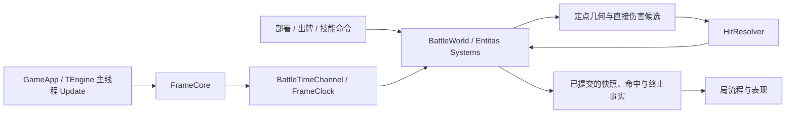

# Project B 帧驱动框架设计方案

本页为拆分前的设计底稿。生产移动采用 [本地 RVO2 接入](Project_B战斗与局内系统/19-寻路模块实现代码.md)，下文自定义积分和移动余数仅保留为历史背景。当前待确认稿见 [01 帧驱动独立模块方案](01-帧驱动独立模块方案.md)、[02 Project B 战斗模块方案](02-Project_B-战斗模块方案.md) 和 [03 HitResolver 独立模块方案](03-HitResolver独立模块方案.md)。

2026-11-15 · 待确认

## 1. 目标与首期范围

Project B 的同一回合中，玩家实时出牌、单位接近敌塔、双方自动攻击，塔破损会影响核心暴露和回合结果。建议采用 **整数纳秒驱动的固定步长、每场独立的 Entitas 战斗世界、定点战斗数值、集中命中结算**。先实现通用帧核心，随后用「部署一批测试单位 → 自动攻击 → 塔破损 → 核心暴露和回合终止」把战斗接入走通。正式牌区、洗牌、商店、整局流程和美术表现在后续接入，首个战斗闭环使用固定初态和测试指令。 [程序策划案](../游戏设计/02-程序策划案.md) · [回合准备与终止](../游戏设计/功能需求/03-回合准备与终止.md) · [伤害与攻击结算](../游戏设计/功能需求/39-伤害与攻击结算.md)

| 策划规则 | 框架中的责任 |
| --- | --- |
| 准备结束后敌方完成部署，才开始战斗 | 局流程交付回合初态。战斗会话创建并发布 Tick 0 后开始收正式战斗指令。 |
| 玩家实时出牌和释放技能，正式战斗无暂停 | 表现提交带会话代号的业务指令。战场每步按固定顺序消费、校验费用与合法位置。暂停和单步属于调试入口。 |
| 抽牌到期且手牌已满，空出手牌后再抽并重计时 | 牌组保留 `NextDrawTick` 与待抽状态。下一次截止以实际抽牌 Tick 为基准。 |
| 单位、塔自动行动，单位存续时间为零可表示无限 | 战场按步处理移动、攻击间隔和存续期限。配置转换时保留无限存续的独立语义。 |
| 塔破损影响核心暴露、计分和能量，核心击破结束本层 | 当步产生有序伤害、破损与核心状态事实。核心连带破损、普通死亡与回合回收各有原因。局流程决定最终分支。 |

规则出处包括 [抽牌与洗牌](../游戏设计/功能需求/06-抽牌与洗牌.md)、[出牌与费用](../游戏设计/功能需求/07-出牌与费用.md)、[玩家单位](../游戏设计/功能需求/09-玩家单位.md)、[敌方防御塔](../游戏设计/功能需求/10-敌方防御塔.md) 和 [英雄核心](../游戏设计/功能需求/11-英雄核心.md)。

### 对五份参考稿的取舍

| 参考稿 | 进入本设计的内容 | 项目化调整 |
| --- | --- | --- |
| 归档 07 帧核心 | 时间通道拥有独立时钟、主线程稳定分发、逻辑与表现分离 | 首期只有战斗通道。采用整数相位。战斗系统树集中组织顺序，等出现其他通道或阶段消费者再扩展接口。 |
| 归档 06 战斗系统 | 输入、逻辑、命中、清理、渲染各有阶段 | 正式入口是出牌、召唤和自动战斗。动作角色连招、Unity 物理查询及全局战斗单例属于参考稿候选。 |
| 10 帧核心修订 | 整数纳秒、固定 Tick、每通道暂停与限步、明确提交点 | 时钟只支持明确的输入范围。帧定时器先做同步任务。异步等待有确定消费者再设计取消和恢复。 |
| 11 战斗接入 | 独立战场、定点位置和速度、战斗结果交接 | 用当前 TEngine 生命周期、Jenny 配置和实际工程目录确定实施前置。 |
| 12 命中与伤害 | 查询与结算分离、攻击段去重、生命递推、三路消费 | 补齐直接伤害的合法性、身份冲突、容量失败、核心暴露和截止 Tick 的边界。 |

五份参考稿中的实施清单和样例均作为设计输入。首期交付边界由本需求和策划规则决定。

## 2. 成熟方案对照

| 查阅原件 | 观察到的做法 | 对 Project B 的影响 |
| --- | --- | --- |
| [Glenn Fiedler · Fix Your Timestep](https://gafferongames.com/post/fix_your_timestep/) | 宿主积累真实时间，模拟以固定步长消费，余量用于插值。限制单帧补步会使高负载下的模拟时间放慢。 | 采用累加、固定步和限步。超额整步时间丢弃是本项目选项，回合时间随模拟一起放慢。 |
| [Bevy · 固定时间源码](https://github.com/bevyengine/bevy/blob/main/crates/bevy_time/src/fixed.rs) | `run_fixed_main_schedule` 从虚拟时间积累余量，固定调度可执行零次或多次。 | 有独立时钟与循环的成熟样本。只借调度模型，Unity 宿主与 Entitas 系统保持现有技术栈。 |
| [Entitas 1.14.1](https://github.com/sschmid/Entitas/releases/tag/1.14.1) · [官方 Systems 文档](https://github.com/sschmid/Entitas/wiki/Systems) | Systems 有初始化、执行、清理、拆卸生命周期。ReactiveSystem 按收集到的实体处理变化。 | 根系统树按顺序推进。每个攻击结果都需要独立身份，结算采用显式数据批次。 |
| [FixedMath.Net · Fix64](https://github.com/asik/FixedMath.Net/blob/master/src/Fix64.cs) · [Photon Quantum · Fixed Point](https://doc.photonengine.com/quantum/v3/manual/quantum-ecs/fixed-point) | 前者二进制 32.32，乘法实现有拆字与饱和策略。后者 48.16，文档区分值域和可安全乘法的操作范围，并区分安全与浮点配置转换。 | 继续评估归档的十进制百万分之一刻度。把输入量化、有效操作范围、舍入和溢出行为写成契约，暂不引入两者依赖。 |
| [OpenRA · 范围伤害](https://github.com/OpenRA/OpenRA/blob/bleed/OpenRA.Mods.Common/Warheads/SpreadDamageWarhead.cs) · [目标伤害](https://github.com/OpenRA/OpenRA/blob/bleed/OpenRA.Mods.Common/Warheads/DamageWarhead.cs) | 对每个目标筛出有效形状，再选择形状、计算伤害并写入。范围与指定目标有共用伤害规则。 | 借鉴「按目标择一」和两路请求收敛。OpenRA 范围伤害边遍历边施加，本项目额外用批次固定资格和提交顺序。 |
| [Box2D · 步进事件](https://box2d.org/documentation/group__events.html) · [白井功名 · 攻击持续帧去重](https://www.gameres.com/657016.html) | Box2D 在步进后提供接触和传感事件，不同事件有各自触发条件。白井的攻击数据段允许同持续形状分段命中、同段只命中一次。 | 借步后收集和攻击段生命周期。权威命中使用当步几何查询或直接伤害请求，覆盖持续重叠和脉冲。 |
| [Klotho · 同步设计](https://github.com/xpTURN/Klotho/blob/main/Docs/SynchronizationDesign.md) | 固定步进加命令、验证帧与回滚，以支持联机同步。 | 用稳定 Tick、命令记录、配置版本与状态摘要验证本地重跑。联机、预测和快照恢复另立需求。 |

Unity `FixedUpdate` 可以承担普通固定更新。Project B 需要回合自有时钟、调试单步、明确限步和注入式重跑，独立时钟更容易规定这些行为。固定 Tick 和定点计算使输入数据与运算可控，结果一致性还依赖稳定遍历、ID、随机流、算法与配置版本。

## 3. 模块、所有权与工程接入



| 位置（拟） | 职责与生命周期 |
| --- | --- |
| `GameLogic/Module/Frame/` | 纯 C# `FrameCore`、`ITimeChannel`、`FrameClock`、`FrameTimer`。宿主持有 Core，注册成功后由 Core 拥有并释放通道。 |
| `GameLogic/Battle/Simulation/` | `BattleTimeChannel` 持有本场 Clock、可选帧定时器和 `BattleWorld`。World 持有正式 Contexts 实例、系统树、战场状态及复用的工作缓冲。 |
| `GameLogic/Battle/Hit/` | 纯 C# 几何、`HitResolver`、伤害批次类型。Entitas 系统负责提取输入与写回。 |
| `GameLogic/Battle/Components/`、`GameLogic/Battle/Generated/` | 手写战斗组件与正式生成输出。业务用稳定 `BattleEntityId`，不保存 Entity 或 Unity 对象到组件。 |
| `GameLogic` 热更宿主及战斗出口 | `GameApp.StartGameLogic()` 激活帧宿主，建议沿用 `Singleton<T>` 和 `IUpdate`，通过 `GameModule.Frame` 暴露窄入口。会话结束只注销通道。全局释放复用 `ReleaseLogic()` → `SingletonSystem.Release()`。发布快照和通知在已提交后进行。 |

宿主在 `Update` 读取 `Time.unscaledTimeAsDouble`，相对上一采样点换算整数纳秒，携带亚纳秒换算余量。新战斗通道在采样边界激活并发布 Tick 0，从下一段完整采样间隔开始累积。恢复前台时重取采样基准，后台离开期间不累计。首次绑定的输入与帧时间在宿主上显式排序。主循环从 `GameApp.Entrance` 接入。现有 `UpdateDriver` 订阅经过 `UniTask.Yield`，因此使用一个应用生命周期的宿主桥，回合切换仅更换所持通道。宿主负责帧更新，`GameModule.Timer` 继续服务需要秒制计时的 UI 与表现。 [GameApp](../../Assets/GameScripts/HotFix/GameLogic/GameApp.cs) · [SingletonSystem](../../Assets/GameScripts/HotFix/GameLogic/SingletonSystem/SingletonSystem.cs) · [UpdateDriver](../../Assets/TEngine/Runtime/Module/UpdataDriver/UpdateDriver.cs) · [Unity 时间采样 API](https://docs.unity3d.com/6000.0/Documentation/ScriptReference/Time-unscaledTimeAsDouble.html)

### 当前 Entitas 接入事实

- 本地工程声明 Unity `6000.0.69f1`，`Assets/Plugins/EntitasOfficial/Entitas/` 已有 Entitas DLL，`GameLogic.asmdef` 的 `overrideReferences` 为 false。项目规则中的「尚未安装」描述与磁盘产物有出入。接口按项目指定的 1.14.1 设计，当前导入、目标平台兼容和 AOT 泛型保留仍待实施验证。 [Unity 版本](../../ProjectSettings/ProjectVersion.txt) · [GameLogic.asmdef](../../Assets/GameScripts/HotFix/GameLogic/GameLogic.asmdef) · [Entitas 开发规则](../../.agents/skills/entitas-dev/SKILL.md)
- 现有 `Jenny.properties` 目标为 `EntitasDemo/Generated`，工具项目扫描 `EntitasDemo/Components/*.cs`，Context 配置为 `Game`。Demo 源在当前工作树已删除。实施时先取得可用的 1.14.1 Jenny CLI，复用工具项目和唯一生成入口，迁移到正式 `Battle` Context。同步调整工具侧属性、组件 glob、定点字段类型的源码或程序集引用。输出使用独占 `Battle/Generated`，因为配置启用了清理目标目录的后处理。工具项目位于仓库根的 `Tools/Entitas/EntitasGen`，改动须与仓库外层接入一并确认。 [Jenny 配置](../../Jenny.properties) · [生成工具项目](../../../Tools/Entitas/EntitasGen/EntitasGen.csproj)
- 每次创建一套正式生成的 `Contexts` 实例和系统树，从该实例取得 `BattleContext`，确认生成器注册必要索引。组件源先于生成代码，修改数据走生成的 `ReplaceXxx`，高频组件以缓存 Group 和复用缓冲读取。有竞争的遍历、分配 ID、随机取样前统一业务排序。热路径只在主线程写入。
- 结束一场先关命令入口，停止进一步步进，取得只读回合结果，再解除观察者并执行系统 `TearDown()`、清理 Context 实体与保留引用。已发布的数据使用值或独立缓冲，生命周期覆盖消费完成。下一回合创建新 World 并按局流程交付的数据初始化。

## 4. 固定步长和时间契约

- 推荐 **60 Hz，每次宿主更新最多 4 步**，作为起始配置。步长语义是精确的 `1 / TickRate` 秒。常态下保留不足一步的余量。预算外的完整步对应时间丢弃并计数，Tick 号连续，战斗倒计时、移动和伤害共同减速。1 秒以上宿主采样间隔按 1 秒计入且单独记录被截时长。正式倍速为 1，建议时钟测试范围为 `1..240 Hz`，调试倍率为 `0..4`。
- 一个宿主帧可以提交零或多步。每次成功推进一 Tick，初态为 0。执行中收到退出或暂停请求，边界在当前步提交后。调试暂停保留时钟余量和显示位置，单步只提交一步并显示该步末快照。恢复时重置显示插值的前后基准，暂停时间和被取消的补步预算不结转。
- 逻辑秒数在加载或开始动作时用 `ceil(secondsRaw × tickRate / 1_000_000)` 向上量化为 Tick。间隔至少 1 Tick，单位寿命的 0 由业务转换为无期限。冷却、Buff、射击间隔等优先用到期 Tick 字段。首期统一使用全场战斗 Tick。若以后确认单位顿帧需要影响逻辑，从命中后下一步开始冻结该单位行动 N 个战斗 Tick。
- 已激活的通道按 `Order`、注册序排序。分发时的新注册下一轮生效，请求注销的通道若尚未驱动则跳过，实际释放在分发收尾。禁止嵌套推进。

```text
FrameCore.Register(channel) / Unregister(channel) / Update(elapsedNs) / Dispose()
ITimeChannel.Order / Update(elapsedNs) / Dispose()
FrameClock.CommittedTick / TickRate / Phase
FrameClock.Advance(elapsedNs, executeStep) / SetDebugPaused(paused) / RequestDebugStep()
FrameTimer.Once(delayTicks, action) / Repeat(intervalTicks, action) / Cancel(handle)
BattleWorld.Initialize(initialState) / RunTick(tick) → BattleTickBatch / Dispose()
```

Clock 负责相位和提交编号，Channel 确定本步执行目标与结果缓冲。签名为方案草图，正式入口的暂停开关只在调试控制器可达。

```text
Advance(elapsedNs)
    若暂停：本轮至多用 RunAndCommit 执行一次单步，成功后清零 phase；返回
    total = phase + min(elapsedNs, 1_000_000_000) × scaleRaw × tickRate
    whole, phase = DivRem(total, 1_000_000_000_000_000)
    budget = min(whole, maxSteps)
    for each step in budget
        RunAndCommit(committedTick + 1)
        若当前步要求结束或暂停：退出本轮

RunAndCommit(candidate)
    预留 outbox 槽位；batch = world.RunTick(candidate)
    committedTick = candidate
    outbox.AppendReserved(batch)

Unity 表现输入：renderAlpha = (double)phase / 1_000_000_000_000_000d
```

相位计算使用受限的 `long`，最大正常输入的乘积是 `960_000_000_000_000_000`，加最大相位后仍可表示。入口检查非负时间与配置范围。渲染 `Alpha` 在表现边界转为浮点。两个快照只覆盖连续成功提交的 Tick，初始、传送和单步用当前帧同步前后快照。每步开工前预留结果缓冲。宿主走独立消费阶段逐批送出，避免在 `SingletonSystem.OnUpdate()` 枚举期间触发更改更新者集合的外部回调。补步失败时将会话标记故障、丢弃故障步的输出并整体退出。ECS 可能已经部分写入，因此故障会话不得继续参与计分或重试。之前已提交的批次可以消费，表现订阅异常不能改变已提交状态。

`FrameTimer` 划归通道，首版提供 Once、Repeat 与 Cancel。每步开始置当前计时 Tick 为候选 Tick，再按「到期 Tick、登记序」派发。同 Tick 内取消对后续项立即生效，本步新登记的延迟至少 1 Tick。重复任务下一次从上次到期 Tick 计算。句柄带计时器实例身份，停止时清理尚未执行的回调。首期回调用于内核和宿主调试。权威业务用截止字段或可编码的到期任务数据，重跑记录后者的截止 Tick、顺序和载荷。

## 5. 定点数与几何

推荐用 `Fixed64.Raw / 1_000_000` 表示配置小数、位置、速度、范围和倍率。Tick、格位、ID 和策划定义的整数量保持整数。十进制刻度能精确表示最多六位小数的输入。首版显式定义原始值构造、比较、加减和必需的乘除，向零舍入，除零和溢出报错。配置读原始整数或固定文化的十进制文本并一次量化，超精度先拒绝。权威初态来自数值配置，写入 Unity Transform 时才转成浮点。若以后引入通用二进制定点库，迁移涉及配置、存档、回放与边界判定，需单独决定。

| 运算 | 首版约定 |
| --- | --- |
| 定点乘除和秒转 Tick | 先算精确中间值，再舍入和检查最终范围。产品热路径靠已验证输入上限使用 checked `long`，超域在配置或状态校验报错。用 `BigInteger` 作为离线配置校验及计算对照，正式宽整数算法仅在业务域证明需要时选型。 |
| 按步移动 | 每轴 `sample = velocityRaw + remainder; displacementRaw = sample / tickRate; remainder = sample % tickRate`。同一连续移动段携带有符号余数。传送、强制吸附和阻挡而丢弃位移时，重置被影响轴的余数。每秒原始速度 ±61 在 60 步后累计 ±61。 |
| 战斗平面 | 用二维定点坐标。首期每个目标一个轴对齐的主体盒，面积攻击用圆形。圆盒查询把圆心夹到盒上求最近点，以 `dx² + dy² ≤ radius²` 判断，接触边界计入。指定目标攻击通过业务范围和保护检查。 |
| 安全范围示例 | 若圆心和盒的所有边界、各轴运行时位置均在 ±1000 世界单位内，且半径 ≤1000，则 `abs(dx), abs(dy) ≤ 2×10^9 Raw`，平方和 ≤`8×10^18`，有符号 `long` 可容纳。地图尺寸或单位比例扩大前重算边界。盒中心加减半径/半宽、位移累加均先检查范围。计算平方时直接用原始值，避免定点乘法两次缩放截断改变几何边界。 |
| 配置与随机 | 开战前定稿为不可变快照，记录版本、公式、数值刻度与舍入规则。随机种子及按顺序取样由 World 持有。战局进度摘要需覆盖可影响后续 Tick 的数据，包括余数、活动攻击段、待派发到期数据和随机状态。 |

首批先用扫描全部受击候选的可读实现，与目标规模对应的预分配数组去除日常分配。候选规模由攻击/目标/形状上限推导，满容量时在发布前报告故障，禁止静默漏命中。需要空间索引时沿用相同输出合同，以扫描版作对照。首期圆盒按当步位置离散判定。高速飞行物另接扫掠查询，复用命中候选接口。

## 6. 战斗帧序与 HitResolver

一场的设计顺序为 **封存指令 → 清理到期资格及处理指令 → 索敌及移动 → 产生攻击请求 → 固定命中快照 → 查询候选 → Resolve → 写回及派生 → 终止判断 → Cleanup → 提交**。评审建议单位存续到期 Tick D 的行动区间为 `[SpawnTick, D)`，D 步先撤销其行动和受击资格。正式抽牌接入时，同一步先处理手中的出牌指令，再处理到期及待抽，因此满手时成功出牌可在当步释放一个抽牌机会，新抽的牌从下一步起可出。索敌采用当前战场快照。攻击采集用移动后位置再判攻击距离。攻击冷却、目标和格位归战场的对应系统，HitResolver 消费已建好的几何与业务候选。

系统树预计由 `BattleCommandSystem`、到期处理、`TargetingSystem`、`MovementSystem`、`AttackRequestSystem`、`HitResolveSystem` 和回合出口系统按上述数据依赖组织。实体至少携带业务 ID、归属、战场定点位置、生命和受击形状。能行动的对象另有目标 ID、移动余数和攻击可用 Tick。塔另有占位、塔种类以及核心的暴露状态。初始化只跑一次，每 Tick 调一次根 `Execute()` 和 `Cleanup()`，按值写出的事件保留各次命中的身份。销毁集中在清理阶段，离场时拆卸系统并释放 Context 引用。

| 数据 | 关键字段和所有权 |
| --- | --- |
| `BattleCommand` | 会话代号、目标 Tick、递增输入序号和业务载荷。UI 将输入登记到下一未执行 Tick，Tick 开始封存该步命令。同一渲染帧的补步只消费一次每条指令。重跑对比使用已经分配到 Tick 的输入记录。 |
| `AttackRequest` | Tick、全场唯一且不复用的 AttackInstanceId、SegmentId、SourceId、AttackDefinitionId、形状或直接目标。创建顺序来自稳定的行动者 ID 或命令序。跨步持续攻击复用实例与段号，段号在同实例内不复用。 |
| `HitCandidate` | 攻击身份、TargetId、候选种类和两侧形状 ID。几何与直接请求进入同一缓冲。直接路径跳过几何相交，仍检查阵营、存活、技能授权和核心保护。 |
| `ResolvedHit` | Tick、HitOrdinal、来源与目标、实例与段号、预扣血计算伤害、实际扣血、前后生命及击破类型。伤害和生命统一用战斗的生命计量单位，原型使用整数。用 `(BattleId, Tick, HitOrdinal)` 标识有序结果。 |

命中去重键为 `(AttackInstanceId, SegmentId, TargetId)`。排序键为该三元组后接候选种类优先级、`HurtboxId`、`HitboxId`。原型同组以合法直接候选优先，几何候选使用稳定形状顺序。攻击定义由实例元数据固定，完全相同的候选可归并，身份相同却携带冲突定义的记录视为生产方错误。后续部位倍率或优先级需引入显式配置。

```text
ResolveTick(tick, requests, targetSnapshot, hitLedger)
    生成几何与直接候选，确保所有缓冲有容量
    按完全定义的业务顺序排序并按去重键分组
    for group in groups
        从快照校验权限，取组内第一个合法候选
        若无合法候选、已使用同段资格或工作生命为 0：跳过
        calculated = damageRule(攻击定义, 快照中的受击属性)
        若 calculated < 0 或超出生命计量范围：报告规则错误
        applied = min(calculated, 工作生命)
        记录结果、更新工作生命、登记本段已生效
        若生命首次从正数变为 0：记阵亡或破损
    返回有序结果、工作生命变化与段命中记录

CommitBattleTick(batch)
    预检批次容量、写回目标与字段范围
    用生成的 ReplaceXxx 等接口写入生命及待清理标记
    应用段命中记录，在段结束且处理完本步候选后回收
    若核心被击破：同一步按稳定 ID 将其余存活塔转为破损状态，记录连带原因
    从事实更新核心暴露、统计及候选终止原因
    执行 Entitas Cleanup，准备提交给宿主的只读数据
```

首期评审语义如下，数值公式与策划待定项可按 §8 调整。

- **同段、多段与免疫。** 多盒、多 Tick 重叠，同段只扣一次。有序结算持续段的记录活到该段结束。免疫与非法候选不占用命中资格，合法的零伤害命中占用资格。独立脉冲用新段号。
- **同 Tick 多次伤害。** 用快照固定进攻资格、阵营、防御与保护，用工作缓冲依次扣减生命。HP 5 先后收到 3、4，实际扣血 3、2，第二条产生唯一击破。本步已发出的合法攻击可以互杀。反击或提交阶段派生的新攻击排到下一 Tick。
- **核心暴露与截止。** 外塔在第 N 步破损，步末提交暴露，N+1 起使用新暴露状态索敌、受击与开火。该规则是方案默认，穿层技能与暴露判定仍需策划确认。回合截止 Tick 为 D 时，评审建议允许 D 完整执行，禁止摄入 D+1 指令。每步结束可同时记录超时、核心破坏和提前结束事实。提前结束的原案条件是费用已无法再出任何牌，且玩家非建筑单位全部阵亡。终止原因的业务优先级由局流程结合策划确定。
- **三类消费。** 战场当前步写入生命、破损与核心暴露。评分、能量、掉落基于同一批事实按各自口径取计算伤害或扣血。核心连带破损只产生带原因的破损事实，每座塔仅产生一次破损，回合回收拥有独立结果。表现收到已提交批次后消费伤害数字和特效，同一渲染帧的不同 Tick 批按序保留。 [评分](../游戏设计/功能需求/14-战斗评分.md) · [角色主动技能](../游戏设计/功能需求/16-角色主动技能.md) · [法球掉落](../游戏设计/功能需求/19-法球掉落与领取.md)

## 7. 分步实施与验收

以下清单是后续实施顺序。各步通过可读的中间产物连到下一步。项目要求按用户批准的范围实施和运行验证。

- [ ] **A1 · 固定时钟、通道与帧定时器。** 在 `Module/Frame/` 接入稳定注册、退出和限步。`纳秒输入 → phase/budget → 有序步进 → 成功提交`。先通过纯 C# 输入驱动，不依赖 Entitas 生成。
- [ ] **A2 · 定点值与配置边界。** 定义 `Fixed64` 与二维定点位置，建立配置输入上限、连续积分和比较相交规则。`文档数值 → 原始整数 → 检查输入域 → Tick/战场配置`。
- [ ] **B1 · 生成正式战场及生命周期。** 补齐 Jenny 工具，迁移扫描与生成目录，建立 `Battle` Context、业务 ID、基础属性和系统树。 `初始化 Contexts → Initialize → 每步 Execute/Cleanup → TearDown/Reset`。
- [ ] **B2 · 攻击候选与 HitResolver。** 接入直接候选、圆盒候选、攻击段去重、生命工作缓冲和当步提交。`快照 → 候选 → 局部递推生命 → 破损事实`。原型使用固定伤害，待正式公式确认后替换规则。
- [ ] **B3 · 宿主与首个闭环。** 从 GameApp 激活帧宿主，构建测试部署、敌塔、核心和回合期限，向消费者交付快照与命中数据。`召唤命令 → 自动接近/攻击 → 塔破损 → 核心暴露或超时 → 移除通道`。
- [ ] **C · 业务接口接续。** 按策划确认的优先级迁移正式配置，接入牌组、主动技能、评分、能量和掉落。`命令与只读战果 → 局流程/各自业务状态`。

| 验收用例 | 预期 |
| --- | --- |
| 60Hz 输入 8ms、9ms、200ms | 各执行 0、1、4 步，报告 8 个超预算步，保留 0.02 步相位。均匀分成接近一帧的 60 段整数纳秒，一秒提交 60 步。 |
| 60Hz 输入 `16_666_666ns + 1ns` | 分别推进 0 和 1 步。使用精确相位，未把每步写死为整数纳秒。 |
| 暂停、单步、取消和退场 | 暂停期间无普通步进。单步一个 Tick。定时器同截止按登记序，先项取消后项立即生效。回合关闭后旧句柄或旧会话指令无法作用新会话。 |
| 定点极小速度与几何 | 每秒 ±61 Raw 的位移正负对称。圆盒相切成立，超出一个 Raw 单位不成立；负坐标和最大域正确；超域拒绝。 |
| 同段同目标以及不同目标 | 同段同目标跨多盒、多 Tick 只应用一次，同段另一目标仍可受伤，新段可再次命中。打乱候选输入顺序后结果一致。 |
| 同 Tick 双击、互杀、核心和超时 | 验证 HP 5 受 3、4 的单次击破；已采集攻击可互杀；外围清空后下一步核心可攻击；截止步的多个终止事实均存在。 |
| 单位到期和抽牌接入 | 单位到期的该步退出可交互战场。抽牌到期时手牌已满，成功出牌后同一步抽 1 张，并以实际抽牌时点重算期限。 |
| 多步、故障和重开 | 同一宿主帧按序消费全部成功批次。若 N+1 失败，N 已提交批次可消费，故障场退出。重开初始 Tick、命令队列和战场互不污染。 |
| 同版本重跑、容量与性能 | 用同初态、已分 Tick 指令、种子和配置，分别以 30/60/120Hz 宿主供给重跑。比较相同已执行 Tick 的命中与状态摘要。记录 P95 Tick 时长、候选缓冲峰值、GC 和丢步次数。预热后稳定战斗的帧核心及几何/结算路径以 `0 B/Tick` 为测量目标。全战场性能按目标设备和最高场上规模验收。 |

## 8. 待用户确认

1. **步频和超载策略。** 是否采用首版 60Hz、每 Update 最多 4 步、超额丢整步，回合时长以战斗 Tick 为准。若必须按现实时间结束，需改定回合计时和补步策略。
2. **定点刻度与场景数值域。** 是否采用十进制百万分之一刻度、暂以 ±1000 世界单位作为原型坐标与几何边界，并在正式配置前确认格位比例、地图半径和最大单位数。
3. **结算与终止的项目规则。** 确认回合截止步、单位到期步、同 Tick 出牌与抽牌顺序，以及互杀、零伤命中资格与核心暴露生效时点。伤害公式、过量伤害的计分和能量口径、连带破损统计、核心击破与荣誉归零优先级由策划确认。A1、A2 和固定伤害的 B2 可以基于文档内的原型口径开展，正式规则接入以确认结果为准。

当前交付是设计文档和源码调研。上表为后续验收预期，当前未运行 Unity、Jenny、编译、测试、Profiler 或回放。
