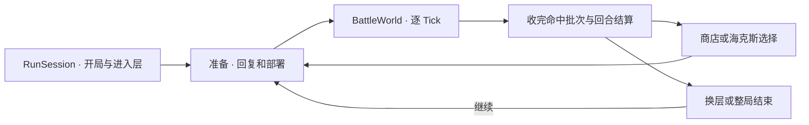

# Project B 战斗编排与集成方案

2026-11-15 · 架构评审稿

## 接入依据

- 策划以本地 [Project_B.md 修订 5989](<D:/缓存/WorkBuddy/2026-11-13-23-19-02/Project_B.md>) 为准。原文 L15–21、L159–290 定义实时战斗和五层挑战，L537–539 明确回合编号跨层累加，L53–157 补齐了旧索引缺失的局内养成、海克斯触发和法球规则。[仓库策划索引](../../游戏设计/00-总览与索引.md)可用于定位旧需求整理。
- [现行帧驱动方案](../Project_B-帧驱动框架设计方案.md) §3–6 给出每回合一个 BattleWorld、整数纳秒驱动固定 Tick、定点运算、HitResolver 和提交点。按工作树已读内容，帧核心和 HitResolver 仍在设计阶段。60 Hz、每宿主更新上限 4 步、超额整步扣除和每百万分之一的固定点刻度，沿用该稿的原型建议，正式选型待确认。
- Entitas 按 1.14.1 设计。当前有 Entitas 官方 DLL、GameLogic 程序集和 Jenny 配置。Jenny 的 Context 为 Game，扫描及输出仍指向已删除的 EntitasDemo，编辑器测试脚本仍引用 Demo 类型。实施前将生成入口迁至正式 Battle Context，并处理遗留测试引用及目标平台的导入和 HybridCLR 边界。[Jenny 配置](../../../Jenny.properties) · [生成项目](../../../../Tools/Entitas/EntitasGen/EntitasGen.csproj) · [编辑器遗留脚本](../../../Assets/Editor/EntitasDemoTest.cs) · [Entitas 1.14.1](https://github.com/sschmid/Entitas/releases/tag/1.14.1)

## 外部实现对照

| 原件 | 核到的实现 | 项目取舍 |
| --- | --- | --- |
| [固定时间步原文](https://gafferongames.com/post/fix_your_timestep/) | 宿主累计时间，模拟按固定步消耗余量，渲染插值独立。过多补步可能扩大积压。 | 沿用帧驱动稿的固定步、余量和限步选择。模拟倒计时按已执行 Tick 扣减。 |
| [OpenRA World.cs](https://github.com/OpenRA/OpenRA/blob/bleed/OpenRA.Game/World.cs#L385-L475) | World 按序推进 Actor、Trait、Effect，并在帧末消费收尾任务。表现另有 TickRender。同步摘要包含影响演算的状态和随机。 | 采用单宿主、稳定推进、独立表现和状态摘要。Project B 的权威跨模块交互走有界值批次，提交期间避免同步业务回调。 |
| [Entitas Systems](https://github.com/sschmid/Entitas/wiki/Systems) | 根系统树管理初始化、执行、清理与拆卸。ReactiveSystem 消费被收集的实体。 | 模块各自提供本地系统和读写入口。需要每笔输入、命中和费用变化时保留独立记录，逐笔结算不依赖 Collector 的合并语义。 |

## 唯一写入方

战斗模块拥有阶段机、命令入口、系统装配、战场格位及占位规则、空间快照编排、HitResolver 和战果汇总。它根据同一份战果传递局内输入，由各模块写自己的状态。模块可独立用固定输入驱动。共享字段限定为稳定 ID、定点值、请求和结果，不共享模块组件访问权。初期可使用同一个 BattleContext，模块内部系统仅访问本模块所拥有的组件，战斗装配只持各自窄接口。孤立演算只装配对应模块。只有生命周期存在实际差异时才增加 Context。

| 方案 | 独占状态与对外结果 |
| --- | --- |
| [卡牌](01-卡牌实现方案.md) | 本局牌组、回合牌区、卡实例及星级、羁绊档位规则、抽牌时钟和打牌后的牌区结果。 |
| [敌方 AI](02-敌方AI实现方案.md) | 规则评分和部署提案。输入是对手库存、现有塔、合法格位等值快照。 |
| [建筑](03-建筑实现方案.md) | 场上建筑实例、生命、攻击状态、破损、抵抗塔复活以及核心暴露规则。输出部署/占用请求、形状、攻击意图与结果，战斗占位表独占格位映射。 |
| [单位](04-单位实现方案.md) | 单位实例、生命、位置、目标、攻击周期、阵亡和回收。 |
| [局内养成](05-局内养成实现方案.md) | 双方经验、等级、成长里程碑、商店格/报价/刷新锁定、法球掉落和领取资格。 |
| [Buff](06-Buff实现方案.md) | Buff 来源、实例、层数、时限、周期触发计数及修正输出。 |
| [技能](07-技能实现方案.md) | 角色能量、施放、阶段和冷却，输出攻击与其他效果意图。 |
| [背包](08-背包实现方案.md) | 物品、装备、装备绑定及敌方待部署等可持有对象的实例。海克斯和牌组可作只读投影。 |
| [资源](09-资源系统实现方案.md) | 金币、荣誉、战斗费用，账本、余额限制及资源变更事实。 |
| [双向选择](10-双向选择系统实现方案.md) | 双向交易规则、海克斯待选会话及双方选中归属记录，输出带双方效果的原子业务计划。 |

## 局生命周期与帧顺序



RunSession 是战斗模块的局级宿主，保存全局回合序号和规则快照，持有各模块局级状态的接口。每次准备开始导入敌塔跨回合快照、基准牌组、资源、技能能量及常驻效果种子。准备回复、复活、分配格位、部署与清理是有序命令事务。玩家确认后，冻结输入快照，AI 给出提案，战斗重新校验占位，统一提交背包到场上及格位变更，处理剩余建筑后才开战。终局导出提交后的模块数据再关闭战斗入口、解绑和拆卸。商店和选择窗用 RunCommandSequence 和 WindowId 推进，BattleTick 仅在进行战斗时增长。

`RoundId = (RunId, GlobalRoundNo)` 连接准备、费用预算、回合内限次记录和唯一回合结算。BattleId 标识某个 BattleWorld 实例，用于命令、场内实体、Tick 和命中。WindowId 标识一次准备、商店或选择窗口，其命令仍携带关联 RunId 与版本。敌方所有权使用当前层英雄实例身份，独立于配置里的英雄定义 ID。

| 阶段 | 生产和消费顺序 |
| --- | --- |
| 入帧 | 封存 BattleCommand，按 InputSequence 处理。到期单位、建筑及 Buff 先退出本步资格，影响指令合法性的旧修正先同步撤销。 |
| 指令提交 | 出牌、施放按序完成准备与批准，旧窗口、旧角色/目标和重复指令按契约拒绝或去重。获准出牌即腾出手牌位置。等待命中结算的牌暂离手，完成载荷后才进入弃牌或移除区。抽牌在出牌后处理，若有其他可抽牌则满手腾位可在当步抽到；新抽牌下一步可出。 |
| 效果与属性 | 应用获准的即时状态修改，重算脏属性、更新费用上限，形成行动输入。需要影响本帧命中的新增影响必须在资格快照前明确应用。首期普通出牌定价读取指令阶段已提交修正，新产生的属性修正默认从这一阶段开始可见。 |
| 行动与命中 | 单位索敌/移动、建筑与单位攻击、技能阶段和持续伤害产生值意图。移动后固定命中快照。几何、直接伤害都进同一命中结算入口。 |
| 结算 | 写回有序生命变化和段命中记录，收集伤亡、破塔和暴露。按已提交事实产生统计、费用/能量等有序请求。命中反应产生的新攻击放入下一 Tick。 |
| 收尾 | 核核心、超时与提前结束，标记并执行 Cleanup。世界成功后才提交 Tick 和整批快照给外部。 |

到期采用半开区间，单位第 D 步到期，第 D 步不能行动或受击。回合时间基准取回合表，按开战时参战牌组份数补时。首期有技能减速时，由战斗模块维护独立的定点剩余倒计时并逐 Tick 扣减，BattleTick 步长保持固定。耗尽倒计时的 D 步完整执行，D+1 的输入不摄入。原案 L294 中 0.5 倍持续 15 秒与「延长 30 秒」无法同时由简单减速得到，建议暂采用 15 个战斗秒的减速窗口，最多少扣 7.5 秒倒计时，待策划确定时钟域和时长。评审提案在结算完当步费用后判断提前结束，同时从各域读取未来抽牌资格、截止前已排定且次数可用的恢复及可施放技能。例如无存活单位且余额为 0，下一步有已排定的 2 费用且能支付最低牌费时，保留一 Tick 等待；随机触发只有明确可达条件时才纳入，回合超时始终生效。回放记录明确的 TargetTick、InputSequence、局级窗口命令、种子和配置版本。同一局使用相同配置和分流随机，按稳定业务 ID 排序。逻辑层不读取渲染帧时间、Unity Transform 或 UI 事件的到达时序。

## HitResolver 边界

`AttackRequest` 带来源、攻击实例、段、定义、空间形状或明确目标。战斗将单位、建筑、技能和周期伤害产生的意图归一，确保攻击身份和元数据由统一入口分配。候选键为 `(AttackInstanceId, SegmentId, TargetId)`。组内择一、校验阵营/可交互/保护/授权，免疫或非法不占段资格。合法零伤害占资格沿用帧稿的首期口径。命中端口交付 `ResolvedHit(BattleId, Tick, HitOrdinal, …)`，包含计算伤害、实际扣血、以及前后生命。单位和建筑各自通过 Entitas 生成 API 写入其生命和待清理标记。比分、能量和掉落以此处输出为依据，可使用各自已配置的计算口径。

```text
RunTick(tick):
    inputs = sealCommands(tick)
    expireDueAndSyncInputEligibility(tick)
    commitEachAccepted(inputs)
    cards.drawIfDue(tick)
    applyEligibleEffectsAndRebuildDirtyStats()
    intents = collectActionsAndAttackRequests(tick)
    snapshot = captureHitEligibilityAndPostMoveShapes()
    resolved = hitResolver.resolve(intents, snapshot, hitLedger)
    units.applyHealthChanges(resolved.unitChanges)
    buildings.applyHealthChanges(resolved.buildingChanges)
    facts = settleAndDerive(resolved)
    exitFacts = evaluateRoundExit(facts)
    cleanup()
    return freezeTickBatch(tick, facts, exitFacts)
```

同 Tick 用资格快照和工作生命分别处理受击资格、实际扣血及唯一击破。HP 为 5 时连续受到计算伤害 3 和 4，实际扣血为 3 和 2。已发出的合法攻击可以互杀。外塔在 N 结算破损，核心暴露在 N 步末写入，N+1 开始影响索敌、受击与开火。核心一击单记破塔积分，连带塔破损使用独立原因，英雄通关掉落与核心本体不掉球分别处理。单位/建筑到期、回合回收和战斗击破事实独立，只有明确配置的事件产出奖励。战斗编排用伤害和破塔积分作分子，按正数整数比例与要求分数比较，得出唯一评级与 RoundResultId。例如 1.1 属 A。资源和成长读取已定评级，分别提交荣誉、收入和经验。核心/超时/提前结束在同 Tick 可并存，结算优先级由确认后的关卡规则决定。

## 跨模块提交

1. 战斗编排用原请求身份校验局、阶段、窗口版本、当前所有者版本和配置引用。每个可消费结果持稳定事实 ID。独立模块输出自身预检结果和待写补丁。
2. 对同一所有者的多笔补丁按笔构造工作视图，验证全批容量、余额、实例 ID、占位与版本。预检使用局部随机游标和 ID 预分配结果，拒绝时释放工作区且不推进权威随机。整批获准后，在模拟线程连续写入，写入期间禁止外部事件、异步工作、重入或普通业务拒绝。
3. 最后提交消费标记、随机游标、序号和 outbox。重复提交以身份返回先前结果，身份相同而载荷不同视为冲突。预检拒绝保持原状态。Entitas 不能通用回滚。异常造成部分写入时，隔离整个故障 RunSession 及其 BattleWorld，并丢弃故障批次输出。只允许读取上一个成功提交的快照和记录，局末奖励不得采用已污染的局级数据。若未来支持恢复，只能从成功提交点重建。
4. TEngine GameEvent 在完成提交后传递值通知。Unity 视图和 YooAsset 加载在表现层进行，使用会话和实例标识确认异步结果仍归属当前视图。外部保存或局外奖励通过独立的可去重入口接收已提交局末事实。

## 实施次序与验收

- [ ] **帧入口与命中底座。** 按现行帧稿建立正式 Entitas 生成与战场系统树，固定战斗 ID 和有序队列。用测试指令串通 `AttackRequest → Resolve → 所有者写入 → BattleTickBatch`。
- [ ] **准备至结算。** 接入单位、建筑、占位与 AI，覆盖普通塔、核心、抵抗塔、胜败出口及同 Tick 结束。用跨回合快照替换对旧实体的引用。
- [ ] **接入战斗输入。** 接卡牌/资源/技能与 Buff，完成 `出牌预检 → 费用与手牌同批 → 召唤或施放`，使用同一命中批报告伤害、技能能量和评分。
- [ ] **接局级模块。** 资源结算、法球、成长、背包和双向选择按有序命令运行。关卡离开后重新进入准备，验证该保留的数据能导入新世界。
- [ ] **按目标配置验收。** 用同版本配置和输入重跑，覆盖多人或多目标排序、同段命中、快照过期、回收、旧窗口、整批拒绝和游戏结果。

| 用例 | 预期 |
| --- | --- |
| 旧牌拖拽到新回合，或准备确认点击两次 | 旧 BattleId 无效，部署只提交一次。 |
| 两个合法伤害同 Tick 击破塔、最后一座外塔暴露核心 | 扣血依次应用，塔只破一次，核心下一 Tick 可被正常攻击。 |
| 两条出牌都引用同一手牌/剩余费用 | 第一条获准后第二条读到新版本，至多成功一次。 |
| 一帧宿主补多步，后一 Tick 因内部异常失败 | 保留之前已提交的批次，故障步不发布，世界停止。 |
| 换层后商店重复收到同一选择完成序号 | 奖励只结算一次，旧窗口不能修改新英雄。 |
| 同一初态、同一已分帧指令和局级记录 | 不同宿主刷新分组下相同已执行 Tick 的状态和事件一致。 |

优先请策划确认核心击破与荣誉归零的优先级、提前结束时的技能/费用恢复资格、定点伤害与评分口径、跨层继承与海克斯激活对象。本文为方案及待办，当前未运行 Jenny、Unity、编译、测试或回放。

