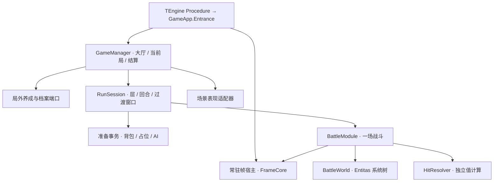

# Project B · GameManager 与游戏生命周期实现方案

2026-11-15 · 设计提案

## 1. 策划要求与设计范围

| 循环 | 原案规则 | 推进所有者 |
| --- | --- | --- |
| 大循环 | 在局外消耗资源成长，选择难度，开始一局，结束后领取局外资源并返回。首期角色可固定为初始角色，多角色选择在原案标「暂无」。 | 应用级玩法入口 `GameManager` 负责大厅、开始、结算呈现与返回。局外养成独占永久档案与奖励入账。 |
| 中循环 | 一局挑战五名防守方英雄；荣誉归零失败；击破前四名英雄各提供额外一次双向海克斯选择，第五名击破满足通关条件。回合号跨层累加，角色能量可跨层延续。 | 单局 `RunSession` 负责当前层、全局回合编号、当局进度、窗口次序、同回合胜负裁决及唯一最终结果。 |
| 小循环 | 回合准备，玩家确认后 AI 完成布阵，进入实时出牌与自动攻防，回合结束后结算。仍继续挑战时进入商店或进入下一层相关流程。 | `RunSession` 持有准备、回合结算、商店与海克斯窗口，调用 `BattleModule` 运行当回合的战斗场次。 |

策划依据为原案修订 5989，导出日期 2026-11-15。循环 L9–25，准备 L232–252，三选一 L123–133，战斗终止 L193–221，评分与能量 L268–294，资源 L296–356，回合表 L535–539。击破核心与荣誉归零同回合的优先级、过层是否进店、英雄选择窗口何时打开、敌人成长继承仍需确认。以下状态名和接口用于技术评审。 [Project_B 原案](https://my.feishu.cn/wiki/AIEkwlgbqiha8dkcxXSc0oH9nae) · [仓库流程索引](../../游戏设计/01-游戏流程.md)

## 2. 调研与选型

| 来源 | 可借鉴的实际做法 | 项目取舍 |
| --- | --- | --- |
| Shattered Pixel Dungeon 的换层入口按模式区分新建、下降、继续和重置。首次下降调用 Dungeon.init，已有英雄的换层推进深度，再按需生成或恢复下一张地图。胜负入口提交排名。 | 让会话进度与局部地图加载分别推进，保存明确移交值。该项目以静态 Dungeon 串起场景，本项目以 GameManager 持 RunSession 及注入的端口组织，方便独立开一场战斗和拒绝陈旧异步结果。 [换层源码](https://github.com/00-Evan/shattered-pixel-dungeon/blob/master/core/src/main/java/com/shatteredpixel/shatteredpixeldungeon/scenes/InterlevelScene.java#L586-L632) · [结果源码](https://github.com/00-Evan/shattered-pixel-dungeon/blob/master/core/src/main/java/com/shatteredpixel/shatteredpixeldungeon/Dungeon.java#L822-L838) |
| Robert Nystrom 的状态模式原文用当前状态、输入和有限转移说明如何管理互斥行为；当状态组合增多时讨论拆分状态机。 | 应用流程和局流程各有有限状态，使用显式转移表。初期用类型化状态和明确函数即可，待转移确有共用行为再抽取。开商店 UI、显示动画属于可重建视图，界面回调只登记输入。 [State 原文源码](https://github.com/munificent/game-programming-patterns/blob/master/book/state.markdown#L88-L119) |
| Unity 异步加载 `Single` 会卸载现有场景。允许挂起激活时，后续异步卸载可能排队等前序完成。 | 首期建议在现有持续宿主之下加载可复用的战斗表现子场景或场地实例，每回合重建逻辑世界。使用 TEngine 场景适配器串行操作同一资源地址，先用正常激活，旧加载补偿完成后才允许该地址进入下一次使用。场景分块与加载模式按实际美术资产决定。 [Unity LoadSceneAsync](https://docs.unity3d.com/6000.0/Documentation/ScriptReference/SceneManagement.SceneManager.LoadSceneAsync.html) · [Unity 场景激活](https://docs.unity3d.com/6000.0/Documentation/ScriptReference/AsyncOperation-allowSceneActivation.html) |

## 3. 作用域和工程位置



| 所有者 | 唯一责任与建议位置 |
| --- | --- |
| `GameApp` 和 TEngine Procedure | 平台初始化、资源与程序集加载、热更入口。现行 `ProcedureLoadAssembly` 在切到 `ProcedureStartGame` 后反射调用 `GameApp.Entrance(object[])`，`ProcedureStartGame` 隐藏启动 UI，`StartGameLogic()` 尚无业务内容。后续由 `StartGameLogic()` 一次装配 GameManager、帧宿主及适配器。`ReleaseLogic()` 先结束玩法所有者，之后调用现有的全局释放。 |
| `GameManager`（拟 `GameLogic/Module/GameFlow/`） | 持一个活动 RunSession，控制大厅、开局加载、运行中、局末、返回、退出。通过构造装配获取局外、场景和 Run 工厂。普通 C# 对象可由 GameApp 直接持有。框架适配入口按现有 `GameModule.XXX` 规范获取 TEngine 能力。 |
| `RunSession`（拟 `GameLogic/Run/`） | 持局级的成长、背包、资源、选择、任务及延续状态。拥有中/小循环状态推进、准备窗口和回合结算。按明确接口使用战斗工厂及局级模块，应用层只请求会话开始、停止和消费最终结果。 |
| `BattleModule`（拟 `GameLogic/Battle/`） | 建立 BattleTimeChannel 和 BattleWorld，持输入与退出批次。每场创建独立 Contexts，在固定 Tick 安排子系统与 HitResolver，并管理该场的表现绑定。通道注册成功后由 FrameCore 负责注销与释放，战斗端以停步请求触发退出。场次结束返回当场事实及跨回合值投影。 |
| 场景适配器与帧宿主 | 适配器管理 `GameModule.Scene` 返回的场景获取与释放；帧宿主采样并调用 FrameCore，场次通过战斗通道注册一次。两者都由应用装配，不承担回合或局末裁决。 |

[GameApp](../../../Assets/GameScripts/HotFix/GameLogic/GameApp.cs) · [ProcedureLoadAssembly](../../../Assets/GameScripts/Procedure/ProcedureLoadAssembly.cs) · [ProcedureStartGame](../../../Assets/GameScripts/Procedure/ProcedureStartGame.cs) · [ISceneModule](../../../Assets/TEngine/Runtime/Module/SceneModule/ISceneModule.cs) · [战斗底座](../02-Project_B-战斗模块方案.md) · [独立帧驱动](../01-帧驱动独立模块方案.md) · [独立 HitResolver](../03-HitResolver独立模块方案.md)

## 4. 状态转移和跨层数据

| 当前阶段 | 输入与动作 | 转移条件 |
| --- | --- | --- |
| 应用初始化 | 读持久档案、处理已经持久登记的未完成局末奖励，加载大厅所需内容。 | 完成进入大厅；失败保留错误和可重试操作。 |
| 大厅 | 允许局外养成操作，确定难度和当前可用角色。StartRun 停止受理大厅写入，等待已接收的档案操作完成，再捕获档案与只读内容、奖励规则，分配唯一 RunId。 | 合法的首个 StartRun 进入开局加载，连续点击只接受一次。 |
| 开局加载 / 换层加载 | 持当次操作身份获取视图资源，在本局冻结的配置中取当层布局和英雄。场地就绪事件只交给当前局及当前层代次。 | 成功才进入准备，失败在本阶段重试或结束过渡并回到大厅。下层加载失败可复用此前已提交的清层结果。 |
| 回合准备 | 资源回复费用；建筑恢复、核心回满、抵抗塔复活。确认后封存窗口，AI 由当前库存、布局与格位纯值生成部署计划。 | 预算和准备修正先提交一次；确认阶段预检全部布局、库存扣减及未部署建筑清理，同批提交后生成 `RoundSetup`。 |
| 战斗运行 | BattleModule 依据 RoundSetup 创建新 BattleId，发布 Tick 0 并接收有序指令。第一段完整的宿主时间开启首 Tick。 | 核心击破、时间耗尽、提前结束或异常产生结束出口。战斗可报告同时成立的多个原因。 |
| 回合结算 | 战斗封住输入、禁止后续步进，复制最后成功提交的数据，交给 RunSession。有资格的终帧结算只消费一次。 | RunSession 计算评级，准备荣誉、经验、金币、奖励机会等各域补丁，按确认后的规则提交一个回合结果与后续分支。 |
| 回合间 / 换层 | 未击破且继续时开商店。有资格的跨级、任务、清层海克斯按来源排队。前四层通关后按规则创建下一层英雄实例，清除旧层限定状态。 | 活动窗口关闭、必要选择完成后进入下一回合。下一回合递增全局回合号，换层仅改变英雄及层身份。 |
| 局末及返回 | RunSession 冻结唯一 `RunOutcome`。GameManager 保留结果值并交给局外养成，已无使用者的战斗和场地资源可先释放。 | 显示入账须取得已持久化的 `RewardReceipt`，随后恢复大厅写入和开局。失败时停在可重试的待结算状态，用相同结果重试；已经持久登记的结果可以在重启后续办。 |

首期评审建议：核心和荣誉同时触发时，两条事实保留，使用可替换的优先级规则。阶段顺序先取战斗事实、准备并核准本回合结算及出口，再据唯一结果开启下一阶段。前四层清层触发的双向海克斯建议指向下一英雄并在其首回合准备前显示，上一层未领法球如何兑现、是否开层间商店、结算奖励与下一层敌人入场顺序待确认。局外奖励只从正常胜/负结果计算，主动放弃、加载失败、模拟故障与应用销毁有独立退出原因。

### 接口与身份

| 值契约 | 输入与消费 |
| --- | --- |
| `ProfileLoadout → RunSetup` | 局外端给出档案版本、角色可用性、解锁白名单、禁用集合、星级与效果修正。GameManager 合并模式、难度、种子、RunId 和版本匹配的只读配置、奖励快照。RunSession 接管纯值，所有层、回合和奖励均从该次快照读取。已获准的新档案和新版本配置在后续开局取得。 |
| `RoundSetup` | `RunId`、`RoundId=(RunId, GlobalRoundNo)`、`LayerInstanceId`、配置及种子、确认后的阵型/占位、牌组、源效果和技能能量快照。BattleId 由战斗工厂为每次 World 组装单独分配，重试 setup 仍换代。回合费用由资源所有者持续持有，战斗通过显式窄端口请求与读预算，场内可存投影。 |
| `BattleResult` | `BattleId, RoundId, CommittedTick, ExitFacts, Totals, RoundCarryValues`。包含实际扣血、直接/连带破损、核心状态和单位回收的值事实及跨回合建筑、能量和有效来源投影。UI 解绑和 ECS 释放后值仍有效。 |
| `RoundResult / RunOutcome` | RunSession 用同一 RoundId 唯一收尾，生成幂等结算事实与唯一 RunOutcome。后者携 `ProfileId, RunId, OutcomeKind, OutcomeDigest, RewardRulesVersion`、累计成绩、有效清层/破塔/回合、永久升卡等已提交统计或事实摘要。 |
| `RewardReceipt` | 局外持久化端口返回 RunId、结果摘要、入账行及档案修订号，重复相同结果返回原收据，摘要冲突保留先前值并报告矛盾。 |
| 窗口和异步操作 | 局级 `WindowId, RunCommandSequence, Revision` 控制确认/购买/选择。场内 `BattleId, Tick, InputSequence` 控制战斗命令。资源获取用 `TransitionId` 和负责的 RunId/LayerInstanceId 关联；关闭后迟到回调不能修改已切换的阶段。 |

## 5. 核心流程与安全收尾

```text
StartRun(request)
    reserve transition and one new RunId while in Lobby
    close lobby writes, await accepted profile writes to terminal status
    capture immutable config and reward rules, resolve ProfileLoadout from same snapshot
    compile and validate RunSetup before requesting scene assets
    load or bind presentation scope asynchronously
    enqueue completion captured with transition identity
    on still-current success: create RunSession(RunSetup), open first preparation

FinishPreparation(command)
    require current preparation WindowId, revision and accepted sequence
    plan = deploymentPlanner.plan(preparedLayoutValues, eligibleInventory)
    batch = prepare placement, inventory consumption and undeployed cleanup
    commit batch once; freeze RoundSetup
    battleSession = battleFactory.create(RoundSetup)
    start only once when world and required scene binding are ready

CompleteBattle(result)
    accept committed BattleResult only for current BattleId and RoundId
    prepare scoring, round grants, honor and next phase using the rule snapshot
    commit RoundResult and branch once
    if run ended: freeze RunOutcome and close pending windows
    otherwise: open ordered intermission windows or move to next layer

CompleteRun(outcome)
    if outcome is not a reward-eligible terminal result: return with its own exit reason
    stage the same frozen reward handoff and resolved award lines durably under ProfileId and RunId
    apply stored pending reward via Profile port
    show granted lines only from committed RewardReceipt
```

- **资源异步。** 现有 `ISceneModule.LoadSceneAsync` 无 `CancellationToken`，子场景 `UnloadAsync` 以资源地址管理。同地址由适配器串行管理。逻辑取消先撤销转移资格，旧加载实际完成后按原操作归属补偿释放。加载成功需要 Scene 有效且已加载，旧场确实卸载且该地址回到可用状态后才开放同地址重试。现有异步加载在登记地址之后的异常路径没有统一清理；子场景带进度的卸载路径也未检查操作状态。实现时若无法通过适配器确认或恢复，隔离该地址，在获准范围内修正 TEngine 清理或使用能确认操作结果的资源适配，优先验证失败重开。Unity API、状态提交和帧注册在主线程执行。后台恢复按帧稿重取采样基准。 [场景模块实现](../../../Assets/TEngine/Runtime/Module/SceneModule/SceneModule.cs)
- **战斗关闭。** 战斗终止或玩家要求放弃时先关输入并请求在当前提交边界停步。保留该终止操作应消费的结果，停止注册中的通道，等 Job 完成后清理订阅、Collector、Systems 和 Context，再释放对应表现资源。当前帧已提交正常终局时，以该结果结算；晚到的放弃请求不能把已完成的正常局改为放弃。
- **故障恢复。** 场景加载失败和准备预检拒绝保留最近提交的局状态。若部署已提交、战斗初始化在 Tick 0 之前失败，重试使用原 RoundSetup 或等价快照和新 BattleId，禁止重复扣库存和回复。若战斗发生部分写入或帧提交故障，隔离当前 RunSession 与 BattleWorld，从诊断中保留最后成功 Tick，首期结束故障会话。整局恢复需要真正落盘的检查点、输入和版本，当前提案只支持已持久登记的局末奖励恢复。
- **奖励重试。** 采用 Profile 单写者，将冻结的结果和按本局规则计算的奖励流水登记为同一档案存储的恢复入口，随后在一个事务里写余额、收据并消除待处理状态。重启先恢复该记录，已提交用原收据，无记录且无局中存档则无法恢复写入前被进程强杀的局。待结算流水随记录保留，支持热更后按原规则完成入账。 [局外养成方案](16-局外养成实现方案.md)
- **事件。** TEngine `GameEvent` 只广播已提交的快照和呈现事实，按钮只发值命令。关键回合/局末结果走装配时绑定的显式结果通道，订阅界面离开、丢失事件或延迟都不会遗漏权威结算。运行期换争用资源前等到绑定已解除。此处的退出设计不依赖 Unity 销毁回调能完成尚未提交的持久写入。 [TEngine 事件规范](../../../.agents/skills/tengine-dev/references/event-system.md)

## 6. 分步目标与验收

- [ ] **建立应用状态和整局工厂。** 将 `GameApp → GameManager → RunSession` 的构造与释放接好。用假档案、假场景和假战斗端口走完一次胜/负。可直接按 §5 的 StartRun 和 CompleteRun 联调。
- [ ] **串通一层内的回合。** 用 `准备窗口 → 部署事务 → RoundSetup → BattleResult → RoundResult` 接真实战斗。负责方分别持有数据，重复准备和重复 BattleResult 不增发、不并行开场。
- [ ] **接五层与局级窗口。** 实现递增全局轮次、局内成长/选择、英雄身份和跨层快照。按策划确认的次序路由前四层奖励和最终通过，评分与荣誉双触发保留明确优先级。
- [ ] **接持久交接。** 用 `冻结 RunOutcome → 持久登记 → 收据落盘 → 返回大厅` 完成闭环。崩溃恢复只覆盖已持久登记的交接。
- [ ] **接 TEngine 表现及退场。** 实现转移操作身份、同地址串行加载、旧操作补偿释放、先停止战斗再释放实体和场景。用场景适配器故障注入验证可重试出口。

| 场景 | 预期 |
| --- | --- |
| 同一回合进入商店返回，再通关进入下一英雄 | 商店不推进 BattleTick；新回合生成新 BattleId 并从 Tick 0 起步；RunId 不变，全局回合号不重置；技能能量按确认的规则延续。 |
| 连点开始、连点准备完成，或加载旧层时返回再进 | 仅一个会话和一个战斗通道；旧完成响应释放自身资源，不能修改新局。 |
| 核心击破、超时、荣誉归零同一步 | 战斗保留所有已提交事实，RunSession 根据确认规则给一个结果；发布奖惩一次。 |
| 回合末已提交，UI 离开或异步展示报错 | 独立战果出口照常完成，局级结果与奖励可从权威读模型查询。 |
| 结果登记后崩溃，或余额已持久化但返回回执前崩溃 | 重开分别处理待结算记录或查询已有回执；重复 RunId 不重复发奖。 |
| 非正常退出或故障 Tick 写入了一部分 | 不出正常胜负奖励；旧运行状态退出后不用于下一局。 |

具体模块依赖、组装与接入顺序见 [模块分类和战斗组装方案](15-模块分类与战斗组装方案.md)。局内详细玩法继续查原有 00–13 文档。本文为待确认的设计提案，未运行 Unity、Jenny、编译或测试。

