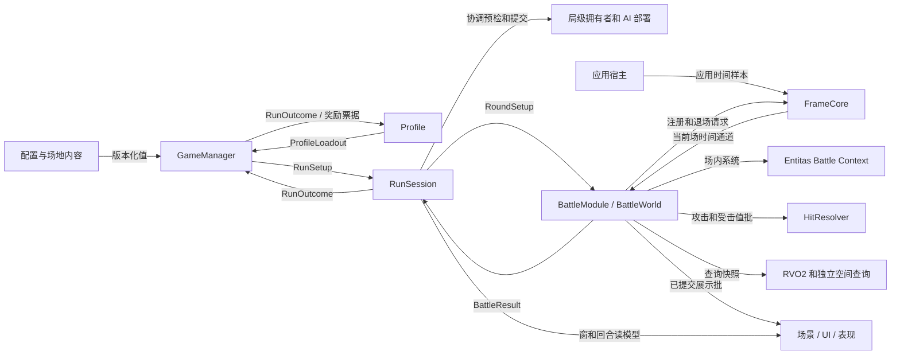

# Project B 模块分类与战斗组装方案

2026-11-15 · 架构评审稿

## 1. 目标与策划依据

从修订 5989 的玩家循环推导模块归属。一局从选择难度和确定本局角色进入，玩家进攻、英雄防守，最多五层。原案多角色选择标为「暂无」，初期可固定初始角色。每层有若干回合，按准备、实时攻防、回合结算、商店或选择窗口推进。核心击破结束该层，荣誉归零结束整局，第五名英雄击破对应通关。全局回合号跨层递增。原案 L15–27、L49–51、L193–242、L268–280、L537–539 对应这些边界。跨层敌人资产继承、商店与三选一在换层处的具体先后，以及核心击破与荣誉归零同时发生的优先级仍待确认。 [Project_B 修订 5989](<D:/缓存/WorkBuddy/2026-11-13-23-19-02/Project_B.md>)

[01 帧驱动](../01-帧驱动独立模块方案.md)、[02 战斗模块](../02-Project_B-战斗模块方案.md)、[03 HitResolver](../03-HitResolver独立模块方案.md) 定义技术接缝，[00 战斗编排](00-战斗编排与集成方案.md)及本目录 01–14、16 定义各域细案。本文统一运行时层次、写入者及交接。`已有细案` 表示有设计文档，`本篇定边界` 表示已有模块合同草图，仍需细化规则和实现。`一期` 指建议的评审与开发顺序。S1 先跑一场可控攻防，S2 串起完整局内闭环，再按配套方案接正式局外养成和整局奖励持久化。

## 2. 模块清单

### 2.1 应用、局外与基础能力

| 模块 | 存续与唯一写入者 | 输入 → 输出 | 方案及范围 |
| --- | --- | --- | --- |
| `GameManager`，大厅、开局、结束展示和返回 | 应用级，独占外层流程、活动 Run 句柄及进入退出状态 | 选定角色、难度和加载结果 → 建立 `RunSetup`、启动 Run，接收 `RunOutcome` 后进入结算页、返大厅 | [生命周期 14](14-GameManager与游戏生命周期实现方案.md)。S2 使用最小大厅、局内和结算入口 |
| `Profile`，账户、全局背包、局外资源与成长 | 玩家档案级，独占 A/B 钱包、C/D/E 禁用配额、科技树、卡牌技能树、内容解锁和档案持久化。F/角色技能树按后续范围启用 | 局外配置命令 → 档案版本及 `ProfileLoadout` 开局快照。`RunOutcome` / 奖励票据 → `RewardReceipt` | [局外养成 16](16-局外养成实现方案.md)。S2 局内联调可用内存替身，局外交付按 16 接 A/B、科技和卡牌技能树、C/D/E 禁用、持久回执 |
| 角色、难度及开局规则输入 | 应用准备、开局冻结，局外配置/载入层是唯一快照生产方 | 角色/初始牌组、解锁禁用、科技修正、难度、种子、配置版本 → `RunSetup` | 本篇定边界。S2 固定初始角色/难度，选角与其他难度按原案补齐 |
| 配置与内容 | 应用内容服务唯一发布版本，`RunSession` 固定整局规则引用，生产只读值投影 | Luban 生成表和场地清单 → 已校验 `RunRules`、`BattleRules`、`MapRuleData` 等 | 本篇定边界。S1 以小型试验配置证实引用链，S2 增加完整闸门 |
| `FrameCore` / `FrameClock` | 应用宿主持有 Core，注册成功由 Core 管通道生命周期；每场通道持有并推进自己的 Clock | 游戏宿主采样的整数纳秒 → 稳定顺序的候选 Tick、已提交水位 | [底座 01](../01-帧驱动独立模块方案.md)。S1 |
| `HitResolver` 与共用定点数值 | Resolver 是纯 C# 值算法，复用工作区和命中账本在调用方 | 攻击请求、受击快照、规则、旧账本 → 有序命中、目标生命变化、账本增量或失败 | [底座 03](../03-HitResolver独立模块方案.md)。S1 |
| 场景、UI、输入映射与表现资源 | 应用、Run 或场景作用域，各视图/场景所有者负责句柄与订阅 | 准备/商店/局结果读模型和已提交战斗值批 → 可见表现；玩家手势 → 带当前身份的命令 | 本篇定边界。S1 使用圆方三角灰盒，S2 接完整操作入口，后续完善像素简笔画、UI、VFX 与音效 |

### 2.2 局级规则与工作流

| 模块 | 存续与唯一写入者 | 输入 → 输出 | 方案及范围 |
| --- | --- | --- | --- |
| `RunSession`、层/回合阶段机与事务协调 | 一局，独占层、英雄实例、全局回合号、阶段、活动窗口、命令序列和一次性结算标记 | `RunSetup`、阶段命令、`BattleResult` → `RoundSetup`、`RoundResult`、商店/选择窗口、`RunOutcome` | [00](00-战斗编排与集成方案.md) 部分职责迁入，细见第 3 节。S2 |
| 地图与准备部署 | 层/本回合准备，准备工作视图持拟议占位，局级部署所有者提交布局和跨回合塔值；AI 持策略及提案，无权提交格位 | 地形与围栏、格位解锁、塔/背包、回复及部署规则 → `DeploymentPlan`、已部署布局 | [AI 02](02-敌方AI实现方案.md)、[建筑 03](03-建筑实现方案.md) 已有细案。本篇补地图与占位合同。S1 固定布局，S2 完整确认/部署 |
| 牌组、羁绊与合成 | 一局，卡牌所有者独占基准卡实例、星级及回合间发牌；羁绊由牌组派生，装备归背包所有者 | `CardGrant`、升级/合成、已提交移除或新卡事实 → `DeckSeed`、`SynergySeed` | [卡牌 01](01-卡牌实现方案.md)、[养成 05](05-局内养成实现方案.md)。S2 |
| 局内与敌人背包 | 一局/英雄实例，背包所有者独占局内物品、装备与绑定、敌方待部署塔及待生效条目 | 购买、奖励、装备、部署消耗或丢弃计划 → 物品状态及部署候选 | [背包 08](08-背包实现方案.md)。S2。牌组和已选海克斯作为只读背包视图 |
| 成长、敌人升级、商店报价与法球 | 一局/英雄实例，成长所有者独占等级经验、已发里程碑、报价/锁定/保底状态和可领取法球 | `RoundSettled`、破塔/击败事实、购买经验、刷新与领取 → 发放计划、开格、双向报价、法球票据 | [养成 05](05-局内养成实现方案.md)。S2 |
| 双向交易、海克斯三选一与洗练 | 一局/选择窗口，选择所有者写已选归属、待选票据和候选；商店报价与余额由各自域写入 | 权威报价或 `ChoiceTicket`、购买/拆除/选择命令 → 双侧 `SelectionPlan`、选择事实 | [选择 10](10-双向选择系统实现方案.md)。S2 串通喂养、移除、择一成对提交；洗练待规则确认 |
| 局内资源与承接种子 | 一局/回合，资源所有者写局内金币 G、荣誉 I 和准备费用预算；技能/Buff 所有者分别写局级能量与持久来源种子 | 评级、商品、等级、持久效果、上一场导出 → `WalletPatch`、新回合满费用和战斗种子 | [资源 09](09-资源系统实现方案.md)、[技能 07](07-技能实现方案.md)、[Buff 06](06-Buff实现方案.md)。S2。当前战斗的费用由资源所有者授权的回合状态独占写入 |
| 回合评分、荣誉结算与整局奖励口径 | 一回合/一局，评分所有者独占评级、原始分值及累计分数，资源/成长各自提交余额和经验。`RunSession` 提交唯一分支与 `RunOutcome` | `BattleResult`、回合分数底和奖励表 → `RoundResult` 和已提交通知 `RoundSettled`、胜败及奖励事实 | 本篇定边界，补原案评分、荣誉、金币与整局额外奖励。S1 可出原始统计，S2 接评分与结算闭环 |
| 任务与奖励路由 | 局级，任务所有者独占任务实例、进度、已完成与已授予；任务定义由配置发布 | 羁绊或海克斯绑定、已提交事实 → `TaskCompleted`、卡牌/升级/效果/选择机会 | 本篇首次划边界，条件语法和发生时点待专项。S2 至少落一条事件计数到奖励，后续扩充条件 |

### 2.3 每场模拟与空间查询

| 模块 | 存续与唯一写入者 | 输入 → 输出 | 方案及范围 |
| --- | --- | --- | --- |
| `BattleModule`、`BattleWorld` 与根 Systems | 一场，独占 Entitas `Battle` Context、ordered command、场内随机和待出版结果；各域系统写本域数据 | `RoundSetup`、候选 Tick 与 `BattleCommand` → 已提交 `BattleTickBatch`、唯一 `BattleResult` | [底座 02](../02-Project_B-战斗模块方案.md)。S1 |
| 战场地形、动态占位与拓扑 | 一场，战场所有者写占位、阻挡/拓扑版本，计算可攻击前沿和核心暴露；建筑系统写核心实体状态 | `MapRuleData`、初始部署、场内放置/死亡事实 → 合法性、格位变更、索敌/受击资格快照 | 本篇补接口，[建筑 03](03-建筑实现方案.md)、[寻路 11](11-战斗寻路与索敌实现方案.md) 消费。S1 测固定地图，S2 接全域判定 |
| 场内牌区、抽牌和出牌 | 一场，卡牌所有者写手牌、牌库、弃牌/移除区、抽牌钟、待完成出牌 | `DeckSeed`、费用/位置校验、抽牌与出牌 → 召唤/技能/效果意图及回合收尾差量 | [卡牌 01](01-卡牌实现方案.md)。S2 |
| 单位与建筑、核心 | 一场，单位、建筑各写自身 HP、位置或锚点、攻防及存续；真实占位由战场所有者写 | 召唤/部署、拓扑、索敌结果、伤害变化 → 移动、攻击、阵亡、破损、可跨回合塔快照 | [单位 04](04-单位实现方案.md)、[建筑 03](03-建筑实现方案.md)。S1 核心、普通塔、自动单位，S2 接抵抗、元素、特殊、光环等规则 |
| 场内技能、Buff、费用与时钟 | 一场，技能写能量、阶段和施放，Buff 写活跃来源和叠层，资源写费用，World 写回合剩余时间 | 角色技能/受击/消耗、装备/地形/羁绊/Buff 种子、已校准时钟 → 修正、攻击意图、费用事件及跨回合种子 | [技能 07](07-技能实现方案.md)、[Buff 06](06-Buff实现方案.md)、[资源 09](09-资源系统实现方案.md)。S2。单局耗尽的费用不结转 |
| RVO2 移动、索敌及 Job | 一场，索敌持目标快照/Job 工作区，移动适配持 ORCABundle/Agent/障碍，单位系统写位置与目标 | 位置/目标/障碍 → 量化新位置；候选快照 → 选敌 ID | [RVO2 移动 19](19-寻路模块实现代码.md)、[四叉树 Job 12](12-四叉树JobSystem索敌实现方案.md)、[战斗接入 13](13-索敌与寻路接入战斗模块方案.md)。先用全扫过验收，四叉树 Job 根据目标 Player 测量接入 |
| 战果事实、命中账本与回放 | 一场，World 统一分配攻击身份和 Tick 序，战果收集器只写已提交统计/事实，宿主拥有可独立存续的结果队列 | 有序命中、结束原因、场内持久变化 → 战果、表现批和重放素材 | [底座 02](../02-Project_B-战斗模块方案.md)、[底座 03](../03-HitResolver独立模块方案.md)、[00](00-战斗编排与集成方案.md)。S1 可比较步进结果，S2 对整局补录窗命令和回合摘要，存档恢复后续 |

## 3. 依赖与组装顺序

箭头表示运行时调用或值流方向。底层帧驱动仅定义自己的通道合同，HitResolver 仅依赖数值和输入输出类型。`GameManager` 调用局级生命周期，局级和场内命令经各自入口提交。对外 `GameEvent` 在提交后的宿主消费阶段发布值消息，窗口依项目规则使用 `AddUIEvent`。场内涉及同一步有序消费的因果通过 Systems 和显式值队列完成。资源/表加载在 TEngine 热更宿主边界使用 `GameModule`、UniTask 和 YooAsset，场景对象与句柄由相应表现所有者管理。Entitas 只在场内使用 1.14.1 正式生成 API，按 [底座 02 的 Jenny 接入](../02-Project_B-战斗模块方案.md) 处理工具和遗留引用。

| 开启或关闭点 | 组装动作及交付 |
| --- | --- |
| 应用启动 | 热更宿主建立应用级 FrameCore 与采样入口。内容服务校验表引用和地图规则。`GameManager` 接管大厅，读取 `ProfileLoadout` 与选择结果生成不可变 `RunSetup`。 |
| 创建 Run，进入层 | 依 `RunSetup` 初始化局级牌组、所有者、资源和随机流。创建 `LayerInstanceId`，初始化该英雄的格位、核心、待部署背包和层配置。英雄定义 ID 和本层英雄实例分别存储。 |
| 准备开启 | `RunSession` 开准备窗。按跨回合快照和配置准备塔回复/复活、技能能量、持久 Buff、牌组、费用上限，提交准备修正与预算的初值，生成第一版准备工作视图。实体世界尚未开始。 |
| 玩家确认与 AI 部署 | 确认冻结准备版本，AI 读取待部署库存、合法格位、塔值和地图拓扑，返回确定性提案。局级协调器重检足迹/上界/库存，用工作视图预检并同批提交占位、背包消费和期末未部署塔清理。已提交初态冻结为 `RoundSetup`。有效确认仅提交一次。 |
| 创建场次并开战 | 工厂根据已完成的 `RoundSetup` 组建独立 World、Battle Context、系统树、索引与命中缓冲，投影局级种子，借已部署布局初始化塔和地形。完成初始化再注册场次时间通道，在宿主采样边界开启 `BattleId` 输入，发布 Tick 0。视图可复用当前场景，但必须绑定新 `BattleId`。 |
| 结束场次并移交 | 最后一条候选步成功后关输入、禁止补步，复制 `BattleResult` 及最后已提交水位至宿主队列。注销通道，完成在途 Job、停 Collector、TearDown、解除 Entity 持有并销毁 World，`RunSession` 随后消费安全的值结果。 |
| 结算、窗口与下一步 | `RunSession` 预检并提交回合结算，按候选结束原因与荣誉状态走继续、换层、失败或通关。打开待用窗口并按阶段消费；继续时进入下一个全局回合。终局 `RunOutcome` 交 `GameManager`，后者调用局外奖励端口并消费回执，展示结算后返回大厅。 |

对 [00 战斗编排](00-战斗编排与集成方案.md) 中的旧称作如下映射。

| 00 中的责任 | 本篇的拥有者 |
| --- | --- |
| 全局回合与层、公共阶段机、确认窗、准备回复与部署、准备期剩余库存清理 | `RunSession` 协调局级所有者；准备期占位计划可用静态地图规则独立预检 |
| 商店、海克斯窗口和发放路由、局内跨域事务、评分和荣誉分支、终局事实 | `RunSession` 编排，各域提交自身状态。`GameManager` 接终局和外层状态，`Profile` 接奖励 |
| 场次空间快照、命令执行、系统装配、场内原子预检、结算命中和结束条件 | `BattleModule` / World 仅对当前场执行。各域写自己的结果，汇总为 `BattleResult` |

## 4. 阶段与数据合同

| 接口值 | 最小字段和消费方 |
| --- | --- |
| `ProfileLoadout` → `RunSetup` | `GameManager` 合并档案版本、角色、准入与开局修正、难度、种子、规则与奖励版本，由 `RunSession` 冻结使用。 |
| `RoundSetup` | `RunId`、`RoundId`、`LayerInstanceId`、配置版本、种子、已部署塔和占位、牌组、效果及能量种子。BattleModule 构建每个 World 时绑定新 `BattleId`。场内通过资源所有者窄端口使用当前回合预算。 |
| `BattleResult` | `BattleId`、`RoundId`、`CommittedTick`、并存的退出事实、伤害和直接/连带破损、塔/牌区/Buff/能量差量。由 `RunSession` 消费一次，入口同时检查活动场和回合。 |
| `RoundResult` / `RoundSettled` | `RoundResult` 含 `RoundResultId`、成绩、已提交的资源/成长事实与唯一下一阶段。`RoundSettled` 是提交后的值通知，供读模型和需要消费该事实的模块使用。 |
| `RunOutcome` | 含 `ProfileId`、`RunId`、胜败/中断原因、摘要和奖励规则版本。`Profile` 只接局结果或奖励票据，奖励成功以回执为准。 |

### 地图、配置与场地

`MapRuleData` 固定地图原点、格坐标与定点转换、格边界、围栏、地形 ID、可用塔格、分层与八方向映射。塔的部署足迹、寻路阻挡和受击形状分别配置。准备期按实例和规划顺序同时预检多塔，换位先移除计划内旧足迹再整体校验新布局，支持识别合法互换与真正重叠。World 独占场内动态占位，塔破损或召唤建筑变更占位和阻挡版本。战场地形按格提供能否站立、投放和战场效果，原案战斗场地条款将效果作用限制到玩家和玩家单位。Buff 章节同时列了地形影响敌塔，配置发布前须澄清。场围栏位置固定，建筑破损只更新拓扑和阻挡。动态占位与方向覆盖由战场计算，建筑系统写核心暴露分量；八方向覆盖算法、越层技能和抵抗塔反复破损的资格规则按策划确认后固化。

配置值投影覆盖原案全部定义。局外以科技树、卡牌技能树、角色技能树、角色与解锁表给快照。局内用物品、海克斯/选择、卡牌/卡组/羁绊、商店、任务和敌人升级定义供给。场内用塔、单位/塔双键基础属性、效果、技能/Buff、回合和地形表。发布时检查缺失 ID、重复双键、地图范围/足迹、回合正分母、定点范围和各道具/效果的接收域。进行中的 Run 继续用开局冻结版本。UI 图标和音效资源加载由表现层消费，判定位置从规则地图采样。异步场地内容失败阻止准备或开场，仅表现资源失败采用预设占位。视图资源回调核 `RunId` 和 `BattleId`/当前显示代际后绑定，已离场结果及时释放。

### Tick 阶段

| 阶段 | 生产与消费顺序 |
| --- | --- |
| Input / Timer | 封存本步命令，先撤销已到期实体与来源的资格，把到期引起的费用和资格修正同步至指令读模型，再按 `InputSequence` 处理出牌、施放。随后判断本步抽牌和计时标记。若满手曾将倒计时停在 0，这一步腾出位置且有合法抽取对象时补抽一张，新牌从下一步可用。 |
| Logic | 应用即时效果，重算脏属性，冻结当步通行、保护及移动前快照。在 `PreMove` 完成单位选塔并提交锁定。Navigation 和局部求解在固定边界回填，主线程提交位移。`PostMove` 用移动后单位快照完成塔索敌并提交锁定，交攻击采集前统一复核实际射程。 |
| Physic | 固定移动后形状和受击资格。几何和直接伤害生成值候选，绑定攻击身份；空间索引与查询使用同阶段快照。 |
| Late | HitResolver 批量计算，预检输出和账本容量，各所有者写生命、破损、技能能量与当步费用。更新拓扑及下一步可见的暴露，检查核心/超时/提前结束，执行 Cleanup 后装好值批。 |
| Clock 提交之后 | 仅发布不超过已提交水位的有序批。表现逐批消费；`RunSession` 在场次完成后消费最终 `BattleResult`，局级判定与窗口可继续推进。 |

战斗按 [帧底座 01](../01-帧驱动独立模块方案.md) 的固定步长提案推进，原型 60 Hz、每次宿主更新最多四步。关卡回合时间取回合表基准及开战牌数补时；抽牌、技能、Buff 和单位分别持自己的计时/截止字段。初始角色技能只调整回合计时系数及费用回复，`FrameClock` 仍使用固定步长。源案同时给出 `0.5 倍 × 15 秒` 和「延长 30 秒」；前者仅少扣 7.5 秒战斗倒计时，实际语义待确认。战斗持续时窗口切换和表现无需暂停演算。首期提前结束按所有非建筑单位已阵亡、且不能支付当前或可再抽的牌判断，抽牌资格涵盖原案手牌满与弃牌回洗约束。已排定回费及可施放技能是否预留对提前结束的影响，作为规则条目确认。

Job 读取 `(BattleId, Tick, SnapshotStage, TopologyRevision)` 标识的值快照、写自己的结果区。主线程在逻辑消费位 `Complete`、校验身份并稳定合并后才写领域状态。移动前邻域与移动后射程分别读取对应快照。拆卸前完成句柄再释放 Native 缓冲。四叉树/格桶/全扫用同一合同，在相同输入与目标 Player 上比对结果、构建及查询耗时、主线程等待和分配。选择优化路径依据实际塔数/单位峰值、空间分布和查询半径。

### 身份、版本与失败

- `RunId` 标识独立局。`RoundId = (RunId, GlobalRoundNo)` 关联准备、战斗费用、限次和结算。`LayerInstanceId` 标识这一层的英雄实例，与现有细案中的 `HeroLayerId` 同义，向外合同统一用 14 的名称。`BattleId` 标识每次创建的 World，`BattleEntityId` 与代际标识场内目标。建筑跨回合另有持久 `TowerInstanceId`，在新 World 映射为新场内身份。Entitas `creationIndex` 和池槽属于实现内部。
- `WindowId + Revision + RunCommandSequence` 关联准备、商店和选择；`OfferId` 区分同格的不同报价。场内命令使用 `BattleId + TargetTick + InputSequence`，攻击段去重使用 `AttackInstanceId + SegmentId + TargetId`（按场隔离），对外用 `(BattleId, Tick, HitOrdinal)`。奖励带原事实和子序号，`RoundResultId` 关联唯一正常回合，`RunOutcomeId` 与奖励票据作为返大厅前的稳定消费身份。
- 各域从暂存工作视图读余额、容量、占位、版本、随机游标和预分配 ID，整批预检后才在模拟或局级主线程提交；最后提交消费印记和 outbox。正常拒绝保留原数据与随机游标。原身份同内容的重试返回此前结果，同身份异载荷报告冲突。新开的窗、报价或 World 不能接受旧版本消息。随机流按洗牌、战斗、商店、法球、海克斯与 AI 等域固定派生，回放同时记录规则版本、种子、稳定排序键和命令的实际归属。
- World 在 Tick 中途异常时立即隔离并退场，丢弃故障步部分结果，保留更早的已提交读模型与批次。该场无正常 `BattleResult`，Run 进入中断。若局级提交到一半出现不变量异常，隔离整个 Run，照常拆卸 World/场景。已交付且带幂等身份的前序事实仍可审阅，本次异常不会铸造正常回合或局外奖励。一般预检失败可在原窗口重新准备；准备已经提交而 World 初始化尚未发布时，可重试同一 `RoundSetup`，每个失败 World 释放并换代，既有部署事务不重复扣用背包。正常退出则封入口和异步回调、结束 Job、退场并按所有权释放各作用域。

## 5. 三条贯通用例

### 出牌到召唤

1. 玩家拖一张牌到目标格，输入桥记录坐标及 `BattleId`、卡实例、目标 Tick、输入序号。场内卡牌查所属手牌/星级与当前价，地图查围栏、地形、格位和足迹，资源和单位分别预检费用和全部召唤容量。
2. 可提交时，场内事务由卡牌、费用、战场和单位所有者连续写入。已接受出牌当步腾出手牌位置，攻击类牌等待本步有效载荷处理后再入弃牌或移除，召唤单位依各自 ID 进入系统。仓库实例存续与战场召唤生命周期相互独立。出牌失败保持牌、费用、占位和单位数。
3. 同 Tick 两条命令指向同一张牌，第二条以第一条提交后的工作状态预检。成功出牌解除满手停抽时，Timer 只补实际到期的一张，新牌下一步可用。回合结束回收单位且记录 `RoundCleanup`，牌区导出永久移除等差量，临时卡/临时星级覆盖按回合范围清理。

### 同 Tick 命中、破塔和回合结算

1. 普通塔在 N 步开始时 HP 为 5，两次合法攻击的计算伤害分别为 3 和 4。Resolver 按攻击身份和段键稳定处理，交付实际扣血 3、2，第二击取得一次首次归零事实。外塔的破损打开一条方向时，Late 更新拓扑，核心从 N+1 起改用新暴露状态。本 Tick 已采集的有效攻击按快照照常结算。
2. 若 N 同时耗尽回合时间，停于该已提交步。若某步实际攻破核心，该步记直接击破积分，仍存活的塔按 `CoreCollapse` 记连带破损，无虚构扣血。核心本体无掉球，前四层英雄击败法球与普通建筑破损概率为独立来源，抵抗塔按自身规则排除掉落并在后续准备复活。轮末回收、超时消失、直接破损和连带破损分别带原因。
3. `RunSession` 按 `BattleResult` 生成评分补丁。评分按 `(造成总伤害 + 破塔积分) / 本回合分数底`，以精确整数比比较。区间左闭右开，`1.1` 属 A，`1.5` 属 S。例取实际扣血口径、积分 10、分数底 20，则 `(3+2+10)/20 = 0.75` 属 C，资源扣 3 荣誉。实际扣血或计算伤害的取值、连带塔是否给分、局内总评分的累计数值及封顶规则待确认。资源与成长各自准备荣誉、金币、经验和奖励补丁。相同 `RoundResultId` 只能给分和发奖一次。核心通关与荣誉归零的并发由配置的唯一分支优先级解决。

| 评级 | F | E | D | C | B | A | S |
| --- | ---: | ---: | ---: | ---: | ---: | ---: | ---: | ---: |
| 比值区间 | [0, 0.2) | [0.2, 0.4) | [0.4, 0.6) | [0.6, 0.8) | [0.8, 1.1) | [1.1, 1.5) | ≥ 1.5 |
| 荣誉变化 | −10 | −8 | −6 | −3 | 0 | +2 | +5 |

### 成长、任务和成对海克斯

1. 回合结算给双方经验，例如玩家从 2 升到 3 时创建该阈值对应的 `ChoiceTicket`。连跨多个阈值时逐项生成。达成羁绊/海克斯任务可以产生独立奖励计划及选择机会。任务只消费稳定已提交事实，领取或直接发放须与消费标记同批提交。战斗内即时任务效果是否存在、如何显示/接入尚待专项，S2 样本在安全窗口处理。
2. `RunSession` 按来源排序并确定接收英雄后逐张开窗。配对表每次按权重抽三个合法候选，选一个同时领取两半。选择系统准备成对计划，再由牌组、背包、资源、Buff 等所有者整体预检和提交，任何一侧拒绝都保留票据与旧状态。敌向即时物品/Buff 和敌向待部署塔分别走效果来源与背包；候选可拆的对象按当前英雄库存的实时资格校验。
3. 前四层英雄的击败票据建议在下一英雄实例建立后、第一轮准备前指向该英雄；其他等级/任务票据也要显式记录目标英雄和处置策略，旧英雄离场时取消其无继承来源。第五层结束提交 `RunOutcome`；最后英雄击败的法球、未领法球处理及与回合评级的入口先后由原案补齐。新下一场只导入已提交的局内种子，局外端口仅使用局结果或奖励票据。

## 6. 开源与官方工程依据

| 已读位置 | 作者的工程边界 | 当前取舍 |
| --- | --- | --- |
| [OpenRA World.cs](https://github.com/OpenRA/OpenRA/blob/bleed/OpenRA.Game/World.cs#L385-L475) | `World.Tick()` 推进 Actor、Trait、Effect 后再顺序排空帧尾任务，`TickRender()` 单独交给表现，`SyncHash()` 包含相关状态和随机。 | 采用显式阶段、分别交付模拟与渲染结果，并在关口记录状态摘要。Project B 使用可复制的战果值和受提交水位约束的 outbox，适合每回合拆世界及局外消费。 |
| [Box2D Events](https://box2d.org/documentation/group__events.html) | 接触、传感器和移动事件在世界内缓冲，完成步进后以批数组供消费；读取方需考虑销毁后的事件引用有效性。 | 采用步后有序事实和稳定身份，世界退场前复制结果。HitResolver 自身做规则、段去重和伤害计算，借鉴点限于事件生命周期。 |
| [Unity 6.0 Create and run a job](https://docs.unity.com/en-us/engine/6000.0/manual/scripting/programming-distribute-work-threads/job-system/creating-jobs) | Job 可异步执行，Native 数据持有者用 `JobHandle.Complete()` 安全取回结果，主线程等待可观察。 | Job 只处理数据快照。固定 Tick 中最晚合法消费点完成句柄并验证身份。等价全扫与 Job 索引分开对照，以实测决定启用门槛。 |

## 7. 分步实施与验收

- [ ] **S1.1 独立值内核。** 根据 01/03 接固定 Tick、纯值伤害及工作缓冲。以 `Advance → Tick → Resolve → Commit` 走通两击归零、同段去重、容量失败和补步只提交成功步。
- [ ] **S1.2 建立一场。** 先接正式 Entitas 1.14.1 Context、单位、塔、地形及占位最小模型。从固定 `RoundSetup` 建场，验证核心暴露、普通攻击、超时、回收、结果按值导出与同场景重开。
- [ ] **S2.1 准备事务和局流程。** `Confirm → PlanDeployment → Commit → RoundSetup → OpenBattle`。覆盖足迹重叠、超格位、重复确认、同类两座塔、上一场抵抗塔复活、构造失败重试和旧窗回调。
- [ ] **S2.2 卡牌与战斗交互。** `PreparePlay → CommitCost+Card+Spawn → ApplyHitFacts`，接抽牌、费用/技能/Buff、战斗提前结束和倒计时。验满手腾位、费用不足、无合法落点、一帧两指令、过期和回收。
- [ ] **S2.3 局级闭环。** `BattleResult → SettleRound → OpenWindow → CommitSelection → PrepareNextRound/EndRun`，接评分、荣誉、经验、一次任务样本、商店、法球和双向选择。验回合成功/失败出口、旧英雄窗口、跨层票据、双侧拒绝、重复奖励票据及结算返大厅。
- [ ] **S2.4 接正式首版前后索敌及寻路。** 按 13/12 接 `PreMove → RVO2 固定步 → 移动提交 → PostMove → 发射`。验证同 Tick 走进塔范围立即符合选敌资格、目标失效后可重选、移动前树与移动后单位不混用、末步拆塔仅更新下一步的障碍及资格。以等价全扫和 11 的塔列表/格桶对比四叉树 Job，记录 Tick P95、构建/查询耗时、`WaitForJobGroupID`、峰值内存及 GC。目标平台、单位峰值与范围确认后再判断实测收益。
- [ ] **S2.5 场地与跨局验证。** 同一 `RunSetup`、规则版本、窗命令和 Tick 输入在不同宿主更新分组下，对齐已提交 Tick 与回合摘要。检查展示批、关窗解绑、异步场地加载、场景复用及连开两局。正式局外持久交接按 16 的奖励回执用例验收。

本篇只交付设计。规则缺口集中在同回合胜败优先级、评分取值及连带奖励、任务时点和第五层奖励、换层窗口顺序、八方向及地形作用对象、角色技能实际计时，以及单位互避和性能规模参数。目前尚未执行实现步骤和运行验收。
