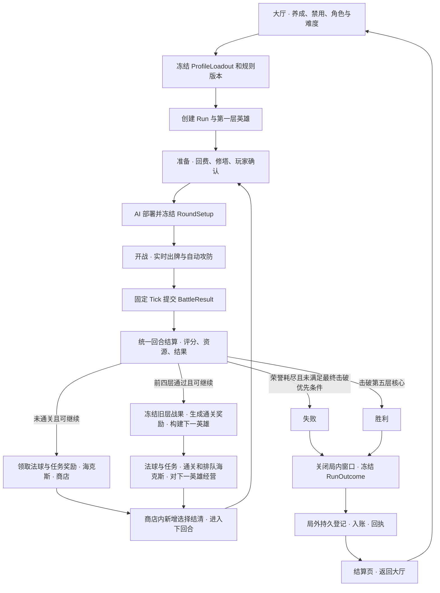

# Project B 整游总流程

2026-11-15 · 设计评审稿

以下连线按本套文档的评审默认绘制。待定岔路及产品确认项见 [规则决策表](05-规则决策表.md)。玩家需求见 [游戏流程](../../游戏设计/01-游戏流程.md)。

## 阶段与交接

| 阶段 | 玩家动作与运行方 | 完成后交付 |
| --- | --- | --- |
| 局外 / 加载 | GameManager 收选角、难度。等待已受理档案变更，冻结匹配版本的角色、牌组、规则及种子；加载首层场地 | `RunSetup`，首个英雄实例 |
| 准备 | RunSession 按全局回合号开启窗口，费用回满、建筑恢复。确认后提交 AI 部署与背包清理。场次资源就绪才开始 | `RoundSetup`，新 `BattleId` 与 Tick 0 |
| 战斗 | BattleModule 执行有序输入、抽牌、移动、索敌、攻击、效果与命中结算，后续窗口等待该场退场 | `BattleResult`，战果和可继承值 |
| 回合结算 | RunSession 消费一次，先准备评分、资源、破塔与层奖励并冻结长期收益，再提交唯一后续分支 | `RoundResult`、奖励票据、下一阶段 |
| 继续当前层 | 领取与选择队列排空后开商店；付费经验或任务引起的新票据结清后允许出店 | 下一回合牌组、效果、待部署资产 |
| 前四层清层 | 旧英雄离场，下一英雄先建立逻辑实例。清层法球、海克斯与商店按顺序进窗 | 新英雄获得正确的敌方半边，下一层视图加载后进入准备 |
| 局末 | 暂停局内操作，冻结结果并拆卸场次，Profile 生成并持久化已有结果的奖励收据 | 局末页显示实收奖励，回大厅后可再次开局 |

场地加载失败保留最近一次成功的阶段及奖励进度。Tick 0 发布前战斗初始化失败用同一 RoundSetup 和新 BattleId 恢复。模拟内部故障与玩家放弃使用中断出口。[存档与回放](37-局外存档与战斗回放.md)

## 一条完整的联调情景

第 1 层第 6 回合出牌打掉外塔，外塔足迹更新后下一 Tick 允许攻击暴露的核心。核心破损时同时到达时限，战果保留两个原因，但只确认一次清层。该回合有等级票据、清层票据和一个待领法球。RunSession 结算第 6 回合，冻结旧层，初始化第 2 层英雄并绑定待选择票据。领取法球发出的普通新卡进入第 7 回合种子。通关和升级海克斯逐个选择，敌方半边授予第 2 层。层间商店喂入一座塔且随后拆除，敌人待部署库存不再含该塔。下一准备窗口显示全局第 7 回合，保留角色能量；玩家按第 7 回合伤害阈值继续充能。第 5 层击破后由档案出具回执；相同 RunId 重送只取得原回执。[清层与继承](11-五层挑战与跨层继承.md) · [结算](14-战斗评分与荣誉裁决.md) · [整局奖励](15-整局结算与局外奖励.md)

失败用例复用相同入口。若第 1 层击破核心但结算后荣誉为零，统计仍包含已击破英雄，先冻结通关球及其永久子行，再直接进入失败结算。不会创建第 2 层，也不打开普通领取、海克斯或商店窗口。
