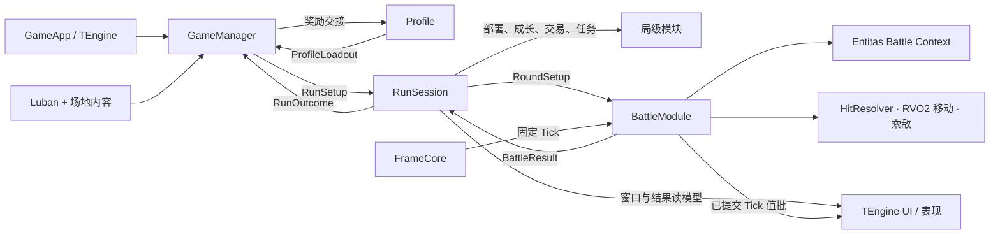

# Project B 整游实现方案

2026-11-15 · 架构评审稿

建立在 [GameManager 生命周期](../Project_B战斗与局内系统/14-GameManager与游戏生命周期实现方案.md) 和 [战斗组装](../Project_B战斗与局内系统/15-模块分类与战斗组装方案.md) 上。原案功能覆盖及逐项实现入口见 [整游方案索引](00-整游方案索引.md)。



## 组装与依赖

- `GameApp.StartGameLogic()` 是后续装配入口，接 TEngine 场景、资源、UI 和内容适配器，建立常驻帧宿主和 GameManager。读取当前项目源码后确认该方法仍为空壳。本套文件中的业务类型按拟议接口阅读。[GameApp](../../../Assets/GameScripts/HotFix/GameLogic/GameApp.cs)
- GameManager 持一个活动 RunSession。Profile 独占局外档案、版本与持久奖励。内容服务发布版本，开局将局外状态和内容投影成不可变 RunSetup。场景和视图持有资源句柄，其失败和生命周期通过主线程异步适配器收口。
- RunSession 持局级的阶段、窗口及去重记录，调用卡牌、背包、成长、选择、任务和资源域各自的预检及提交方法。回合间结论由 RunSession 编排，[旧战斗编排 00](../Project_B战斗与局内系统/00-战斗编排与集成方案.md) 的阶段归属采用 14/15 的映射。
- BattleModule 每回合装配一个 Entitas 1.14.1 Battle World，消费已确认的塔阵、规则、牌组及效果种子。Battle 中的单位、建筑、地形、技能、牌区和资源各写自身数据。FrameCore 管通道与时间，HitResolver 由输入值计算有序伤害及账本增量。资源域持唯一 `RoundBudget`，从准备归属交给当前 BattleId 通过窄端口同步提交增减；战斗中 RunSession 只读已提交投影，金币和荣誉依旧由局级资源账本写。关场即收回端口，费用余额只记审计并销毁。
- TEngine `GameEvent` 广播提交后的读模型，UI 使用 `AddUIEvent` 监听。业务命令和结果走装配显式端口。同 Tick 多笔命中和消耗使用值队列或显式请求实体。热更业务拟落 `Assets/GameScripts/HotFix/GameLogic/`，配置生成遵循现有 GameProto 路线，待主要入口装配时确认现行生成与程序集引用。[TEngine 框架规范](../../../.agents/skills/tengine-dev/SKILL.md) · [Entitas 规范](../../../.agents/skills/entitas-dev/SKILL.md)

## 身份、时序与提交合同

| 合同 | 生产与消费 |
| --- | --- |
| `ProfileLoadout → RunSetup` | 角色、解锁/禁用、成长修正、难度、种子、配置和规则版本。RunSession 冻结本局引用 |
| `RoundSetup` | RunId、RoundId、LayerInstanceId、阵型、地图、牌组、效果、能量及预算入口。World 组装生成新 BattleId |
| `BattleCommand / BattleTickBatch` | BattleId、Tick、InputSequence。按 Input / Logic / Physic / Late 的既定系统树执行，成功后发布战果值和状态投影 |
| `BattleResult → RoundResult` | 最后提交水位、退出事实、命中和破损统计、跨回合差量。Run 验证活动场、回合和摘要；重复结果重放原结果 |
| `WindowId + Revision + RunCommandSequence` | 准备、商店、选择、任务等窗口命令身份。报价、选择和可领对象另有实例 ID，与窗口刷新解耦 |
| `RunOutcome → RewardReceipt` | ProfileId、RunId、结果摘要、规则版本、奖励流水与档案修订。最终回执可在显示中断后重读 |

```text
handle(command):
    existing = lookupResult(command.identity)
    if existing: return requireSamePayload(existing, command)
    assertActiveScopeAndExpectedRevision(command)
    proposal = planAllOwnersAgainstWorkingCopies(command)
    if rejected: return reasonWithCurrentProjection()
    commitOwnerPatchesThenIdentityAndOutbox(proposal)
    publishCommittedProjection()
```

预检包含本批累计余额、容量、占位、目标版本、奖励限次及随机游标。同步提交区不能引入等待、视图回调或可预见的业务失败。Entitas 数据有部分提交时终止故障会话，保留上个成功水位；退出先封输入，再完成 Job、停 Collector、解绑和释放 World/视图资源。应用层加载与档案写入采用操作身份，旧异步结果只能清理自身持有的资源。[战斗底座](../02-Project_B-战斗模块方案.md) · [帧驱动](../01-帧驱动独立模块方案.md) · [独立 HitResolver](../03-HitResolver独立模块方案.md)

场内产生掉落的输入是带稳定身份的已提交破损事实。首版法球抽样与真正可领票据在回合结算时提交，场内只提供破塔反馈。场内能量、效果和费用即时走固定 Tick。海克斯机会、任务奖励、局外奖励走各自局级或档案端口，均有可查询的提交结果。

## S1 到完整局的实现演进

S1 先可重建地执行一个固定阵型与回合。S2 连通真实开局、回合间决策、换层和局末。完整内容阶段才扩大资产、角色和养成规则；定点结果的一致性、Job 与全扫口径和表现预算都留可复现的验收点。Luban 的引用和范围校验用于表内数据，导出后进一步验证跨表玩法约束。持久档案采用单写者与事务回执。外部实现复用的是提交与恢复思路，具体后端按项目平台再选。[Luban 官方仓库](https://github.com/focus-creative-games/luban/blob/main/README_EN.md) · [事务与可靠交付示例](https://learn.microsoft.com/en-us/samples/azure-samples/cosmos-db-design-patterns/transactional-outbox/)
