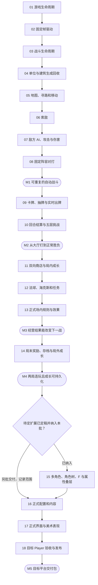
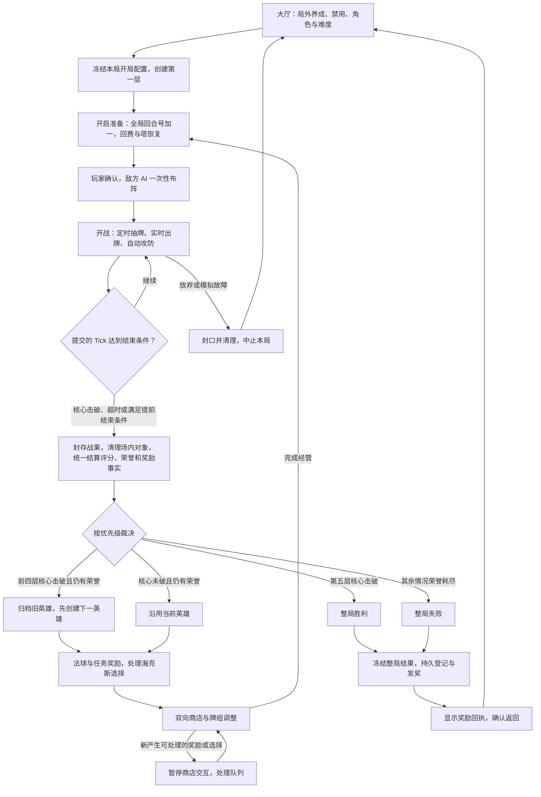

# Project B 整游实现流程与里程碑

2026-11-15 · 实施计划评审稿

从现有 TEngine 启动入口开始，先做能暂停和重开的固定阵容对打，再让卡牌接入真实战斗，把单场扩展成五层挑战，最后串起局内经营、局外成长、正式内容和发布。每一步在上一阶段的游戏入口上继续做，阶段结束保留可直接演示的场景和输入。

本计划采用[现有执行手册](00-实施顺序与验收索引.md)的前九步顺序，将其后续阶段展开成独立任务。玩法范围来自[全量需求索引](../../游戏设计/00-总览与索引.md)，待定规则沿用[规则决策表](../05-规则决策表.md)的联调默认。样本阵容、时间和奖励数值统一标识为联调用途。各步骤的勾选与验收状态在实施后填写。

## 1. 开发流程图

图中是**功能合入和里程碑验收顺序**。策划可在 04–08 期间准备卡组、地图和五英雄样本，在 09–13 期间制作回合表、报价、选择池和效果表。美术可随 04–09 的灰盒玩法验证尺寸、遮挡和点击范围。正式素材替换与验收在 17 完成。

| 里程碑 | 演示者可以完成的操作 | 交接给下一阶段 |
| --- | --- | --- |
| M1 自动战斗 | 从大厅开一场固定阵容战，看到绕障追击、互伤、核心击破或超时，退出后能重开 | 可复现地图、阵容、种子、命令和提交摘要 |
| M2 五层闭环 | 选难度，准备、实时出牌，连续跑回合及跨层，走到胜利和荣誉耗尽两种结局 | 稳定的回合战果、结算顺序、层间交接和玩法窗口入口 |
| M3 局内经营 | 打塔得到法球，在回合间自购、喂对手、拆除、选海克斯，再看双方变化实际进入战场 | 可复现的经营决策及收益来源记录 |
| M4 局外闭环 | 完成一局、领取永久奖励、点树或改禁用，重启后开第二局并看到改动 | 可读取的存档、奖励回执和新局快照 |
| M5 可发布 | 用正式内容从安装启动到打完五层，完成局末结算并再次开局 | 构建、内容版本、实机验收记录和待定扩展范围 |

## 2. 游戏运行流程图

流程采用评审默认。首次进入直接准备，普通经营发生在相邻两战之间。具体裁决和变化影响见[规则决策表](../05-规则决策表.md)。

| 交接点 | 谁负责 | 后续阶段收到什么 |
| --- | --- | --- |
| 大厅 → 当前局 | 游戏宿主管理入口，局外档案提供已提交进度 | 角色、难度、有效科技与技能、禁用、起始牌组、种子和内容版本 |
| 准备 → 战斗 | 局会话确认一次本轮准备并交场次装配 | 地图、敌阵、牌组、回费与效果、时限、评分基准及随机初值 |
| 战斗 → 回合结算 | 战斗模块提交场内事实，局会话负责积分与局内权益 | 最后成功 Tick、实际伤害、破损归因、核心结果和可继承值 |
| 回合间 → 下一战 | 局会话负责金币、牌组、背包、选择和层实例 | 玩家经营结果、新增待部署内容、下一战的常驻效果及正确的敌方归属 |
| 整局结算 → 下次开局 | 档案负责永久余额、账本和回执 | 可重试的结算回执、新局可用的局外养成和禁用快照 |

## 3. 分步实施

### 01 · 建立五状态游戏生命周期

- [ ] 从现有启动场景和热更业务入口进入大厅。开工时处置阻挡启动的 Entitas Demo 编辑器引用和场景孤立组件，保留框架启动节点。
- [ ] 建立开始、运行、暂停、结束、退出五个状态。开始受理一局并加载，运行推进当前局，暂停冻结玩法，结束接收一次自然结果，退出关闭输入并释放子战斗、界面和资源。先用可手动完成的样本局跑完整路径。
- [ ] 给大厅和调试界面接开始、暂停、继续、模拟结束和放弃操作。异步就绪回报绑定发起时的本局身份，取回上一局的资源时由其加载方收尾。

**交接与验收**　交付唯一的游戏启动和退出入口。能走大厅 → 开局 → 暂停 → 继续 → 自然结局 → 大厅，也能在暂停或加载时放弃并重开。每局只公布一种离场结果。

### 02 · 建立固定步帧驱动

- [ ] 在 01 的游戏宿主下接入唯一的帧推进入口。建立固定 Tick、整数时间、定点数值口径和独立时钟通道，先驱动可观察的计数器。
- [ ] 定义追帧上限、超额时间计量、暂停和继续的边界。玩法按 Tick 推进，画面按已经提交的状态插值。保留已提交 Tick 和输入顺序供诊断及回放。

**交接与验收**　同一段输入用不同的画面帧切分，在未触发过载且推进到同一 Tick 时得到同一结果。暂停期间 Tick 冻结，继续时从原进度推进。大卡顿可观察丢弃或限流的时间，调试单步可推进一 Tick。

### 03 · 建立三状态战斗生命周期

- [ ] 加入开始战斗、结束战斗和退出战斗三个状态。开始负责装配和注册通道，结束负责封存自然战果，退出负责取消或故障清理。
- [ ] 用空战场跑通一次正式进入和退出。由局会话启动场次，为每场分配身份，按目标 Tick 和顺序受理输入。自然结束以最后成功提交的 Tick 为准，退出关闭输入并清空排队命令。
- [ ] 把发布战果、注销通道、解除订阅和资源收尾接在同一生命周期上。开战前装配失败使用原准备结果重试并创建新场次；模拟进行中的失败按中止处理。

**交接与验收**　空战可超时结束，也可主动退出。自然结果各场只上报一次，取消与故障走各自的离场结果。上一场的输入和加载回调在重开后失效。

### 04 · 生成和回收单位、建筑及视图

- [ ] 确定 Entitas 1.14.1 正式战场 Context、目标程序集、Jenny 生成入口及根系统。每场随战斗创建，随战斗退出销毁。
- [ ] 用固定数据创建玩家单位、敌方塔和英雄核心。统一场内身份、阵营、位置、生命、碰撞轮廓和建筑占位，并在灰盒视图上标注可读身份。
- [ ] 区分战斗死亡与回收。死亡事实供计分、掉落和占位变化消费，退场回收只释放实体、占位和视图。异步视图按场次和单位身份绑定。

**交接与验收**　同一种子可复现同一阵容。杀死一单位和主动退出分别看到对应结果。先退出再让资源回调完成，已销毁单位与新场均不出现旧视图。

### 05 · 地图、合法站位与寻路

- [ ] 搭建围栏内的小地图，标出部署范围、可走区、墙、塔脚印和攻击站位。先提供无遮挡和绕墙两种样本，再接可变化占位。
- [ ] 以可攻击站位作为寻路终点。输出可达、无路和等待，移动按固定 Tick 消费路线，相同代价用稳定顺序决胜。障碍变化时只使受影响的路径重新求解。

**交接与验收**　单位能绕墙进入合法站位，完全封闭时进入等待。拆除挡路塔后可改走新通道，换图后旧路线失效。局会话可复用这份地图约束检查部署。

### 06 · 索敌与追击

- [ ] 先用小阵容做可比对的候选查询。根据阵营、生存、保护、距离和可达性筛选目标，按规则优先级和稳定身份选出目标。
- [ ] 将索敌接给 05 的移动。当前目标死亡、失效或不可达时按明确时机重选；无合法目标进入等待。后续空间索引优化使用相同目标结果作为对照。

**交接与验收**　等距等权候选在输入顺序不同的情况下仍选到同一目标。近目标被封住时可追击可达目标，目标死亡后能重选，受保护核心不进入可攻击候选。

### 07 · 敌方 AI、攻击与命中结算

- [ ] 先做准备期固定模板 AI。玩家确认后从合法格位和库存算出布阵草案，整体有效时只提交一次。正式库存选择和恢复在 10 接入。
- [ ] 接场内 AI 的等待、追击、进入射程、攻速冷却与攻击。把攻击范围、命中资格、实际扣血、死亡和占位更新落到同一提交顺序，保留攻击归因和同段去重。
- [ ] 先用可移除的挡塔验证核心门控。当前 Tick 的攻击从已冻结的保护状态判断，本 Tick 击破挡塔产生的缺口给下一 Tick 使用。正式八向屏障在 13 合入。

**交接与验收**　玩家和防守单位能按节奏互伤。同段重复命中只计一次，两个独立攻击各自结算。移除挡塔后核心按提交边界暴露，布阵连点不会重复消耗库存。

### 08 · 固定阵容对打，完成 M1

- [ ] 将 01–07 接成大厅可选的固定对打。使用一张地图、一组进攻单位、一组敌塔和一个核心，支持击破核心、超时和放弃三条路径。
- [ ] 保留双方阵容、地图、种子、时限、命令和逐 Tick 摘要。灰盒画面能看到移动、攻击、生命变化、死亡和本场结束原因。

**交接与验收**　同种子同命令得到同一提交摘要。暂停后继续可打完，放弃后可以再次开战。此场留下后续出牌和索敌性能对照使用的固定样本。

### 09 · 接牌组、费用与实时出牌

- [ ] 把开战固定生成的玩家进攻方替换为实际的出牌入口，保留 08 的固定对打样本。接持久牌组到本轮牌库、手牌、弃牌、移除和待完成区，做确定性洗牌、起手、定时再抽、满手待抽和弃牌洗回。
- [ ] 接入费用恢复和出牌操作。玩家从手牌选择卡牌和目标，战斗在 Tick 内决定目标是否合法，再一并提交费用、牌区和效果。界面显示待处理、成功或拒绝的实际结果。
- [ ] 用单位牌、技能牌、建筑牌和强化卡各做一张联调样本。接同一套生成、伤害和效果入口，安排即时抽牌、减费、临时发牌和临时升星的生效及清理时机。

**交接与验收**　玩家能靠出牌打穿原固定阵容。非法点位、费用不足和重复输入均有一致的牌区与费用结果。满手等待、弃牌洗回、回合关闭后的临时变化可逐项复现。

### 10 · 跑通回合、评分和五层挑战，完成 M2

- [ ] 大厅接角色样本、难度和五英雄路线，冻结本局内容版本和种子。每次打开准备时递增全局回合号，恢复费用、按塔类恢复或复活，玩家确认后让 AI 从本层已持有资产一次性部署。
- [ ] 用全局回合表提供时限、评分分母和相关基准。落实核心击破、超时、无法继续出牌且场上已无玩家非建筑单位三类结束条件；提前结束同时考虑截止前可达的回费、抽牌或其他可出牌路径。
- [ ] 结算提交一次评分、荣誉和奖励事实，按图中顺序决定继续同层、换层、胜利或失败。先以占位过场打开下一回合。跨层保留玩家局内成长和能量，旧英雄归档，新英雄按自身配置初始化。费用、牌区和回合内效果在每轮结束时清理。
- [ ] 把五层地图 1–5、五个英雄样本、基础卡组、正常胜负页面和返回大厅接在同一入口。清层路径先建下一英雄逻辑，下一层视图加载失败时重试同一层，保留已提交结果。

**交接与验收**　用短回合样本从大厅打完整个五层。另跑同层多轮、荣誉耗尽、第 1 层第 6 回合清层后第 2 层使用第 7 回合表，以及核心击破、时限归零、荣誉归零同次发生的判例。局会话输出稳定战果供经营和奖励阶段消费。

### 11 · 接金币、经验、商店和局内背包

- [ ] 把 10 的占位过场换成真实经营。先能查看双方拥有的内容、回合金币与利息、经验与等级、敌方升级和待部署资产。收入和等级变化按回合结算记录一次。
- [ ] 接双方各六格的样本报价、固定格位、刷新、锁定和保底规则。先走通自购、喂对手和拆除，再处理合法性、撤销来源和跨窗口状态。交易把报价、金币、双方权益与消费标记一起提交。
- [ ] 接牌组增删、合成、永久升星、装备归属和物品消耗。普通新卡进下一回合牌库，送给敌方的塔进入对应英雄的待部署库存。同店可拆内容按其交易来源撤销。

**交接与验收**　在同一次开店中买卡、给敌方送塔获益，再按规则拆塔。下一回合可从牌库抽到新卡，已拆塔不会参与 AI 布阵。对同一报价连点或在金币不足时购买，双方收支和库存保持一致。

### 12 · 接法球、双向海克斯与任务

- [ ] 根据已提交的直接塔破损和通关事实生成可追溯的法球记录，冻结候选和奖励。把领取、放弃和批量处理接到回合间窗口，永久奖励子行独立交给局末权益。
- [ ] 将通关、等级、任务及配置奖励产生的海克斯机会放进队列，按规则开三组配对候选，玩家与当前接收英雄的一对效果一起提交。接海克斯重置、绑定任务和卡牌、装备、升星等奖励来源。
- [ ] 清层时把尚未展开的通用机会绑定给新英雄。先处理法球和同批任务奖励，再按通关、等级、任务及其他来源处理海克斯。商店内产生新票据时暂停交互，结清后恢复同一窗口。

**交接与验收**　清层和升级同回合时两次选择各消费一次，敌方半边都交给下一英雄。领取后重载场景不会再发奖。购买经验触发选择时，确认后返回原商店并保留交易与报价状态。终局只交接已冻结的永久权益。

### 13 · 补正式战场规则与效果，完成 M3

- [ ] 补常规、抵抗、元素、特殊与光环塔的正式行为，加入八方向核心屏障、外侧前沿、地形、部署限制和攻击资格。让地图占位、路径可达与目标许可读取同一份局部规则。
- [ ] 接玩家、单位、塔和区域的增减益，区分即时、持续、回合内和本局常驻，记录来源和撤销范围。把海克斯、物品、装备、牌组羁绊、地形及技能统一送入相应效果入口。
- [ ] 接角色主动技能能量、操作和生效时钟，核对暂停、回费、剩余时限及跨层能量。接正式卡牌效果与任务计数所需的伤害、破损及交易归因。

**交接与验收**　同一阵容分别带和不带局内成长效果开战，能观察可解释的路径、伤害或费用差异。抵抗塔恢复、核心暴露、不同来源叠加与撤销、回合结束清理均有独立场景。回放输出可定位经营决策改变了哪一场的输入。

### 14 · 局末结算、档案和局外成长，完成 M4

- [ ] 正常胜负生成稳定的局末战果，按保存的规则版本计算 A/B 等奖励。先记录待发权益，再以同一事务提交余额、账本和回执。局末页显示处理中、可重试和已到账状态。
- [ ] 建立全局背包、档案版本与迁移。接科技树、卡牌技能树，以及卡牌、物品、海克斯三种禁用。已确认的解锁与禁用进入下一局快照。
- [ ] 串起“战果 → 永久奖励 → 大厅养成 → 新局”。重启后恢复已登记的局末结算。评审默认下，放弃局与模拟故障保留中止原因；活动局续玩按独立扩展评审。

**交接与验收**　先打完一局，分别在待发已写入和入账已完成时重启。恢复后同一结果只给一份奖励，新局可见树节点、星级能力和禁用变化。旧档可迁移，失败结果有独立可读回执。

### 15 · 落地已定稿的扩展功能

- [ ] 策划定稿后接多角色选择、解锁、角色技能树和局外资源 F。明确每个角色的初始参数、解锁消耗、技能来源、奖励来源与结算归属。
- [ ] 定稿后接属性叠层的槽位、触发、上限和跨阶段继承。属性叠层和临时效果各自拥有独立来源及清理周期。
- [ ] 排期逐项注明本批启用、分批启用或等待定稿。已经延期的入口与引用纳入正式配置一致性检查。

**交接与验收**　启用的角色能解锁并用各自初始牌组、技能和难度跑通新局。资源 F 可追溯到发放来源，重试只到账一次。叠层只影响约定状态。此步骤的验收以该批明确启用的子功能为准。

### 16 · 正式内容、配置与版本切换

- [ ] 用阶段样本的发展过程建立表族。正式生产走现有 Luban 链，覆盖角色、五英雄、地图、全局回合、卡牌与塔、经济与掉落、效果、选择池、任务、局外树和奖励。
- [ ] 校验跨表引用、阶段和接收域、五层布局、三选一最小候选池、商店保底、正评分分母及回合表尾端策略。策划确认正式权重、伤害、进度与奖励曲线；数值冲突保持可定位的表/行/字段记录。
- [ ] 生成版本化内容包。新局使用装配成功的版本，活动局读开局时冻结的规则。坏包按流程停止新局装配，并能定位缺项。

**交接与验收**　仅通过配置表更换阵容、卡组和价格，启动对应版本并完成一局。资源地址、卡牌星级、候选池或评分分母错误，可在内容交接前复现并给出具体位置。

### 17 · 正式 UI、美术、音效与资源装配

- [ ] 补大厅、开局、准备、战斗 HUD、商店、背包、奖励、选择、任务及结算界面，和 M2–M4 的现有业务入口对接。覆盖等待、确认、合法操作反馈、取消、重试与边界样本。
- [ ] 接正式像素美术、动画和音效。校准单位与塔占位辨识、八向屏障提示、透明排序、部署预览、命中与破损反馈、收益提示与目标平台布局。
- [ ] 通过 TEngine 窗口生命周期和 YooAsset 管理可见资源。场景与窗口异步结束时根据各自的身份和作用域释放。回放和自动战斗仍以已提交业务结果为准。

**交接与验收**　用正式界面独立走完从大厅到结算的完整流程。快速切窗、换层或放弃后，没有旧图标、单位或提示串到新界面。目标分辨率下能辨识可部署区域、塔与核心的保护状态，以及双方经营收益。

### 18 · 目标 Player、性能与发布，完成 M5

- [ ] 在目标平台制作可启动的包。从干净环境安装或更新，校验热更程序集、Luban 表、资源包、存档目录和内容版本对应。按正式内容跑五层胜负、第二局启动及坏包恢复。
- [ ] 用固定小阵容和正式高压阵容记录逐 Tick 一致性、耗时、分配、索敌和寻路开销。记录重复开局与退场后的资源变化。目标帧率、设备档位和性能门槛由本批验收标准给出。
- [ ] 归档构建产物、提交、配置和资源版本，以及胜负、旧档迁移、奖励补发、回放、资源释放的实机证据。将启用范围和已记录的问题交接到发布清单。

**交接与验收**　发布包从安装到正常结算和重开可复现。至少完成一场完整胜利、一场荣誉耗尽失败、一次存档恢复和一轮真实阵容压力运行，并按目标设备记录结果。

## 4. 贯穿联调的三条主线

| 场景 | 复用步骤 | 预期交接 |
| --- | --- | --- |
| 停止后立即开新局 | M1 固定对打，M2 实时出牌，M5 正式资源 | 暂停继续保留 Tick；放弃封口和回收；下一场使用新身份，旧命令、订阅及异步视图不会串场 |
| 第 1 层第 6 回合清层 | M2 结算，M3 经营，M5 正式内容 | 拆外塔暴露核心，核心击破和超时同 Tick 仍只有一次结算；法球与通关、等级票据顺序正确；新英雄接收配对奖励和购买塔；第 7 回合验证新卡、敌阵和继承能量 |
| 截止时击破核心且荣誉归零 | M2 分支，M4 回执，M5 Player | 第五层走胜利，前四层走失败并仍记录该英雄已击破；回执按同一战果重复提交只返回原入账结果 |

每一步记录入口、版本、种子或输入、预期结果、实际结果和证据位置。若阶段验收失败，保留该坏例；修复后用同一场景与上一里程碑的正常入口再验。

## 5. 排期前要落实的输入

| 需确认 | 最迟影响 | 可先推进的工作 |
| --- | --- | --- |
| 首回合是否进店、提前结束、同回合裁决、跨层敌方继承 | 10 的正式分支和 12 的奖励归属 | 01–09 及采用评审默认的五层联调 |
| 全局回合行与尾端、五层阵型、塔类、地形、伤害及角色技能数值 | 13 的正式玩法，16 的数据验收 | 灰盒地形、样本阵容和可重复 Tick 用例 |
| 商店报价与保底、选择池、掉落与任务、局末奖励公式 | 11–14 的正式经济与结算，16 的内容准入 | 样本报价、样本奖励和完整交易及回执链 |
| 多角色、角色技能树、F、属性叠层等启用范围 | 15 的交付范围和 16–17 的配置与界面 | 默认角色及第一套完整局外循环 |
| 平台、设备档位、分辨率、性能预算、正式资产日期 | 17–18 的界面与发布验收 | 灰盒演示、基准回放、最小内容包结构 |

详细模块设计与需求追溯见[整游方案索引](../00-整游方案索引.md)。游戏与帧驱动工程参考见[生命周期与帧驱动方案](01-游戏生命周期与帧驱动.md)。玩法专题以[仓库策划需求](../../游戏设计/00-总览与索引.md)和[规则决策表](../05-规则决策表.md)为准。
