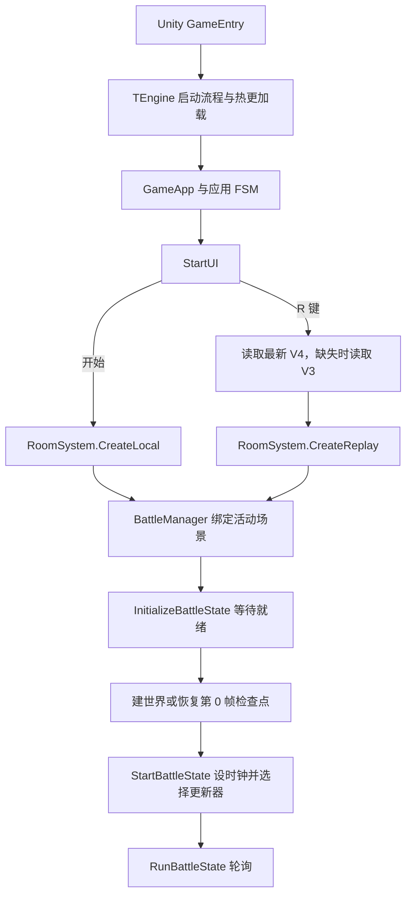

# Project B 的 ET10 迁移总结与多维对照

2026-11-19。Project B 以当前工作区源码为准，Git `HEAD` 为 `5abd4ad`，后续 Room 拆分、V4 录像和去掉 `LS` 前缀的实现已在工作区。ET 以固定提交 `743c635dd5b0f6f6bab549c0093382c85f3f8307` 为准，其中 `cn.etetet.lockstep` 为 `3.0.2`。 [ET 固定提交][et-pin] · [ET 锁步包][et-package] · [Project B 实施记录][pb-implementation]

## 一、总体结论

**Project B 已完成 ET10 锁步机制的单机适配。** ET 的房间、固定逻辑帧、更新器、快照、检查点与回放是设计参照。Project B 用 TEngine 管应用和当局生命周期，用 Entitas 管演算世界，用自己的存档格式保存录像。当前能走本地实时推进、录像重演、跨检查点定位和末帧对账。正式玩法仍通过 `LockstepWorldSetup` 接入，独立权威服与 ET 联机调用链仍属方案范围。 [ET 锁步包][et-package] · [Project B 房间][pb-room-system] · [Project B 宿主][pb-manager] · [原完整迁入计划][pb-original-plan]

| 迁移维度 | 当前结论 |
| --- | --- |
| 框架宿主 | 继续使用 Unity 6、TEngine、HybridCLR、YooAsset、UniTask 与 Luban 生成链。工作区未见 `cn.etetet.*` 包进入当前游戏启动链。 |
| 结构 | 对齐 ET 的 `Room` 与 `RoomSystem` 分离、按角色划分更新器、由客户端工具承接回放操作。Project B 脚本使用无 `LS` 前缀的项目命名。 |
| 单机逻辑 | 固定帧、封存输入、共用单帧入口、帧前快照、录像、四档倍速、分批跳转与世界重建已落地。 |
| 本项目扩展 | 帧内请求自然结束、回放逐帧 hash 停步、V4 终局 hash、旧 V3 读取和世界替换通知。 |
| 交付边界 | 当前是单机框架。正式开局使用空玩家表与默认 Battle Context。最新命名版尚未复验完整正式菜单链、正式玩法或独立 Player。 |

## 二、迁移经历与代码基线

| 阶段 | 有据可查的产出 |
| --- | --- |
| 应用生命周期与全局帧驱动 | `7790eaf` 接入 `StartUI` 和应用 FSM。`a09cf96` 接入固定帧驱动和探针，为后续房间帧驱动提供历史起点。 |
| ET 调研与完整迁入设计 | `480cde0`、`b1ee8ad` 归档 ET10 调研与适配。其中独立 .NET 权威端、真联机、预测、重连和协议生成是原计划目标。 |
| 单机房间与权威世界 | `6bffb6c` 接入房间和当局固定帧，`2c370b3` 接入本地权威帧与 Entitas，`5abd4ad` 调整战斗运行时、生成目录及定点工具。 |
| 当前工作区 | 房间和世界支持 V3 快照、检查点和回放定位。随后按 ET 拆分 Room、共享系统与两类更新器，增加场景绑定、自然结束和 V4 终局对账，再统一去掉项目脚本中的 `LS` 前缀。 |

提交只说明对应阶段曾入库。以下的当前图和脚本表以工作区中实际文件为准。 [完整迁入计划][pb-original-plan] · [历史脚本对照][pb-old-compare] · [当前实施结果][pb-implementation]

## 三、项目架构对照

| 层面 | ET10 固定基线 | Project B 当前实现 |
| --- | --- | --- |
| Unity 与入口 | Unity `2022.3.62f3`。客户端 `Init` 组装 `World` 单例、资源和代码加载器，在 Unity Update/LateUpdate 驱动 `FiberManager`。锁步示例还有独立 .NET App。 [ET 版本][et-version] · [Unity Init][et-loader] · [.NET App][et-app] | Unity `6000.0.69f1`。`GameEntry` 启动 TEngine 流程，`ProcedureLoadAssembly` 调用 `GameApp.Entrance`，进入 UI 和应用 FSM。 [Project B 版本][pb-version] · [热更加载][pb-loader] · [GameApp][pb-gameapp] |
| 生命周期与调度 | `World`、`Fiber`、`Scene`、`Entity` 与系统回调共同运行。Room 挂到相应场景，权威、预测和回放的 Updater 组件各有入口。 [FiberManager][et-fiber] · [ET Room][et-room] · [进场与挂接][et-scene] | TEngine 更新应用 FSM 和当局 FSM。`BattleManager` 持有唯一活动 Room，`RoomSystem.Start` 选择更新入口。当局是普通 C# 对象，回放复用本地宿主。 [应用管理器][pb-game-manager] · [当局宿主][pb-manager] · [RoomSystem][pb-room-system] |
| 游戏规则与世界 | `LSWorld` 管帧、ID 和随机状态，`LSUpdater` 在世界内按实体 ID 调用更新。 [LSWorld][et-world] · [LSUpdater][et-world-update] | `LockstepWorld` 持有独立 Entitas Context 和系统树。单帧为 `Execute → Cleanup → Frame++`，需稳定顺序的系统显式取按 ID 排序的实体列表。 [Project B 世界][pb-world] · [Jenny 配置][pb-jenny] |
| 数值与时间 | TrueSync 提供定点类型，`FixedTimeCounter` 接收时间锚点。联网示例各更新器取 `TimeInfo.ServerNow()`。 [ET 锁步依赖][et-package] · [上游时钟][et-clock] · [服务端更新][et-server] | 当前使用 `FixedPoint`、`FixedVector2/3`、`FixedQuaternion`、`DeterministicRandom` 和 `StableBytesHash`。现场时间由本进程 `Stopwatch` 量化为毫秒。 [Utility][pb-utility] · [本地时钟][pb-clock] |
| 快照、录像和协议 | ET 用 MemoryPack 保存 `LSWorld` 与 `Replay`，整帧输入还能走上游消息协议。 [RoomSystem][et-room-system] · [LSClientHelper][et-helper] · [客户端确认][et-confirm] | 快照采用显式字段和稳定组件键，录像是项目自己的小端 V3/V4 格式。当前运行源码从本地输入或录像获取帧，网络会话、协议、预测和重连均未接入。 [组件编解码][pb-codecs] · [本地文件][pb-replay-file] |

Project B 的 `Runtime/Battle`、`Runtime/Lockstep` 和 `Runtime/Entitas` 同编进 `GameLogic.asmdef`。`Model`、`Hotfix` 和 `World` 的划分表达脚本职责。两个独立回归工程通过 `.csproj` 链接纯演算、回放与 Entitas 生成源码，排除 Unity 场景和 UniTask 文件 I/O。 [GameLogic.asmdef][pb-asmdef] · [ReplaySeek.csproj][pb-seek-proj] · [ReplaySpeeds.csproj][pb-speeds-proj]

## 四、目录与代码职责映射

Project B 路径以 `Assets/GameScripts/HotFix/GameLogic/` 为根。当前 `Runtime/Lockstep` 有 17 个 C# 文件，`Runtime/Battle` 有 6 个，未将 Entitas 生成物和 Demo 计入。ET 路径以相应包为根。

| Project B 当前文件或目录 | ET 对应入口 | 代码关系 |
| --- | --- | --- |
| `GameApp.cs`、`Module/GameAppModule`、`GameModule.cs` | `loader/Init`、`World`、`FiberManager` 的启动和宿主职责 | 沿用 TEngine 应用入口、模块访问、资源与退出释放。 |
| `UI/StartUI`、`Runtime/Battle/BattleManager.cs`、`State/` | `LSSceneChangeHelper` 及场景挂接与更新回调 | Manager 管当前房间和菜单。初始化、启动、进行、结束由 TEngine 状态分阶段执行。 |
| `Runtime/Lockstep/Model/Share/Room.cs` | `lockstep/Model/Share/Room.cs` | 房间保存世界、时钟、帧号、玩家槽、输入历史、录像与模式更新入口，ET 使用实体组件承载相近数据。 |
| `Hotfix/Share/RoomSystem.cs` | `lockstep/Hotfix/Share/RoomSystem.cs` | 共用房间业务入口，管理建房、初始化、启动、单帧、历史、恢复和释放。Project B 还处理本地自然结束和终局封存。 |
| `Hotfix/Local/LocalFrameUpdater.cs` | `LSServerUpdaterSystem` 的权威步进部分 | 到期即封帧并推进一次。ET 服务端额外补远端玩家输入并广播。 |
| `Model/Client/ReplayUpdater.cs`、`Hotfix/Client/ReplayUpdaterSystem.cs` | `LSReplayUpdater`、`LSReplayUpdaterSystem` | 回放独立管理倍率、定位、停止、分歧和推进。采用宿主主动调用。 |
| `Hotfix/Client/ClientHelper.cs`、`ClientHelper.ReplayFile.cs` | `LSClientHelper` | 同一 partial 类型，前者处理跳转与倍速，后者处理本地 V3/V4 文件。ET 工具还包含联机回滚、hash 上报及 MemoryPack 保存。 |
| `Hotfix/Client/SceneChangeHelper.cs` | `LSSceneChangeHelper` | 绑定进入时的本地活动场景并报告就绪，失效由当局 FSM 统一退出。ET 还在进场中处理开局消息、更新器挂接与重连。 |
| `Model/Share/FixedTimeCounter.cs`、`FrameBuffer.cs` | `FixedTimeCounter`、`FrameBuffer` | 复用定时锚点、环形帧历史的思路。Project B 用实际帧号校验每个槽，负责本地待提交值封帧。 |
| `Model/Share/PlayerFrameInput.cs`、`OneFrameInputs.cs`、`Replay.cs` | `LSInput`、`OneFrameInputs`、`Replay` | 单人单帧与全体整帧结构对应。Project B 使用固定槽和只读整帧视图，`Replay` 持有录制顺序、种子、帧前 hash、检查点与可选 `TerminalHash`。 |
| `World/LockstepWorld.cs`、`LockstepWorldSetup.cs`、`WorldSnapshot.cs`、`SnapshotComponentCodecs.cs` | `lsentity/LSWorld`、`LSUpdater`、`RoomSystem` 快照逻辑 | Entitas 执行、组件编解码和装配入口属于 Project B 的实现。更换时递增世界版本并清理旧世界，宿主在更新返回后通知。 |
| `Runtime/Entitas/Generated/Battle`、`Module/Utility` | ET 的 `LSEntity` 及 TrueSync 各自承担相近功能 | 保留 Jenny 生成流程与项目定点工具。ET 的 `LSInputComponentSystem` 对应未来消费输入的世界内系统。`ApplyInputs` 对应当帧输入投递。 |

[当前宿主目录][pb-battle-dir] · [当前 Lockstep 目录][pb-lockstep-dir] · [ET RoomSystem][et-room-system] · [ET 权威更新][et-server] · [ET 回放更新][et-replay] · [ET 输入消费][et-input-system]

## 五、运行流程对照

### 1. 启动和本地进场



ET 实时进场先挂 Room，等待表现准备并通知服务端，再等 `Room2C_Start` 取得统一开战时间与初值。Project B 在本地绑定已有活动场景，世界就绪后从本进程时钟开始。两者正常开局都以 `AuthorityFrame = -1`、世界待执行第 `0` 帧为起点，开战时间的来源与进场握手不同。ET 示例即使 `MatchCount = 1` 仍有客户端和服务端。 [ET 进场][et-scene] · [ET 服务端开局][et-ready] · [ET 初始帧][et-room-system] · [Project B 进场][pb-manager]

### 2. 实时与回放的共同帧

```text
实时 Room  → LocalFrameUpdater → 到期后 FrameBuffer.Seal(f) ┐
回放 Room  → ReplayUpdaterSystem → 读取录像第 f 帧输入       ├→ RoomSystem.Tick(f)
                                                            ┘
共同帧      → 投递输入 → 捕获帧前世界 → 实时记录或回放校验
           → 保存帧历史 → Entitas Execute → Cleanup → 世界帧号加一
退出        → 帧末完成或手动退出 → 封存有帧实时录像 → 释放房间 → 回菜单及保存
```

实时每次轮询最多执行一帧，帧长 50 ms。新输入写入下一待封帧，同槽采用最后一次提交。未提交的槽沿用已确认值。ET 的权威更新器同样等下一帧到期，缺值时用上一帧或默认值，然后还会向客户端广播权威整帧。两边实时单帧的共同顺序都是输入先写入，随后捕获帧前状态并留存记录，最后推进世界。 [ET 权威更新][et-server] · [ET 共同帧][et-room-system] · [Project B 本地更新][pb-local-updater] · [Project B 共同帧][pb-tick]

### 3. 回放定位、分歧和结束

1. **正常播放。** Project B 从录像第 0 帧检查点恢复，场景和世界就绪后起钟。`ReplayUpdaterSystem` 按录像输入重演，到期帧可以连做多次。约 5 ms 的预算在每一帧执行完成后检查。ET 回放更新也使用类似的到期与预算机制，但进场由 `Replay.UnitInfos` 建世界。 [ET 播放入口][et-scene] · [ET 回放更新][et-replay] · [Project B 回放更新][pb-replay-updater]
2. **跳转。** `ClientHelper.JumpReplay` 提交目标。健康的同区间前跳复用世界。后跳、跨检查点或分歧恢复会建立新 Context 和缓存、递增 `WorldRevision`，并把房间确认帧重设为检查点 `F - 1`，先重演 `F`。ET 上游 `JumpReplay` 在恢复后将 `AuthorityFrame` 设为 `F`，后续回放取下一输入 `F + 1`。例如 `F = 1200` 时，两侧首个消费输入的编号不同。 [ET 跳转][et-helper] · [Project B 跳转][pb-client] · [Project B 检查点恢复][pb-room-system]
3. **两种分歧。** `FrameDiverged` 是投递输入后的帧前 hash 不一致，该帧的世界系统不执行，确认帧保持上一帧。`TerminalDiverged` 是最后一帧已执行和清理后，V4 终局 hash 不一致。ET 示例中的网络 hash 检查用于跨端状态诊断，普通回放分支跳过帧快照保存，行为与本项目的本地停步不同。 [ET 房间快照][et-room-system] · [ET hash 对账][et-hash] · [Project B 共同帧][pb-tick] · [Project B 终局回放][pb-replay-updater]
4. **自然结束与文件。** 世界系统发出 `RequestFinish()` 后，当前帧的其余系统与 Cleanup 仍执行。只有实时房间将此信号提交为 `IsFinished`，外层随后封存并释放。回放按录像的末帧停留，可再次定位。V4 记录最后一帧执行后的指纹，V3 仍做逐帧帧前核对。 [世界执行][pb-world] · [房间封存][pb-room-system] · [宿主退出][pb-manager] · [文件布局][pb-replay-file]

## 六、功能落实程度

| 功能 | Project B 状态 | 与 ET 的实际差别 |
| --- | --- | --- |
| 50 ms 时钟、首帧编号、帧到期 | 已实现 | 锚点公式相同。Project B 使用单调毫秒；ET 联机有服务器时间来源和校时消息。 |
| 单机权威输入 | 框架已实现 | 可在准备期提交本地输入。正式开局调用传空列表。Demo 以脚本提交输入并装配样例玩家，正式设备桥接尚未接入。 |
| 输入、快照和 hash 历史 | 已实现 | 默认 1,200 帧。当前缓存保存本地确认数据与重演记录，没有 ET 的网络预测帧历史。 |
| 世界快照和恢复 | 已实现 | 按稳定 ID 保存实体、最大 ID、随机状态、字段和帧号。组件需显式登记稳定键与读写逻辑。两边快照格式独立。 |
| 回放速度、定位和重建 | 已实现 | 倍率 1、2、4、8 对应整数毫秒 50、25、12、6。按约 5 ms 预算分批定位，在目标帧执行完成后重锚。 |
| 回放文件 | 已实现 | 新写入 `battle-last-v4.replay`，缺文件时读取 `battle-last-v3.replay`。坏 V4 报错，保存采用临时文件与替换。ET 使用 MemoryPack `Replay`，数据格式不可互读。 |
| 单机进退场和世界替换通知 | 框架已实现 | 复用活动主场景，有 `WorldChanged` 通知。独立战斗场景资源与正式视图绑定尚未落地。 |
| 自然结束和终局 hash | 已实现 | 属于 Project B 的单机扩展。胜负、奖励、结算以及正式玩法系统在游戏层落地。 |
| 真实客户端预测、权威广播、回滚校正、跨端 hash、重连 | 当前没有运行实现 | ET 示例已提供对应房间、客户端、服务端和消息处理入口。独立 .NET 回归宿主只消费本地演算源码。 |
| 独立 Unity Player | 交付待验收 | 当前 `EditorBuildSettings.asset` 指向缺失的 `SampleScene.unity`，工作区场景为 `main.unity`。现有 ReleaseTools 读取 `EditorBuildSettings.scenes`，因此正式构建入口仍需核对。 |

[Project B 帧时钟][pb-clock] · [Project B 帧缓存][pb-buffer] · [项目组件表][pb-battle-context] · [Project B 回放数据][pb-replay-data] · [ET 校时][et-adjust] · [ET 预测][et-client] · [ET 确认回滚][et-confirm] · [构建场景][pb-build-settings] · [ReleaseTools][pb-release-tools]

## 七、代码层的关键合同与影响

当前框架接口可以按以下顺序接入。启钟前就能提交输入，`Update` 只由宿主轮询，退场时先读取需要保存的录像再释放房间。这里的 `playerIds`、`worldSetup`、输入采样及时间参数由调用方提供。 [房间 API][pb-room-system] · [装配 API][pb-setup] · [现有独立接线][pb-seek-proj]

```csharp
Room room = RoomSystem.CreateLocal(localPlayerId, playerIds, worldSetup);
room.SubmitLocalInput(firstInput);

// 宿主确认场景就绪后执行。
room.InitializeWorld();
room.Start(FixedTimeCounter.ReadMilliseconds());

// 每次宿主轮询。
room.Update(FixedTimeCounter.ReadMilliseconds());

// 退出时，frameCount 为 0 的实时局和回放局不会产生新录像。
Replay recording = room.SealReplay();
room.Release();
```

| 代码合同 | 当前实现 | 审阅和接入时的意义 |
| --- | --- | --- |
| 世界帧与房间帧 | `AuthorityFrame` 表示房间已经确认或正在确认的帧。`LockstepWorld.Frame` 表示下一次待演算帧。正常执行完 `F` 后两值分别为 `F` 和 `F + 1`。 | 快照是帧前状态。检查点恢复和终局 hash 都依赖该边界，不能把 V4 终局指纹当成 `F` 的帧前指纹。 |
| 一份共同 Tick | 仅 `RoomSystem.Tick` 确定输入、快照、记录或校验顺序。`LocalFrameUpdater` 和 `ReplayUpdaterSystem` 控制何时调它。 | 调度策略可以独立演变。实时和回放共享世界规则，有明确的帧前分歧退出点。 |
| 装配与序列化 | 运行时通过 `LockstepWorldSetup` 接 Context、初值、系统树、组件编解码和输入投递。快照使用稳定实体 ID、组件键和可恢复随机状态。 | 影响未来演算的状态应进入可恢复数据。单个系统的非序列化临时字段、普通 Group 的默认遍历顺序和 Unity 表现状态需要按实际规则核对。 |
| 世界生命周期 | 初始化和检查点重建创建独立世界。恢复装配成功后替换 `World`、帧历史以及确认帧，递增版本并释放旧世界。宿主在更新返回后通知新世界。 | 对外可用世界版本或稳定 ID 更新引用。回放同区间向前定位时可以沿用当前世界，避免无谓重建。 |
| 本地确定性成本 | 世界按稳定 ID 顺序遍历实体并写快照，`CaptureSnapshot()` 分配 `MemoryStream`、快照字节并计算 FNV-1a。实时和回放都在共同 Tick 取帧前快照。 | 1,200 帧环形历史限制保留数量。每帧开销与世界实体、组件和快照大小相关，当前 Demo 证据不足以外推正式大规模场景。 |
| 宿主与演算代码边界 | `ClientHelper` 文件操作和 `SceneChangeHelper` 依赖宿主。确定性世界、房间和回放控制可直接被两个独立 .NET 工程链接。 | 当前已证明本地可独立运行演算路径。真正服务端还需要部署入口、消息协议、时钟与模式适配。 |

[RoomSystem.Tick][pb-tick] · [世界与快照][pb-world] · [世界装配][pb-setup] · [组件编解码][pb-codecs] · [稳定 hash][pb-utility] · [独立项目链接][pb-seek-proj]

## 八、验证记录与待闭环工作

| 证据 | 已记录结果 | 覆盖边界 |
| --- | --- | --- |
| `FixedMathComparison` 的历史源码对账 | 793 个样本，0 差异，覆盖定点标量、向量和四元数的选定路径。 | 仅覆盖记录中的样本。完整 TrueSync API、全部溢出边界与跨平台需要独立验证。 [定点对账记录][pb-math-report] |
| `ReplaySeek` 与 `ReplaySpeeds` | 对齐结构和补齐单机后通过。前者覆盖第 1,200 帧边界、分批定位、同区间复用、分歧恢复、自然结束与终局分歧。后者覆盖 40 帧的四档切换、逐帧 hash 与随机样本。 | 独立源码宿主、不经过正式菜单。此记录发生于去掉 `LS` 前缀之前。 [实施验收记录][pb-implementation] |
| Unity 编辑模式临时录像用例 | 已记录通过旧 V3 播放、V4 往返、保存失败保留原档、坏档拒绝。 | 使用临时路径，与玩家持久化目录和正式 Play Mode 进退场的验证分开。 [Demo][pb-demo] · [实施验收记录][pb-implementation] |
| 去掉 `LS` 前缀 | Unity 重命名 6 个文件，原 GUID 均保留，正式和 Demo 引用已同步。 | 完成路径、GUID 和旧引用检查，未在改名后重新跑整组回归。 [当前实施记录][pb-implementation] |
| 正式菜单、正式玩法和构建 | 开局、读取和退场入口已有源码。完整 `StartUI → 实时 → 保存 → 回放 → 再开` 仍待最新版本 Play Mode 验收。正式玩法与独立 Player 仍待接入或交付。 | 当前 `BattleContext` 生成组件为 0。实际输入、玩法、表现、跨平台确定性和构建场景需各自有证据。 [StartUI][pb-start-ui] · [Battle 组件表][pb-battle-context] · [构建场景][pb-build-settings] |

整体结论是 **框架层可以继续接单机玩法，当前最直接的验收缺口是正式菜单与持久化路径**。ET 真联机需要另行落地权威端、协议收发、帧确认、预测回滚、校时与重连。若后续需要按 ET 业务能力验收，更合适的度量是分别验证每条链路和确定性契约。 [当前实施记录][pb-implementation] · [脚本与行为基线][pb-old-compare]

本次更新为源码、配置及历史验证记录的汇总。未改代码、资源和配置，未重新执行编译、测试或 Unity Play Mode。

[pb-implementation]: Project_B按ET10改造并补齐单机逻辑帧框架执行方案.md
[pb-old-compare]: Project_B与ET10逻辑帧脚本目录及行为对照.md
[pb-original-plan]: Project_B-ET10源码迁入与Entitas战斗联机分步执行手册.md
[pb-math-report]: 定点运算对账与单机回放倍速验收.md
[pb-version]: ../../ProjectSettings/ProjectVersion.txt#L1
[pb-loader]: ../../Assets/GameScripts/Procedure/ProcedureLoadAssembly.cs#L136
[pb-gameapp]: ../../Assets/GameScripts/HotFix/GameLogic/GameApp.cs#L26
[pb-game-manager]: ../../Assets/GameScripts/HotFix/GameLogic/Module/GameAppModule/GameAppManager.cs
[pb-manager]: ../../Assets/GameScripts/HotFix/GameLogic/Runtime/Battle/BattleManager.cs
[pb-asmdef]: ../../Assets/GameScripts/HotFix/GameLogic/GameLogic.asmdef
[pb-battle-dir]: ../../Assets/GameScripts/HotFix/GameLogic/Runtime/Battle
[pb-lockstep-dir]: ../../Assets/GameScripts/HotFix/GameLogic/Runtime/Lockstep
[pb-start-ui]: ../../Assets/GameScripts/HotFix/GameLogic/UI/StartUI.cs
[pb-jenny]: ../../Jenny.properties#L8
[pb-battle-context]: ../../Assets/GameScripts/HotFix/GameLogic/Runtime/Entitas/Generated/Battle/BattleComponentsLookup.cs#L13
[pb-room-system]: ../../Assets/GameScripts/HotFix/GameLogic/Runtime/Lockstep/Hotfix/Share/RoomSystem.cs
[pb-tick]: ../../Assets/GameScripts/HotFix/GameLogic/Runtime/Lockstep/Hotfix/Share/RoomSystem.cs#L116
[pb-local-updater]: ../../Assets/GameScripts/HotFix/GameLogic/Runtime/Lockstep/Hotfix/Local/LocalFrameUpdater.cs
[pb-client]: ../../Assets/GameScripts/HotFix/GameLogic/Runtime/Lockstep/Hotfix/Client/ClientHelper.cs
[pb-replay-updater]: ../../Assets/GameScripts/HotFix/GameLogic/Runtime/Lockstep/Hotfix/Client/ReplayUpdaterSystem.cs
[pb-replay-file]: ../../Assets/GameScripts/HotFix/GameLogic/Runtime/Lockstep/Hotfix/Client/ClientHelper.ReplayFile.cs
[pb-world]: ../../Assets/GameScripts/HotFix/GameLogic/Runtime/Lockstep/World/LockstepWorld.cs
[pb-setup]: ../../Assets/GameScripts/HotFix/GameLogic/Runtime/Lockstep/World/LockstepWorldSetup.cs
[pb-codecs]: ../../Assets/GameScripts/HotFix/GameLogic/Runtime/Lockstep/World/SnapshotComponentCodecs.cs
[pb-clock]: ../../Assets/GameScripts/HotFix/GameLogic/Runtime/Lockstep/Model/Share/FixedTimeCounter.cs
[pb-buffer]: ../../Assets/GameScripts/HotFix/GameLogic/Runtime/Lockstep/Model/Share/FrameBuffer.cs
[pb-replay-data]: ../../Assets/GameScripts/HotFix/GameLogic/Runtime/Lockstep/Model/Share/Replay.cs
[pb-utility]: ../../Assets/GameScripts/HotFix/GameLogic/Module/Utility
[pb-seek-proj]: ../../Tools/BattleFrameworkDemo/ReplaySeek/ReplaySeek.csproj
[pb-speeds-proj]: ../../Tools/BattleFrameworkDemo/ReplaySpeeds/ReplaySpeeds.csproj
[pb-demo]: ../../Tools/BattleFrameworkDemo/BattleFrameworkDemo.cs
[pb-build-settings]: ../../ProjectSettings/EditorBuildSettings.asset#L8
[pb-release-tools]: ../../Assets/TEngine/Editor/ReleaseTools/ReleaseTools.cs#L415
[et-pin]: https://github.com/egametang/ET/commit/743c635dd5b0f6f6bab549c0093382c85f3f8307
[et-version]: https://github.com/egametang/ET/blob/743c635dd5b0f6f6bab549c0093382c85f3f8307/ProjectSettings/ProjectVersion.txt
[et-loader]: https://github.com/egametang/ET/blob/743c635dd5b0f6f6bab549c0093382c85f3f8307/Packages/cn.etetet.loader/Scripts/Loader/Client/Init.cs
[et-fiber]: https://github.com/egametang/ET/blob/743c635dd5b0f6f6bab549c0093382c85f3f8307/Packages/cn.etetet.core/Scripts/Core/Share/World/Fiber/FiberManager.cs
[et-app]: https://github.com/egametang/ET/blob/743c635dd5b0f6f6bab549c0093382c85f3f8307/Packages/cn.etetet.lockstep/DotNet~/App/Program.cs
[et-package]: https://github.com/egametang/ET/blob/743c635dd5b0f6f6bab549c0093382c85f3f8307/Packages/cn.etetet.lockstep/package.json
[et-scene]: https://github.com/egametang/ET/blob/743c635dd5b0f6f6bab549c0093382c85f3f8307/Packages/cn.etetet.lockstep/Scripts/Hotfix/Client/LSSceneChangeHelper.cs
[et-ready]: https://github.com/egametang/ET/blob/743c635dd5b0f6f6bab549c0093382c85f3f8307/Packages/cn.etetet.lockstep/Scripts/Hotfix/Server/Map/C2Room_ChangeSceneFinishHandler.cs
[et-room]: https://github.com/egametang/ET/blob/743c635dd5b0f6f6bab549c0093382c85f3f8307/Packages/cn.etetet.lockstep/Scripts/Model/Share/Room.cs
[et-room-system]: https://github.com/egametang/ET/blob/743c635dd5b0f6f6bab549c0093382c85f3f8307/Packages/cn.etetet.lockstep/Scripts/Hotfix/Share/RoomSystem.cs
[et-clock]: https://github.com/egametang/ET/blob/743c635dd5b0f6f6bab549c0093382c85f3f8307/Packages/cn.etetet.lockstep/Scripts/Model/Share/FixedTimeCounter.cs
[et-server]: https://github.com/egametang/ET/blob/743c635dd5b0f6f6bab549c0093382c85f3f8307/Packages/cn.etetet.lockstep/Scripts/Hotfix/Server/Room/LSServerUpdaterSystem.cs
[et-client]: https://github.com/egametang/ET/blob/743c635dd5b0f6f6bab549c0093382c85f3f8307/Packages/cn.etetet.lockstep/Scripts/Hotfix/Client/LSClientUpdaterSystem.cs
[et-confirm]: https://github.com/egametang/ET/blob/743c635dd5b0f6f6bab549c0093382c85f3f8307/Packages/cn.etetet.lockstep/Scripts/Hotfix/Client/OneFrameInputsHandler.cs
[et-adjust]: https://github.com/egametang/ET/blob/743c635dd5b0f6f6bab549c0093382c85f3f8307/Packages/cn.etetet.lockstep/Scripts/Hotfix/Client/Room2C_AdjustUpdateTimeHandler.cs
[et-hash]: https://github.com/egametang/ET/blob/743c635dd5b0f6f6bab549c0093382c85f3f8307/Packages/cn.etetet.lockstep/Scripts/Hotfix/Server/Room/C2Room_CheckHashHandler.cs
[et-replay]: https://github.com/egametang/ET/blob/743c635dd5b0f6f6bab549c0093382c85f3f8307/Packages/cn.etetet.lockstep/Scripts/Hotfix/Client/LSReplayUpdaterSystem.cs
[et-helper]: https://github.com/egametang/ET/blob/743c635dd5b0f6f6bab549c0093382c85f3f8307/Packages/cn.etetet.lockstep/Scripts/Hotfix/Client/LSClientHelper.cs
[et-input-system]: https://github.com/egametang/ET/blob/743c635dd5b0f6f6bab549c0093382c85f3f8307/Packages/cn.etetet.lockstep/Scripts/Hotfix/Share/LSInputComponentSystem.cs
[et-world]: https://github.com/egametang/ET/blob/743c635dd5b0f6f6bab549c0093382c85f3f8307/Packages/cn.etetet.lsentity/Scripts/Core/Share/LSWorld.cs
[et-world-update]: https://github.com/egametang/ET/blob/743c635dd5b0f6f6bab549c0093382c85f3f8307/Packages/cn.etetet.lsentity/Scripts/Core/Share/LSUpdater.cs
