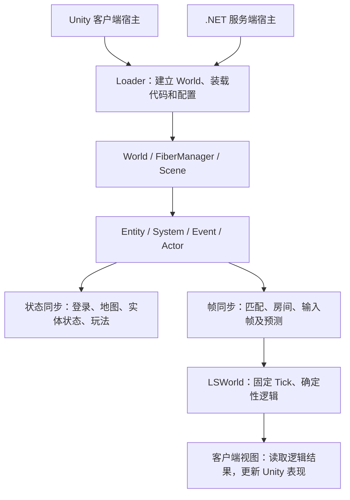
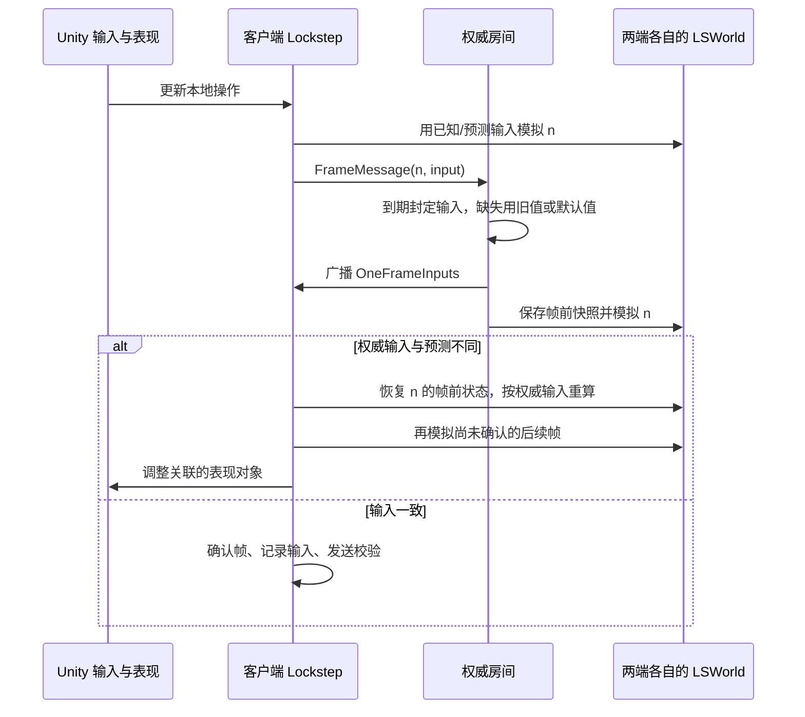

# Unity ET 框架全量源码调研与逻辑帧驱动

调研日期：2026-11-17（北京时间）。对象：官方 `egametang/ET` 及官方 ET Packages 中与帧同步有关的包。方法：固定 Git 提交，枚举跟踪目录，按包核对元数据与源码入口，展开核心运行时与 Lockstep 的调用链。

> **有。ET 自带一套可由固定逻辑帧推进的确定性仿真与联机帧同步实现。** ET10 的 `lsentity` 提供逻辑世界和系统派发，`truesync` 提供定点数学，`lockstep` 把两者装配为联机房间，负责输入帧、权威推进、客户端预测、纠偏、快照和录像。ET 8.1 也有相应的内置源码。ET 的常规 Fiber/Entity Update、状态同步和 Lockstep 是不同层面的机制。

> **对 Project B：** 已选 ET10 `master` 为迁移底稿。新战斗可直接使用原生 LSWorld 和 ET 网络，现有 Unity/TEngine 负责应用宿主。独立的 [迁移实施方案](Project_B-ET逻辑帧与网络迁移实施方案.md) 对照了三种组织方式、先单机后联网的里程碑和验收。

## 1. 版本、范围和证据

| 版本 | 固定源码 | 模块位置和阅读方式 |
| --- | --- | --- |
| **ET10（默认分支 `master`）** | [`743c635dd5b0f6f6bab549c0093382c85f3f8307`][et10commit] | 本文主体。源码按 `Packages/cn.etetet.*` 分包，仓库同时提供状态同步和帧同步演示。 |
| **ET 9.0（`release9.0`）** | [`9bcbf5d184f5c114123409cfee3033fbcb8c4123`][et9root] | 发布分支是引导项目；该提交的 `Packages` 没有内置 `cn.etetet.lockstep`，配有 ET-Packages scoped registry。帧同步可看 [官方独立 Lockstep 源码仓库][et9package]。独立包有自己的提交历史，不能把其任意提交等同于发布分支所有用户实际安装的版本。 |
| **ET 8.1（`release8.1`）** | [`b7bdaa0dcd5c682d968ec8922eb7a6dc4637011c`][et8root] | 源码集中在 `Unity/Assets/Scripts`。沿 `Model/Share/LockStep`、`Hotfix/Client/LockStep`、`Hotfix/Server/LockStep` 可读完整链路。 |
| ET 7.2 / 6.0 | [`release7.2`][et7root] / [`release6.0`][et6root] | 官方还保留这些历史分支；本文不将它们的 Actor、序列化、目录和启动方式混到 ET10。 |

这里的“完整”是指 **ET10 固定提交的全部内置 ET 功能包及其他包目录、核心内部模块、框架与示例的边界、三代帧同步证据和阅读入口**。第三方库会说明用途与归属；生成代码、Unity 资源和内部方法不逐行译写。外部注册表的付费或未随仓库交付的扩展只列已识别的入口，不用宣传文字推断其源码实现。本次只做源码静态调研，未执行外部仓库脚本、启动 Unity、联网对局、跑测试或做性能测量。

许可按所用提交读：该 [ET10 LICENSE][license10] 限制修改后以开源形式再发布，并要求商业项目上线前取得许可，明确第三方商业插件需另行授权；[ET9 LICENSE][license9] 有内部修改、传播及上线通知条款；[ET 8.1 LICENSE][license8] 是 MIT 文本。仓库公开可读只是源码可获取；引用或移植某个包之前，还要核对那个包及其依赖、素材的许可。本文只总结机制和指向源码。

## 2. 仓库地图与整体架构

| 位置 | 作用 |
| --- | --- |
| [`Packages/`][packages] | ET 各包、工具、样例和插件；`package.json` 是包元数据，`packagegit.json` 是 ET 的包来源/同步相关元数据，`manifest.json` 与 `packages-lock.json` 分别描述 Unity 依赖入口和解析结果。包清单与当前场景实际启用的包是两个口径。 |
| [`Assets/`][assets] | Unity 项目级资源、共有美术/设置和插件，例如 DOTween、Odin、TMP；不要把这些资源目录当成 ET 的业务运行时。 |
| [`ProjectSettings/`][settings] | Editor、渲染及工程设置；实际 Unity 版本以固定提交中的 `ProjectVersion.txt` 为准。 |
| [`Scripts/`][scripts] | 初始化、启动、发布和仓库导出等脚本。入口代码与发布脚本分别阅读。 |
| [`Book/`][book]、[运行指南][guide] | 启动、协程、Entity、事件、Actor、数值、AI、Package 制作及更新等说明。书中历史篇章与最新代码可能有差异，结论以同提交源码为准。 |
| [`docs/superpowers/specs`][specs] 和工程级配置 | 设计记录、编辑器配置、开发规则、版本记录、许可；用于理解架构演进，不是 Player 的运行依赖。 |

ET 面向 Unity 客户端和 C#/.NET 服务端。一个仓库里有公共逻辑、服务器逻辑、客户端逻辑和 Unity 表现；本地可以装配为客户端/服务端同一开发环境，部署时使用独立服务端入口。读源码时需要同时看**代码层**和**端侧**：

| 目录或层 | 如何阅读 |
| --- | --- |
| `Core/`、`Loader/` | 前者是可供游戏复用的运行时底座；后者连接 Unity／.NET 宿主、配置、代码加载和日志。 |
| `Model/` / `Hotfix/` | Model 保存实体、组件、协议及其他数据模型；Hotfix 组织系统、处理器、业务帮助类和入口。数据与行为拆分为热更新边界服务，不能把所有变更都视为可无缝热更。 |
| `ModelView/` / `HotfixView/` | Unity 表现数据与运行行为；资源、视图实体、输入采样、动画、摄像机和 UI 在这层接入。服务端不应依赖 Unity 表现代码。 |
| `Client/`、`Server/`、`Share/`、`Test/` | 控制运行端或用途；`Share` 表示供两端共用，不能据此全盘视为确定性逻辑。 |
| `DotNet~/`、`CodeMode/`、`Editor/` 等 | 独立 .NET 项目、编译模式差异和 Unity 编辑器工具；包间依赖需同时看 `package.json` 与具体 .NET/Unity 组装文件。 |
| `Proto/`、`Excel/`、`Config/`、`Bundles/` | 依据具体包分别存放协议定义、表格、导出或运行配置、资源；并非每个包都有这些目录。 |

## 3. 核心运行时：模块、职责和查找入口

以下目录相对于 [`cn.etetet.core/Scripts`][corescripts]。这里是游戏各包共用的底座。除独立标出的帧同步模块，其生命周期和计时没有承诺固定模拟 Tick。

| 内部能力 | 源码定位 | 做什么 |
| --- | --- | --- |
| 世界和单例 | `Core/Share/World`，[World][world] | 持有进程级对象和单例的装配及释放；Fiber 还有自己的作用域。世界对象不是战斗录像本身。 |
| 类型发现、启动钩子 | `Core/Share/World/Code`、`World/EventSystem`；`CodeTypes`、`CodeProcessAttribute` | 从加载的程序集中组织可发现的类型、注册系统和事件；热重载时重建相应代码侧入口。 |
| Fiber 调度 | [FiberManager][fibermanager]、[Fiber][fiber]、`MainThreadScheduler`、`ThreadScheduler`、`ThreadPoolScheduler` | 管理纤程和场景生命周期，把更新调度到主线程、专属线程或线程池。Fiber 是组织逻辑和隔离状态的单元，不等于“一纤程一线程”。观察范围以实际选用的 scheduler 为准。 |
| Scene、Entity 和对象引用 | `Core/Share/Entity`，[Entity][entity]、`IScene`、`EntityRef`、`EntitySceneFactory` | 管理父子树、组件、场景归属、逻辑 ID 和运行实例身份。实体引用需要考虑对象已销毁、被池复用或跨 await 后失效；别把 ET 的 Entity 直接认作 Entitas 的 Entity/Group。 |
| Entity 系统 | `EntitySystemSingleton`、`World/Fiber/EntitySystem.cs`；模板由 `sourcegenerator` 辅助生成 | 基于系统类型和生命周期派发 Awake、Update、LateUpdate、Destroy 等。注册与属性/生成器相关，读手写方法时也查生成入口。 |
| 进程内事件和调用 | `EventSystem.cs`、`EventAttribute`、`InvokeAttribute` | Publish 面向事件接收者，Invoke 面向带标识的处理器调用。这里的事件系统和通过网络传输的消息不同；有异步处理时不能拿它当作仿真阶段的固定顺序保证。 |
| Actor 与邮箱 | `World/Fiber/Mailboxes.cs`、`Model/Share/Actor`、`Hotfix/Share/Actor`、`Model/Share/Mailbox` | Actor 地址、进程内消息投递、请求/响应关联、按 Fiber 切换执行环境，区分不同邮箱策略。跨进程链路由 `netinner` 补齐；实体位置路由由 `actorlocation` 补齐。 |
| 时钟、Timer、逻辑锁 | `World/TimeInfo`、[TimerComponent][timer]、`CoroutineLock` | 查询本地时间、基于偏移的服务端时间，调度一次、循环和等待定时器；CoroutineLock 管理逻辑协程之间对同一 key 的串行访问。常规 Timer 不等价于可恢复的“某战斗 Tick 到期”。 |
| ETTask、取消与等待 | `ETTask/`、`ETCancellationToken/`、`ThreadSynchronizationContext.cs`、`Model/Share/ObjectWait` | 自定义 async/await 原语与上下文、取消、按类型等待信号和线程调度；用于网络、加载、协程业务。同步仿真阶段不应挂起等待它们。 |
| 网络传输和缓冲 | `Core/Share/Network` 中的 `KService` / `KChannel`、`TService` / `TChannel`、`WService` / `WChannel`、`PacketParser` | 服务和连接的创建、发送、接收、定期 Pump 和释放；分别看 KCP、TCP、WebSocket 链路及相应传输适配。解析与传输不负责玩法校验。 |
| 消息、会话和编解码 | `Model/Share/Message`、`Hotfix/Share/Message`、`Core/Share/Serialize` | 消息类型/编号映射、RPC 请求响应、发送与分派；MemoryPack 是主要二进制路径，Mongo/BSON 有自己的序列化用途。协议定义及生成产物另查 `proto`，不能把使用 `.proto` 作为输入描述等同于在网上跑 Protobuf wire format。 |
| 池、集合、工具 | `Object/`、`Collection/`、`Helper/`、`Method/` | 对象复用、集合和缓冲、反射和工具方法。池对象的所有权必须在分派、发送、回收之间明确，跨线程转移要有合同。 |
| 配置、日志、错误与诊断 | `Config/`、`World/Log`、`ErrorCore.cs`、`Scripts/Hotfix/Test` | 通用配置合同、日志接入、错误约定；源码树包含 Timer、Fiber、Entity、网络等测试用例。存在用例不代表本次已运行。 |

**启动链。** [Unity Init][unityInit] 建立运行时、装入代码并把宿主 Update/LateUpdate 交给 FiberManager；[服务端入口][serverProgram] 独立运行。Loader 处理程序集、配置和日志。以 [状态同步 Entry][stateentry] 为例，入口注册序列化器与单例，处理代码注册，加载配置，再按 SceneName 建主 Fiber。帧同步示例有自己的启动配置和房间 Scene。固定提交的 Unity 工程为 **2022.3.62f3**，[服务端 Lockstep App.csproj][serverProject] 目标为 **`net8.0`**；两者都不代表 Project B 应更换 Editor 或整套编译器。

**网络的三层。** 传输把字节送达；会话/协议把字节变成消息和 RPC；Actor、位置服务及玩法处理器决定接收者和语义。登录、连接保活、路由发现、跨服迁移、匹配和房间是独立职责。只需要两端共享战斗时，首个可运行链路可以只含传输、会话、协议和权威房间。

**状态同步示例。** 从 Realm/Gate 登录和进入 Map，到服务端生成或移除单位、传播移动、数值和范围内实体变化，客户端运行视图更新。包里也包含 UI 和玩法网络接线。这里的状态由服务器驱动，和 Lockstep 里以同一输入集合推进仿真的房间互为参考，不能把两条路径的移动、数值或表现直接互换。

## 4. ET10 全部内置包清单

固定提交的 `Packages/` 有 **56 个 `cn.etetet.*` 包、5 个其他包目录**，以及 `manifest.json` 和 `packages-lock.json` 两个根文件。下表版本取同提交各自的 `package.json`，入口链接固定到实际文件；包元数据中的依赖版本是声明值，可能与当前仓库内置实现的版本不同。例如 Lockstep 声明依赖 Core 3.0.3，同提交内置 Core 元数据却是 4.0.0。定位问题时同时核对装配和实际版本。

### 运行时与共享底座

| 包 | 责任和功能 | 源码入口 |
| --- | --- | --- |
| [`core`](https://github.com/egametang/ET/tree/743c635dd5b0f6f6bab549c0093382c85f3f8307/Packages/cn.etetet.core) 4.0.0 | World、Fiber、Entity/System、事件、Actor、ETTask、锁、定时器、对象池、网络服务和序列化合同；见上一节 | [World.cs](https://github.com/egametang/ET/blob/743c635dd5b0f6f6bab549c0093382c85f3f8307/Packages/cn.etetet.core/Scripts/Core/Share/World/World.cs) · [FiberManager.cs](https://github.com/egametang/ET/blob/743c635dd5b0f6f6bab549c0093382c85f3f8307/Packages/cn.etetet.core/Scripts/Core/Share/World/Fiber/FiberManager.cs) · [Entity.cs](https://github.com/egametang/ET/blob/743c635dd5b0f6f6bab549c0093382c85f3f8307/Packages/cn.etetet.core/Scripts/Core/Share/Entity/Entity.cs) |
| [`loader`](https://github.com/egametang/ET/tree/743c635dd5b0f6f6bab549c0093382c85f3f8307/Packages/cn.etetet.loader) 2.0.7 | Unity / .NET 启动、程序集加载与热重载、配置装载、宿主日志、项目生成和构建入口 | [Init.cs](https://github.com/egametang/ET/blob/743c635dd5b0f6f6bab549c0093382c85f3f8307/Packages/cn.etetet.loader/CodeMode/Loader/Server/Init.cs) · [CodeLoader.cs](https://github.com/egametang/ET/blob/743c635dd5b0f6f6bab549c0093382c85f3f8307/Packages/cn.etetet.loader/CodeMode/Loader/Server/CodeLoader.cs) · [BuildHelper.cs](https://github.com/egametang/ET/blob/743c635dd5b0f6f6bab549c0093382c85f3f8307/Packages/cn.etetet.loader/Scripts/Editor/Share/BuildHelper.cs) |
| [`memorypack`](https://github.com/egametang/ET/tree/743c635dd5b0f6f6bab549c0093382c85f3f8307/Packages/cn.etetet.memorypack) 1.10.0 | 随仓库组织的 MemoryPack 实现与生成端：二进制序列化、格式化器及代码生成；供协议和快照使用 | [MemoryPackSerializer.Serialize.cs](https://github.com/egametang/ET/blob/743c635dd5b0f6f6bab549c0093382c85f3f8307/Packages/cn.etetet.memorypack/DotNet~/ET.MemoryPack/MemoryPackSerializer.Serialize.cs) · [MemoryPackGenerator.cs](https://github.com/egametang/ET/blob/743c635dd5b0f6f6bab549c0093382c85f3f8307/Packages/cn.etetet.memorypack/DotNet~/ET.MemoryPack.Generator/MemoryPackGenerator.cs) |
| [`mathematics`](https://github.com/egametang/ET/tree/743c635dd5b0f6f6bab549c0093382c85f3f8307/Packages/cn.etetet.mathematics) 0.0.2 | Unity.Mathematics 在 ET 工程中的 .NET/Unity 依赖组织，常见 float 向量、四元数用法属于普通数学；区别于 TrueSync 定点 | [ET.Mathematics.csproj](https://github.com/egametang/ET/blob/743c635dd5b0f6f6bab549c0093382c85f3f8307/Packages/cn.etetet.mathematics/DotNet~/ET.Mathematics.csproj) · [PackageType.cs](https://github.com/egametang/ET/blob/743c635dd5b0f6f6bab549c0093382c85f3f8307/Packages/cn.etetet.mathematics/Scripts/Model/Share/PackageType.cs) |
| [`truesync`](https://github.com/egametang/ET/tree/743c635dd5b0f6f6bab549c0093382c85f3f8307/Packages/cn.etetet.truesync) 3.0.0 | 定点标量、向量、矩阵、四元数、三角查表、随机数；本包目录不等于完整的 Photon TrueSync 联机或物理产品 | [Fix64.cs](https://github.com/egametang/ET/blob/743c635dd5b0f6f6bab549c0093382c85f3f8307/Packages/cn.etetet.truesync/Scripts/Core/Share/Fix64.cs) · [TSVector.cs](https://github.com/egametang/ET/blob/743c635dd5b0f6f6bab549c0093382c85f3f8307/Packages/cn.etetet.truesync/Scripts/Core/Share/TSVector.cs) · [TSRandom.cs](https://github.com/egametang/ET/blob/743c635dd5b0f6f6bab549c0093382c85f3f8307/Packages/cn.etetet.truesync/Scripts/Core/Share/TSRandom.cs) |
| [`lsentity`](https://github.com/egametang/ET/tree/743c635dd5b0f6f6bab549c0093382c85f3f8307/Packages/cn.etetet.lsentity) 3.0.0 | 逻辑世界、逻辑实体、固定步更新与回滚回调的系统派发；底层仍用 ET Entity、序列化与 TrueSync | [LSWorld.cs](https://github.com/egametang/ET/blob/743c635dd5b0f6f6bab549c0093382c85f3f8307/Packages/cn.etetet.lsentity/Scripts/Core/Share/LSWorld.cs) · [LSUpdater.cs](https://github.com/egametang/ET/blob/743c635dd5b0f6f6bab549c0093382c85f3f8307/Packages/cn.etetet.lsentity/Scripts/Core/Share/LSUpdater.cs) · [LSEntity.cs](https://github.com/egametang/ET/blob/743c635dd5b0f6f6bab549c0093382c85f3f8307/Packages/cn.etetet.lsentity/Scripts/Core/Share/LSEntity.cs) |
| [`proto`](https://github.com/egametang/ET/tree/743c635dd5b0f6f6bab549c0093382c85f3f8307/Packages/cn.etetet.proto) 2.0.1 | 协议导出及生成物的组织位置；会合各包的协议，生成端侧消息定义，应用识别 opcode 与请求/响应关系 | [ServiceDiscovery_S_20500.cs](https://github.com/egametang/ET/blob/743c635dd5b0f6f6bab549c0093382c85f3f8307/Packages/cn.etetet.proto/CodeMode/Model/ClientServer/ServiceDiscovery_S_20500.cs) · [PackageType.cs](https://github.com/egametang/ET/blob/743c635dd5b0f6f6bab549c0093382c85f3f8307/Packages/cn.etetet.proto/Scripts/Model/Share/PackageType.cs) |
| [`config`](https://github.com/egametang/ET/tree/743c635dd5b0f6f6bab549c0093382c85f3f8307/Packages/cn.etetet.config) 2.0.0 | 游戏表产物与配置工厂，含装备、道具、地图、单位、任务、文本和数值配置；与启动配置、配置导出工具分层 | [MapConfigCategoryFactory_Config.cs](https://github.com/egametang/ET/blob/743c635dd5b0f6f6bab549c0093382c85f3f8307/Packages/cn.etetet.config/CodeMode/Config/ClientServer/Config/MapConfigCategoryFactory_Config.cs) · [UnitConfig.cs](https://github.com/egametang/ET/blob/743c635dd5b0f6f6bab549c0093382c85f3f8307/Packages/cn.etetet.config/CodeMode/Model/ClientServer/Config/ET/UnitConfig.cs) · [TextConfig.cs](https://github.com/egametang/ET/blob/743c635dd5b0f6f6bab549c0093382c85f3f8307/Packages/cn.etetet.config/CodeMode/Model/ClientServer/Config/ET/TextConfig.cs) |
| [`startconfig`](https://github.com/egametang/ET/tree/743c635dd5b0f6f6bab549c0093382c85f3f8307/Packages/cn.etetet.startconfig) 2.0.1 | 机器、进程、区服、场景配置及不同启动预设；给进程启动和场景部署提供参数 | [StartProcessConfigCategoryFactory_Localhost.cs](https://github.com/egametang/ET/blob/743c635dd5b0f6f6bab549c0093382c85f3f8307/Packages/cn.etetet.startconfig/CodeMode/Config/ClientServer/Localhost/StartProcessConfigCategoryFactory_Localhost.cs) · [StartSceneConfigCategoryFactory_Localhost.cs](https://github.com/egametang/ET/blob/743c635dd5b0f6f6bab549c0093382c85f3f8307/Packages/cn.etetet.startconfig/CodeMode/Config/ClientServer/Localhost/StartSceneConfigCategoryFactory_Localhost.cs) |
| [`db`](https://github.com/egametang/ET/tree/743c635dd5b0f6f6bab549c0093382c85f3f8307/Packages/cn.etetet.db) 4.0.0 | MongoDB 接入和 DB 管理：实例化数据库组件、划分访问对象、读写实体；不要把数据库当逻辑帧状态容器 | [DBComponentSystem.cs](https://github.com/egametang/ET/blob/743c635dd5b0f6f6bab549c0093382c85f3f8307/Packages/cn.etetet.db/Scripts/Hotfix/Server/DBComponentSystem.cs) · [DBManagerComponentSystem.cs](https://github.com/egametang/ET/blob/743c635dd5b0f6f6bab549c0093382c85f3f8307/Packages/cn.etetet.db/Scripts/Hotfix/Server/DBManagerComponentSystem.cs) |
| [`sourcegenerator`](https://github.com/egametang/ET/tree/743c635dd5b0f6f6bab549c0093382c85f3f8307/Packages/cn.etetet.sourcegenerator) 0.0.7 | Entity/System 等样板生成、Model/Hotfix 层约束、生命周期、ETTask、协程锁及其他 Roslyn 分析与修复 | [CoroutineLockAnalyzer.cs](https://github.com/egametang/ET/blob/743c635dd5b0f6f6bab549c0093382c85f3f8307/Packages/cn.etetet.sourcegenerator/DotNet~/ET.SourceGenerator/Analyzer/CoroutineLockAnalyzer.cs) · [ETTaskAnalyzer.cs](https://github.com/egametang/ET/blob/743c635dd5b0f6f6bab549c0093382c85f3f8307/Packages/cn.etetet.sourcegenerator/DotNet~/ET.SourceGenerator/Analyzer/ETTaskAnalyzer.cs) |

### 通信、会话和服务

| 包 | 责任和功能 | 源码入口 |
| --- | --- | --- |
| [`netinner`](https://github.com/egametang/ET/tree/743c635dd5b0f6f6bab549c0093382c85f3f8307/Packages/cn.etetet.netinner) 2.0.1 | 进程之间的内部网络、发送/请求、传输入站到 Actor 消息；与 Unity 客户端外网 Session 概念分开 | [A2NetInner_MessageHandler.cs](https://github.com/egametang/ET/blob/743c635dd5b0f6f6bab549c0093382c85f3f8307/Packages/cn.etetet.netinner/Scripts/Hotfix/Server/A2NetInner_MessageHandler.cs) · [A2NetInner_RequestHandler.cs](https://github.com/egametang/ET/blob/743c635dd5b0f6f6bab549c0093382c85f3f8307/Packages/cn.etetet.netinner/Scripts/Hotfix/Server/A2NetInner_RequestHandler.cs) |
| [`actorlocation`](https://github.com/egametang/ET/tree/743c635dd5b0f6f6bab549c0093382c85f3f8307/Packages/cn.etetet.actorlocation) 2.0.1 | 位置注册与查询、锁定/解除、实体迁移期间的位置消息、按实体定位发送、顺序邮箱 | [LocationComponentSystem.cs](https://github.com/egametang/ET/blob/743c635dd5b0f6f6bab549c0093382c85f3f8307/Packages/cn.etetet.actorlocation/Scripts/Hotfix/Server/LocationComponentSystem.cs) · [LocationProxyComponentSystem.cs](https://github.com/egametang/ET/blob/743c635dd5b0f6f6bab549c0093382c85f3f8307/Packages/cn.etetet.actorlocation/Scripts/Hotfix/Server/LocationProxyComponentSystem.cs) · [MessageLocationSenderComponentSystem.cs](https://github.com/egametang/ET/blob/743c635dd5b0f6f6bab549c0093382c85f3f8307/Packages/cn.etetet.actorlocation/Scripts/Hotfix/Server/MessageLocationSenderComponentSystem.cs) |
| [`router`](https://github.com/egametang/ET/tree/743c635dd5b0f6f6bab549c0093382c85f3f8307/Packages/cn.etetet.router) 2.0.1 | Router/RouterManager、客户端接入地址发现、路由或路径切换协作；不执行战斗命令 | [RouterComponentSystem.cs](https://github.com/egametang/ET/blob/743c635dd5b0f6f6bab549c0093382c85f3f8307/Packages/cn.etetet.router/Scripts/Hotfix/Server/RouterComponentSystem.cs) · [RouterManagerAddressComponentSystem.cs](https://github.com/egametang/ET/blob/743c635dd5b0f6f6bab549c0093382c85f3f8307/Packages/cn.etetet.router/Scripts/Hotfix/Server/RouterManagerAddressComponentSystem.cs) · [HttpGetRouterHandler.cs](https://github.com/egametang/ET/blob/743c635dd5b0f6f6bab549c0093382c85f3f8307/Packages/cn.etetet.router/Scripts/Hotfix/Server/HttpGetRouterHandler.cs) |
| [`login`](https://github.com/egametang/ET/tree/743c635dd5b0f6f6bab549c0093382c85f3f8307/Packages/cn.etetet.login) 2.0.1 | Realm/Gate 登录会话、客户端网络 Fiber、Ping、连接检查及 ClientSender/代理消息 | [LoginHelper.cs](https://github.com/egametang/ET/blob/743c635dd5b0f6f6bab549c0093382c85f3f8307/Packages/cn.etetet.login/Scripts/Hotfix/Client/Login/LoginHelper.cs) · [Main2NetClient_LoginHandler.cs](https://github.com/egametang/ET/blob/743c635dd5b0f6f6bab549c0093382c85f3f8307/Packages/cn.etetet.login/Scripts/Hotfix/Client/NetClient/Main2NetClient_LoginHandler.cs) · [ClientSenderComponentSystem.cs](https://github.com/egametang/ET/blob/743c635dd5b0f6f6bab549c0093382c85f3f8307/Packages/cn.etetet.login/Scripts/Hotfix/Client/Login/ClientSenderComponentSystem.cs) · [PingComponentSystem.cs](https://github.com/egametang/ET/blob/743c635dd5b0f6f6bab549c0093382c85f3f8307/Packages/cn.etetet.login/Scripts/Hotfix/Client/NetClient/PingComponentSystem.cs) |
| [`http`](https://github.com/egametang/ET/tree/743c635dd5b0f6f6bab549c0093382c85f3f8307/Packages/cn.etetet.http) 2.0.0 | 服务器 HTTP 入口与按属性路由的 Handler；与 KCP 房间数据通道分开 | [HttpComponentSystem.cs](https://github.com/egametang/ET/blob/743c635dd5b0f6f6bab549c0093382c85f3f8307/Packages/cn.etetet.http/Scripts/Hotfix/Server/HttpComponentSystem.cs) · [HttpHandlerAttribute.cs](https://github.com/egametang/ET/blob/743c635dd5b0f6f6bab549c0093382c85f3f8307/Packages/cn.etetet.http/Scripts/Model/Server/HttpHandlerAttribute.cs) |
| [`servicediscovery`](https://github.com/egametang/ET/tree/743c635dd5b0f6f6bab549c0093382c85f3f8307/Packages/cn.etetet.servicediscovery) 4.0.0 | 注册、注销、查询、订阅及变更通知；Agent 转发、心跳/租约和主节点切换辅助多进程动态部署 | [FiberInit_ServiceDiscovery.cs](https://github.com/egametang/ET/blob/743c635dd5b0f6f6bab549c0093382c85f3f8307/Packages/cn.etetet.servicediscovery/Scripts/Hotfix/Server/FiberInit_ServiceDiscovery.cs) · [ServiceDiscoveryAgentSystem.cs](https://github.com/egametang/ET/blob/743c635dd5b0f6f6bab549c0093382c85f3f8307/Packages/cn.etetet.servicediscovery/Scripts/Hotfix/Server/ServiceDiscoveryAgentSystem.cs) · [ServiceChangeNotificationHandler.cs](https://github.com/egametang/ET/blob/743c635dd5b0f6f6bab549c0093382c85f3f8307/Packages/cn.etetet.servicediscovery/Scripts/Hotfix/Server/ServiceChangeNotificationHandler.cs) |
| [`aspire`](https://github.com/egametang/ET/tree/743c635dd5b0f6f6bab549c0093382c85f3f8307/Packages/cn.etetet.aspire) 1.0.0 | 独立 Aspire 宿主，用配置装配进程/副本；OpenTelemetry 接入用于观察服务 | [Program.cs](https://github.com/egametang/ET/blob/743c635dd5b0f6f6bab549c0093382c85f3f8307/Packages/cn.etetet.aspire/DotNet~/Program.cs) · [EntryEvent2_OpenTelemetry.cs](https://github.com/egametang/ET/blob/743c635dd5b0f6f6bab549c0093382c85f3f8307/Packages/cn.etetet.aspire/CodeMode/Server/EntryEvent2_OpenTelemetry.cs) |
| [`console`](https://github.com/egametang/ET/tree/743c635dd5b0f6f6bab549c0093382c85f3f8307/Packages/cn.etetet.console) 2.0.0 | 服务端控制台命令发现和分发，包含配置、程序集 Reload 等处理器 | [ConsoleComponentSystem.cs](https://github.com/egametang/ET/blob/743c635dd5b0f6f6bab549c0093382c85f3f8307/Packages/cn.etetet.console/Scripts/Hotfix/Server/ConsoleComponentSystem.cs) · [ReloadConfigConsoleHandler.cs](https://github.com/egametang/ET/blob/743c635dd5b0f6f6bab549c0093382c85f3f8307/Packages/cn.etetet.console/Scripts/Hotfix/Server/ReloadConfigConsoleHandler.cs) · [ReloadDllConsoleHandler.cs](https://github.com/egametang/ET/blob/743c635dd5b0f6f6bab549c0093382c85f3f8307/Packages/cn.etetet.console/Scripts/Hotfix/Server/ReloadDllConsoleHandler.cs) |
| [`robot`](https://github.com/egametang/ET/tree/743c635dd5b0f6f6bab549c0093382c85f3f8307/Packages/cn.etetet.robot) 2.0.0 | 机器人 Fiber、登录/退出与批量管理，可用于模拟客户端；不等于已验证的压测结论 | [RobotManagerComponentSystem.cs](https://github.com/egametang/ET/blob/743c635dd5b0f6f6bab549c0093382c85f3f8307/Packages/cn.etetet.robot/Scripts/Hotfix/Server/RobotManagerComponentSystem.cs) · [Robot_LoginRequestHandler.cs](https://github.com/egametang/ET/blob/743c635dd5b0f6f6bab549c0093382c85f3f8307/Packages/cn.etetet.robot/Scripts/Hotfix/Client/Robot_LoginRequestHandler.cs) |

### 游戏域、AI 与两条同步示例

| 包 | 责任和功能 | 源码入口 |
| --- | --- | --- |
| [`lockstep`](https://github.com/egametang/ET/tree/743c635dd5b0f6f6bab549c0093382c85f3f8307/Packages/cn.etetet.lockstep) 3.0.2 | 匹配与房间、按帧输入、时钟对齐、预测回滚、快照、校验、重连、录像及小型 Unity 视图 | [LSClientUpdaterSystem.cs](https://github.com/egametang/ET/blob/743c635dd5b0f6f6bab549c0093382c85f3f8307/Packages/cn.etetet.lockstep/Scripts/Hotfix/Client/LSClientUpdaterSystem.cs) · [LSServerUpdaterSystem.cs](https://github.com/egametang/ET/blob/743c635dd5b0f6f6bab549c0093382c85f3f8307/Packages/cn.etetet.lockstep/Scripts/Hotfix/Server/Room/LSServerUpdaterSystem.cs) · [RoomSystem.cs](https://github.com/egametang/ET/blob/743c635dd5b0f6f6bab549c0093382c85f3f8307/Packages/cn.etetet.lockstep/Scripts/Hotfix/Share/RoomSystem.cs) · [FrameBuffer.cs](https://github.com/egametang/ET/blob/743c635dd5b0f6f6bab549c0093382c85f3f8307/Packages/cn.etetet.lockstep/Scripts/Model/Share/FrameBuffer.cs) |
| [`statesync`](https://github.com/egametang/ET/tree/743c635dd5b0f6f6bab549c0093382c85f3f8307/Packages/cn.etetet.statesync) 4.0.0 | 状态同步示例的项目启动和装配、登录/大厅/加载与地图 HUD 等界面接线；复用以下玩法包 | [Entry.cs](https://github.com/egametang/ET/blob/743c635dd5b0f6f6bab549c0093382c85f3f8307/Packages/cn.etetet.statesync/Scripts/Hotfix/Share/Entry.cs) · [LoginPanelComponentSystemGen.cs](https://github.com/egametang/ET/blob/743c635dd5b0f6f6bab549c0093382c85f3f8307/Packages/cn.etetet.statesync/Scripts/HotfixView/Client/YIUIGen/Login/LoginPanelComponentSystemGen.cs) · [HUDPanelComponentSystemGen.cs](https://github.com/egametang/ET/blob/743c635dd5b0f6f6bab549c0093382c85f3f8307/Packages/cn.etetet.statesync/Scripts/HotfixView/Client/YIUIGen/Main/HUDPanelComponentSystemGen.cs) |
| [`unit`](https://github.com/egametang/ET/tree/743c635dd5b0f6f6bab549c0093382c85f3f8307/Packages/cn.etetet.unit) 2.0.0 | 普通地图 Unit、UnitComponent、分类与实体索引；区别于 Lockstep 的 LSUnit | [Unit.cs](https://github.com/egametang/ET/blob/743c635dd5b0f6f6bab549c0093382c85f3f8307/Packages/cn.etetet.unit/Scripts/Model/Share/Unit.cs) · [UnitComponentSystem.cs](https://github.com/egametang/ET/blob/743c635dd5b0f6f6bab549c0093382c85f3f8307/Packages/cn.etetet.unit/Scripts/Hotfix/Share/UnitComponentSystem.cs) · [UnitTypeHelper.cs](https://github.com/egametang/ET/blob/743c635dd5b0f6f6bab549c0093382c85f3f8307/Packages/cn.etetet.unit/Scripts/Model/Share/UnitTypeHelper.cs) |
| [`map`](https://github.com/egametang/ET/tree/743c635dd5b0f6f6bab549c0093382c85f3f8307/Packages/cn.etetet.map) 1.0.0 | 地图配置、客户端场景引用、地图消息与单位辅助、客户端邮箱和文本等公共结构 | [MapConfig.cs](https://github.com/egametang/ET/blob/743c635dd5b0f6f6bab549c0093382c85f3f8307/Packages/cn.etetet.map/Scripts/Model/Share/MapConfig.cs) · [MapMessageHelper.cs](https://github.com/egametang/ET/blob/743c635dd5b0f6f6bab549c0093382c85f3f8307/Packages/cn.etetet.map/Scripts/Hotfix/Server/MapMessageHelper.cs) · [CurrentScenesComponentSystem.cs](https://github.com/egametang/ET/blob/743c635dd5b0f6f6bab549c0093382c85f3f8307/Packages/cn.etetet.map/Scripts/Hotfix/Client/CurrentScenesComponentSystem.cs) |
| [`mapmanager`](https://github.com/egametang/ET/tree/743c635dd5b0f6f6bab549c0093382c85f3f8307/Packages/cn.etetet.mapmanager) 1.0.0 | 地图实例或分线分配、进出图通知、合线等管理 | [MapManagerComponentSystem.cs](https://github.com/egametang/ET/blob/743c635dd5b0f6f6bab549c0093382c85f3f8307/Packages/cn.etetet.mapmanager/Scripts/Hotfix/Server/MapManagerComponentSystem.cs) · [MergeLinesComponentSystem.cs](https://github.com/egametang/ET/blob/743c635dd5b0f6f6bab549c0093382c85f3f8307/Packages/cn.etetet.mapmanager/Scripts/Hotfix/Server/MergeLinesComponentSystem.cs) |
| [`transfer`](https://github.com/egametang/ET/tree/743c635dd5b0f6f6bab549c0093382c85f3f8307/Packages/cn.etetet.transfer) 1.0.0 | 跨地图进入/传送、场景变更协议、Unit 转移与目标地图接收 | [TransferHelper.cs](https://github.com/egametang/ET/blob/743c635dd5b0f6f6bab549c0093382c85f3f8307/Packages/cn.etetet.transfer/Scripts/Hotfix/Server/TransferHelper.cs) · [C2M_TransferMapHandler.cs](https://github.com/egametang/ET/blob/743c635dd5b0f6f6bab549c0093382c85f3f8307/Packages/cn.etetet.transfer/Scripts/Hotfix/Server/C2M_TransferMapHandler.cs) · [M2M_UnitTransferRequestHandler.cs](https://github.com/egametang/ET/blob/743c635dd5b0f6f6bab549c0093382c85f3f8307/Packages/cn.etetet.transfer/Scripts/Hotfix/Server/Map/M2M_UnitTransferRequestHandler.cs) |
| [`aoi`](https://github.com/egametang/ET/tree/743c635dd5b0f6f6bab549c0093382c85f3f8307/Packages/cn.etetet.aoi) 4.0.0 | 范围内可见实体管理、移动或离开触发可见集变化、相位或可见性辅助 | [AOIManagerComponentSystem.cs](https://github.com/egametang/ET/blob/743c635dd5b0f6f6bab549c0093382c85f3f8307/Packages/cn.etetet.aoi/Scripts/Hotfix/Server/AOIManagerComponentSystem.cs) · [AOISeeCheckHelper.cs](https://github.com/egametang/ET/blob/743c635dd5b0f6f6bab549c0093382c85f3f8307/Packages/cn.etetet.aoi/Scripts/Hotfix/Server/AOISeeCheckHelper.cs) · [PhaseHelper.cs](https://github.com/egametang/ET/blob/743c635dd5b0f6f6bab549c0093382c85f3f8307/Packages/cn.etetet.aoi/Scripts/Hotfix/Server/AOI/PhaseHelper.cs) |
| [`mapplay`](https://github.com/egametang/ET/tree/743c635dd5b0f6f6bab549c0093382c85f3f8307/Packages/cn.etetet.mapplay) 1.0.0 | 普通地图玩法接线，自身及其他单位创建/移除、数值变化、宠物行为、退出 | [M2C_CreateUnitsHandler.cs](https://github.com/egametang/ET/blob/743c635dd5b0f6f6bab549c0093382c85f3f8307/Packages/cn.etetet.mapplay/Scripts/Hotfix/Client/Unit/M2C_CreateUnitsHandler.cs) · [M2C_NumericChangeHandler.cs](https://github.com/egametang/ET/blob/743c635dd5b0f6f6bab549c0093382c85f3f8307/Packages/cn.etetet.mapplay/Scripts/Hotfix/Client/M2C_NumericChangeHandler.cs) · [PetComponentSystem.cs](https://github.com/egametang/ET/blob/743c635dd5b0f6f6bab549c0093382c85f3f8307/Packages/cn.etetet.mapplay/Scripts/Hotfix/Server/Unit/PetComponentSystem.cs) |
| [`move`](https://github.com/egametang/ET/tree/743c635dd5b0f6f6bab549c0093382c85f3f8307/Packages/cn.etetet.move) 2.0.0 | 单位路径移动和转向、停止、客户端读取服务器路径结果；不要直接套到确定性世界 | [MoveComponentSystem.cs](https://github.com/egametang/ET/blob/743c635dd5b0f6f6bab549c0093382c85f3f8307/Packages/cn.etetet.move/Scripts/Hotfix/Share/MoveComponentSystem.cs) · [TurnComponentSystem.cs](https://github.com/egametang/ET/blob/743c635dd5b0f6f6bab549c0093382c85f3f8307/Packages/cn.etetet.move/Scripts/Hotfix/Share/TurnComponentSystem.cs) · [M2C_PathfindingResultHandler.cs](https://github.com/egametang/ET/blob/743c635dd5b0f6f6bab549c0093382c85f3f8307/Packages/cn.etetet.move/Scripts/Hotfix/Client/Move/M2C_PathfindingResultHandler.cs) |
| [`recast`](https://github.com/egametang/ET/tree/743c635dd5b0f6f6bab549c0093382c85f3f8307/Packages/cn.etetet.recast) 2.0.0 | DotRecast 导航实现和 ET 寻路组件，NavMesh/Detour 查询等；未证明其与定点 Lockstep 组合可跨机完全一致 | [PathfindingComponentSystem.cs](https://github.com/egametang/ET/blob/743c635dd5b0f6f6bab549c0093382c85f3f8307/Packages/cn.etetet.recast/Scripts/Hotfix/Share/PathfindingComponentSystem.cs) · [DtCrowdConfig.cs](https://github.com/egametang/ET/blob/743c635dd5b0f6f6bab549c0093382c85f3f8307/Packages/cn.etetet.recast/Scripts/Core/Share/Detour.Crowd/DtCrowdConfig.cs) |
| [`numeric`](https://github.com/egametang/ET/tree/743c635dd5b0f6f6bab549c0093382c85f3f8307/Packages/cn.etetet.numeric) 2.0.0 | 数值存取与更新派发、数值类型导表；服务于普通单位属性系统 | [NumericComponentSystem.cs](https://github.com/egametang/ET/blob/743c635dd5b0f6f6bab549c0093382c85f3f8307/Packages/cn.etetet.numeric/Scripts/Hotfix/Share/NumericComponentSystem.cs) · [ExcelHandler_NumericType.cs](https://github.com/egametang/ET/blob/743c635dd5b0f6f6bab549c0093382c85f3f8307/Packages/cn.etetet.numeric/DotNet~/ExcelExporter/ExcelHandler_NumericType.cs) |
| [`behaviortree`](https://github.com/egametang/ET/tree/743c635dd5b0f6f6bab549c0093382c85f3f8307/Packages/cn.etetet.behaviortree) 4.0.0 | 节点/运行器、Sequence/Selector/Not 等控制结构、编辑器、调试和导出 | [BTHelper.cs](https://github.com/egametang/ET/blob/743c635dd5b0f6f6bab549c0093382c85f3f8307/Packages/cn.etetet.behaviortree/Scripts/Hotfix/Share/BTHelper.cs) · [BTSequenceHandler.cs](https://github.com/egametang/ET/blob/743c635dd5b0f6f6bab549c0093382c85f3f8307/Packages/cn.etetet.behaviortree/Scripts/Hotfix/Share/BTSequenceHandler.cs) · [BTConfigCodeExporter.cs](https://github.com/egametang/ET/blob/743c635dd5b0f6f6bab549c0093382c85f3f8307/Packages/cn.etetet.behaviortree/Scripts/Editor/Share/BehaviorTreeEditor/BTConfigCodeExporter.cs) |
| [`btnode`](https://github.com/egametang/ET/tree/743c635dd5b0f6f6bab549c0093382c85f3f8307/Packages/cn.etetet.btnode) 1.0.0 | 可复用和业务专用节点集合，包含怪物巡逻/追击/归位、宠物跟随、条件/技能行为等 | [AI_MonsterXunLuoHandler.cs](https://github.com/egametang/ET/blob/743c635dd5b0f6f6bab549c0093382c85f3f8307/Packages/cn.etetet.btnode/Scripts/Hotfix/Server/AI/AI_MonsterXunLuoHandler.cs) · [AI_MonsterReturnHandler.cs](https://github.com/egametang/ET/blob/743c635dd5b0f6f6bab549c0093382c85f3f8307/Packages/cn.etetet.btnode/Scripts/Hotfix/Server/AI/AI_MonsterReturnHandler.cs) · [AI_PetFollowHandler.cs](https://github.com/egametang/ET/blob/743c635dd5b0f6f6bab549c0093382c85f3f8307/Packages/cn.etetet.btnode/Scripts/Hotfix/Server/AI/AI_PetFollowHandler.cs) |
| [`conditionexpr`](https://github.com/egametang/ET/tree/743c635dd5b0f6f6bab549c0093382c85f3f8307/Packages/cn.etetet.conditionexpr) 4.0.0 | 把表内条件表达式编译为行为树，比较数值、组合逻辑、条件错误码和 owner 等参数 | [ConditionRootHandler.cs](https://github.com/egametang/ET/blob/743c635dd5b0f6f6bab549c0093382c85f3f8307/Packages/cn.etetet.conditionexpr/Scripts/Hotfix/Share/ConditionRootHandler.cs) · [BTNumericCompareHandler.cs](https://github.com/egametang/ET/blob/743c635dd5b0f6f6bab549c0093382c85f3f8307/Packages/cn.etetet.conditionexpr/Scripts/Hotfix/Share/BTNumericCompareHandler.cs) · [ConditionCompareHelper.cs](https://github.com/egametang/ET/blob/743c635dd5b0f6f6bab549c0093382c85f3f8307/Packages/cn.etetet.conditionexpr/Scripts/Model/Share/ConditionCompareHelper.cs) |
| [`spell`](https://github.com/egametang/ET/tree/743c635dd5b0f6f6bab549c0093382c85f3f8307/Packages/cn.etetet.spell) 4.0.0 | 施法、冷却、Buff 增删与变更、数值修饰、客户端表现、技能/Buff 可视化配置 | [SpellHelper.cs](https://github.com/egametang/ET/blob/743c635dd5b0f6f6bab549c0093382c85f3f8307/Packages/cn.etetet.spell/Scripts/Hotfix/Server/SpellHelper.cs) · [BuffHelper.cs](https://github.com/egametang/ET/blob/743c635dd5b0f6f6bab549c0093382c85f3f8307/Packages/cn.etetet.spell/Scripts/Hotfix/Server/BuffHelper.cs) · [SpellEditorWindow.cs](https://github.com/egametang/ET/blob/743c635dd5b0f6f6bab549c0093382c85f3f8307/Packages/cn.etetet.spell/Scripts/Editor/Share/SpellEditor/SpellEditorWindow.cs) · [M2C_UpdateCDHandler.cs](https://github.com/egametang/ET/blob/743c635dd5b0f6f6bab549c0093382c85f3f8307/Packages/cn.etetet.spell/Scripts/Hotfix/Client/M2C_UpdateCDHandler.cs) |
| [`item`](https://github.com/egametang/ET/tree/743c635dd5b0f6f6bab549c0093382c85f3f8307/Packages/cn.etetet.item) 4.0.0 | 背包数据、容量变化、同步、整理、移动、消耗与丢弃请求 | [ItemComponentSystem.cs](https://github.com/egametang/ET/blob/743c635dd5b0f6f6bab549c0093382c85f3f8307/Packages/cn.etetet.item/Scripts/Hotfix/Server/ItemComponentSystem.cs) · [C2M_MoveItemHandler.cs](https://github.com/egametang/ET/blob/743c635dd5b0f6f6bab549c0093382c85f3f8307/Packages/cn.etetet.item/Scripts/Hotfix/Server/C2M_MoveItemHandler.cs) · [C2M_UseItemHandler.cs](https://github.com/egametang/ET/blob/743c635dd5b0f6f6bab549c0093382c85f3f8307/Packages/cn.etetet.item/Scripts/Hotfix/Server/C2M_UseItemHandler.cs) |
| [`equipment`](https://github.com/egametang/ET/tree/743c635dd5b0f6f6bab549c0093382c85f3f8307/Packages/cn.etetet.equipment) 4.0.0 | 装备业务数据和同步、与道具/单位数值交互 | [EquipmentComponentSystem.cs](https://github.com/egametang/ET/blob/743c635dd5b0f6f6bab549c0093382c85f3f8307/Packages/cn.etetet.equipment/Scripts/Hotfix/Server/EquipmentComponentSystem.cs) · [M2C_UpdateEquipmentHandler.cs](https://github.com/egametang/ET/blob/743c635dd5b0f6f6bab549c0093382c85f3f8307/Packages/cn.etetet.equipment/Scripts/Hotfix/Client/M2C_UpdateEquipmentHandler.cs) · [EquipmentHelper.cs](https://github.com/egametang/ET/blob/743c635dd5b0f6f6bab549c0093382c85f3f8307/Packages/cn.etetet.equipment/Scripts/Hotfix/Server/EquipmentHelper.cs) |
| [`quest`](https://github.com/egametang/ET/tree/743c635dd5b0f6f6bab549c0093382c85f3f8307/Packages/cn.etetet.quest) 4.0.0 | 查任务、接受/提交、同步、目标和任务事件进度 | [QuestComponentSystem.cs](https://github.com/egametang/ET/blob/743c635dd5b0f6f6bab549c0093382c85f3f8307/Packages/cn.etetet.quest/Scripts/Hotfix/Server/QuestComponentSystem.cs) · [QuestEventHelper.cs](https://github.com/egametang/ET/blob/743c635dd5b0f6f6bab549c0093382c85f3f8307/Packages/cn.etetet.quest/Scripts/Hotfix/Server/QuestEventHelper.cs) · [C2M_SubmitQuestHandler.cs](https://github.com/egametang/ET/blob/743c635dd5b0f6f6bab549c0093382c85f3f8307/Packages/cn.etetet.quest/Scripts/Hotfix/Server/C2M_SubmitQuestHandler.cs) |
| [`achievement`](https://github.com/egametang/ET/tree/743c635dd5b0f6f6bab549c0093382c85f3f8307/Packages/cn.etetet.achievement) 4.0.0 | 分类、详情、统计、进度事件、成就查询与领奖 | [AchievementComponentSystem.cs](https://github.com/egametang/ET/blob/743c635dd5b0f6f6bab549c0093382c85f3f8307/Packages/cn.etetet.achievement/Scripts/Hotfix/Server/AchievementComponentSystem.cs) · [AchievementEventHandlers.cs](https://github.com/egametang/ET/blob/743c635dd5b0f6f6bab549c0093382c85f3f8307/Packages/cn.etetet.achievement/Scripts/Hotfix/Server/AchievementEventHandlers.cs) · [C2M_ClaimAchievement_Handler.cs](https://github.com/egametang/ET/blob/743c635dd5b0f6f6bab549c0093382c85f3f8307/Packages/cn.etetet.achievement/Scripts/Hotfix/Server/C2M_ClaimAchievement_Handler.cs) |

### Unity 表现和资源

| 包 | 责任和功能 | 源码入口 |
| --- | --- | --- |
| [`yiui`](https://github.com/egametang/ET/tree/743c635dd5b0f6f6bab549c0093382c85f3f8307/Packages/cn.etetet.yiui) 0.0.0 | 项目侧 YIUI 生成产物、资源和设置入口；当前包以 I2Terms 等项目生成件为例；UI 运行时主要在 yiuiframework | [I2Terms.cs](https://github.com/egametang/ET/blob/743c635dd5b0f6f6bab549c0093382c85f3f8307/Packages/cn.etetet.yiui/Scripts/Model/Share/YIUIGen/I2Terms/I2Terms.cs) |
| [`yiuiframework`](https://github.com/egametang/ET/tree/743c635dd5b0f6f6bab549c0093382c85f3f8307/Packages/cn.etetet.yiuiframework) 3.1.0 | YIUI 面板/View、绑定与生成、UI 交互／动画、编辑器创建和检查、代码规则；业务 UI 可依赖其入口 | [YIUIEntitySystemAnalyzer.cs](https://github.com/egametang/ET/blob/743c635dd5b0f6f6bab549c0093382c85f3f8307/Packages/cn.etetet.yiuiframework/DotNet~/SourceGenerator/Analyzer/YIUIEntitySystemAnalyzer.cs) · [CreateUIBaseModule.cs](https://github.com/egametang/ET/blob/743c635dd5b0f6f6bab549c0093382c85f3f8307/Packages/cn.etetet.yiuiframework/Editor/YIUIAutoTool/Window/UIBase/CreateUIBaseModule.cs) · [UICheckPrefabModule.cs](https://github.com/egametang/ET/blob/743c635dd5b0f6f6bab549c0093382c85f3f8307/Packages/cn.etetet.yiuiframework/Editor/YIUIAutoTool/Window/UICheck/Prefab/UICheckPrefabModule.cs) |
| [`yiuiinvoke`](https://github.com/egametang/ET/tree/743c635dd5b0f6f6bab549c0093382c85f3f8307/Packages/cn.etetet.yiuiinvoke) 4.0.3 | 面向 Entity 的 Invoke/返回分发、YIUI 扩展和调用约束 | [IInvokeEntity.cs](https://github.com/egametang/ET/blob/743c635dd5b0f6f6bab549c0093382c85f3f8307/Packages/cn.etetet.yiuiinvoke/Scripts/Core/Share/EventSystem/IInvokeEntity.cs) · [YIUIInvokeHandler.cs](https://github.com/egametang/ET/blob/743c635dd5b0f6f6bab549c0093382c85f3f8307/Packages/cn.etetet.yiuiinvoke/Scripts/Core/Share/Handler/YIUIInvokeHandler.cs) · [YIUIInvokeReturnHandler.cs](https://github.com/egametang/ET/blob/743c635dd5b0f6f6bab549c0093382c85f3f8307/Packages/cn.etetet.yiuiinvoke/Scripts/Core/Share/Handler/YIUIInvokeReturnHandler.cs) |
| [`yiuiyooassets`](https://github.com/egametang/ET/tree/743c635dd5b0f6f6bab549c0093382c85f3f8307/Packages/cn.etetet.yiuiyooassets) 3.1.0 | UI 加载、释放、Sprite 与图集回调对接 YooAsset | [YIUIAtlasModule.cs](https://github.com/egametang/ET/blob/743c635dd5b0f6f6bab549c0093382c85f3f8307/Packages/cn.etetet.yiuiyooassets/Editor/YIUIEditor/YIUIAtlasModule.cs) · [YIUIInvokeLoadHandler.cs](https://github.com/egametang/ET/blob/743c635dd5b0f6f6bab549c0093382c85f3f8307/Packages/cn.etetet.yiuiyooassets/Scripts/HotfixView/Client/Event/YIUIInvokeLoadHandler.cs) · [YIUIInvokeReleaseHandler.cs](https://github.com/egametang/ET/blob/743c635dd5b0f6f6bab549c0093382c85f3f8307/Packages/cn.etetet.yiuiyooassets/Scripts/HotfixView/Client/Event/YIUIInvokeReleaseHandler.cs) |
| [`yooassets`](https://github.com/egametang/ET/tree/743c635dd5b0f6f6bab549c0093382c85f3f8307/Packages/cn.etetet.yooassets) 2.3.14 | 资源分组收集、构建、清单、初始化、下载、解包和加载；组合了上游实现与 ET 配置 | [AssetBundleCollectorConfig.cs](https://github.com/egametang/ET/blob/743c635dd5b0f6f6bab549c0093382c85f3f8307/Packages/cn.etetet.yooassets/Editor/AssetBundleCollector/AssetBundleCollectorConfig.cs) · [AssetBundleBuilderHelper.cs](https://github.com/egametang/ET/blob/743c635dd5b0f6f6bab549c0093382c85f3f8307/Packages/cn.etetet.yooassets/Editor/AssetBundleBuilder/AssetBundleBuilderHelper.cs) · [DownloadSystemHelper.cs](https://github.com/egametang/ET/blob/743c635dd5b0f6f6bab549c0093382c85f3f8307/Packages/cn.etetet.yooassets/Runtime/DownloadSystem/DownloadSystemHelper.cs) |
| [`yiui3ddisplay`](https://github.com/egametang/ET/tree/743c635dd5b0f6f6bab549c0093382c85f3f8307/Packages/cn.etetet.yiui3ddisplay) 3.1.0 | 在 UI 中显示 3D 模型、输入/交互与演示 | [YIUI3DDisplayClickHelper.cs](https://github.com/egametang/ET/blob/743c635dd5b0f6f6bab549c0093382c85f3f8307/Packages/cn.etetet.yiui3ddisplay/Scripts/ModelView/Client/Event/YIUI3DDisplayClickHelper.cs) · [ModelDisplayDemoViewComponentSystem.cs](https://github.com/egametang/ET/blob/743c635dd5b0f6f6bab549c0093382c85f3f8307/Packages/cn.etetet.yiui3ddisplay/Scripts/HotfixView/Client/YIUISystem/ModelDisplay/ModelDisplayDemoViewComponentSystem.cs) |
| [`yiuieffect`](https://github.com/egametang/ET/tree/743c635dd5b0f6f6bab549c0093382c85f3f8307/Packages/cn.etetet.yiuieffect) 3.0.0 | UI 特效、Canvas/UI 粒子与相关演示 | [UIParticleUpdater.cs](https://github.com/egametang/ET/blob/743c635dd5b0f6f6bab549c0093382c85f3f8307/Packages/cn.etetet.yiuieffect/Plugins/UIParticle/UIParticleUpdater.cs) |
| [`yiuigm`](https://github.com/egametang/ET/tree/743c635dd5b0f6f6bab549c0093382c85f3f8307/Packages/cn.etetet.yiuigm) 3.0.1 | 测试用 GM 命令、类型和参数编辑、GM 面板 | [GMCommandComponentSystem.cs](https://github.com/egametang/ET/blob/743c635dd5b0f6f6bab549c0093382c85f3f8307/Packages/cn.etetet.yiuigm/Scripts/HotfixView/Client/GM/GMCommandComponentSystem.cs) · [GMPanelComponentSystem.cs](https://github.com/egametang/ET/blob/743c635dd5b0f6f6bab549c0093382c85f3f8307/Packages/cn.etetet.yiuigm/Scripts/HotfixView/Client/YIUISystem/GM/GMPanelComponentSystem.cs) |
| [`yiuiloopscrollrectasync`](https://github.com/egametang/ET/tree/743c635dd5b0f6f6bab549c0093382c85f3f8307/Packages/cn.etetet.yiuiloopscrollrectasync) 3.0.1 | 异步循环列表、横竖排列、分组与单元复用演示 | [LoopScrollSizeHelper.cs](https://github.com/egametang/ET/blob/743c635dd5b0f6f6bab549c0093382c85f3f8307/Packages/cn.etetet.yiuiloopscrollrectasync/Runtime/LoopScrollSizeHelper.cs) · [LoopScrollVerticalViewComponentSystem.cs](https://github.com/egametang/ET/blob/743c635dd5b0f6f6bab549c0093382c85f3f8307/Packages/cn.etetet.yiuiloopscrollrectasync/Scripts/HotfixView/Client/YIUISystem/LoopScrollRectDemo/LoopScrollVerticalViewComponentSystem.cs) |
| [`yiuireddot`](https://github.com/egametang/ET/tree/743c635dd5b0f6f6bab549c0093382c85f3f8307/Packages/cn.etetet.yiuireddot) 3.0.0 | 红点规则、配置图、变化传播、编辑器 | [UIRedDotConfigDAG.cs](https://github.com/egametang/ET/blob/743c635dd5b0f6f6bab549c0093382c85f3f8307/Packages/cn.etetet.yiuireddot/Editor/RedDot/Config/UIRedDotConfigDAG.cs) · [UIRedDotModule.cs](https://github.com/egametang/ET/blob/743c635dd5b0f6f6bab549c0093382c85f3f8307/Packages/cn.etetet.yiuireddot/Editor/YIUIAutoTool/UIRedDotModule.cs) · [On_Event_RedDot_Change_Handler.cs](https://github.com/egametang/ET/blob/743c635dd5b0f6f6bab549c0093382c85f3f8307/Packages/cn.etetet.yiuireddot/Scripts/HotfixView/Client/System/On_Event_RedDot_Change_Handler.cs) |
| [`yiuitips`](https://github.com/egametang/ET/tree/743c635dd5b0f6f6bab549c0093382c85f3f8307/Packages/cn.etetet.yiuitips) 3.0.2 | 弹出提示、文本/消息 View、一部分等待提示接口 | [TipsHelper.cs](https://github.com/egametang/ET/blob/743c635dd5b0f6f6bab549c0093382c85f3f8307/Packages/cn.etetet.yiuitips/Scripts/HotfixView/Client/YIUISystem/Helper/TipsHelper.cs) · [TipsViewComponentSystem.cs](https://github.com/egametang/ET/blob/743c635dd5b0f6f6bab549c0093382c85f3f8307/Packages/cn.etetet.yiuitips/Scripts/HotfixView/Client/YIUISystem/Tips/TipsViewComponentSystem.cs) |
| [`yiuiluban`](https://github.com/egametang/ET/tree/743c635dd5b0f6f6bab549c0093382c85f3f8307/Packages/cn.etetet.yiuiluban) 2.0.1 | Luban 的配置定义、导表、生成代码与加载适配；含客户端、服务端和共享配置示例 | [YIUIItemConfigCategory.cs](https://github.com/egametang/ET/blob/743c635dd5b0f6f6bab549c0093382c85f3f8307/Packages/cn.etetet.yiuiluban/.Template/cn.etetet.yiuilubandemo/CodeMode/Model/ClientServer/ConfigGen/YIUITest/YIUIItemConfigCategory.cs) · [YIUIClientServerConfig.cs](https://github.com/egametang/ET/blob/743c635dd5b0f6f6bab549c0093382c85f3f8307/Packages/cn.etetet.yiuiluban/.Template/cn.etetet.yiuilubandemo/CodeMode/Model/ClientServer/ConfigGen/YIUITest/YIUIClientServerConfig.cs) |

### 工程、构建与验证工具

| 包 | 责任和功能 | 源码入口 |
| --- | --- | --- |
| [`packagemanager`](https://github.com/egametang/ET/tree/743c635dd5b0f6f6bab549c0093382c85f3f8307/Packages/cn.etetet.packagemanager) 1.0.2 | ET Package 工具窗口、包发现/依赖、创建/导出、索引和文档入口 | [ETPackageHubModule.cs](https://github.com/egametang/ET/blob/743c635dd5b0f6f6bab549c0093382c85f3f8307/Packages/cn.etetet.packagemanager/Editor/Window/HubModule/ETPackageHubModule.cs) · [ETPackageCreateModule.cs](https://github.com/egametang/ET/blob/743c635dd5b0f6f6bab549c0093382c85f3f8307/Packages/cn.etetet.packagemanager/Editor/Window/CreateModule/ETPackageCreateModule.cs) · [ETPackageDocumentModule.cs](https://github.com/egametang/ET/blob/743c635dd5b0f6f6bab549c0093382c85f3f8307/Packages/cn.etetet.packagemanager/Editor/Window/Document/ETPackageDocumentModule.cs) |
| [`hybridclr`](https://github.com/egametang/ET/tree/743c635dd5b0f6f6bab549c0093382c85f3f8307/Packages/cn.etetet.hybridclr) 8.5.1 | Unity IL2CPP 热更相关包：AOT 引用、裁剪保留、桥接、构建和分析脚本等；与 ET 自身代码加载边界分开 | [AOTReferenceGeneratorCommand.cs](https://github.com/egametang/ET/blob/743c635dd5b0f6f6bab549c0093382c85f3f8307/Packages/cn.etetet.hybridclr/Scripts/Editor/Share/Commands/AOTReferenceGeneratorCommand.cs) · [MethodBridgeGeneratorCommand.cs](https://github.com/egametang/ET/blob/743c635dd5b0f6f6bab549c0093382c85f3f8307/Packages/cn.etetet.hybridclr/Scripts/Editor/Share/Commands/MethodBridgeGeneratorCommand.cs) · [LinkGeneratorCommand.cs](https://github.com/egametang/ET/blob/743c635dd5b0f6f6bab549c0093382c85f3f8307/Packages/cn.etetet.hybridclr/Scripts/Editor/Share/Commands/LinkGeneratorCommand.cs) |
| [`harness`](https://github.com/egametang/ET/tree/743c635dd5b0f6f6bab549c0093382c85f3f8307/Packages/cn.etetet.harness) 1.0.0 | 项目开发工作流和 Roslyn 护栏，包括包依赖、await 后 Entity、消息引用、禁用不合规访问以及测试命名；也包含工具技能 | [PackageAnalyzer.cs](https://github.com/egametang/ET/blob/743c635dd5b0f6f6bab549c0093382c85f3f8307/Packages/cn.etetet.harness/DotNet~/SourceGenerator/PackageAnalyzer.cs) · [AwaitEntityAnalyzer.cs](https://github.com/egametang/ET/blob/743c635dd5b0f6f6bab549c0093382c85f3f8307/Packages/cn.etetet.harness/DotNet~/SourceGenerator/AwaitEntityAnalyzer.cs) · [MessageObjectReferenceAnalyzer.cs](https://github.com/egametang/ET/blob/743c635dd5b0f6f6bab549c0093382c85f3f8307/Packages/cn.etetet.harness/DotNet~/SourceGenerator/MessageObjectReferenceAnalyzer.cs) |
| [`unitybridge`](https://github.com/egametang/ET/tree/743c635dd5b0f6f6bab549c0093382c85f3f8307/Packages/cn.etetet.unitybridge) 2.0.0 | 连接 Unity Editor 与客户端控制端的工具：编译/刷新、运行状态、场景和资源、对象/Transform/Inspector、预制体、日志、截图、测试和编辑器命令等 | [UnityBridgeAssetSearchHandler.cs](https://github.com/egametang/ET/blob/743c635dd5b0f6f6bab549c0093382c85f3f8307/Packages/cn.etetet.unitybridge/Scripts/Editor/Share/UnityBridgeAssetSearchHandler.cs) · [UnityBridgeBatchExecuteHandler.cs](https://github.com/egametang/ET/blob/743c635dd5b0f6f6bab549c0093382c85f3f8307/Packages/cn.etetet.unitybridge/Scripts/Editor/Share/UnityBridgeBatchExecuteHandler.cs) · [AUnityBridgeInspectorHandler.cs](https://github.com/egametang/ET/blob/743c635dd5b0f6f6bab549c0093382c85f3f8307/Packages/cn.etetet.unitybridge/Scripts/Editor/Share/AUnityBridgeInspectorHandler.cs) |
| [`test`](https://github.com/egametang/ET/tree/743c635dd5b0f6f6bab549c0093382c85f3f8307/Packages/cn.etetet.test) 2.0.0 | 测试发现、过滤、用例 Fiber、夹具准备、配置和数据库清理、端到端交互辅助 | [TestRunHelper.cs](https://github.com/egametang/ET/blob/743c635dd5b0f6f6bab549c0093382c85f3f8307/Packages/cn.etetet.test/Scripts/Hotfix/Test/TestRunHelper.cs) · [TestHelper.cs](https://github.com/egametang/ET/blob/743c635dd5b0f6f6bab549c0093382c85f3f8307/Packages/cn.etetet.test/Scripts/Hotfix/Test/TestHelper.cs) · [ATestHandler.cs](https://github.com/egametang/ET/blob/743c635dd5b0f6f6bab549c0093382c85f3f8307/Packages/cn.etetet.test/Scripts/Model/Test/ATestHandler.cs) |

### 其他包目录

| 包 | 用途 |
| --- | --- |
| [`com.etetet.init`](https://github.com/egametang/ET/tree/743c635dd5b0f6f6bab549c0093382c85f3f8307/Packages/com.etetet.init) 0.0.1 | 代码模式、主包选择、依赖解析、全局设置和初始 Unity 工程接线。 |
| [`com.halodi.halodi-unity-package-registry-manager`](https://github.com/egametang/ET/tree/743c635dd5b0f6f6bab549c0093382c85f3f8307/Packages/com.halodi.halodi-unity-package-registry-manager) 1.0.5 | Unity Scoped Registry 管理工具。 |
| [`com.unity.ide.cursor`](https://github.com/egametang/ET/tree/743c635dd5b0f6f6bab549c0093382c85f3f8307/Packages/com.unity.ide.cursor) 2.0.24 | Cursor IDE 集成和项目文件关联。 |
| [`com.unity.ide.rider`](https://github.com/egametang/ET/tree/743c635dd5b0f6f6bab549c0093382c85f3f8307/Packages/com.unity.ide.rider) 3.0.31 | Rider IDE 集成。 |
| [`com.unity.ide.visualstudio`](https://github.com/egametang/ET/tree/743c635dd5b0f6f6bab549c0093382c85f3f8307/Packages/com.unity.ide.visualstudio) 2.0.24 | Visual Studio IDE 集成。 |

项目实际启用的 Unity 官方包和解析版本见 [manifest.json](https://github.com/egametang/ET/blob/743c635dd5b0f6f6bab549c0093382c85f3f8307/Packages/manifest.json)、[packages-lock.json](https://github.com/egametang/ET/blob/743c635dd5b0f6f6bab549c0093382c85f3f8307/Packages/packages-lock.json)。ET Package 生态中另有 WebGL、MongoDB 补丁、FGUI 及 YIUI 条件、池、音频、视频、伤害提示等扩展；[官方 README 的 ET9 扩展段](https://github.com/egametang/ET/blob/743c635dd5b0f6f6bab549c0093382c85f3f8307/README.md#et9最新package在这里搜索插件et-packages安装请看运行指南) 是寻找入口，不代表它们都属于本次源码树或全部已审阅。

## 5. 逻辑帧深读：ET10 Lockstep

### 5.1 三种“帧”和两个水位

| 名称 | 含义 |
| --- | --- |
| Unity 渲染/宿主 Update | 客户端读键位、做表现；同时给 ET 运行时推进机会。一次 Update 可以执行 0 或多次逻辑 Tick。 |
| Fiber 的 Update / LateUpdate | 调度普通实体、信息接收和房间更新组件；它提供执行机会，自己不是 Battle Tick。 |
| `LSWorld.Frame` | 当前待执行的逻辑帧；[LSWorld.Update][lsworld] 派发逻辑系统后递增。 |
| `AuthorityFrame` | 服务器已裁定的输入帧水位；客户端跟随所收到的权威输入。 |
| `PredictionFrame` | 客户端已本地演算的水位；可暂时领先。先预测输入，再按权威输入校正。 |

[LSConstValue][lsconst] 用 **50 ms/步 = 20 Hz**，示例匹配人数常量是 **1**，间隔录像快照常量为 **1,200 帧**，即默认一分钟。不是 ET 全局 FPS 或上线容量。修改步率还要查共享示例移动公式；[LSInputComponentSystem][lsinput] 的移动量含固定的 50 ms，而客户端调时改变的是“何时推进”，不改变一步的模拟长度。

[FixedTimeCounter][fixedtime] 将指定帧映射到毫秒时间：基准时刻 +（帧号 − 基准帧）× 间隔。更改间隔会把基准移动到当前帧，维持该点的时间连续性。客户端依据服务器反馈调整**墙钟侧**推进间隔，[示例实现][adjusttime] 限制在 40–66 ms；本地暂停/调试、任意倍率、多个时间通道并非这个计数器本身负责。

### 5.2 从按键到可回滚的逻辑世界

| 环节 | 源码、执行顺序和边界 |
| --- | --- |
| 匹配、开房、进场 | Gate 把匹配请求交给 Match，Map 侧管理房间，RoomRoot Fiber 装配房间对象和服务器推进器。客户端场景/资源准备完成后通知服务器，接收初态及开始时间，再启动客户端推进器。入口：[服务端房间初始化][roominit]、[客户端换场][scenechange]、[内外协议目录][lsproto]。 |
| 采样和发送 | [LSOperaComponentSystem][lsopera] 采 Unity WASD，更新 `LSClientUpdater.Input`。到点后 [LSClientUpdaterSystem][clientupdater] 消费输入，发送含帧号的 `FrameMessage`。原样沿用上一输入只适合持续量；一次按下或离散命令需要显式序号和去重。 |
| 收包与前视窗口 | [FrameMessageHandler][framehandler] 把输入写入按帧、按玩家索引的缓冲槽，示例丢弃小于当前权威帧或领先超过 10 帧的输入；还会周期反馈时差。它以严格“小于”剪掉旧帧，且权威输入消息没有独立的显式确认帧序号；项目化时需要按窗口代数、明确封存规则和帧号重查这些假设。 |
| 服务端裁定 | [LSServerUpdaterSystem][serverupdater] 比较服务器时间与下一权威帧到期时刻，每次系统 Update 最多处理一帧。凑齐输入直接使用，否则补上一帧同玩家输入或默认值。源码先递增权威水位、复制并广播这一组输入，再 `Room.Update`。生产型端若 Step 可能失败，应以成功提交为广播边界。 |
| 客户端预测 | [LSClientUpdaterSystem][clientupdater] 逐步追到墙钟允许的帧；预测远端时带入最近权威输入，只覆盖自己的当前输入。循环先判断 `PredictionFrame - AuthorityFrame > 5` 再递增，因此“领先最多 5 帧”是代码注释的意图，不能当作严格上界；正常循环另有一次约 5 ms 的耗时退出判断，也不能中断一个已开始的昂贵 Step。 |
| 确定性步进 | [RoomSystem.Update][roomsystem] 把该帧输入落到每个 `LSInputComponent`，非回放时保存当前帧的快照并按权威水位记录输入，再调用 [LSWorld.Update][lsworld]；[LSUpdater][lsupdater] 把注册的逻辑实体按 ID 排序后派发 `LSUpdate`。可复现依赖同初态、状态、输入、顺序和逻辑；定点向量与独立随机源只是其中两部分。 |
| 快照和帧环 | [FrameBuffer][framebuffer] 将输入、快照、Hash 按帧号取模，默认 1,200 个槽，预留前视空间，快照流初始容量 10,240 字节/槽。这里的业务状态采样点是**已装入本帧输入，但逻辑系统尚未执行**；每次恢复后应用权威输入再执行该帧。槽位可复用，不能把槽号当完整帧号；示例检查主要限制非负和 MaxFrame，不保证历史仍在窗口。 |
| 输入校正 | [OneFrameInputsHandler][oneframehandler] 顺序递增 AuthorityFrame。若权威帧还未预测，先放入缓冲；若已预测，比较整组输入。不同则 [LSClientHelper.Rollback][lsclienthelper] Dispose 旧世界，反序列化该帧快照，使用权威输入重演该帧，保留本地后续输入并重预测其他玩家，再走 LSRollback 回调。表现对象按稳定 ID 重新获取逻辑实体。 |
| 状态校验 | 快照序列化字节求 Hash；客户端仅对权威范围内的帧上报。服务端发现差异发回对应快照；[客户端失败处理][hashfail] 打印双边世界供排查，这条代码**不会**自动用服务端快照接管当前世界。输错了可以回滚，输入相同但状态漂移还需要单独的发现和恢复策略。 |
| 重连 | [G2Room_ReconnectHandler][reconnect] 回传开始时间、权威帧和每个示例玩家的位置/朝向，[客户端重连][scenechange] 用这些值创建新世界。该路径能表达移动演示的恢复；不能把它当作复杂游戏的全量 Buff、AI、随机、定时器恢复。 |
| 录像和视图 | [RoomSystem.Record][roomsystem] 保存已确认输入并间隔保存快照；[LSClientHelper][lsclienthelper] 序列化录像、按快照跳转；[LSReplayUpdater][replayupdater] 重放记录输入，提供 1/2/4/8 倍的播放节奏。[LSUnitViewSystem][lsview] 在 Unity 侧读逻辑坐标，应用显示和动画，支持回滚后的对象重新关联。实际录制语义与端侧加载、帧下标和起始帧有关，迁移时明确约定并测试。 |

### 5.3 哪些已经证实，哪些只是演示边界

- **可由公开源码证实：** 固定逻辑 Tick 与 Unity 表现分离；房间合并输入，客户端预测，权威输入纠偏；快照、校验、录像和重连原型；定点数学、世界级 RNG 和稳定 ID 派发。ET 8.1 的 [客户端 updater][et8client]、[服务端 updater][et8server] 已能看到主要链路；ET9 独立包固定到 [`af052058da40ff17c6abc084f887d4a9243e6253`][et9pkgpin]，其 [包依赖][et9pkgmanifest] 与 ET10 独立核对。
- **需要新增或验收：** 完整快照和版本治理、旧槽位/重复包验证、可恢复的服务端提交、复杂游戏的重连、生产认证、异常网络和过载约束、跨平台决定性、真实规模下的性能。官方 `package.json` 将 `lockstep` 标为演示；ET 是成熟的架构参考，演示常量和业务载荷并非量产规格。
- **为什么不能直接把三个包拖进现项目：** [ET10 Lockstep 包依赖][lspackage] 还包含 core、loader、actorlocation、router、login、netinner、协议、热更、资源、配置、测试、服务发现及若干 YIUI 包；LSWorld 直接使用 Entity、Fiber、MemoryPack、BSON 属性和 TrueSync。安装示例项目和移植确定性/通信机制是两项不同工作。详见 [Project B 迁移实施方案](Project_B-ET逻辑帧与网络迁移实施方案.md)。

## 6. 还有哪些可参考的逻辑帧框架

| 方案 | 驱动/同步类型 | 可查资料与用途 | 对 Project B 的判断 |
| --- | --- | --- | --- |
| **ET 8.1 / ET10 Lockstep** | 固定 Tick；服务器整合输入；客户端预测与回滚。 | 两代官方源码均可定位；可研究从输入到房间、逻辑世界和表现的完整边界。 | 已选 ET10 `master` 作为实际移植底稿，ET 8.1 作为历史对照。 |
| **JiepengTan/LockstepEngine** | Unity/C# 的确定性逻辑框架参考。 | [官方仓库](https://github.com/JiepengTan/LockstepEngine) 按 `Engine.LockstepEngine`、`Engine.View`、`Engine.Editor`、`Test.Unity` 组织，项目说明涵盖数学、碰撞、导航、行为树和序列化。 | 可对照“逻辑与表现分层”和确定性子库的组织。该报告未确认其每个子项目的授权或当前 Unity 兼容性。 |
| **nibsbin/LockstepFramework（原 SnpM）** | RTS、塔防、MOBA 的锁步框架参考。 | [官方仓库](https://github.com/nibsbin/LockstepFramework) 有 `Core`、`Example`、`Integration`，可先读 [LICENSE](https://github.com/nibsbin/LockstepFramework/blob/Master/LICENSE) 再查依赖。 | 与大量单位和 RTS 类业务更相近。适合看命令分发、仿真和视图组织，旧工程移植成本需另外核对。 |
| **Photon Quantum 3** | 确定性 ECS、已确认帧/预测帧、回滚重算。 | [官方架构](https://doc.photonengine.com/quantum/v3/quantum-intro)、[帧语义](https://doc.photonengine.com/quantum/v3/manual/frames)、[测试与回放](https://doc.photonengine.com/quantum/v3/manual/testing)。官方文档能验证能力；此处未按开源的 ET 同等口径审阅 Photon 的全部内核源码。 | 适合做商业产品与工具链对标。引入时要评估 ECS、SDK、服务和许可证，而不是单独引入一个时钟。 |
| **Unity Netcode for Entities** | 固定时间步预测；收到服务器 Ghost 状态快照后可重模拟。 | [Unity 官方 Prediction 文档](https://docs.unity.cn/Packages/com.unity.netcode%401.0/manual/prediction.html)、[预测系统组 API](https://docs.unity.cn/Packages/com.unity.netcode%401.2/api/Unity.NetCode.PredictedSimulationSystemGroup.html)。链接为指定版本，实际使用时按项目版本查 API。 | 适用于 DOTS 和服务器状态权威路线。固定 Tick 与重模拟仍不等于“各端只交换输入、长期按确定性仿真一致”。与计划选用的 ET Entity 仿真不同，若改走该路线需重新评估架构。 |

选型第一问是要解决哪类问题：**固定步长**解决同一战斗随渲染 FPS 改变而多跑或少跑的问题；**确定性仿真**要求同初态和逐帧输入得出同结果；**帧同步**还要处理各端如何认定同一组帧输入，以及丢包、迟到、纠错和重连。这三层可以依次引入。

## 7. 对 Roguelike / Project B 的建议

Project B 拟直接迁入 ET 的逻辑帧和网络；已有简易时钟和战斗方案不作为新框架的约束。以同一个 ET 逻辑世界、权威帧推进和协议合同贯通离线、两客户端和独立服务端；战斗运行时之外的资源与界面交由现有 Unity 宿主。具体文件、阶段、风险与可验证结果见 [ET 逻辑帧与网络迁移实施方案](Project_B-ET逻辑帧与网络迁移实施方案.md)。

## 8. 源码阅读顺序

1. 先看 [官方运行指南][guide]、[包目录][packages] 和 [ET10 许可][license10]，固定本文提交。
2. 从 [Unity Init][unityInit] 或 [.NET 服务端入口][serverProgram] 追到 [World][world]、[FiberManager][fibermanager] 和 [Fiber][fiber]；再读 [Entity][entity]、[TimerComponent][timer] 及 Actor 模块。
3. 走一遍 [状态同步入口][stateentry]，确认登录、进图、单位及属性消息走哪条线路。
4. 看 [固定时间映射][fixedtime]、[服务端帧推进][serverupdater]、[客户端帧推进][clientupdater] 和 [权威输入处理][oneframehandler]；最后看 [逻辑世界][lsworld]、[逻辑派发][lsupdater]、[快照及房间][roomsystem] 和 [回放推进][replayupdater]。
5. 比较 [ET 8.1 的帧常量][et8const] 和 [ET9 独立 Lockstep 包][et9package]，不要用旧博客里的目录解释 ET10。机制判断优先用官方源码；无需依赖二手文章补全事实。

[et10commit]: https://github.com/egametang/ET/commit/743c635dd5b0f6f6bab549c0093382c85f3f8307
[et9root]: https://github.com/egametang/ET/tree/9bcbf5d184f5c114123409cfee3033fbcb8c4123
[et8root]: https://github.com/egametang/ET/tree/b7bdaa0dcd5c682d968ec8922eb7a6dc4637011c
[et7root]: https://github.com/egametang/ET/tree/release7.2
[et6root]: https://github.com/egametang/ET/tree/release6.0
[et9package]: https://github.com/ET-Packages/cn.etetet.lockstep
[et9pkgpin]: https://github.com/ET-Packages/cn.etetet.lockstep/tree/af052058da40ff17c6abc084f887d4a9243e6253
[et9pkgmanifest]: https://github.com/ET-Packages/cn.etetet.lockstep/blob/af052058da40ff17c6abc084f887d4a9243e6253/package.json
[license10]: https://github.com/egametang/ET/blob/743c635dd5b0f6f6bab549c0093382c85f3f8307/LICENSE
[license9]: https://github.com/egametang/ET/blob/9bcbf5d184f5c114123409cfee3033fbcb8c4123/LICENSE
[license8]: https://github.com/egametang/ET/blob/b7bdaa0dcd5c682d968ec8922eb7a6dc4637011c/LICENSE
[packages]: https://github.com/egametang/ET/tree/743c635dd5b0f6f6bab549c0093382c85f3f8307/Packages
[assets]: https://github.com/egametang/ET/tree/743c635dd5b0f6f6bab549c0093382c85f3f8307/Assets
[settings]: https://github.com/egametang/ET/tree/743c635dd5b0f6f6bab549c0093382c85f3f8307/ProjectSettings
[scripts]: https://github.com/egametang/ET/tree/743c635dd5b0f6f6bab549c0093382c85f3f8307/Scripts
[book]: https://github.com/egametang/ET/tree/743c635dd5b0f6f6bab549c0093382c85f3f8307/Book
[guide]: https://github.com/egametang/ET/blob/743c635dd5b0f6f6bab549c0093382c85f3f8307/Book/1.1Running%20Guide.md
[specs]: https://github.com/egametang/ET/tree/743c635dd5b0f6f6bab549c0093382c85f3f8307/docs/superpowers/specs
[corescripts]: https://github.com/egametang/ET/tree/743c635dd5b0f6f6bab549c0093382c85f3f8307/Packages/cn.etetet.core/Scripts
[lsproto]: https://github.com/egametang/ET/tree/743c635dd5b0f6f6bab549c0093382c85f3f8307/Packages/cn.etetet.lockstep/Proto
[lspackage]: https://github.com/egametang/ET/blob/743c635dd5b0f6f6bab549c0093382c85f3f8307/Packages/cn.etetet.lockstep/package.json
[et8const]: https://github.com/egametang/ET/blob/b7bdaa0dcd5c682d968ec8922eb7a6dc4637011c/Unity/Assets/Scripts/Model/Share/LockStep/LSConstValue.cs
[et8client]: https://github.com/egametang/ET/blob/b7bdaa0dcd5c682d968ec8922eb7a6dc4637011c/Unity/Assets/Scripts/Hotfix/Client/LockStep/LSClientUpdaterSystem.cs
[et8server]: https://github.com/egametang/ET/blob/b7bdaa0dcd5c682d968ec8922eb7a6dc4637011c/Unity/Assets/Scripts/Hotfix/Server/LockStep/Room/LSServerUpdaterSystem.cs
[world]: https://github.com/egametang/ET/blob/743c635dd5b0f6f6bab549c0093382c85f3f8307/Packages/cn.etetet.core/Scripts/Core/Share/World/World.cs
[fibermanager]: https://github.com/egametang/ET/blob/743c635dd5b0f6f6bab549c0093382c85f3f8307/Packages/cn.etetet.core/Scripts/Core/Share/World/Fiber/FiberManager.cs
[fiber]: https://github.com/egametang/ET/blob/743c635dd5b0f6f6bab549c0093382c85f3f8307/Packages/cn.etetet.core/Scripts/Core/Share/World/Fiber/Fiber.cs
[entity]: https://github.com/egametang/ET/blob/743c635dd5b0f6f6bab549c0093382c85f3f8307/Packages/cn.etetet.core/Scripts/Core/Share/Entity/Entity.cs
[timer]: https://github.com/egametang/ET/blob/743c635dd5b0f6f6bab549c0093382c85f3f8307/Packages/cn.etetet.core/Scripts/Core/Share/Timer/TimerComponent.cs
[unityInit]: https://github.com/egametang/ET/blob/743c635dd5b0f6f6bab549c0093382c85f3f8307/Packages/cn.etetet.loader/Scripts/Loader/Client/Init.cs
[serverProgram]: https://github.com/egametang/ET/blob/743c635dd5b0f6f6bab549c0093382c85f3f8307/Packages/cn.etetet.lockstep/DotNet~/App/Program.cs
[serverProject]: https://github.com/egametang/ET/blob/743c635dd5b0f6f6bab549c0093382c85f3f8307/Packages/cn.etetet.lockstep/DotNet~/App/ET.App.csproj
[stateentry]: https://github.com/egametang/ET/blob/743c635dd5b0f6f6bab549c0093382c85f3f8307/Packages/cn.etetet.statesync/Scripts/Hotfix/Share/Entry.cs
[fixedtime]: https://github.com/egametang/ET/blob/743c635dd5b0f6f6bab549c0093382c85f3f8307/Packages/cn.etetet.lockstep/Scripts/Model/Share/FixedTimeCounter.cs
[serverupdater]: https://github.com/egametang/ET/blob/743c635dd5b0f6f6bab549c0093382c85f3f8307/Packages/cn.etetet.lockstep/Scripts/Hotfix/Server/Room/LSServerUpdaterSystem.cs
[clientupdater]: https://github.com/egametang/ET/blob/743c635dd5b0f6f6bab549c0093382c85f3f8307/Packages/cn.etetet.lockstep/Scripts/Hotfix/Client/LSClientUpdaterSystem.cs
[oneframehandler]: https://github.com/egametang/ET/blob/743c635dd5b0f6f6bab549c0093382c85f3f8307/Packages/cn.etetet.lockstep/Scripts/Hotfix/Client/OneFrameInputsHandler.cs
[lsworld]: https://github.com/egametang/ET/blob/743c635dd5b0f6f6bab549c0093382c85f3f8307/Packages/cn.etetet.lsentity/Scripts/Core/Share/LSWorld.cs
[lsupdater]: https://github.com/egametang/ET/blob/743c635dd5b0f6f6bab549c0093382c85f3f8307/Packages/cn.etetet.lsentity/Scripts/Core/Share/LSUpdater.cs
[roomsystem]: https://github.com/egametang/ET/blob/743c635dd5b0f6f6bab549c0093382c85f3f8307/Packages/cn.etetet.lockstep/Scripts/Hotfix/Share/RoomSystem.cs
[replayupdater]: https://github.com/egametang/ET/blob/743c635dd5b0f6f6bab549c0093382c85f3f8307/Packages/cn.etetet.lockstep/Scripts/Hotfix/Client/LSReplayUpdaterSystem.cs
[lsconst]: https://github.com/egametang/ET/blob/743c635dd5b0f6f6bab549c0093382c85f3f8307/Packages/cn.etetet.lockstep/Scripts/Model/Share/LSConstValue.cs
[lsinput]: https://github.com/egametang/ET/blob/743c635dd5b0f6f6bab549c0093382c85f3f8307/Packages/cn.etetet.lockstep/Scripts/Hotfix/Share/LSInputComponentSystem.cs
[adjusttime]: https://github.com/egametang/ET/blob/743c635dd5b0f6f6bab549c0093382c85f3f8307/Packages/cn.etetet.lockstep/Scripts/Hotfix/Client/Room2C_AdjustUpdateTimeHandler.cs
[roominit]: https://github.com/egametang/ET/blob/743c635dd5b0f6f6bab549c0093382c85f3f8307/Packages/cn.etetet.lockstep/Scripts/Hotfix/Server/Room/RoomManager2Room_InitHandler.cs
[scenechange]: https://github.com/egametang/ET/blob/743c635dd5b0f6f6bab549c0093382c85f3f8307/Packages/cn.etetet.lockstep/Scripts/Hotfix/Client/LSSceneChangeHelper.cs
[lsopera]: https://github.com/egametang/ET/blob/743c635dd5b0f6f6bab549c0093382c85f3f8307/Packages/cn.etetet.lockstep/Scripts/HotfixView/Client/LSOperaComponentSystem.cs
[framehandler]: https://github.com/egametang/ET/blob/743c635dd5b0f6f6bab549c0093382c85f3f8307/Packages/cn.etetet.lockstep/Scripts/Hotfix/Server/Map/FrameMessageHandler.cs
[framebuffer]: https://github.com/egametang/ET/blob/743c635dd5b0f6f6bab549c0093382c85f3f8307/Packages/cn.etetet.lockstep/Scripts/Model/Share/FrameBuffer.cs
[lsclienthelper]: https://github.com/egametang/ET/blob/743c635dd5b0f6f6bab549c0093382c85f3f8307/Packages/cn.etetet.lockstep/Scripts/Hotfix/Client/LSClientHelper.cs
[hashfail]: https://github.com/egametang/ET/blob/743c635dd5b0f6f6bab549c0093382c85f3f8307/Packages/cn.etetet.lockstep/Scripts/Hotfix/Client/Room2C_CheckHashFailHandler.cs
[reconnect]: https://github.com/egametang/ET/blob/743c635dd5b0f6f6bab549c0093382c85f3f8307/Packages/cn.etetet.lockstep/Scripts/Hotfix/Server/Room/G2Room_ReconnectHandler.cs
[lsview]: https://github.com/egametang/ET/blob/743c635dd5b0f6f6bab549c0093382c85f3f8307/Packages/cn.etetet.lockstep/Scripts/HotfixView/Client/LSUnitViewSystem.cs
