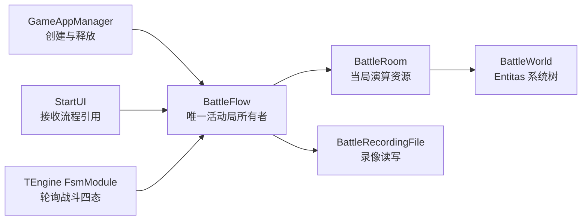

# 单机战斗流程与演算模块脚本迁移方案

日期：2026-11-19。设计依据：[职责边界评估](./单机战斗流程与帧演算职责边界.md)。本次是单机架构调整；自然结束、终局校验、新玩法、独立场景和联机另排。回放 V3 和确定性行为作为回归基线，不随搬迁改协议。

## 已确认的单例方案与执行结果

用户确认用 `Runtime/Battle/BattleManager : Singleton<BattleManager>` 替代下文最初提出的普通 `BattleFlow` 实例方案。下方保留原脚本迁移明细作为设计记录；涉及生命周期、类型名与 UI 接线的差异以本节为准。

| 原草案 | 实际落地 |
| --- | --- |
| `BattleFlow.cs`、`BattleFlowState.cs`、`IFsm<BattleFlow>` | 使用 `BattleManager.cs`、`BattleManagerState.cs` 和 `IFsm<BattleManager>`；四个状态文件位于 `Runtime/Battle/State`。 |
| `GameAppManager` 创建、`GameApp` 通过 `UserData` 注入 | `StartUI` 直接调用 `BattleManager.Instance.StartBattle()`，读取上一局亦经该单例；不修改 `GameApp` 或 `GameAppManager`。现有 `SingletonSystem.Release` 回收管理器。 |
| Room 与模块 | 原 `BattleModule` 类型与 `GameModule.Battle` 已删除；Room 不再注册 FSM。演算文件统一在 `Module/BattleSimulation`。 |
| Demo 入口 | 纯演算案例创建独立 Room；演算 Play Mode Demo 有独立的 TEngine FSM，另有正式菜单按钮、单局所有权与释放用例。 |

- [x] 清点源码调用点与旧模块脚本的 GUID 引用。旧模块脚本未发现外部资源引用。
- [x] 收口 Room 和 FSM 的所有权。正式层只有 `BattleManager` 保存当前局，释放走原全局单例系统；Room 仅管理演算资源。
- [x] 使用 Unity Pipeline 移动并核对 GUID：状态目录及基类、管理器脚本、整个演算目录；旧模块由 Unity 删除。
- [x] 改造 Demo 与两个独立宿主，使定位和倍速都直接测试当前演算源码，不使用已过期的 GameLogic DLL。
- [x] Unity 编译无错误；`main` Play Mode 通过正式开始按钮、重复开始、从第 0 帧开始、直接调管理器释放和重开；临时录像的空局 V3 存读、25 帧定点演算、1,206 帧检查点世界重建、40 帧四档倍速均通过。独立宿主的分歧停止与恢复、分批定位、倍速用例通过。测试后恢复 Edit Mode，场景无未保存改动，Console 无错误或警告。
- [ ] 正式 Esc/R 键盘链路与玩家最新录像的真实路径不在本次回归覆盖内；未覆盖完整应用退出回调和独立 Player。后续沿用[剩余工作分步执行方案](./单机战斗框架剩余工作分步执行方案.md)。

## 一、最终对象和依赖关系

| 谁 | 拥有什么 | 负责什么 |
| --- | --- | --- |
| `GameAppManager` | 一个普通 `BattleFlow` 实例 | 创建、提供给菜单入口、随应用释放。现有应用 FSM 的暂停和退出职责保持原样；不在那里演算战斗。 |
| `Runtime/Battle/BattleFlow` | 唯一的活动 `BattleRoom` 引用；一个 TEngine 战斗 FSM 引用；本地文件操作状态 | 创建当局、准备、开战、进行、退局；菜单、最新录像、操作命令、后续结算的接线。实时和回放走同一流程。 |
| `Module/BattleSimulation/BattleRoom` | 世界、时钟、更新器、历史、录像及当前帧 | 创建和释放当局演算资源，推进、提交输入、定位、变速；不持有 FSM，不决定何时换场景或回菜单。 |
| `BattleWorld` | Entitas Context、系统树、稳定 ID、随机数 | 运行和清理一帧、捕获与恢复确定性世界。系统规则从 `BattleWorldSetup` 接入。 |
| `StartUI` | 打开窗口时传入的 `BattleFlow` 引用，非所有者 | 把开始按钮和 R 键转成流程命令。通过现有 `UserData / OnRefresh` 接入；不自行查找或创建流程。 |



ET10 的[场景切换](https://github.com/egametang/ET/blob/743c635dd5b0f6f6bab549c0093382c85f3f8307/Packages/cn.etetet.lockstep/Scripts/Hotfix/Client/LSSceneChangeHelper.cs#L6)由外层准备并替换 Room；[Room 更新](https://github.com/egametang/ET/blob/743c635dd5b0f6f6bab549c0093382c85f3f8307/Packages/cn.etetet.lockstep/Scripts/Hotfix/Share/RoomSystem.cs#L31)集中处理输入、快照和演算。这里保留这种职责边界，用项目现有 TEngine FSM 和 Entitas 表达。目录名 `BattleSimulation` 表示一组演算能力，不新增同名管理类或全局入口。

## 二、逐脚本迁移清单

下表路径以 `Assets/GameScripts/HotFix/GameLogic` 为根。移动或改名的文件与原 `.meta` 一起迁移，保持 GUID；新文件和新文件夹通过项目允许的 Unity 工作流生成元数据。保留 `GameLogic` 命名空间、当前 asmdef、Entitas 自动生成路径和资源名。实际移动前从源码、生成配置和序列化文本查一次引用；本轮不直接编辑场景或 Prefab。

| 当前脚本 | 目标脚本与操作 | 改造内容 |
| --- | --- | --- |
| `Runtime/Battle/LocalBattleFlow.cs` | **改名** `Runtime/Battle/BattleFlow.cs` | 改成由应用拥有的普通实例。去掉 `Singleton<LocalBattleFlow>` 和 `ILateUpdate`，保留并成为唯一的 `_room` 持有者，新增 `IFsm<BattleFlow>`。负责菜单、快捷键转发、录像路径和退局。 |
| `Module/BattleModule/BattleModule.cs` | **拆职责后删除** | 活动局管理迁 `BattleFlow`；房间构造、输入、定位、倍率的实例机制归 `BattleRoom`。不留兼容全局门面。 |
| `Module/BattleModule/BattleRoom.cs` | **移动** `Module/BattleSimulation/BattleRoom.cs` | 保留类名。去 `IFsm<BattleRoom>`、构造中注册 FSM、`Close` 状态跳转及释放时注销 FSM。收归实例开始、轮询、输入、定位、变速、释放。 |
| `Module/BattleModule/State/BattleRoomState.cs` | **移动改名** `Runtime/Battle/State/BattleFlowState.cs` | 改继承 `FsmState<BattleFlow>`，保留在当前状态上调用 `ChangeState<EndBattleState>` 的受控退局入口；不由 Room 切状态。 |
| `Module/BattleModule/State/InitializeBattleState.cs` | **移动** `Runtime/Battle/State/InitializeBattleState.cs` | 改用 `fsm.Owner` 读流程保存的就绪条件；就绪后初始化 Room 世界。准备中收到退局命令可直接去结束。 |
| `Module/BattleModule/State/StartBattleState.cs` | **移动** `Runtime/Battle/State/StartBattleState.cs` | 调用当前 Room 的 `StartSimulation`；时钟和更新器仍由 Room 创建，然后切进行态。 |
| `Module/BattleModule/State/RunBattleState.cs` | **移动** `Runtime/Battle/State/RunBattleState.cs` | 用原单调毫秒时间轮询 Room；按原顺序先尝试推进再分派回放/退出命令。整个项目只有这一处正式战斗轮询入口。 |
| `Module/BattleModule/State/EndBattleState.cs` | **移动** `Runtime/Battle/State/EndBattleState.cs` | `OnEnter` 委托 Flow 收尾一次，之后状态不推进，直到新局或应用释放时销毁这份 FSM。 |
| `Module/BattleModule/BattleUpdater.cs` | **移动** `Module/BattleSimulation/BattleUpdater.cs` | 不改算法。实时权威步进、回放分批、完成定位继续播放，仍由 Room 持有并调用。 |
| `Module/BattleModule/FixedTimeCounter.cs` | **移动** `Module/BattleSimulation/FixedTimeCounter.cs` | 不改名；继续按整数毫秒计时、支持倍率变更锚点，保留 50 ms 基准。 |
| `Module/BattleModule/BattleWorld.cs` | **移动** `Module/BattleSimulation/BattleWorld.cs` | 不改 Entitas 生命周期、稳定 ID、随机数或快照格式。 |
| `Module/BattleModule/BattleWorldSetup.cs` | **移动** `Module/BattleSimulation/BattleWorldSetup.cs` | 保留组件登记、开局、系统和输入回调。以后玩法在 Runtime 装配，演算目录不放玩法系统。 |
| `Module/BattleModule/BattleStartData.cs` | **移动** `Module/BattleSimulation/BattleStartData.cs` | 保留现有玩家表和种子。由 Room 创建入口校验并冻结玩家槽。 |
| `Module/BattleModule/BattleInput.cs` | **移动** `Module/BattleSimulation/BattleInput.cs` | 保留定点方向和按钮字段。 |
| `Module/BattleModule/BattleFrameInputs.cs` | **移动** `Module/BattleSimulation/BattleFrameInputs.cs` | 保留当帧封存输入的同步只读视图。 |
| `Module/BattleModule/BattleFrameBuffer.cs` | **移动** `Module/BattleSimulation/BattleFrameBuffer.cs` | 保留输入封帧与确认历史环形缓存。 |
| `Module/BattleModule/BattleRecording.cs` | **移动** `Module/BattleSimulation/BattleRecording.cs` | 保留 `BattleRecording` 及同文件的 `BattleRecordedFrame`。 |
| `Module/BattleModule/BattleRecordingFile.cs` | **移动** `Module/BattleSimulation/BattleRecordingFile.cs` | 保留 V3 读写、校验和原有异步落盘方案，只接收调用者给的路径；不在这里选最新录像或处理菜单。 |
| `Module/BattleModule/BattleSnapshotComponents.cs` | **移动** `Module/BattleSimulation/BattleSnapshotComponents.cs` | 保留组件编解码登记和稳定键。 |
| `Module/BattleModule/BattleWorldSnapshot.cs` | **移动** `Module/BattleSimulation/BattleWorldSnapshot.cs` | 保持快照帧号、序列字节和指纹兼容。 |
| `GameModule.cs` | **原位改** | 删除 `GameModule.Battle`。现有 `Fsm`、`UI` 等真实模块的访问方式不变。不新增 `BattleFlow` 静态入口。 |
| `Module/GameAppModule/GameAppManager.cs` | **原位改** | `OnInit` 创建 Flow；使用只读成员把实例交给启动代码；`OnRelease` 先释放 Flow，再按现有方式释放应用 FSM。 |
| `GameApp.cs` | **原位改** | 初始化并启动现有应用宿主后，再通过 `ShowUIAsync<StartUI>(flow)` 注入流程。现有热更释放链不变。 |
| `UI/StartUI.cs` | **原位改** | `OnRefresh` 读取并绑定传入的 `BattleFlow`，开始按钮及 R 键只发命令。退局重开窗口时传同一实例。生成的按钮绑定和 prefab 不改。 |
| `Module/Utility/*.cs`、`Runtime/Entitas/Generated/Battle/*.cs` | **保留原位** | 定点数、随机数和 Hash 工具继续在 Utility；Entitas 生成配置与产物不迁移。 |

## 三、关键方法和字段归属

| 原有成员 | 拟落点 | 合同 |
| --- | --- | --- |
| `LocalBattleFlow._room` / `BattleModule._currentRoom` | `BattleFlow._room` | 只有 Flow 决定是否可开始另一局，并明确接管和清空引用。UI、状态、Demo 可以暂时持有局部引用，不另存第二份活动局。 |
| `BattleModule.StartBattle / StartReplay / StartRoom` | `BattleFlow.StartBattle / StartLastReplayAsync`；`BattleRoom.CreateLive / CreateReplay` | Flow 保留当前局和本地文件忙的入口判断；Room 工厂共用一次玩家表校验、槽表冻结。创建 Room 不注册 FSM、不初始化世界、不启动时钟。读取无录像仍由 Flow 提示。 |
| `InitializeBattleState._isReady` | `BattleFlow` 的当次准备条件 | 仍检查当前场景已加载；实时和回放共用准备过程。FSM State 不持有可变的跨状态数据，不用 `GetState<T>()` 传参。 |
| `BattleRoom.CreateInitialWorld` / 原开始态创建时钟 | `BattleRoom.InitializeWorld()` / `StartSimulation()` | 第一个方法只建世界或恢复零帧检查点；第二个只建立 Room 时钟与更新器。两者分别由初始化态和开始态调用。 |
| `RunBattleState` 直接访问 `room.Updater` | `BattleRoom.Update(long nowMs)` | Room 内委托原 updater；不允许 Flow、UI 或应用 FSM 再手动调第二次。源码级回归可传可控毫秒。 |
| `BattleModule.SubmitLocalInput(room, input)` | `room.SubmitLocalInput(input)` | 调用目标即为该 Room，保留本地槽、实时模式等入口规则；继续允许有效实时局在准备期提交第 0 帧输入。 |
| `BattleModule.SeekReplay(room, frame)` | `room.SeekReplay(frame)` | 按当前 V3 行为校验回放、时钟和范围；只提交定位请求，继续由 updater 分批推进。`RequestReplaySeek` 的赋值可合并到实例入口，其内部准备/完成步骤保留。 |
| `BattleModule.SetReplaySpeed(room, speed)` | `room.SetReplaySpeed(speed)` | 保留 1/2/4/8 倍及锚点；不再从全局管理对象转发。 |
| `LocalBattleFlow.OnLateUpdate` | `InitializeBattleState / RunBattleState` 按需调 Flow 的命令处理 | 准备态只允许 Esc 取消；进行态处理 Esc、Tab、方向键及分歧反馈。取消优先于准备完成；第 0 帧仍由进入进行态后的正式轮询推进。不得把键盘是否存在当作推帧条件。 |
| `LocalBattleFlow.ExitAsync`、`BattleModule.EndBattle / OnRelease`、`BattleRoom.Close` | `BattleFlow` 退局与应用释放；`BattleRoom.Release()` | Flow 发起四态切换并决定是否回菜单、写入录像；Room 只释放本身。正常退出、准备中取消和应用关闭均经过同一个房间所有者。应用释放沿用现状：不启动保存或重开菜单。 |

## 四、具体执行链

### 开局与播放

1. `GameApp` 启动 `GameAppManager` 后注入同一个 `BattleFlow` 给菜单。菜单调用 `StartBattle()` 或 `StartLastReplayAsync()`。
2. Flow 拒绝重复进场。回放先异步读文件；应用释放后返回的结果不得创建房间或触碰菜单。成功才创建 Room、注册 `IFsm<BattleFlow>`，开始初始化态并关闭菜单。
3. 初始化态等待就绪，随后建或恢复 World；开始态调用 `StartSimulation`，时钟锚定后切进行态；进行态在 TEngine 轮询中运行 `room.Update(nowMs)`。
4. 进行态将快捷键命令交给 Flow。Flow 查询当前 Room 并调用对应实例操作。定位期间累加的起点仍采用待定位目标；没有待定位目标时才使用当前帧。真实设备输入接线和玩法系统不在本轮加入。

### 手动退出、重开与应用释放

1. 状态只在当次 Room 更新返回后切到结束态；准备中也可直接结束。结束态取走唯一的 `_room`，留住本次要保存的录像引用，再调用 `Room.Release()`。此时不在 Room 的 Tick 调用栈里。
2. 结束态保留但不再推进。不在自己的状态回调中销毁该 FSM；下次开战时，Flow 先销毁已结束的 FSM，再创建下一局的。应用退出时也由 Flow 注销自己的 FSM。用实际句柄销毁，不按类型无差别注销；测试和正式流程若需分别注册，使用不同的 FSM 名称。
3. 正常退局恢复菜单并传回同一 Flow。实时且已录制帧才保存 `battle-last-v3.replay`；回放退出、准备中取消不覆盖录像。存盘期间继续拒绝重复开局和读取，异步续体只负责自己那次文件操作。
4. 应用释放先标记 Flow 已结束，解除战斗 FSM 并释放仍在的 Room，然后进行现有应用 FSM 清理。考虑现有 `GameAppManager` 已记录的 FSM 模块可能先关闭的顺序：已销毁句柄不再注销，但仍应释放 Room；无需为假设的并发增加额外回收层。

关键伪代码：

```text
启动: app.CreateFlow → showMenu(flow)
进场: flow.CreateRoom → flow.StartFsm(Initialize) → closeMenu
初始化: ready → room.InitializeWorld → StartBattleState
开始: room.StartSimulation → RunBattleState
进行: room.Update(nowMs) → flow.HandleCommands
结束: take currentRoom → release room → showMenu(flow) → save live recording if needed
重开: destroy finished FSM → create next room/FSM
应用释放: flow.MarkReleased → destroy surviving FSM → release active room
```

## 五、原方案执行顺序与验收（实际结果见首节）

- [ ] **锁定现状及引用。** 记录当前 V3 读写、50 ms 推帧、旧定位/分歧用例，并清点 `GameModule.Battle`、`LocalBattleFlow`、Room 类型和 Demo 工程的路径引用；先把当前局所有权的调用链确认完整。
- [ ] **迁移流程所有权与四态。** 按第三、四节同时改 `BattleFlow`、状态、Room、App 和菜单，去掉两个静态战斗入口及 `BattleModule` 类。验收准备前帧号为 -1、开战后由 FSM 推第 0 帧；Esc 取消不产生空录像；重开没有残留 FSM、Room 或引用；校验没有录制/读取完成后重入旧会话。
- [ ] **归位演算文件。** 按逐脚本表移动，保持原 GUID 和热更程序集；更新显式路径和引用，最后再移除空的旧 `Module/BattleModule`。对照迁移前后算法差异，保持实时提交顺序、检查点帧边界、位姿/随机/指纹及回放 V3 行为。
- [ ] **迁移可移除 Demo 和独立宿主。** `BattleFrameworkDemo.cs`、`ReplaySpeedDemo.cs`、`ReplaySeek/Program.cs` 不再通过 BattleModule 或绕过它的单例构造。纯演算案例改用独立 Room；等待场景和验证 FSM 的案例另从 Flow 实例进入，Editor Demo 不占用正式菜单的当前局。更新 `ReplaySeek.csproj` 的链接目录和 `Host.cs` 的宿主替身，删掉这轮不再用到的 Singleton 链接与替身；`ReplaySpeeds.csproj` 区分新源码与是否已重新编译的 GameLogic DLL。更新 README 复跑命令与实际依赖。
- [ ] **完成分层验收。** 独立宿主跑当前源码、比对跨 1,200 帧检查点重建、同区间复用、分批定位、分歧前停止、四档倍速及逐帧指纹；Unity 走正式菜单从就绪开局、准备取消、退出落盘、读取回放、切速定位、再开一局以及应用关闭。不用独立宿主替代真实 Unity 验收；按项目 Pipeline 工作流记录实际结果。

依赖方向和验收边界稳定后，再回到[剩余工作分步执行方案](./单机战斗框架剩余工作分步执行方案.md)的自然结束与终局校验。执行时只在入口校验，同类数据不重复验证；避免宽泛 try-catch、无依据的防御和只用一次的通用抽象。没有实施的目标保持未勾选。
