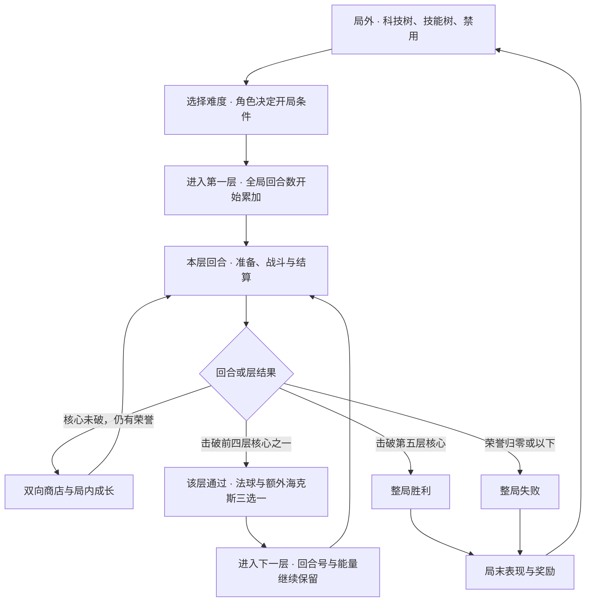

# Project_B 游戏流程

依据 [《Project_B.md》修订 5989](<D:/缓存/WorkBuddy/2026-11-13-23-19-02/Project_B.md>) 及附件白板 1–4。流程采用正文已明确的触发条件，白板差异列在对应阶段。

## 局外与整局循环

玩家在局外消耗资源点亮科技树、卡牌技能树及角色技能树，设置卡牌、物品、海克斯禁用。卡牌技能树开放星级上限与对应星级能力。选择难度后，根据角色取得初始牌组、荣誉、金币、费用和主动技能，开始五层挑战。多角色选择流程仍待定义。

核心被击破会立即结束本层，当时仍存活的敌塔同时破损。前四层各给一次额外海克斯三选一，表列第一层必掉紫、第四层必掉金，第二和第三层在紫/金档间的实际发放口径待确认。第五层击败后获胜，其通关法球规则未列出。核心本身不触发拆塔法球。

通关回合的结算先后尚未定稿。白板 3 将击败和金币、荣誉画为不同分支，并画成领取海克斯后再判断有无下一名敌人。正文规定前四次击败才奖励三选一。需要统一核心击破当回合是否增减荣誉、同时达到失败条件时如何判定、通关奖励与商店和换层的先后。

## 单回合

| 阶段 | 玩家操作 | 规则与结果 |
| --- | --- | --- |
| 准备 | 查看当前防守，点击准备结束 | 恢复满费用。存活常规塔回复已损生命 15%，核心回满，抵抗塔满血恢复或复活。玩家确认后 AI 完成部署，未部署塔从敌人背包清理。 |
| 开战 | 查看起手牌和可部署区域 | 牌组洗入牌库，基础起手 5 张，基础手牌上限 10 张，科技可提高。该回合的时间、评分分母由全局回合决定；牌组每超出一张预期张数按该回合规则补时。 |
| 实时战斗 | 花费用出牌，能量充满时按空格释放角色技能 | 单位与塔自动战斗，按间隔抽牌，满手等待，抽空洗回弃牌。羁绊和其他效果可回费、给临时牌或临时升星。攻击与费用消耗可以充能，破坏敌塔可掉落法球。 |
| 结束 | 查看结果 | 正文条件为时间到零，或费用已无法再出牌且场上玩家非建筑单位全灭。核心击破直接结束本层。玩家单位与建筑回收，临时牌移除、临时升星还原、非常驻效果清空，按伤害及拆塔分计算评分。 |
| 回合间成长 | 买经验、浏览商店、调整牌组与装备 | 回合结束双方获固定经验，按规则可给予敌方指定塔、物品及 BUFF。商店双方各 6 格，自购、喂养、拆除、刷新或锁定。普通新卡下回合开始参与抽取。 |
| 海克斯与任务 | 获得三选一机会时选一组，完成海克斯或羁绊任务 | 达到指定玩家等级、通过前四层或特定任务会给三选一机会。每组同时给予双方各一个海克斯。已有海克斯可通过特定海克斯重置。具体选择和任务奖励界面介入时点待定。 |

白板 2 将商店放在战斗前的准备段，正文从战斗开始描述「战斗结束 → 商店 → 下一回合」。两者都把商店放在相邻战斗之间，首回合是否先逛商店、商店退出和 AI 部署先后仍需确认。白板 1、2 另画出强制结束回合或召唤，正文没有定义该操作。双方回合中一直自动战斗，手动停止召唤后是否继续等待场上单位行动仍待定。

## 跨回合、跨层和回到局外

- 全局回合号跨层累加，持续决定回合时长、评分基准、经验、敌方发放、商店商品资格和初始角色的伤害充能门槛。
- 对局牌组修改持续至本局结束，角色能量可以跨回合和跨层保留。回合剩余费用不结转。跨层时的敌方等级、背包、海克斯和物品归属还需确认。
- 玩家击败第五名英雄或在对局内荣誉耗尽时进入整局结算。根据累计表现、胜负等发放局外资源，返回局外继续养成。离局后局内牌组改动还原，局内效果清空。
