# Project_C 游戏流程图

| 项 | 内容 |
|---|---|
| 文档状态 | **草稿 v0.1**（流程依据策划案原文，缺口见 04） |
| 更新时间 | 2026-11-10 |
| 关联文档 | [00 总览](00-总览与索引.md) · [02 功能模块](02-功能模块划分.md) · [03 程序规格](03-程序向系统规格.md) · [04 缺口清单](04-策划案缺口与待确认清单.md) |
| 图表格式 | Mermaid。GitHub / VS Code / Typora / Obsidian 可直接渲染；纯文本环境请按"步骤表"阅读 |

## 阅读约定

- 每个流程都配**步骤表**，图只表达拓扑，表表达顺序与条件。**图与表冲突时以表为准**（表是给程序抄的）。
- 节点后缀 `?` 表示判定；`【推断】` 表示策划案未写、程序补的默认行为，需在 04 确认。
- `G-xx` 指向 04 的缺口条目。

---

## 1. 三个循环（大 / 中 / 小）

### 1.1 图解

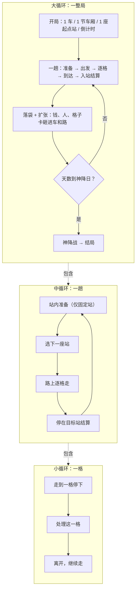

### 1.2 三层循环的边界

| 循环 | 起点 | 终点 | 期间能做的决策 | 期间冻结的东西 |
|---|---|---|---|---|
| 小循环（一格） | 进入该格 | 离开该格 | 事件选项、格内功能（市场等） | 路线（不可改）、建造（不可做）、时间（只扣该格路耗） |
| 中循环（一趟） | 站内点「出发」 | 到达目标站并完成入站结算 | 选目的地、选路线、途中格子交互 | 地图格（不可新建）、队伍（不可改） |
| 大循环（一局） | 开局 | 神降战结束 | 修站、造格、改车、改阵容、对话、送礼 | — |

> **关键**：扩张（修站 → 开区域 → 地图变大）只发生在**回到站之后**。这正是策划案"决定这局能走多远的是回来之后那一步"的机制含义。

---

## 2. 顶层状态机（行驶 / 停靠 / 结算）

### 2.1 图解

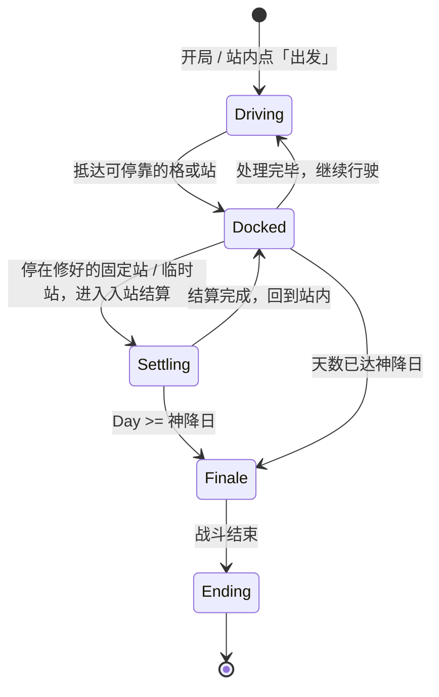

### 2.2 状态契约

| 状态 | 推进行程时间 | 推进天数 | 可开面板 | 进入条件 | 退出条件 |
|---|---|---|---|---|---|
| `Driving` 行驶 | ✅（按格） | ❌ | ❌ 不允许决策面板 | 站内点出发 / 离开停靠格 | 抵达可停靠格 |
| `Docked` 停靠 | ❌ | ❌ | ✅ 格内结算、市场、站功能 | 抵达可停靠格 | 点「离开」/ 进入结算 |
| `Settling` 结算 | ❌ | ✅（强制休息 +1）【推断】 | ✅ 入站结算面板 | 停在休息站 | 结算 7 步走完 |
| `Finale` 终局 | ❌ | ❌ | ✅ 战斗面板 | Day 达神降日 | 战斗结束 |

**与策划案的关系**：策划案写"只有行驶推进时间，停靠和结算都冻结"，同时又写"大部分情况下回到休息站才推进时间"。两句话不矛盾的前提是：**时间不是一个流动的量，而是两个离散计数器**——行程时间（格）与天数（Day）。详见 03 §2 与 G-01。

### 2.3 状态-面板映射（给 UI）

| 状态 | 常驻 UI | 可弹出的全屏面板 |
|---|---|---|
| `Driving` | 路线条、车厢、体力、天数、暂停 | 无（仅暂停/设置） |
| `Docked`（格） | 格子信息、可选操作 | 事件面板、市场、格内结算 |
| `Docked`（固定站） | 站信息、站功能入口 | 站内主页、建造、改车、改阵容、市场、对话 |
| `Settling` | 结算进度 | 入站结算面板、抽卡面板、剧情播放、升级面板 |
| `Finale` | 战斗 UI | 战斗、结局 |

---

## 3. 时间模型（双时钟）

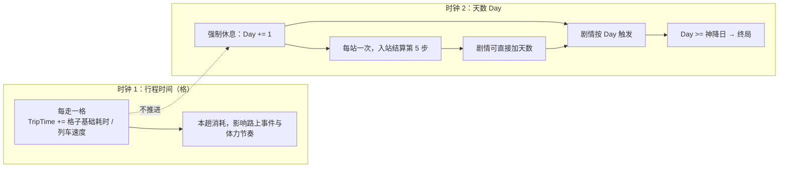

| 问题 | 答案 |
|---|---|
| 走一格花多少时间 | `单格路耗 = 格子基础耗时 ÷ 列车速度`（数值 TBD，见 G-22） |
| 天数什么时候 +1 | 只在入站结算的"强制休息"和"剧情加天"时 |
| 停靠格会不会推时间 | 不会。停靠冻结时钟 |
| 时间会不会被扣 | 特殊事件可以减时间（把 Day 往神降日推），也会延迟神降（Day 回退或神降日延后），机制待定，见 G-19 |

> 行程时间与天数如果是两套数，玩家看到两个倒计时会困惑。建议 UI 只显示**天数**，行程时间只作为"这一趟走了多久"的文案/表现（策划确认，G-01）。

---

## 4. 到站：入站结算（顺序写死）

策划案原文规定的固定顺序，**不允许程序改序**。

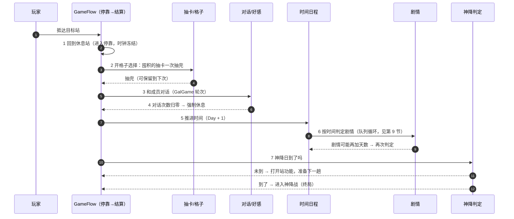

### 4.1 步骤表

| 步 | 名称 | 触发条件 | 处理 | 出口 |
|---|---|---|---|---|
| 1 | 回到休息站 | 抵达任意站 | 进入 `Docked`，切站内场景/UI | 必过 |
| 2 | 开格子选择 | 存在待抽次数 > 0 | 循环执行抽卡会话，直到待抽次数 = 0 | 无待抽则跳过 |
| 3 | 和成员对话 | 站内有人可聊 | GalGame 式对话，消耗轮次，加好感 | 轮次用尽 |
| 4 | 强制休息 | 对话轮次归零 | 不可跳过，回体力（仅固定站/临时站） | 必过 |
| 5 | 推进时间 | 强制休息完成 | `Day += 1` | 必过 |
| 6 | 按时间判剧情 | Day 变化后 | 收集 → 排序 → 播放 → 可能再 +1 天 → 重收集 | 队列空 |
| 7 | 神降日到了吗 | 剧情队列结束 | `Day >= DescentDay` 判定 | 到 → 终局；未到 → 站功能 |

### 4.2 边界

| 场景 | 行为 |
|---|---|
| 停在**坏站** | 不跑入站结算（无休息、无抽卡、无对话）。只能离开或继续走 |
| 停在**临时站** | 跑"休息"部分：回体力、次数 -1；不跑对话/抽卡/剧情？【推断】按站型开放，见 G-16 |
| 同一站重复到达 | 每次都完整跑一遍；对话轮次每次重置【推断】 |
| 抽卡面板中途退出 | 不允许（会话未结束不可退出），否则保留位状态错乱 |
| 剧情播放中途点跳过 | 只跳播放，结果照结算（C-12） |

---

## 5. 站内功能菜单（按站型开放）

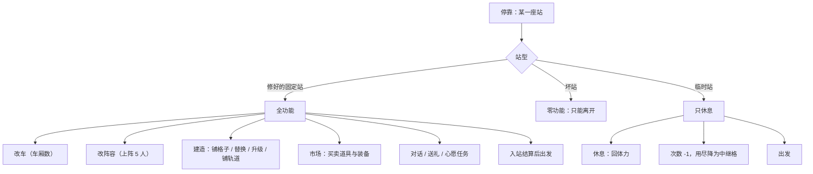

| 功能 | 固定站 | 临时站 | 坏站 | 备注 |
|---|---|---|---|---|
| 休息（回体力） | ✅ 永久 | ✅ 次数 1 | ❌ | C-04：坏站不回体力 |
| 入站结算全流程 | ✅ | 部分【推断】 | ❌ | G-16 |
| 改车 / 改阵容 | ✅ | ❌ | ❌ | C-02 |
| 建造 / 替换 / 升级 / 铺轨道 | ✅ | ❌ | ❌ | C-03：这里"修建"站也在这里 |
| 市场 | ✅ | ❌ | ❌ | 城市类格另有市场，见 §7 |
| 对话 / 送礼 | ✅ | ❌ | ❌ | 对话只在此、且休息前 |
| 修站（把坏站变成固定站） | ✅ 目标站 | — | — | 修好后开一片新区域 |

---

## 6. 出站：选目的地与选路

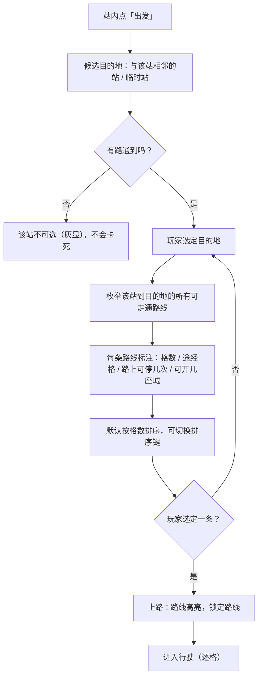

### 6.1 规则

| 项 | 规则 |
|---|---|
| 目的地范围 | 与该站相邻的车站或临时车站（雷索纳斯式跑图） |
| 路线数量 | 通常不止一条（随机地形 + 玩家自铺路线） |
| 排序键 | 默认格数升序；可切"途经城市数"等其他键（键集合 TBD，G-15） |
| 路线数量上限 | 枚举结果需截断，建议最多展示 8 条【推断】 |
| 路上能否改路线 | ❌ 不能。选定即锁 |
| 路上能否造格子 | ❌ 不能（只能在修好的固定站造） |
| 格数与时间 | 一格 = 一份路耗，绕远就多花 |

> 程序注意：**"所有可走通的路线"是路径枚举问题**，地图小（几十格）时简单路径数量仍然可能爆炸。上限与剪枝策略见 03 §5.2。

---

## 7. 行驶：逐格推进与单格处理

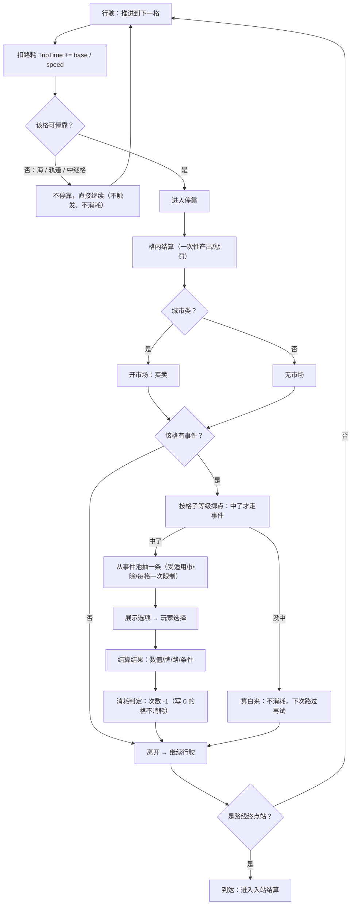

### 7.1 可停靠格清单（**待策划确认，G-15**）

| 格类型 | 会停靠 | 会掷事件 | 会消耗次数 | 备注 |
|---|---|---|---|---|
| 村庄 / 小镇 / 城市 | ✅ | ✅ | ❌（次数 0） | 有市场 |
| 副本 | ✅ | — | ✅（次数 1） | 进入副本玩法（内容缺失，G-06） |
| 圣地 / 神迹 | ✅ | ✅ | TBD | 次数 TBD |
| 普通 / 精英 / 特殊敌人 | ✅ | — | TBD | 触发战斗 |
| 未知格 | ✅ | ✅ | TBD | — |
| 资源格 | ✅ | ✅ | TBD | — |
| 固定休息站 | ✅ | — | ❌ | 走站功能 |
| 临时休息站 | ✅ | — | 🅾 每停一次 -1 | 用尽 → 中继格 |
| 中继格 | ❌ | ❌ | ❌ | 与海上轨道同待遇 |
| 海上轨道 | ❌ | ❌ | ❌ | C-06 |
| 虚空 / 空格 | ❌ | ❌ | — | 不可通行（C-05） |

### 7.2 单格处理后的公共约束

- 停靠期间**不能**建造、不能改阵容、不能换路线。
- 事件消耗的是**格子实例的次数**，不是格子类型。
- "没中"不写消耗，但要写"本格已掷过"吗？**不写**——策划案要求下次路过还能再试（G-13 与 08 节第 5 条筛子"跳过不算触发"）。

---

## 8. 事件：触发与抽选

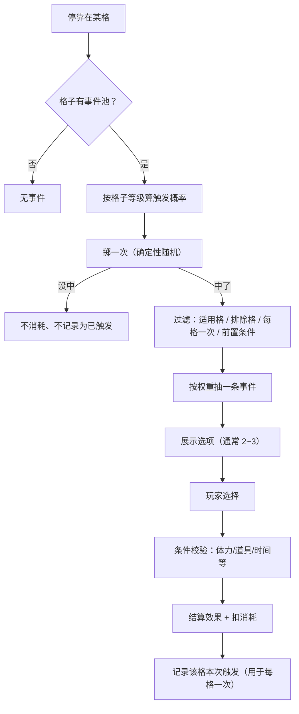

### 8.1 策划侧校验规则（写表时用，程序做成配置校验）

| # | 筛子 | 程序可校验 |
|---|---|---|
| 1 | 不能有明确最优解 | ❌ 人工判断 |
| 2 | 至少一个选项会疼 | 半自动：选项效果需要有负值或消耗 |
| 3 | 至少一个选项给的不是数值（牌/路/条件） | ✅ 效果类型枚举里必须有非数值项 |
| 4 | 不写只造氛围不做事的内容 | ✅ 每个选项必须有至少一个 effect |
| 5 | 同一条事件不在同一地方反复刷 | ✅ `每格一次` 标记 + 位置键 |

> 事件表**九字段定义缺失**、"已经排出来的九条"表格为空 → G-04。

---

## 9. 剧情：队列与优先级

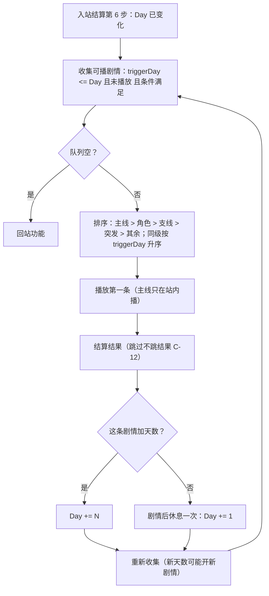

### 9.1 循环终止条件（**必须实现，否则会死循环**）

| 保护 | 规则 |
|---|---|
| 单日剧情上限 | 同一次入站结算内最多播 8 条【推断】，超出进日志告警 |
| 天数上限 | `Day >= DescentDay` 时停止剧情队列，直接进终局判定 |
| 已播标记 | 每条剧情播放后写 `played`，绝不允许重复入队 |
| 空指针 | 队列里只有已播剧情时直接退出 |

> 策划案给出的两个日期例子**互相矛盾**（第 30 天 / 第 28 天 / 跳过 2 天的先后关系对不上），判定规则需要重写为"`triggerDay <= 当前 Day` 且未播即触发"这种可执行形式。见 G-14。

---

## 10. 好感度 / 对话 / 心愿 / 支线

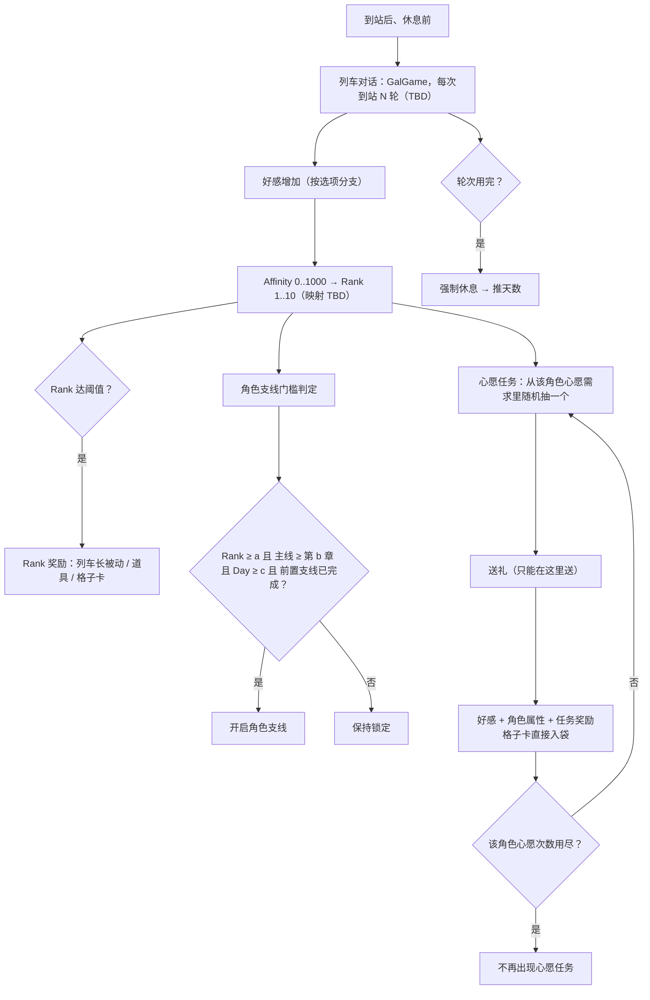

| 项 | 值 | 状态 |
|---|---|---|
| 好感上限 | 1000 | 已定 |
| Rank 上限 | 10 | 已定 |
| 每 Rank 门槛值 | — | **TBD（G-24）** |
| 每次到站对话轮数 | — | **TBD（G-12）** |
| 心愿任务次数（按角色） | — | **TBD（G-12）** |
| 支线四门槛 | 写在角色支线表 | 已定结构 |

---

## 11. 抽卡：获取路径、池、保留

### 11.1 获取与开抽时机

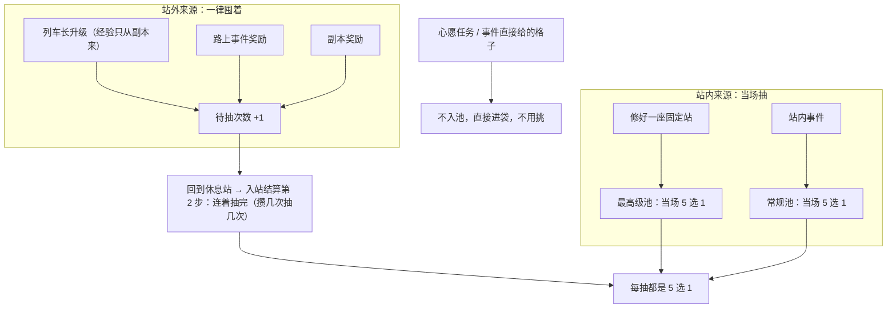

### 11.2 一次 5 选 1 的内部流程（抽法一·保留）

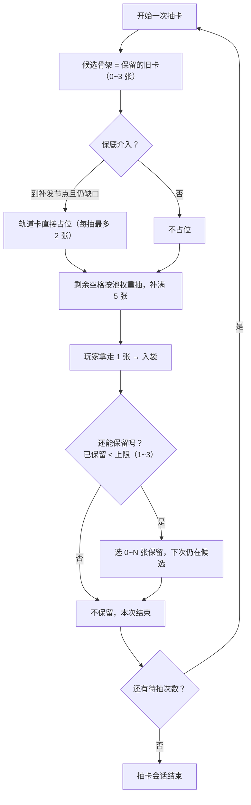

| 规则 | 内容 | 状态 |
|---|---|---|
| 抽法一（保留） | 拿走 1 张；可另留 1~3 张，下次仍摆候选 | **未定（G-08）** |
| 抽法二（不留） | 攒几次抽几次，抽完即散 | 旧方案，备选 |
| 保留上限提升 | 初始 1，最高 3 | 已定 |
| 池分池 | 修站 → 最高级池；其余 → 常规池 | 池内容 TBD（G-09） |
| 池内容 | 分级数量、每级放什么、最高级池放哪几张 | **TBD** |

> 程序注意：抽法一与抽法二的**存档结构完全不同**（抽法一要给"保留位"和"候选快照"存档，抽法二只需一个待抽计数）。**先定 G-08 再写这块代码**。

---

## 12. 保底：轨道卡与跨海清单

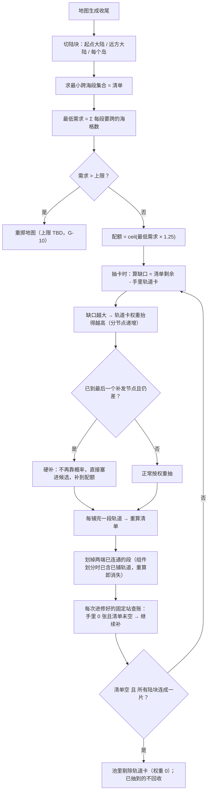

### 12.1 关键数字

| 量 | 定义 | 例 |
|---|---|---|
| 最低需求 `MinDemand` | 把所有陆块串起来的最小海格总数 | 20 |
| 配额 `Quota` | `ceil(MinDemand × 1.25)`，向上取整 | 25 |
| 缺口 `Shortage` | `清单剩余海格数 - 手里轨道卡数`（下限 0） | 12 |
| 清单剩余 | 每段两端未被其他路连通时，该段长度计入 | — |

> "配额不是硬上限，还没连通就继续加" —— 即 `Quota` 只是**正常应发到的量**，查账机制可以继续补。这是防卡死的关键，不要写成上限判断。

---

## 13. 地图生成流水线

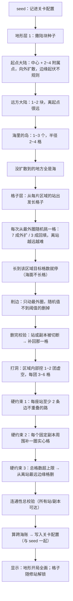

### 13.1 岛的规则

| 项 | 规则 |
|---|---|
| 格数 | 4~10 格 |
| 站 | 通常不放修好的站，只放临时站或坏站 |
| 内容 | 稀有副本、特殊产出（绕这一趟就是为了它） |
| 连接 | 只能靠玩家铺海上轨道 |

---

## 14. 建造与铺轨（只在修好的固定站）

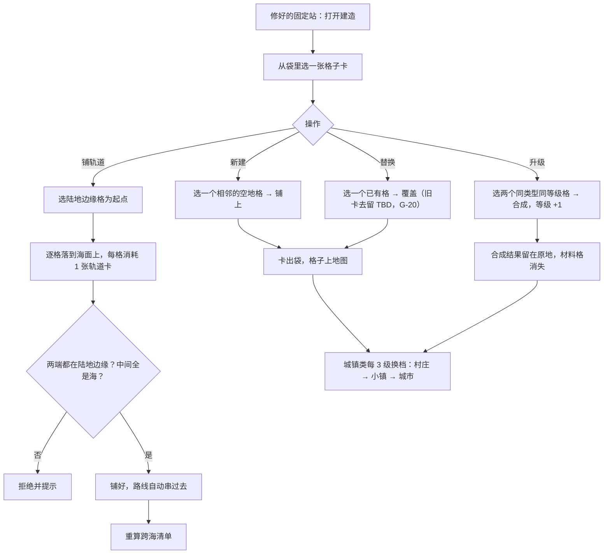

| 规则 | 内容 |
|---|---|
| 建造地点 | 仅修好的固定站（C-02/C-03） |
| 升级条件 | 同类型 + 同等级，2 合 1 |
| 档位 | 每 3 级换档 |
| 轨道消耗 | 1 格 = 1 张卡，不花钱、无其他消耗 |
| 轨道跨几格 | 受列车限制（TBD，G-22） |
| 轨道两端 | 必须落陆地边缘格，中间全海 |
| 已铺轨道能否拆 | **未定义（G-20）** |

---

## 15. 神降与结局

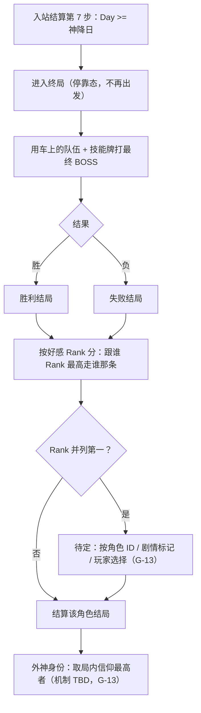

---

## 16. 存档：什么时候写盘

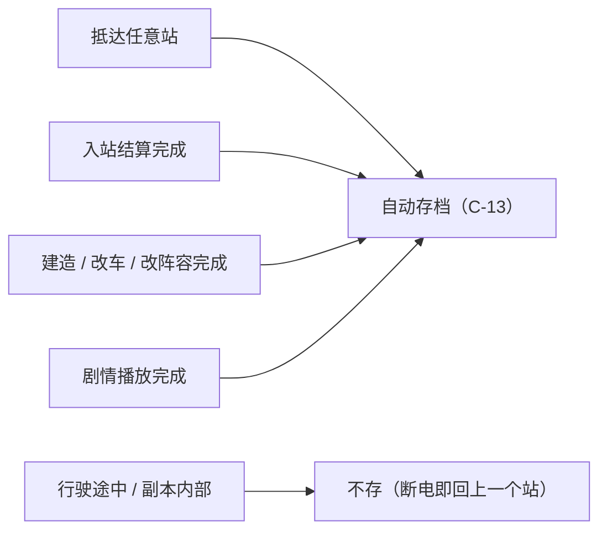

| 存点什么 | 是否必须 |
|---|---|
| 地图（seed + 已生成状态 + 已解锁区域 + 已铺格子） | ✅ |
| 列车（车厢数、速度）、队伍、上阵 | ✅ |
| 成员的牌、装备、好感、Rank | ✅ |
| 天数、行程时间、体力、钱 | ✅ |
| 待抽次数、保留位、候选快照（抽法一）、保底状态 | ✅ |
| 已触发事件（每格一次）、剧情已播标记、支线进度 | ✅ |
| 临时站剩余次数、已修固定站集合 | ✅ |
| RNG 状态（保证重进不改变后续随机） | ✅【推断】 |

> 存档结构见 03 §9。**"所有站点自动存档"不等于"行驶中可存"**：路上退出会丢到上一个站，需要确认是否接受（G-18）。

---

## 17. 一趟完整时序（程序视角）

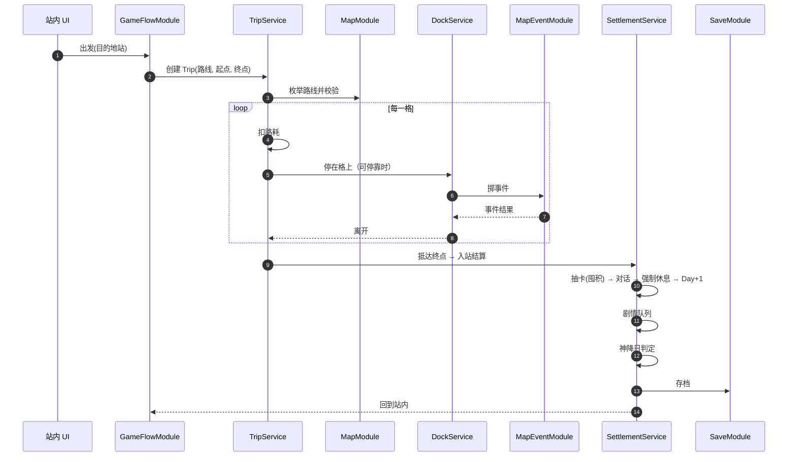

---

## 附：待确认流程清单（本文档依赖这些结论才能定稿）

| 编号 | 影响本文档的哪一节 | 问题 |
|---|---|---|
| G-01 | §2, §3 | 行程时间与天数是两套时钟吗 |
| G-08 | §11.2 | 抽法一（保留）还是抽法二（不留） |
| G-15 | §6, §7.1 | 哪些格会停靠、排序键有哪些 |
| G-16 | §4.2, §5 | 临时站的入站结算跑到哪一步 |
| G-05 | §15 | 战斗流程（完全缺失，无法画） |
| G-06 | §7.1 | 副本内部流程（完全缺失，无法画） |
