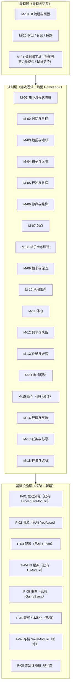
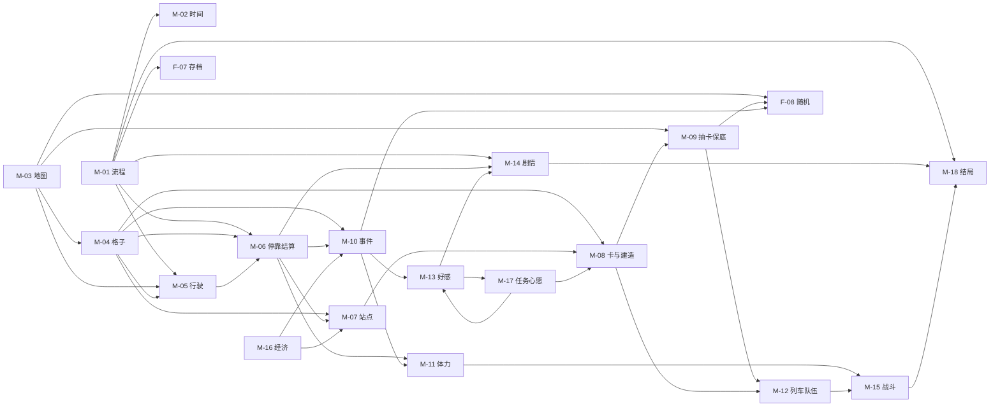

# Project_C 功能模块划分

| 项 | 内容 |
|---|---|
| 文档状态 | **草稿 v0.1**（模块边界待主程评审；优先级受 04 阻塞项影响） |
| 更新时间 | 2026-11-10 |
| 关联文档 | [01 流程图](01-游戏流程图.md) · [03 程序规格](03-程序向系统规格.md) · [04 缺口清单](04-策划案缺口与待确认清单.md) |
| 读者 | 主程、客户端程序、制作人（排期用） |

---

## 1. 划分原则

1. **按"谁持有状态"切，不按 UI 切**。每个模块只有一个数据主人，其他模块只能通过查询接口/事件读它。
2. **一模块一配置域**。模块的数据表归属明确，避免一张表被三个模块同时写。
3. **能被单独验收**。每个模块给"怎么算做完了"，不写"实现 XXX 功能"这种空话。
4. **KISS**：不引入 ECS、不引入事件总线以外的通信机制；模块间用 `GameEvent` 或直接调接口，不搞消息中间件。
5. **对齐 TEngine 现有能力**：能用框架的就用（`UIModule`/`GameEvent`/`ConfigSystem`/`UniTask`），只新增框架没有的（存档、确定性随机）。

---

## 2. 模块总览



---

## 3. 依赖关系



**读图结论**

- `M-01/M-02/M-03` 是地基：这三个不通，其他都写不了。
- `M-15 战斗` 是唯一被"策划案缺失"卡住的模块（G-05），但它同时被 `M-11`、`M-12`、`M-18` 依赖 → **必须尽早上战斗设计，哪怕先做占位**。
- `M-16 经济` 的入口散布在 `M-07`（站内市场）、`M-10`（事件买卖）、`M-04`（城市格市场），所以它的接口要早定，实现可以晚。

---

## 4. 模块详表

> 字段说明：**持有状态** = 该模块独占的运行时数据（存档由它负责写）；**不做** = 明确的边界，防止越权；**验收** = 可测的完成定义。

### 4.1 核心层

| ID | 模块 | 职责 | 持有状态 | 不做 | 优先级 |
|---|---|---|---|---|---|
| M-01 | 核心流程状态机 `GameFlowModule` | 行驶/停靠/结算/终局的切换；入站结算 7 步编排 | `FlowState`、`SettlementContext` | 具体业务结算（交给各模块）；启动流程（那是 ProcedureModule） | P0 |
| M-02 | 时间与日程 `TimeScheduleModule` | 行程时间累加、天数推进、神降日判定、时间类修正 | `TripTime`、`Day`、`DescentDay`、修正列表 | 剧情内容（M-14） | P0 |
| M-03 | 地图与地形 `MapModule` | 六边形网格、地形分层、生成流水线、种子复现、区域解锁 | `HexGrid`、`TerrainLayer`、`RegionSet`、`MapSeed` | 格子玩法（M-04）；渲染（M-19） | P0 |
| M-04 | 格子与区域 `CellModule` | 格子类型/次数/等级/档位/事件状态、可通行判定、铺格写入 | `CellRuntime[]` | 事件内容（M-10）；建造规则（M-08） | P0 |
| M-05 | 行驶与寻路 `TravelModule` | 路线枚举与排序、Trip 生命周期、逐格推进、路耗扣除 | `TripContext`、`RouteOption[]` | 单格交互（M-06） | P0 |
| M-06 | 停靠与结算 `DockModule` | 停靠入口、单格处理编排、入站结算执行、格内结算 | `DockContext` | 各子系统细节 | P0 |
| M-07 | 站点 `StationModule` | 站型、修站、临时站次数、站功能开关、区域解锁联动 | `StationRuntime[]`、`UnlockedRegions` | 建造（M-08） | P0 |
| M-08 | 格子卡与建造 `GridCardModule` | 卡袋、铺/替换/升级/铺轨、合成、档位 | `CardBag`、`PlacedCard[]` | 抽卡概率（M-09） | P0 |
| M-09 | 抽卡与保底 `DrawModule` | 待抽计数、5 选 1、保留位、分池、权重、跨海清单与保底 | `DrawState`、`RetainedCards`、`CrossingList` | 卡定义（配置） | P0（保底可 P1） |

### 4.2 玩法层

| ID | 模块 | 职责 | 持有状态 | 不做 | 优先级 |
|---|---|---|---|---|---|
| M-10 | 地图事件 `MapEventModule` | 掷点、过滤、抽选、选项效果结算、每格一次标记 | `CellEventState[]` | 事件文案（配置） | P1 |
| M-11 | 体力 `StaminaModule` | 体力消费、回复、失败率计算、失败处理 | `Stamina` | 战斗判定（M-15） | P1 |
| M-12 | 列车与队伍 `TrainModule` | 车厢数、载客上限、速度、上阵 5 人、成员工位 | `TrainState`、`Formation` | 好感（M-13）；战斗（M-15） | P1 |
| M-13 | 乘员与好感 `CharacterModule` | 好感 0~1000、Rank、对话轮次、心愿、支线开启条件 | `CharacterState[]`、`Rank` | 剧情播放（M-14） | P1 |
| M-14 | 剧情导演 `StoryDirector` | 剧情队列、优先级、播放、加天数、跳过、已播标记 | `StoryProgress` | 对话文本内容（M-13/配置） | P1 |
| M-15 | 战斗 `BattleModule` | 牌/装备/回合/胜负 | `BattleContext` | **设计文档缺失，见 G-05** | P0-阻塞 |
| M-16 | 经济与市场 `EconomyModule` | 钱、价格、买卖、库存 | `Wallet`、`ShopStock` | 掉落（M-10/M-17） | P1 |
| M-17 | 任务与心愿 `QuestModule` | 心愿任务、送礼、奖励发放 | `QuestRuntime[]` | 好感数值（M-13） | P2 |
| M-18 | 神降与结局 `FinaleModule` | 终局触发、结局判定（Rank 最高）、外神身份 | `EndingResult` | 战斗过程（M-15） | P2 |

### 4.3 基础设施

| ID | 模块 | 职责 | 是否新增 | 优先级 |
|---|---|---|---|---|
| F-01 | 启动流程 | `ProcedureModule` 已有；游戏内状态机**不复用**它 | 复用 | — |
| F-02 | 资源 | YooAsset + `GameModule.Resource` | 复用 | — |
| F-03 | 配置 | Luban `ConfigSystem`，新增 `pc_` 前缀表（见 03 §8） | 配置 | P0 |
| F-04 | UI | `UIWindow`/`UIWidget` + `WindowAttribute` 代码生成 | 复用 | — |
| F-05 | 事件 | `GameEvent`，模块→UI 单向通知 | 复用 | — |
| F-06 | 音频 / 本地化 | `GameModule.Audio` / `Localization` | 复用 | — |
| F-07 | 存档 `SaveModule` | 快照序列化、版本迁移、槽位、自动存档 | **新增** | P0 |
| F-08 | 确定性随机 `PcRng` | 按 `(seed, channel, counter)` 派生，保证复现 | **新增** | P0 |

### 4.4 表现层（本文档不展开细节）

| ID | 模块 | 职责 | 边界 | 优先级 |
|---|---|---|---|---|
| M-19 | UI 流程与面板 | 状态→面板映射、返回/中断、二次确认、空态 | 只调规则层接口，不持状态；界面清单需另立文档（04 §5） | P0（随 M1 最小实现） |
| M-20 | 演出 / 音频 / 特效 | 行驶镜头、六边形地图缩放层级、抽卡演出 | 不参与结算 | P1 |
| M-21 | 编辑器工具 | 地图 seed 预览、表校验器、调试命令 | 只在 Editor 生效（见 03 §17） | P0（M0 就要有预览） |

---

## 5. 功能点清单（可直接当任务池）

> `验收` 一列写成"输入 → 期望输出"，避免"实现了"这种无法验证的描述。

### 5.1 P0 · 垂直切片必须

| ID | 功能点 | 归属 | 验收要点 |
|---|---|---|---|
| F-101 | 六边形网格与坐标系统 | M-03 | 给定 axial 坐标，6 邻接、距离、线性插值结果正确；边界不越界 |
| F-102 | 地形生成（seed 复现） | M-03 | 同 seed 连续生成 100 次，地块拓扑哈希完全一致 |
| F-103 | 区域格子生长 | M-04 | 每片区域格数落在目标区间；海上不长格 |
| F-104 | 削边 / 打洞 / 三条硬约束 | M-04 | 每站 ≥2 条边不重叠路径；副本周围 6 邻接全实心；总格数 ≤ 上限 |
| F-105 | 连通性总校验 | M-03 | 所有站/固定副本可达；不可达时自动补格或重掷 |
| F-106 | 跨海需求计算 | M-09 | 给定已知地图，需求值与手工计算一致；结果写入关卡配置 |
| F-107 | 路线枚举与排序 | M-05 | 两站间返回 ≤N 条路线，按格数升序，途经格完整可回放 |
| F-108 | Trip 生命周期与路耗 | M-05 | 走 N 格，行程时间 = Σ(base/speed)；中途不可改路线 |
| F-109 | 停靠判定与单格处理 | M-06 | 不可停靠格直接跳过；可停靠格进入 Docked 并冻结时间 |
| F-110 | 入站结算 7 步编排 | M-01/M-06 | 顺序严格；每步可单独调试跳过；异常中断可从存档恢复 |
| F-111 | 站型与功能开关 | M-07 | 坏站零功能；临时站只有休息；固定站全功能 |
| F-112 | 修站与区域解锁 | M-07 | 修好一座站后，对应区域格子从不可见变可见可走 |
| F-113 | 卡袋与铺格 | M-08 | 入袋即时；铺格只能在固定站；格子卡离开袋子后地图正确更新 |
| F-114 | 合成升级与档位 | M-08 | 同类型同等级 2 合 1；每 3 级换档 |
| F-115 | 海上轨道铺设 | M-08 | 两端必须陆地边缘；每格扣 1 张卡；铺好路线自动连通 |
| F-116 | 5 选 1 抽卡 | M-09 | 候选 5 张不重复；拿走 1 张；剩余按规则处理 |
| F-117 | 保留位（抽法一） | M-09 | 保留卡下次仍在候选；上限 1~3；跨存档持久化 |
| F-118 | 待抽计数与囤卡 | M-09 | 站外来源只加计数；回站一次性抽完 |
| F-119 | 轨道卡保底 | M-09 | 缺口越大权重越高；到节点硬补；进站查账；连通后权重归零 |
| F-120 | 存档与恢复 | F-07 | 任意站点存档后重进，地图/背包/好感/日期/RNG 全部一致 |
| F-121 | 确定性随机 | F-08 | 同 seed + 同操作序列，事件/抽卡结果完全一致 |

### 5.2 P1 · 系统闭环

| ID | 功能点 | 归属 | 验收要点 |
|---|---|---|---|
| F-201 | 事件掷点与消耗 | M-10 | 没中不消耗、不标记；中了按次数扣；每格一次生效 |
| F-202 | 事件选项与效果结算 | M-10 | 效果类型覆盖：数值/牌/路/条件；条件不满足的选项灰显 |
| F-203 | 体力消费与回复 | M-11 | 移动不扣；做事扣；固定站/临时站回复；坏站不回复 |
| F-204 | 失败率计算 | M-11 | 公式与策划案一致；边界（需求 0 / 体力充足 / 极大缺额）不崩 |
| F-205 | 车厢与载客上限 | M-12 | 上限 = 车厢数 × 3；超员入队被拒绝并提示 |
| F-206 | 上阵 5 人 | M-12 | 上阵位固定 5；超员替换；与载客上限互不影响 |
| F-207 | 好感与 Rank | M-13 | 0~1000 钳制；Rank 1~10；界面只显示 Rank |
| F-208 | 列车对话轮次 | M-13 | 到站后休息前可聊；轮次用尽强制休息；路上不可聊 |
| F-209 | 心愿任务与送礼 | M-13/M-17 | 只在心愿任务里送礼；完成后好感+属性+格子卡入袋；次数用尽不再出 |
| F-210 | 角色支线四门槛 | M-13 | 四条件全对才开；缺一条则锁定且可查原因 |
| F-211 | 剧情队列与优先级 | M-14 | 主线>角色>支线>突发；同级按天数升序 |
| F-212 | 剧情加天数与再判定 | M-14 | 剧情加天后重新收集；循环终止保护生效 |
| F-213 | 剧情跳过 | M-14 | 只跳播放，奖励照发 |
| F-214 | 钱与买卖 | M-16 | 钱无上限；买卖价格按配置；库存扣减正确 |
| F-215 | 城市格市场 | M-16 | 停在城市类格可开市场；坏站/海上无市场 |

### 5.3 P2 · 终局与内容

| ID | 功能点 | 归属 | 验收要点 |
|---|---|---|---|
| F-301 | 战斗流程 | M-15 | 依赖战斗设计文档（G-05） |
| F-302 | 牌与装备装配 | M-15/M-12 | 每人 ≤8 牌 ≤3 装备；上阵 5 人合计进入战斗 |
| F-303 | 神降触发 | M-18 | Day ≥ DescentDay 必触发，不可绕过 |
| F-304 | 结局判定 | M-18 | 胜/负两套；按 Rank 最高；并列有确定规则 |
| F-305 | 外神身份判定 | M-18 | 按局内信仰最高者（机制 TBD） |
| F-306 | 内容表填充 | 策划 | 事件 9 条、格子卡池、剧情、角色、价格 |

---

## 6. 里程碑与垂直切片

> 工期是**粗估**，依赖 04 的结论速度；不含美术产能。

### M0 · 技术验证（约 2 周）

**目标**：证明"六边形地图能生成、能走、能量出跨海需求"。

- F-101 / F-102 / F-104 / F-105 / F-106 / F-107
- 产出：一个 Debug 场景，按 seed 生成地图、点两站出路线、打印跨海需求。
- 退出标准：换 20 个 seed 不出不可达地图；单张图生成 < 200ms。

### M1 · 垂直切片（约 4 周，**最重要**）

**目标**：跑通"出发 → 走两格 → 回站 → 抽卡 → 铺一格 → 再出发"。

- F-108 / F-109 / F-110（简化版）/ F-113 / F-116 / F-118 / F-120 / F-121
- 界面只要最丑的按钮版，不接美术。
- 退出标准：能连续走 3 趟不崩、存档读档后状态完全一致。

### M2 · 系统闭环（约 6 周）

**目标**：让"回站那一步"真的有决策。

- F-111 / F-112 / F-114 / F-115 / F-117 / F-119
- F-201 / F-202 / F-203 / F-204 / F-205 / F-206 / F-207 / F-208
- 退出标准：一局能玩到第 10 天，中途不出现"无事可做"或"必卡死"。

### M3 · 内容与终局（约 6 周 + 内容工期）

**目标**：能打完一局。

- F-209 / F-210 / F-211 / F-212 / F-213 / F-214 / F-215
- F-301~F-305（战斗需先有设计）
- 退出标准：完整一局有胜/负两种结局，好感决定分支。

### 依赖风险

| 风险 | 影响 | 应对 |
|---|---|---|
| 战斗设计未出 | M3 无法收尾，M0-M2 不受影响 | 先用"占位战斗"（按队伍战力自动结算）保住流程 |
| 抽法未定（G-08） | M2 的 F-117 返工 | M1 先按抽法二实现计数，保留位留接口 |
| 副本玩法未定（G-06） | 升级经验来源缺失，等级系统空转 | 先让副本"进去 → 打完 → 拿卡出"三件套跑通 |
| 数值全缺（G-22） | 无法调平衡 | 全部走配置表，代码里不写死任何数字 |

---

## 7. 代码落点与命名约定

```
Assets/GameScripts/HotFix/GameLogic/
├── Module/                     # 已有：UIModule 等框架级扩展
├── Game/                       # 新增：Project_C 业务
│   ├── Flow/                   # M-01
│   ├── Time/                   # M-02
│   ├── Map/                    # M-03 M-04
│   ├── Travel/                 # M-05
│   ├── Dock/                   # M-06
│   ├── Station/                # M-07
│   ├── GridCard/               # M-08 M-09
│   ├── MapEvent/               # M-10
│   ├── Stamina/                # M-11
│   ├── Train/                  # M-12
│   ├── Character/              # M-13
│   ├── Story/                  # M-14
│   ├── Battle/                 # M-15
│   ├── Economy/                # M-16
│   ├── Quest/                  # M-17
│   ├── Finale/                 # M-18
│   ├── Save/                   # F-07
│   └── Rng/                    # F-08
└── Config/                     # 各表的管理器封装（TbXxxConfigMgr）
```

| 约定 | 内容 |
|---|---|
| 命名空间 | `GameLogic.Game.<系统>`，与目录一致 |
| 类后缀 | 状态持有者 `XxxState`；服务 `XxxModule`/`XxxService`；纯数据 `XxxData`；配置行 `XxxRow` |
| 不新增 asmdef | 全部放在 `GameLogic` 内，避免热更程序集碎片化 |
| 随机 | 禁止 `UnityEngine.Random`，统一 `PcRng` |
| 时间 | 禁止 `DateTime.Now` 参与逻辑，统一 `Day` 计数 |
| 数值 | 禁止在代码里写字面量阈值，全部走配置 |

---

## 8. 文档归档约定

| 类型 | 位置 |
|---|---|
| 本文档集（设计派生文档） | `UnityProject/Docx/游戏设计/Project_C/` |
| 功能实现方案（单系统） | `UnityProject/Docx/功能开发/<系统名>/` |
| 架构级方案 | `UnityProject/Docx/架构设计/` |
| UI 流程 / 界面清单 | 建议新增 `UnityProject/Docx/游戏设计/Project_C/05-UI流程与界面清单.md`（尚未写，见 04 §5） |
